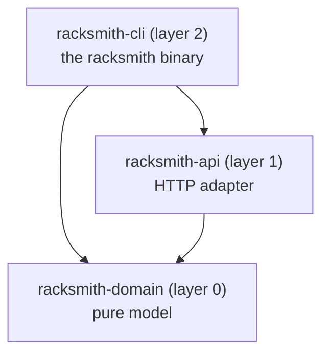

# Architecture

This document explains how the RackSmith workspace is structured and why. The rules themselves are
not written here: they live in [`architecture.toml`](../architecture.toml) and are enforced by
`cargo xtask arch` on every pull request.

This file describes the M0 code layout that exists today. The target architecture for M1 and later
(crates, runtime components, storage, boot and deploy path, security) lives in
[docs/design/system-design.md](design/system-design.md), with its decisions in ADRs 0011–0033; this
file is updated as M1 pull requests land those changes.

## Layers

| Layer | Crate              | Responsibility                                                     |
|-------|--------------------|--------------------------------------------------------------------|
| 0     | `racksmith-domain` | Domain types and the machine lifecycle. Pure, synchronous, no I/O. |
| 1     | `racksmith-api`    | Adapters that translate the domain to the outside world (HTTP).    |
| 2     | `racksmith-cli`    | The composition root: parses arguments, wires adapters, runs them. |

A crate may depend only on workspace crates in a strictly lower layer, and only on external
crates listed in its allowlist in `architecture.toml`. The `xtask` crate is repository tooling and
depends on no product crate. The [`fuzz/`](../fuzz/) project is excluded from the workspace and
depends on the crates it fuzzes.

### Why the domain is pure

`racksmith-domain` holds the decisions that matter most, such as whether a machine may be
deployed or wiped. Keeping it free of I/O, async runtimes and logging means that:

- it can be tested exhaustively and quickly, with property tests and Kani proofs;
- its behavior is deterministic, so the TLA+ model and the Rust code can be compared directly;
- adapters cannot smuggle policy into the transport layer, because the domain is the only place
  that knows the rules.

`architecture.toml` backs this with source bans: `std::fs`, `std::net`, `std::process`, `tokio`
and `async fn` are rejected in the domain crate's sources.

### Adapters translate, they do not decide

`racksmith-api` maps HTTP requests to domain calls and domain errors to HTTP responses (for
example `TransitionError` to `409 Conflict`). It holds state in a `MachineRegistry`, an in-memory
`BTreeMap` behind an async lock. This store is deliberately minimal and will be replaced when
persistence is designed; that choice will get its own ADR.

Future adapters (DHCP, TFTP, BMC power control, image deployment) will be further layer 1 crates
alongside `racksmith-api`, each translating one protocol to the domain.

### The binary composes

`racksmith-cli` is the only place where adapters are wired together, configuration is read and the
process is set up (logging, signal handling). It is also the only product crate that may use
`anyhow`; libraries return typed `thiserror` errors so their callers can match on them.

## Cross-cutting rules

| Rule                                         | Enforced by                                          |
|----------------------------------------------|------------------------------------------------------|
| Layering and dependency allowlists           | `architecture.toml`, `cargo xtask arch`              |
| Every crate inherits the workspace lints     | `cargo xtask arch`                                   |
| Dependencies are declared once, centrally    | `[workspace.dependencies]`, `cargo xtask arch`       |
| No `unsafe`, no panicking shortcuts          | `[workspace.lints]` in [`Cargo.toml`](../Cargo.toml) |
| Deterministic collections, no `println!`     | [`clippy.toml`](../clippy.toml)                      |
| Licenses, advisories, sources, banned crates | [`deny.toml`](../deny.toml), `cargo deny check`      |
| Docs match the code they describe            | `cargo xtask docs`                                   |
| The TLA+ model checks the table the code implements | `cargo xtask docs` (generated `Transitions`)  |
| Lint levels only in `Cargo.toml`; `expect` on items only | `cargo xtask arch` (source rules)        |
| No `mod.rs`, `#[path]` or `include!`         | `cargo xtask arch` (source rules)                    |
| `TODO`/`FIXME` reference an issue            | `cargo xtask arch` (source rules)                    |
| Dependencies come from crates.io or the workspace | `cargo xtask arch`, `cargo deny check`          |
| The fuzz project restates the lint policy exactly | `cargo xtask arch`                              |

See [trust-pyramid.md](trust-pyramid.md) for how these fit together, and the
[ADRs](adr/) for the decisions behind them, notably
[ADR 0002](adr/0002-rust-and-workspace-layout.md).
