# RackSmith system design

| | |
|---|---|
| **Status** | Accepted 2026-11-18 (owner decisions in §16.5) |
| **Date** | 2026-11-18 |
| **Owner** | @zoza1982 |
| **Scope** | The target architecture for M1 (fast-deploy MVP), with the seams M2–M4 need |
| **Binding inputs** | [PRD](../prd.md) (R1–R39, §7 targets, §8 milestones, §9 decisions, §12 open questions), ADRs [0001](../adr/0001-record-architecture-decisions.md)–[0010](../adr/0010-virtual-lab-ci-testbed.md), [`architecture.toml`](../../architecture.toml), [AGENTS.md](../../AGENTS.md), [lifecycle](../lifecycle.md), [trust pyramid](../trust-pyramid.md) |
| **Decisions** | Each new decision is recorded as an ADR, accepted by the owner on 2026-11-18: [0011](../adr/0011-evolve-workspace-into-ports-core-adapters.md)–[0033](../adr/0033-provisioning-network-boundary-and-os-ready-path.md) (see §15) |
| **Changes** | Pull requests only. This document describes targets; code, `architecture.toml` and the lifecycle implementation change in M1 PRs, each under its ADR |

This document is the authoritative system design. [docs/architecture.md](../architecture.md)
describes the M0 code that exists today; this file describes where it is going. It was
synthesized from three competing design proposals (an operability and safety proposal, which
the review panel chose as the base, an MVP-scope proposal and a performance proposal) and five
research reports (prior art, boot-time budget, Rust ecosystem, control-plane scale, security).
Every number is either derived in the text, measured by a named gate, or cited in
[References](#references).

**Labels used throughout.** **[M1]** ships in the 12-week MVP. **[M1-stretch]** is built in M1
only if the schedule allows, and always has a named fallback. **[M2]**, **[M3]** and **[M4]** are
later milestones, designed for now so that the shapes do not change. **[est]** marks an
engineering estimate that a named gate must measure. **[owner]** marks a point only the owner can
decide (collected in §16).

---

## 1. Overview and goals

### 1.1 The design in one paragraph

RackSmith is one static binary that behaves like a single-replica Raft cluster. Every durable
change is an etcd-style multi-key transaction with revision preconditions, applied by one
group-commit writer to an embedded redb file, which stamps it with a global revision (the Raft
log index in M2). Level-triggered reconcilers are fed by a gap-free watch over that revision
stream. **Exactly one reconciler acts on any machine**, and it is a thin executor around one
pure, total function in the domain crate, `decide(machine, observations, now) -> Decision`, which
returns at most one lifecycle event, one operation-record change and one side effect. Side
effects follow a **two-step protocol**: a reconcile first commits an *operation record* (the
intent, carrying the fencing tuple `(term, enrollment_generation, operation_id, attempt)`), and only a
later reconcile, reading that committed record back, may emit the effect. Destructive effects
are typed: a disk write or power action can only be expressed with a `DiskWriteGrant` or
`PowerGrant`, which have no public constructor and are minted only by the lifecycle aggregate. A
`tainted` flag makes it impossible to return a machine that held a tenant's data to the pool
without passing through `releasing`. The image data path never touches the control-plane
runtime: agents stream content-addressed, independently verifiable 4 MiB zstd chunks of a signed
`rsimg` image from the origin or any HTTP cache, under bandwidth admission that starts when the
agent says Hello, not when the machine powers on. Liveness, progress and BMC polls stay in
memory; only edges are persisted.

### 1.2 Design principles

Each principle maps to a mechanism, ordered by the [trust pyramid](../trust-pyramid.md): types and
checks first, prose last.

| # | Principle | Mechanism |
|---|---|---|
| P-1 | No destructive effect without an explicit, model-checked transition and a committed operation record | `DiskWriteGrant`/`PowerGrant` types (Kani-proved constructors), `tainted` guard, `DeployProtocol.tla` (§4) |
| P-2 | One actor per machine; adapters translate, the domain decides | One `MachineReconciler` keyed by `MachineId`; `decide()`, `boot::decide()`, `admission::admit()` and `authorize()` are pure domain functions (§4, §7) |
| P-3 | Persist edges, not levels | Heartbeats, progress ticks and power polls live in memory; the store records transitions and phase edges only (§6.5) |
| P-4 | The control plane is not on the image data path | Plans carry URLs and digests; agents pull from the origin or caches; the origin runs on its own runtime (§2.3, §9) |
| P-5 | M1 is single-replica Raft | Store trait with etcd semantics, single writer, global revisions, `LeaderGate`, fencing term fixed at 0 in M1 (§6.8) |
| P-6 | Every claim is measured and labelled | Per-phase timings from three clocks with skew correction, POST profiles, `virtual-lab`/`simulated`/`rented-hardware` labels (§9.1, §12.4) |
| P-7 | Scope fits one maintainer | Ordered cut list and never-cut list (§14.4); ADRs tiered by the freeze they gate (§15) |

### 1.3 Traceability to PRD requirements

| Req | Where | Milestone |
|---|---|---|
| R1 single static binary | §2 (one process, `racksmith serve`), §3 (`racksmith-cli` composes), §12.6 packaging | M1 |
| R2 embedded crash-safe store | §6 (redb behind `Store`, group commit) | M1 |
| R3 front-end-agnostic core | §3 (`racksmith-core` and `racksmith-server` have no clap, kube or signal handling), §7.6 | M1 |
| R4 operator | §2.1, §7.6 | M2 (designed) |
| R5 HA with Raft | §6.8 (openraft below the same apply loop), `LeaderGate`, fencing term | M2 (designed) |
| R6 site agent | §9.5 (cache role seeds it) | M3 (seeded) |
| R7 boot services | §8 (proxyDHCP default, full DHCPv4, TFTP, HTTP(S) boot, iPXE; UEFI first, BIOS via `undionly.kpxe`) | M1 |
| R8 auto-enrollment | §8.6, §8.9, §10.3 | M1 |
| R9 `Ipam`, `Dhcp`, `Dns` traits | §8.7 (traits, built-in DHCP and IPAM in full mode; built-in DNS is zone files only, a partial delivery flagged in §16.3) | M1 (partial) |
| R10 Kea, NetBox, RFC 2136 | §8.7 (adapters pass the same contract suites) | M2 |
| R11 DHCPv6 | §8.1 (not built; `BootNetwork` is address-family aware) | M4 |
| R12 Redfish | §8.7 | M1 |
| R13 IPMI | §8.7 (on the cut list, §14.4, [owner]) | M1 |
| R14 credentials encrypted and redacted | §11.5 | M1 |
| R15 virtual media | §8.7 (`PowerDriver` capability) | M2 |
| R16 DPU | §11.3 | M4 |
| R17 agent, streaming, SHA-256 + signature, partitions, config | §9.3, §10 (the agent streams rsimg only; raw and qcow2 are import formats, a reading of R17 flagged in §16.3) | M1 |
| R18 catalog, verify before write, OCI, 5 recipes | §9.2 (imports need a pinned digest or a verifiable signature), §9.6, §11.6 (OCI on the cut list, [owner]) | M1 |
| R19 first-boot config | §10.6 (config drive: NoCloud and config-2 for Ignition; SSH keys) | M1 |
| R20 streamed progress, per-phase timings | §5.5, §12.4 | M1 |
| R21 kexec, node caches, secure erase | §9.7 (`Handoff::Kexec` reserved), §4.7 (`erasing`) | M3 (seams in M1) |
| R22 P2P or multicast | §9.5 (chunks are already pieces) | M4 |
| R23 basic inventory | §10.5 | M1 |
| R24–R26 GPU layer | §4.7 (`quarantined`), §10.5 (commission steps) | M3 |
| R27 agent mTLS bound to enrollment | §10.3, §11.4 | M1 |
| R28 tokens and RBAC | §11.7 | M1 |
| R29 Secure Boot, attestation | §11.3, §4.7 (`attesting`) | M2 |
| R30 credential rotation, Sigstore | §11.5, §11.6 | M2 |
| R31 audit log | §11.8 (M1: actor-attributed events in the same transaction, a pull-forward [owner]; hash chain in M2) | M1-min, M2 |
| R32 protobuf, gRPC, REST, OpenAPI | §5 | M1 |
| R33 CLI covers every RPC | §5.7 (`cargo xtask cli-coverage`) | M1 |
| R34 spec/status and `apply -f` | §5.3, §5.6 | M1 |
| R35 GitOps | §5.6 (same apply path) | M2 |
| R36 Terraform, Cluster API | §5 (typed clients from the same protos) | M2 |
| R37 Slurm | — | M4 |
| R38 logs, metrics, traces | §12 | M1 |
| R39 idempotent, crash-safe reconcilers | §7.3, §7.4, §13.4 | M1 |

### 1.4 Traceability to PRD §7 targets

| §7 target | Design answer | Verified by |
|---|---|---|
| Power-on → OS-ready p95 < 5 min, single machine (virtual lab) | Phase budget §9.1: 254 s planning figure (sum of per-phase p95s, not a bound) on the pinned-OVMF lab with reboot hand-off; RackSmith-controlled subtotal tracked separately | `lab-nightly-bench`: the 2 GB benchmark image, `post-0`, 60 runs per night, gated on the measured end-to-end p95 and its one-sided 95% upper confidence bound (§9.1, §13.1). The per-PR `lab-e2e` (1 VM, small image) is functional evidence only |
| 1,000 concurrent deploys, p95 < 5 min, bandwidth permitting | Global cap at deploy, bandwidth tokens at agent Hello, published slot formula and in-flight figure (§9.5) | `sim deploy-1000` in two topologies, nightly (§13.2) |
| 10,000 machines per control plane | O(changes) reconciliation, in-memory liveness, group commit, BMC semaphores, separate runtimes (§2.3, §6, §7) | `sim enroll-10k`, `steady-10k`, `power-restore` |
| API read p99 < 50 ms at 10k | Reads from the in-memory object cache; pages of 500 (max 1,000); the control runtime is isolated from boot and image I/O (§2.3, §5.4) | `steady-10k` at 200 rps of reads during `deploy-1000` |
| RSS < 2 GB at 10k | Budget about 1.1 GiB, explicit redb cache of 256 MiB (§12.7) | sim gate fails above 1.8 GiB |
| Install → first deployed machine < 15 min | `racksmith init` (no toolchain, no image build; verified boot artifacts in place) → `serve` → `bmc add --create-machine` → `machine commission` → `image import` → `machine deploy` (§8.9, §12.6) | `quickstart` CI job, nightly |
| Upgrade: replace the binary; reversible migrations within a minor | Storage proto, `up`/`down` migrations, automatic pre-migration snapshot (§6.7) | `upgrade-test` N-1 → N → N-1, nightly |

### 1.5 What M1 explicitly is not

- **Not tenant-safe.** M1 is a single trust domain. `release` is a metadata wipe that stops the old
  OS from booting; it is not data sanitization (secure erase is R21, M3). M1 does not defend
  against firmware or BMC implants left by a previous tenant (T5, §11.1). The docs and the CLI
  say so [owner].
- **Not authenticated at stage 1 of the boot.** proxyDHCP, TFTP and the iPXE binary are
  unauthenticated until Secure Boot (R29, M2). Everything after the iPXE binary is HTTPS with the
  installation's root CA pinned. In M1 a deployed OS stays on its provisioning network, so every
  deployed host is an on-link party there; M1 therefore claims no isolation from deployed
  machines, and the threat model rates T1 and T3 with "any deployed OS" as a possible attacker
  (§11.1, [ADR 0033](../adr/0033-provisioning-network-boundary-and-os-ready-path.md)).
- **Not a real-hardware benchmark.** M1 numbers are labelled `virtual-lab` or `simulated`
  ([ADR 0010](../adr/0010-virtual-lab-ci-testbed.md)). Synthetic POST profiles show how the number
  moves on real hardware classes (§9.1). With the research p95 figures, two POSTs miss 5 minutes
  p95 on commodity servers as well as on GPU servers; that needs kexec and parked agents (M3).
- **No kexec, no parked agents, no site cache role.** Their seams ship in M1 (§9.7, §9.5).

---

## 2. Component architecture

### 2.1 Runtime components

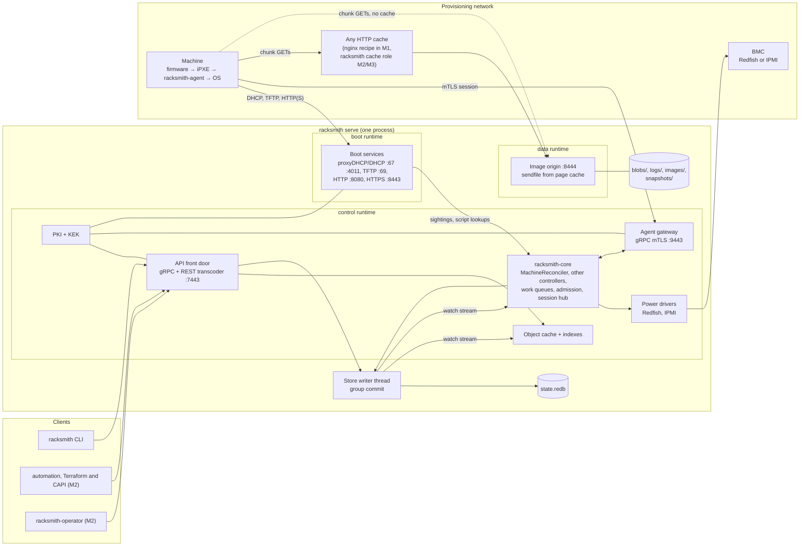

| Component | Responsibilities | Boundaries |
|---|---|---|
| **Control plane** (`racksmith serve`) | Owns the store; the only holder of the KEK, CA keys and BMC credentials; runs every reconciler (in M2, only on the Raft leader) | Never streams image bytes through reconcilers; never dials agents (agents dial out); never blocks the writer on a slow watcher |
| **Reconcilers** (`racksmith-core`) | `MachineReconciler` (the only component that causes side effects for a machine); `ImageImporter`; `BmcReconciler` (session, TLS pin, identity read, machine creation and BMC binding, §8.9); `IpamReconciler` (full-mode addresses, §8.7); `Housekeeper` (retention, expired tokens, pending-enrollment GC); `CertRenewer` | Read through the object cache, write through `TypedStore`, reach the world only through ports (§3.3) |
| **Effect executors** (`racksmith-core`) | One per BMC endpoint: performs power and boot-override actions handed over by the `MachineReconciler` and reports each outcome as an observation (§7.3) | The only place that awaits BMC semaphores, rate limiters and vendor retries |
| **Observers** (`racksmith-core`) | `PowerPoller` (writes `obs.power` only on change), `AgentSessionHub` (liveness in memory; persists `connected ↔ lost` edges only for machines with an open operation), DHCP sightings from boot services, `RogueDhcpWatch` (metric only) | Write observations; never act |
| **API front door** (`racksmith-api`) | tonic gRPC services, REST transcoder on the same port, authn/authz tower layer, rate limits | Reads from the object cache, never from disk; every write is a store transaction validated by the domain |
| **Agent gateway** (`racksmith-api`) | `AgentService` on its own listener with client-auth mTLS required; enrollment; session protocol | Never shares a TLS configuration or an authz path with the user API |
| **Store** (`racksmith-store-redb`) | Transactions with compares, global revisions, watch ring, snapshots, migrations | Only the writer thread mutates the file; the domain never sees storage types |
| **Boot services** (`racksmith-netboot` + `racksmith-netboot-core`) | proxyDHCP, full DHCPv4, read-only TFTP, boot HTTP (NBP for UEFI HTTP Boot, OS phone-home) and boot HTTPS (per-boot script, kernel, initramfs) | Every "what do I answer this machine?" decision is a pure function (`boot::decide()` in the domain, packet-level choices in `netboot-core`) |
| **Power drivers** | `racksmith-redfish`, `racksmith-ipmi` behind `PowerDriver` | Destructive calls take a `PowerGrant`; reads do not |
| **Image service** (`racksmith-imagesvc`) | Import (rsimg, raw, qcow2 via `qemu-img` if installed; OCI pull of rsimg artifacts), catalog signing, origin HTTP server with Range and `sendfile` | Runs on the data runtime; image bytes are never stored in redb |
| **Site agent** | Not in M1. The M2/M3 cache role (`racksmith serve --role cache`) becomes the R6 site agent in M3 when it also hosts boot services | — |
| **`racksmith-agent`** | Static musl Rust PID 1 in an initramfs: network bring-up, enrollment, one mTLS session, inventory, verified image write, config drive, hand-off | Never listens on a port; writes only to the disk named in its plan; never parses qcow2 |
| **CLI** | The same binary: `racksmith serve`, `init`, `doctor`, `admin …` and a typed gRPC client for every RPC | Holds no privileged path; the bootstrap admin may use a 0600 Unix socket |
| **Operator** [M2] | `racksmith-operator` hosts the same `racksmith-server` library; CRDs are an authoring and projection surface over the embedded store (§7.6) | Never writes per-second progress to etcd; the core never sees kube types |

### 2.2 Ports and listeners

| Listener | Port | Protocol | Authentication | Runtime | Bound to |
|---|---|---|---|---|---|
| User API | 7443/tcp | gRPC + REST over TLS 1.3 | Bearer token | control | Management interface |
| Agent gateway | 9443/tcp | gRPC over mTLS, TLS 1.3 | Agent client certificate; `Enroll` is server-auth only | control | Provisioning interfaces |
| proxyDHCP / DHCP | 67/udp, 4011/udp | DHCPv4 | none (stage 1) | boot | Provisioning interfaces only (`SO_BINDTODEVICE`) |
| TFTP | 69/udp + ephemeral | TFTP, read requests only | none (stage 1) | boot | Provisioning interfaces only |
| Boot HTTP | 8080/tcp | HTTP | none for the iPXE NBP | boot | Provisioning interfaces |
| OS ready | 8080/tcp by default (`ready_listen`) | HTTP, `POST /ready/<token>` only | single-use ready token | boot | Provisioning interfaces by default; may be a separate, routed address ([ADR 0033](../adr/0033-provisioning-network-boundary-and-os-ready-path.md)) |
| Boot HTTPS | 8443/tcp | HTTPS, TLS 1.2 (ECDHE-GCM for iPXE) and 1.3 | Server cert chaining to the pinned server root; boot token in the script | boot (script); data (kernel and initramfs, §8.2) | Provisioning interfaces, or the address advertised per relayed subnet (§8.10) |
| Image origin | 8444/tcp | HTTP by default (integrity from the signed manifest); HTTPS opt-in | none for chunks | data | Provisioning interfaces |
| Metrics, health | 9464/tcp | HTTP | none; localhost by default | control | Loopback |

### 2.3 Process layout: four isolated execution contexts

One process, but no workload can starve another ([ADR 0024](../adr/0024-separate-runtimes-in-one-process.md)).
This is the fix for the most likely way to miss the API p99 target: a 10k-machine DHCP storm after
a site power restore, or the origin pushing gigabytes per second, sharing workers with the API.
CERN's Ironic conductors crashed when image bytes went through them (prior-art research).

| Context | Threads (default) | Hosts | Why separate |
|---|---|---|---|
| Control runtime (tokio) | `min(8, ncpu/2)` workers | API, agent gateway, reconcilers, observers, power drivers, object cache | Latency-sensitive; owns the p99 < 50 ms target |
| Boot runtime (tokio) | 2 workers | DHCP, TFTP, the iPXE NBP over HTTP, per-boot scripts, phone-home | A herd of 10k DHCP requests must not delay the API, and API load must not delay DHCP answers |
| Data runtime (blocking pool) | `min(16, ncpu/2)` OS threads | Image origin (`rustix::fs::sendfile`), stage-2 kernel and initramfs over HTTPS (rustls, about 46 GB at 1,000 concurrent boots, §8.2), import pipeline, zstd encoding | Bulk and CPU-bound; no per-byte async overhead, and bulk TLS never shares the 2 boot workers with DHCP |
| Store writer | 1 dedicated OS thread | redb group commit and `fsync` | `fsync` must never block a tokio worker |

The contexts talk over bounded channels only. The boot runtime asks the core for decisions
through the `BootDecisions` port (§3.3), implemented in the core as a bounded request channel
(capacity 4,096, answered from the object cache); when it is full, boot services drop the packet,
which DHCP and TFTP clients retry by design. Per-MAC and global rate limits (§8.8) sit in front of
that channel.

### 2.4 Deployment and network topology

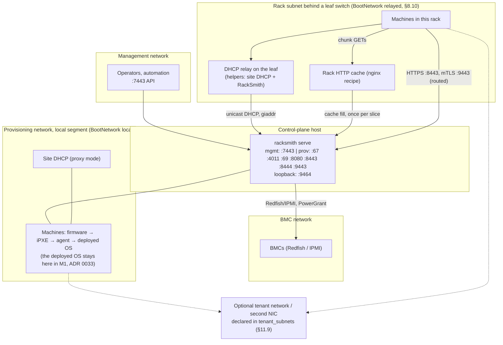

Which listener faces which network is in §2.2. The BMC network and the management network are
never the provisioning network; `racksmith doctor` warns when a provisioning interface carries the
management API address or the default route (§12.5).

---

## 3. Crate and workspace layout

### 3.1 Layered crate map

The layer rule stays the one `architecture.toml` enforces today: a crate depends only on crates in
a strictly lower layer that are listed in its `workspace-deps`, and dev-dependencies obey the same
rule. That is why the test kit sits below everything that tests against it. The full map and its
rules are [ADR 0011](../adr/0011-evolve-workspace-into-ports-core-adapters.md).

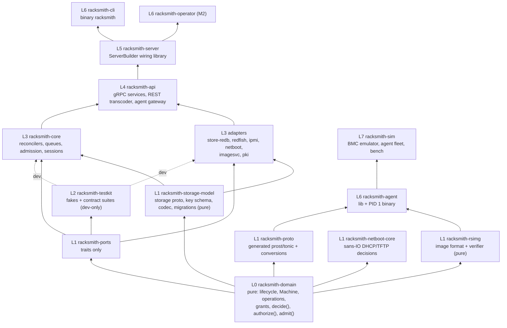

| Crate | Layer | Kind | Responsibilities | Workspace deps | Key external deps |
|---|---|---|---|---|---|
| `racksmith-domain` | 0 | pure | ids; lifecycle (`MachineState`, `MachineEvent`, `TRANSITIONS`, guards); `Machine` aggregate and `Machine::restore`; `Operation`, `Fencing`, `DiskWriteGrant`, `PowerGrant`; `decide()`; `boot::decide()`; `admission::admit()`; `Actor`, `permits()`, `authorize()`; `resolve_root_disk()`; IPAM allocation; `Secret<T>`; `Timestamp` | — | serde, thiserror |
| `racksmith-ports` | 1 | **ports** | `Store`, `PowerDriver`, `Dhcp`, `Ipam`, `Dns`, `BootArtifacts`, `BootDecisions`, `BootTokens`, `AgentSessions`, `ImageCatalog`, `BlobStore`, `LogSink`, `KekProvider`, `Authenticator`, `Clock`, `Entropy`, `LeaderGate` | domain | thiserror, futures-core, bytes |
| `racksmith-proto` | 1 | generated + mapping | checked-in prost/tonic/pbjson output in `src/gen/`; hand-written `TryFrom` conversions to and from domain types; the method-policy table; the REST route table | domain | prost, tonic, tonic-prost, pbjson, prost-reflect |
| `racksmith-rsimg` | 1 | pure | rsimg v1 manifest model (prost types generated into its own `src/gen/` by `cargo xtask codegen`), canonical encoding, extent math, signature verification (ECDSA P-256, cosign `sign-blob` compatible), `Plan::validate` consistency checks shared by agent and control plane | domain | prost, sha2, p256 |
| `racksmith-storage-model` | 1 | pure | `racksmith.storage.v1` (generated into its own `src/gen/`), the key schema of §6.4, the `StoredMachine` ⇄ bytes codec used by every writer and by the object cache, the `MIGRATIONS` table (§6.7) | domain | prost |
| `racksmith-netboot-core` | 1 | pure (sans-IO) | DHCP/proxyDHCP option selection from a parsed packet and a `BootAction`; TFTP transfer state machine (RFC 1350, 2347, 2348, 2349, 7440) | domain | dhcproto |
| `racksmith-testkit` | 2 | test support, **dev-only** | deterministic in-memory `Store`, `FakePower` (scripted, fault-injecting), `FakeAgent`, `ManualClock`, seeded `Entropy`; contract suites `store_contract::run`, `power_contract::run`, … | domain, ports | tokio (test-util), proptest |
| `racksmith-core` | 3 | engine | `Controller<R>`, `WorkQueue`, rate limiters, semaphores, `MachineReconciler` (executor around `decide()`), per-BMC effect executors, observers, `AdmissionController`, `AgentSessionHub` (implements `AgentSessions`), the `BootDecisions` channel, `ObjectCache`, `TypedStore` | domain, ports, rsimg, storage-model | tokio (rt, sync, time), tracing, governor, prometheus-client |
| `racksmith-store-redb` | 3 | adapter (`Store`) | writer thread, group commit, key index, watch ring, snapshots, running the migrations of `racksmith-storage-model` at open | domain, ports, storage-model | redb, tracing |
| `racksmith-redfish` | 3 | adapter (`PowerDriver`) | hand-written Redfish subset, sessions, TLS pinning, vendor quirk table | domain, ports | reqwest (rustls, no default roots), serde_json |
| `racksmith-ipmi` | 3 | adapter (`PowerDriver`) | own RMCP+ client (RAKP, cipher suites 3 and 17) | domain, ports | hmac, sha1, sha2, aes, cbc |
| `racksmith-netboot` | 3 | adapter (`Dhcp`, `BootArtifacts`, built-in `Ipam`, `Dns`) | UDP/HTTP listeners around `netboot-core`; iPXE script rendering; trust-anchor injection (§8.3); zone-file DNS publisher | domain, ports, netboot-core | socket2, axum, tokio-rustls |
| `racksmith-imagesvc` | 3 | adapter (`ImageCatalog`) | import pipeline, rsimg encoder, origin server, own OCI pull client for rsimg artifacts | domain, ports, rsimg | zstd, reqwest, httparse, rustix |
| `racksmith-pki` | 3 | adapter (`KekProvider`, `Authenticator`, `BootTokens`, CA) | built-in CA with fixed issuance templates (§11.4), certificate issuance, envelope AEAD, boot and ready token minting and verification | domain, ports | rcgen, rustls (ring), x509-parser, chacha20poly1305, hmac, sha2, zeroize |
| `racksmith-api` | 4 | adapter | tonic services, authn/authz and rate-limit layers, REST transcoder, agent gateway | domain, ports, proto, storage-model, core, pki | tonic, axum, tower, prost-reflect, governor |
| `racksmith-server` | 5 | wiring library | `ServerBuilder` (config → ports → core → API), runtime layout (§2.3), graceful drain. No CLI parsing and no signal handling ([ADR 0005](../adr/0005-one-core-two-front-ends.md)) | all of L3–L4 | tokio, opentelemetry, tracing-opentelemetry |
| `racksmith-cli` | 6 | front end | binary `racksmith`: clap, config file, signals, `init`, `serve`, `doctor`, `admin`, client commands | server, proto, domain | clap, anyhow, tracing-subscriber |
| `racksmith-agent` | 6 | front end (lib + bin) | PID 1 duties, netlink, enrollment, session client, inventory, write pipeline, config drive, hand-off | domain, proto, rsimg | tonic (client), rustls (ring), rcgen (default features `crypto`, `pem`, `ring`; CSR encoding only), rustix, rtnetlink, zstd, smbios-lib, gpt, fatfs (`default-features = false`, features `std`, `alloc`: no `chrono`) |
| `racksmith-operator` | 6 | front end [M2] | CRD sync controller | server, proto | kube, kube-runtime, k8s-openapi |
| `racksmith-sim` | 7 | tooling | BMC emulator (Redfish + IPMI) in QEMU and fleet modes, simulated agents linked against the real agent library, scenario driver, benchmark harness | agent, proto, rsimg, testkit | tokio, axum, rustls, rcgen |
| `racksmith-store-raft` | 3 | adapter [M2] | `Store` + `LeaderGate` over openraft, redb as the state machine | domain, ports | openraft (pinned exactly) |

`racksmith-api` (today's axum placeholder) is rewritten in place as the gRPC crate; its M0
routes are not a compatibility promise ([ADR 0006](../adr/0006-protobuf-contracts-grpc-api.md)).
Crates are created by the workstream that first needs them; the layer map is fixed by ADR 0011
so that adding a crate later is an allowlist entry, not a design debate.

**Platforms.** RackSmith ships for Linux only, but CI clippy runs on macOS and Windows and tests run
on macOS. Crates that call Linux-only APIs (`racksmith-agent`, `racksmith-netboot`,
`racksmith-imagesvc`, `racksmith-sim`, and therefore `racksmith-server`, `racksmith-cli` and
`racksmith-operator`, which link them) are marked `platforms = ["linux"]` in `architecture.toml`.
The portable crates (domain, ports, proto, rsimg, storage-model, netboot-core, testkit, core,
store-redb, redfish, ipmi, pki, api) stay checked on every OS. How CI uses that list is
[ADR 0030](../adr/0030-linux-only-crates-and-ci-platform-matrix.md), which must be accepted
before the first Linux-only crate lands (before F1).

### 3.2 New `architecture.toml` rules (beyond layering)

These are rules for `cargo xtask arch`, so the boundaries are enforced, not requested. Changing
`architecture.toml` is itself the subject of ADR 0011.

| Rule | Kind | Why |
|---|---|---|
| `clap`, `kube`, `kube-runtime`, `k8s-openapi` only in L6 front ends; `tokio::signal` source-banned below L6 | dependency ban + source ban | [ADR 0005](../adr/0005-one-core-two-front-ends.md) enforcement |
| `redb` only in `racksmith-store-redb` (and `racksmith-store-raft` in M2) | dependency ban | the engine stays swappable ([ADR 0009](../adr/0009-embedded-store-behind-trait.md)) |
| `reqwest` only in `racksmith-redfish` and `racksmith-imagesvc` | dependency ban | no ad-hoc outbound HTTP from the core |
| `racksmith-core` source-bans `std::fs`, `std::net`, `std::process` | source ban | the core reaches the world only through ports |
| `racksmith-ports` source-bans `tokio` | source ban | ports return `impl Future + Send`, not a runtime |
| `racksmith-rsimg` and `racksmith-netboot-core` get the domain's source bans (no fs, net, process, tokio, `async fn`) | source ban | pure, deterministic, fuzzable; shared by agent and control plane |
| `racksmith-agent` may not depend on `racksmith-core`, any `racksmith-store-*`, power, `racksmith-api`, `racksmith-pki` or `racksmith-imagesvc` | dependency ban | keeps the agent small and its trust surface narrow |
| `racksmith-testkit` and `racksmith-sim` may appear only as dev-dependencies of product crates | new `dev-only` rule kind | test code never ships |
| `aws-lc-rs`, `aws-lc-sys` banned everywhere; ring is the only rustls provider | dependency ban (+ `deny.toml`, [ADR 0028](../adr/0028-supply-chain-policy-amendments.md)) | one crypto provider, simple static musl builds |
| `expose_secret` source-banned outside `racksmith-pki`, `racksmith-redfish`, `racksmith-ipmi`, `racksmith-agent` | source ban | secrets are read only where they are used (R14) |
| Generated files live only under the generated roots listed in `architecture.toml` (M1: `crates/racksmith-proto/src/gen/`, `crates/racksmith-rsimg/src/gen/`, `crates/racksmith-storage-model/src/gen/`), are all written by `cargo xtask codegen` and carry a generated-file header; `cargo xtask codegen --check` fails when any is stale. Nobody writes prost types by hand ([ADR 0006](../adr/0006-protobuf-contracts-grpc-api.md)) | new `generated` path rule | makes the generated-code policy of [ADR 0019](../adr/0019-protobuf-codegen-and-rest-transcoder.md) checkable without forcing the L1 crates that own a signed or persisted proto to depend on each other |
| Crates marked `platforms = ["linux"]` may be depended on only by crates with the same mark | new `platforms` field | keeps the portable set portable ([ADR 0030](../adr/0030-linux-only-crates-and-ci-platform-matrix.md)) |
| `cargo xtask size`: stripped `racksmith-agent` (x86_64 musl) ≤ 12 MiB; initramfs ≤ 40 MiB (target 32 MiB) | new CI gate | boot time and fleet bytes depend on it (§10.1) |

### 3.3 Ports versus adapters

| Port (trait in `racksmith-ports`) | M1 implementation | Later |
|---|---|---|
| `Store` | `racksmith-store-redb` | `racksmith-store-raft` (M2); an external database stays possible, never required |
| `PowerDriver` | `racksmith-redfish`, `racksmith-ipmi` | nv-redfish quirks (M3), virtual media (R15, M2) |
| `Dhcp` | built-in in `racksmith-netboot` (leases in the store) | Kea (M2) |
| `Ipam` | built-in, store-backed (`racksmith-netboot`, algorithm in the domain) | NetBox (M2) |
| `Dns` | zone-file publisher (atomic rename; SOA serial = store revision) | RFC 2136, PowerDNS (M2) |
| `BootArtifacts` | content-addressed iPXE, kernel and initramfs per arch under `data/boot/`, installed and verified as in §12.6 | — |
| `BootDecisions` | bounded request channel into the core's object cache (§2.3); the seam between `racksmith-netboot` and `racksmith-core`, which share a layer | — |
| `BootTokens` | `racksmith-pki` (HMAC boot tokens and ready tokens, §8.5, §10.6); `racksmith-netboot` mints through it at script time without depending on the PKI crate | — |
| `AgentSessions` | `AgentSessionHub` in the core: `hello`, `report` (acked only after commit), `push_plan` (re-checks `(generation, op, attempt)` and the bound session, §10.3), `cancel`; the agent gateway in `racksmith-api` is its transport | — |
| `ImageCatalog` | `racksmith-imagesvc` (HTTP(S), OCI rsimg artifacts) | S3-compatible sources (M2) |
| `BlobStore`, `LogSink` | local directories | S3-compatible (M2) |
| `KekProvider` | key file; systemd-creds through `$CREDENTIALS_DIRECTORY` (no extra code) | Argon2id passphrase, Vault Transit, KMS, PKCS#11 (M2+) |
| `Authenticator` | static hashed tokens | OIDC/JWKS (M2) |
| `LeaderGate` | `AlwaysLeader` plus the observe-only switch used after a restore (§6.6) | Raft leadership (M2) |
| `Clock`, `Entropy` | system | `ManualClock`, seeded RNG (testkit) |

Every port method is idempotent or "ensure"-shaped, and every port has a contract suite in
`racksmith-testkit` that the built-in implementation and every later adapter must pass
([ADR 0008](../adr/0008-pluggable-network-services.md)). Ports use static dispatch
(`impl Future + Send`, no `dyn`), so the core is generic (`Core<S: Store, P: PowerDriver, …>`) and
the hot path has no boxing.

### 3.4 How this lets agent fleets build in parallel

1. **Freeze the seams first.** F1 (end of week 2) freezes the ports (including the cross-stream
   seams `BootDecisions`, `BootTokens` and `AgentSessions`), the domain types, the storage key
   schema and codec in `racksmith-storage-model`, and the codegen pipeline (§14.2). After that,
   every L3 crate is an independent work package whose "done" is defined by a contract suite in
   `racksmith-testkit`.
2. **Isolation is enforced.** Adapters cannot import each other (layer rule), the core cannot
   touch the network (source bans), and the agent cannot import the control plane. A PR that
   crosses a boundary fails `cargo xtask arch`, not review.
3. **Fakes below, contracts above.** `racksmith-core` is built and crash-tested entirely against
   testkit fakes before any real adapter exists (§13.4); each adapter is tested against its
   contract suite and recorded fixtures without needing the core.
4. **One owner per crate per sprint**, assigned in the issue tracker, avoids conflicting agent PRs.
   A port signature change after F1 is its own PR with an ADR amendment.
5. **Generated artifacts are checked by xtask** (protobuf code, policy and route tables, OpenAPI,
   lifecycle tables), so drift between workstreams is a CI failure rather than a review burden.

---
## 4. Domain model and extended lifecycle

### 4.1 The machine aggregate

The M0 `Machine { id, mac, hostname, state }` grows into a spec/status aggregate in
`racksmith-domain`. It keeps the M0 rule that it is `Serialize` but **not** `Deserialize`: it is
rebuilt from storage only through `Machine::restore(StoredMachine) -> Result<Machine, RestoreError>`,
which re-validates every invariant in §4.6, so a corrupted, hand-edited or stale store cannot forge
a state ([ADR 0025](../adr/0025-restore-safety-and-reversible-migrations.md)).

```rust
pub struct Machine {
    id: MachineId,                        // m-<16 hex>, random non-zero u64 chosen by the proposer
    meta: Meta,                           // name, labels, pool, site, tenant (empty in M1)
    spec: MachineSpec,                    // desired state, user-owned
    state: MachineState,                  // lifecycle, reconciler-owned
    phase: Phase,                         // progress inside `state`; the pairing is checked (§4.4)
    identity: Identity,                   // smbios_uuid, serial, macs: BTreeSet<MacAddress>
    disks: DiskInventory,                 // from commissioning: DiskId, size, transport, removable
    enrollment_generation: Generation,    // strictly increasing (I9)
    tainted: bool,                        // set by Deploy; cleared only by ReleaseCompleted (I7)
    owner: Option<OwnerRef>,              // set by Allocate; cleared by StartCommissioning, ReleaseCompleted and MarkFixed
    root_disk: Option<DiskId>,            // resolved at Allocate (§4.3); cleared with `owner`
    operation: Option<Operation>,         // at most one open operation (I8)
    conditions: Conditions,               // BTreeMap<ConditionType, Condition>
}

pub struct MachineSpec {
    pub bmc: Option<BmcRef>,              // None => manual power (§8.9): allowed for commissioning, never for allocate
    pub boot_mac: Option<MacAddress>,     // set by the operator, or learned from the first matching PXE sighting (§8.9)
    pub assignment: Option<Assignment>,   // Some => want Deployed for this owner; None => want Ready
    pub maintenance: bool,                // true => want Broken (out of service)
    pub commission_nonce: u64,            // bump => recommission (from `ready`, or from an untainted `broken`)
    pub repair_nonce: u64,                // bump => mark_fixed for an untainted `broken`; only an admin may change it
}
pub struct Assignment { pub owner: OwnerRef, pub image: ImageRef, pub first_boot: FirstBootRef, pub nonce: u64 }
```

Observations (power, agent session, inventory blob digest, last deploy summary) are not part of
the aggregate. Facts the domain does not decide on stay out of the type that guards transitions;
`decide()` receives them as a separate `Observations` value (§4.4).

### 4.2 The M1 lifecycle change

The PRD expects M1–M3 to change the lifecycle (§8, "Lifecycle evolution"). M1 makes the smallest
change that closes a real safety gap, and nothing more
([ADR 0013](../adr/0013-extend-lifecycle-with-tainted-guard.md), [owner] approval needed before F1).

**The gap.** In the M0 table, a machine that is `deployed` (or `deploying`) can go
`mark_broken → broken → mark_fixed → ready` without passing through `releasing`. It is then
allocatable with the previous tenant's disk contents intact. The only failure exit of
`releasing` is `mark_broken`, which leads into the same hole.

**The change.**

1. **A `tainted` flag** on the aggregate: set by `deploy`, cleared only by `release_completed`.
   It means "the disk may hold deployed data".
2. **A guard:** `mark_fixed` and `start_commissioning` from `broken` are rejected while `tainted` is
   set. A tainted broken machine has exactly one way back: `release`.
3. **`broken → releasing` on `release`**, the clean exit for a broken machine that may hold data.
4. **`releasing → broken` on `release_failed`**, a real failure exit for the wipe.
5. **Release of a never-tainted machine skips the boot.** `allocated → releasing` with
   `tainted = false` completes immediately; the reconciler emits `release_completed` with no power
   action (graft from the ops review).

**Not changed in M1.** No new states. `enrolling` is not added: the window between token
presentation and certificate issue is one store transaction (§10.3), and "waiting for approval"
is modelled as an `EnrollmentRequest` object that is not yet a machine (§8.5).
`new → commissioning` stays. `abort_deployment` is not added: an operator cancels a deploy with
`mark_broken` (which supersedes the operation and bumps the generation) followed by `release`.

States stay at 8 and events grow from 11 to 12 (`release_failed`), so the exhaustive `match` and the
conformance test classify **96** `(state, event)` pairs instead of 88.

| From | Event | To | Guard (`Machine::handle`) | Effect on aggregate |
|---|---|---|---|---|
| `new` | `start_commissioning` | `commissioning` | — | opens a `Commission` operation |
| `ready` | `start_commissioning` | `commissioning` | — | opens a `Commission` operation |
| `broken` | `start_commissioning` | `commissioning` | **`!tainted`** | **clears `owner`, `root_disk`**; opens a `Commission` operation |
| `commissioning` | `commissioning_succeeded` | `ready` | report belongs to the open operation | records inventory; closes the operation |
| `commissioning` | `commissioning_failed` | `broken` | — | closes the operation |
| `ready` | `allocate` | `allocated` | a root disk resolves (§4.3) | sets `owner`, `root_disk` |
| `allocated` | `deploy` | `deploying` | global deploy slot granted (§9.5) | **sets `tainted`**; opens a `Deploy` operation |
| `deploying` | `deployment_succeeded` | `deployed` | OS-ready for the open operation | closes the operation |
| `deploying` | `deployment_failed` | `broken` | attempts exhausted or deadline passed | closes the operation |
| `allocated` | `release` | `releasing` | — | opens a `Release` operation |
| `deployed` | `release` | `releasing` | — | opens a `Release` operation |
| `broken` | `release` | `releasing` | — | opens a `Release` operation |
| `releasing` | `release_completed` | `ready` | wipe report for the open operation, or `!tainted` | **clears `tainted`**, `owner`, `root_disk`; bumps `enrollment_generation` |
| `releasing` | `release_failed` | `broken` | — | closes the operation; `tainted` unchanged |
| every state except `broken` | `mark_broken` | `broken` | — | supersedes the open operation; bumps `enrollment_generation` |
| `broken` | `mark_fixed` | `ready` | **`!tainted`** | clears `owner`, `root_disk` |

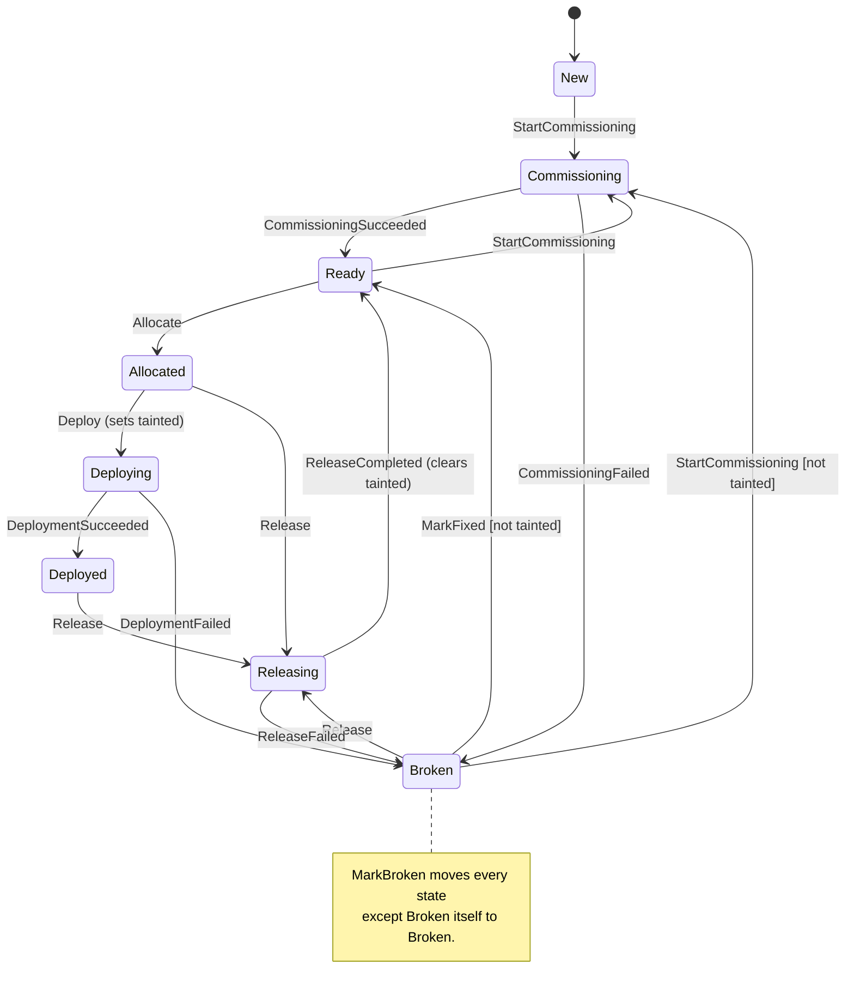

`start_commissioning` clears `owner` and `root_disk` from every source state (a no-op from `new`
and `ready`, where both are already `None`). Without that, `ready → allocate → allocated →
mark_broken → broken → start_commissioning → commissioning → commissioning_succeeded → ready`
would end in `ready` with an owner and break I7. The effect is part of the table that Kani,
proptest and the TLA+ model check, so this path is covered by construction.

`TRANSITIONS` stays a `(from, event, to)` table; the two guards become a second generated table,
`GUARDS: [(from, event, Guard)]`, rendered by `cargo xtask docs` into `docs/lifecycle.md` and into
the TLA+ model next to `Transitions`, so the guard cannot drift either. I3 ("`ready` is reachable
from every state") still holds: a tainted broken machine reaches `ready` through `releasing`.

### 4.3 Operations, fencing and grants

```rust
pub struct Operation {
    pub id: OperationId,                 // 128-bit random, from the Entropy port
    pub kind: OperationKind,             // Commission | Deploy { deploy_id } | Release { wipe: WipeLevel }
    pub fencing: Fencing,
    pub started_at: Timestamp,           // passed in; the domain never reads a clock
    pub deadline: Timestamp,             // absolute; after a restart, credited with the downtime (§7.3)
    pub phase_deadline: Timestamp,
    pub session: Option<SessionBinding>, // key id of the agent whose Enroll consumed this attempt's token (§10.3)
    pub last_report_seq: u64,            // agent report dedup within the current attempt; reset to 0 when `attempt` changes (§7.4)
}

pub struct Fencing { pub term: Term, pub generation: Generation, pub op: OperationId, pub attempt: Attempt }
// `attempt` (u8, bounded by policy, default 2, then the *_failed event) is part of the fencing:
// every plan and report carries it, so a late report from attempt 1 cannot pass during attempt 2.
// M1: term is always Term(0) and LeaderGate is AlwaysLeader. M2 Raft fills in the term
// without changing any signature (ADR 0014).

/// Proof that the lifecycle permits writing to one disk of one machine for one operation.
/// No public constructor, no Clone, no Deserialize. Only `Machine::grant_disk_write` makes one.
pub struct DiskWriteGrant { machine: MachineId, fencing: Fencing, scope: WriteScope, not_after: Timestamp }
pub enum WriteScope { ImageWrite { manifest: Digest, target: DiskId }, MetadataWipe { target: DiskId } }

/// Proof that a power-state or boot-override change is backed by an open operation.
pub struct PowerGrant { machine: MachineId, fencing: Fencing, allowed: PowerScope }

impl Machine {
    pub fn grant_disk_write(&self, op: OperationId, now: Timestamp) -> Result<DiskWriteGrant, GrantError>;
    pub fn grant_power(&self, op: OperationId, now: Timestamp) -> Result<PowerGrant, GrantError>;
}
```

**Grant rules** (Kani-proved for all inputs, bounded):

- `ImageWrite` only in `deploying`, with an open `Deploy` operation whose id matches, before its
  deadline, targeting `root_disk`.
- `MetadataWipe` only in `releasing` with `tainted`, with an open `Release` operation whose id
  matches, targeting `root_disk` (plus the other non-removable disks the commissioning inventory
  lists, when the pool's `wipe_policy.scope` is `all-nonremovable`, §10.4).
- `PowerGrant` only with an open operation whose id matches. Power is never changed "because the
  poller saw something".
- `PowerDriver::ensure_power` and `set_boot_override` take `&PowerGrant`, and the agent plan for a
  disk-writing step is built only from a `DiskWriteGrant`. A destructive call without a lifecycle
  reason does not compile.

**Two-step protocol (fixes the circularity of "record before act").** The grant constructors read
`self.operation`, and a `Machine` exists only as the result of `Machine::restore` from a store
snapshot. So:

1. Reconcile N decides to start work: its `Decision` contains an *operation change* (open or
   advance a phase) and **no** side effect. The executor commits it in one transaction with
   compares on the revisions it read.
2. The commit's watch event re-enqueues the machine. Reconcile N+1 restores the machine from the
   committed state, sees the open operation in a phase that expects an effect, and `decide()`
   returns the effect with a grant minted from that committed operation.

A grant therefore proves that the operation it names was durably recorded before the effect.
What it cannot prove is that the operation is *still* open when the effect lands (a user
`mark_broken` may race it). That residual is handled by fencing at the receiver: the agent
gateway pushes a plan only if `(generation, op, attempt)` still match the current `life` record
and only on the session bound to this attempt (§10.3), the agent rejects plans whose
`(machine, generation)` differ from its certificate or whose term is below the highest it has
seen, and power effects are ensure-shaped levels whose outcome comes back as a BMC observation
(§4.4, §7.3). `DeployProtocol.tla` models exactly this ordering (§4.8).

**Grants inside the control plane, consistency checks in the agent.** The plan that reaches the
agent carries the fencing tuple and the target `DiskId`, but it is not a signed capability: an
unsigned struct adds nothing beyond mTLS plus fencing. The agent's `Plan::validate` (in
`racksmith-rsimg`, shared and fuzzed) is a **consistency check**: step order, every disk-writing
step names the plan's target, the target exists, and the fencing matches the session. A signed
grant can be added later if a threat needs it.

**Target disk is pinned, never guessed** ([ADR 0014](../adr/0014-pure-decide-step-with-operations-fencing-grants.md)).
Commissioning records each disk's stable identity: `DiskId::Wwn(..)` when the device reports a WWN
or EUI-64/NGUID, otherwise `DiskId::Serial { model, serial }`. A disk with neither is not eligible
as a target (condition `NoStableDiskId`). At `allocate`, the pure
`resolve_root_disk(inventory, pool.root_disk_rule) -> Result<DiskId, DiskSelectionError>` resolves
the pool rule (for example `smallest-nonremovable-ssd-at-least(image)`, `wwn:…`, `serial:…`) to
exactly one `DiskId`, which is stored in `root_disk` and shown in the dry-run plan. The agent
writes only to the block device whose identity equals it; otherwise it fails with
`TargetDiskNotFound`. There is no fallback. The virtual lab gives every disk an explicit serial
(QEMU `-device nvme,serial=…`) so this path is exercised on every PR.

### 4.4 `decide()`: orchestration as one pure step function

All orchestration logic lives in one pure, total function in the domain. Reconcilers execute;
they never decide ([ADR 0014](../adr/0014-pure-decide-step-with-operations-fencing-grants.md)).

```rust
pub fn decide(m: &Machine, obs: &Observations, now: Timestamp, cfg: &Timeouts) -> Decision;

pub struct Observations {
    pub bmc: Option<BmcObservation>,          // None for a machine without a BMC (§8.9)
    pub agent: AgentObservation,              // None | Connected { generation, op, attempt, session, last_acked_seq } | Lost { since }
    pub reports: Vec<AgentReport>,            // fenced, deduplicated reports not yet applied
    pub dhcp_seen: Option<Timestamp>,         // first DISCOVER for the boot MAC in this attempt
    pub os_ready: Option<ReadySignal>,        // from the committed `obs` edge (§10.6), never memory-only
    pub deploy_slot: SlotState,               // global admission (§9.5)
    pub bandwidth: TokenState,                // per-source token held by this machine's session
    pub restarted_at: Option<Timestamp>,      // control-plane start, for the post-restart grace (§7.3)
}

pub struct BmcObservation {
    pub power: Option<PowerObservation>,                   // value, observed_at, source
    pub boot_override: Option<(BootTarget, Once)>,         // as last read from the BMC
    pub last_action: Option<ActionOutcome>,                // reported by the effect executor (§7.3)
}
pub struct ActionOutcome {
    pub op: OperationId, pub attempt: Attempt, pub phase: Phase, pub kind: ActionKind,
    pub result: Result<(), PowerErrorClass>,  // Busy | Conflict | Unauthorized | CertificateMismatch | Unsupported | Unreachable | Timeout | Protocol
    pub at: Timestamp,
}

pub struct Decision {
    pub event: Option<MachineEvent>,          // at most one lifecycle event
    pub op_change: OpChange,                  // None | Open(kind) | Advance(phase) | Close(outcome)
    pub action: Option<Action>,               // at most one side effect, only for a committed op
    pub requeue: Option<Requeue>,             // After(Duration) | At(Timestamp)
}

pub enum Action {
    EnsurePower { target: PowerTarget, grant: PowerGrant },          // Off | On (levels, never "cycle")
    SetBootOverride { target: BootTarget, grant: PowerGrant },       // Pxe | UefiHttp | Disk, always Once
    SendPlan { plan: PlanSpec, grant: Option<DiskWriteGrant> },     // Commission | Deploy | Wipe
    Proceed { step: HandoffStep },                                   // e.g. ack ImageWritten, then reboot
    ProbeReady { port: u16 },                                        // recipes without phone-home
}
```

**Phases** are progress inside a state. `Phase` is a closed enum whose pairing with
`MachineState` is checked by its constructor, so `Writing` in `ready` is unrepresentable. Phases
decide nothing about destructive permission; grants do.

| State | Phases, in order |
|---|---|
| `new` | `Discovered` |
| `commissioning` | `PowerOffIssuing`, `BootOverrideIssuing`, `PowerOnIssuing` (or `AwaitingManualPower` without a BMC), `AwaitingAgent`, `Inventorying`, `PowerOffAfter` |
| `allocated` | `Idle`, `Queued` (waiting for a global deploy slot) |
| `deploying` | `PowerOffIssuing`, `BootOverrideIssuing`, `PowerOnIssuing`, `AwaitingAgent`, `AwaitingBandwidth`, `Writing`, `HandingOff`, `AwaitingOsReady`, then on a hand-off retry (I11) `HandoffPowerOff`, `HandoffOverride`, `HandoffPowerOn`, back to `AwaitingOsReady` |
| `releasing` | `PowerOffIssuing`, `BootOverrideIssuing`, `PowerOnIssuing`, `AwaitingAgent`, `Wiping`, `PowerOffAfter` |
| `ready`, `deployed`, `broken` | `Idle` |

**Phases advance on evidence.** An `*Issuing` phase advances only when `BmcObservation` shows the
effect landed: `PowerOffIssuing` when power reads `Off`, `BootOverrideIssuing` when
`boot_override` reads the target with `Once` (or, for BMCs that do not report overrides, a
successful `last_action` for this `(op, attempt, phase)`), `PowerOnIssuing` when power reads `On`
after the override was confirmed. A failed `last_action` is classified in the domain:
`Busy`/`Conflict`/`Timeout`/`Unreachable` stay in the phase and requeue with backoff,
`Unauthorized` and `CertificateMismatch` set the conditions `BmcAuthFailed` and
`BmcCertificateChanged` and wait without retrying, and `Unsupported` fails the attempt. The
adapter only reports; the domain decides. The hand-off retry phases exist because `EnsurePower(On)`
is a no-op on a machine that is powered on but hung: a retry must observe `Off` before it sets the
`Disk, Once` override and powers on again.

`decide()` is written as a rule table, `DECIDE_RULES: [(state, phase, observation class) →
(event, op change, action kind, requeue)]`, interpreted by a small total function. The table is
the unit the conformance test enumerates (§4.8). Generating the `DeployProtocol.tla` step relation
from it, the way `TRANSITIONS` feeds `MachineLifecycle.tla`, is **[M1-stretch]**: the model is
hand-written first, so F2 does not depend on a novel generator.

### 4.5 Actor permission matrix

`permits(actor, event)` is a pure, total function over `Actor × MachineEvent`, Kani-checked. Agents
never cause a lifecycle event: their reports are observations that `decide()` weighs after the
fencing check.

| Event | Viewer | Operator | Admin | Reconciler acting on a user intent | Reconciler without intent | Agent, first-boot caller |
|---|---|---|---|---|---|---|
| `start_commissioning` | ✗ | ✓ | ✓ | ✓ | ✓ only for `new` under `auto-commission` policy | ✗ |
| `allocate`, `deploy`, `release` | ✗ | ✓ | ✓ | ✓ (intent author ≥ operator) | ✗ | ✗ |
| `*_succeeded`, `*_failed`, `release_completed`, `release_failed` | ✗ | ✗ | ✗ | ✓ | ✓ | ✗ |
| `mark_broken` | ✗ | ✓ | ✓ | ✓ | ✓ (deadline exceeded, integrity failure, boot-token conflict, restore) | ✗ |
| `mark_fixed` | ✗ | ✗ | ✓ | ✓ only when the intent author is admin (`repair_nonce`) | ✗ | ✗ |

Every lifecycle change still goes through the reconciler (§5.2). The Admin column says who may
write the intent; the reconciler column says the reconciler may execute it. `MarkFixed` writes
`spec.repair_nonce`, and the spec write path rejects a change to that field from a principal
below admin, so the reconciler sees only admin-authored repair intents.

### 4.6 Invariants

I1–I5 from [docs/lifecycle.md](../lifecycle.md) are kept unchanged.

| ID | Invariant | Checked by |
|---|---|---|
| I6 | A disk write happens only under a `DiskWriteGrant`: image writes only in `deploying`, wipes only in `releasing`, each for the open operation of the matching kind, targeting `root_disk` | type system (no constructor), Kani (`grant_disk_write`), `DeployProtocol.tla` (`WritesOnlyUnderCommittedOp`), deterministic simulation |
| I7 | `ready ⇒ ¬tainted ∧ owner = None`. No machine that may hold deployed data is allocatable without passing through `releasing` | Kani (`handle`), proptest, TLA+ (`MachineLifecycle.tla`) |
| I8 | At most one open operation per machine, and every open operation has an absolute `deadline` | type (`Option<Operation>`), proptest |
| I9 | `enrollment_generation` strictly increases on `release_completed`, `mark_broken`, re-enrollment (including every token-consuming `Enroll`, §10.3) and restore. A certificate, plan or report with an older generation is rejected | proptest, Kani, TLA+ |
| I10 | Agents and first-boot callers cause no lifecycle event directly; only `decide()` emits events, and only from reports whose `(generation, op, attempt)` are current | Kani (`permits`), TLA+ (`NoStaleCompletion`) |
| I11 | After `ImageWritten` is persisted for an attempt, hand-off retries are BMC power actions to disk, never a second write in the same attempt | proptest over `decide`, TLA+ |
| I12 | `decide()` is total, returns at most one event and one action, and returns an action only for an operation that is already committed in the input | Kani (bounded), proptest against a reference interpreter |
| I13 | `NoDeposedLeaderWrite`: an agent never acts on a plan whose term is below the highest term it has seen. In M1 the term is constant, so this is checked for M2's sake | TLA+ (`DeployProtocol.tla` with a `NewLeader` action) |
| I14 (liveness) | Every open operation is eventually closed, under weak fairness of the deadline actions | TLA+ |
| I15 | After a restore, no side effect is issued until an admin resumes; every operation opened before the restore is superseded; every machine that is not `new` carries `RestoreUnverified`, and while it does `decide()` emits no event other than `mark_broken` and no action, so nothing is allocated, deployed, released or wiped until its BMC power and identity have been observed and an admin has verified it (§6.6) | proptest, Kani (bounded, over `decide()`), restore drill in the lab (§13.1) |

### 4.7 Later states, designed now

The shape is fixed now so that later milestones add rows, not concepts. Each change runs the full
AGENTS.md lifecycle checklist when it lands.

| State | Milestone | Entered by | Left by | Safety role |
|---|---|---|---|---|
| `attesting` | M2 (R29) | `release_completed` and `commissioning_succeeded` when the pool requires attestation | `attestation_passed → ready`; `attestation_failed → broken` (M2) or `quarantined` (M3) | No `allocate` edge from `attesting`, so a machine that fails attestation cannot be allocated, by construction |
| `erasing` | M3 (R21) | `release` when the wipe level is `sanitize` | `erase_completed → ready` (or `attesting`); `erase_failed → broken` | Resumable: NVMe sanitize survives resets, so the reconciler polls the sanitize log instead of reissuing |
| `quarantined` | M3 (R26) | `quarantine` from `ready`, `allocated`, `deployed` | `start_commissioning` (if `!tainted`), `release`, `mark_broken` | No `allocate` edge; `deploy` is impossible |

Residency (a parked agent, M3) stays orthogonal to the lifecycle: `status.agent.residency` is
reserved as `NONE` in M1. Parking grants no disk writes (only `deploying` does), so it adds speed
without a new safety case when it lands.

### 4.8 What changes in TLA+, Kani, proptest and fuzzing

- **`specs/tla/MachineLifecycle.tla`:** `Transitions` and the new `Guards` are regenerated from the
  Rust tables (`cargo xtask docs --fix`). New variables `tainted` and `owner` (including the
  clearing of `owner` on `start_commissioning`); new invariant I7; I3 re-checked with the guard.
- **New `specs/tla/DeployProtocol.tla`** (hand-written in M1):
  - **Variables:** the store record (state, phase, operation, generation, term), a controller with
    a volatile view, the agent (`maxTermSeen`, current plan), a BMC (power level, pending
    override), an append-only `effects` log tagged with fencing, and `term`.
  - **Actions:** `Decide` (read committed state, commit an operation change), `Effect` (issue the
    effect for a committed operation), `BmcObserve` (the effect's outcome and the override state
    become an observation), `Crash` (drop the volatile view; at most K times), `AgentAccept`,
    `AgentReport` (tagged with its attempt), `ReportApply`, `NextAttempt` (new boot token,
    `last_report_seq` reset), `HandoffRetry` (power off, override, power on), `Deadline`,
    `UserMarkBroken`, and `NewLeader` (bumps the term; the old controller may still issue effects
    until it notices).
  - **Safety:** `WritesOnlyUnderCommittedOp` (I6, I12), `NoStaleCompletion` (I10, including a
    report from an earlier attempt), `NoDeposedLeaderWrite` (I13), `EnsureNotCycle` (no blind reset
    after a crash without a power observation first), `PhaseAdvancesOnEvidence` (no `*Issuing`
    phase advances without a matching BMC observation), `NoSecondWriteAfterImageWritten` (I11).
  - **Liveness:** `OpEventuallyClosed` (I14).
  - **Bounds:** 2 machines, 3 operations, 2 terms, K = 2 crashes: small enough for TLC on every PR;
    larger bounds nightly.
  - **Conformance:** a Rust test enumerates `DECIDE_RULES` and checks `decide()` against it
    exhaustively over abstract inputs; the hand-written TLA+ step relation mirrors the same table,
    and generating it is the stretch item in §4.4.
- **Kani** (`#[cfg(kani)]` in `racksmith-domain`): `grant_disk_write` and `grant_power` return `Ok`
  only for the I6 pairs; `permits()` for all `Actor × MachineEvent × MachineState`; `handle` keeps I7;
  `decide()` never returns an action for an uncommitted operation (I12, bounded);
  `boot::decide()` never returns `ServeAgent` with a disk-writing purpose outside `deploying` or
  `releasing`; `Phase` and `MachineState` pairing.
- **proptest:** random event sequences with random actors, operation ids and interleaved crashes
  (serialize, drop, `restore()`), checking I6–I12 and I15; `restore(serialize(m)) == m`;
  `resolve_root_disk` never picks a removable disk and honours an explicit rule exactly;
  work-queue properties (§7.2); admission arithmetic (§9.5).
- **Fuzz:** the existing `lifecycle_sequence` target gains actors, guards and the `tainted` flag;
  a new `decide_sequence` target drives `decide()` with arbitrary observations.

### 4.9 Declarative mapping and destructive confirmation

The reconciler turns desired state into the next event, one step per reconcile:

| Current | Desired (`spec`) | Next event | Destructive? |
|---|---|---|---|
| `ready` | `assignment` set | `allocate` | no |
| `allocated` | `assignment` set | `deploy` (after a global slot) | **yes** (disk write) |
| `deployed` | `assignment` with a changed `nonce` or `image` | `release`, then `allocate`, `deploy` | **yes** |
| `deployed`, `allocated`, `broken` | `assignment` cleared | `release` | **yes** (wipe, unless never tainted) |
| any | `maintenance: true` | `mark_broken` | no |
| `ready`, or `broken` with `!tainted` and `maintenance: false` | `commission_nonce` bumped | `start_commissioning` | no |
| `broken` with `!tainted` and `maintenance: false` | `repair_nonce` bumped (admin only) | `mark_fixed` | no |

A `broken` machine is never fixed or recommissioned implicitly: `life` records the last
`commission_nonce` and `repair_nonce` the reconciler acted on (and the current values whenever the
machine enters `broken`), and only a larger value counts. A `deployment_failed` or
`commissioning_failed` machine with `maintenance: false` therefore stays `broken` until someone
asks.

**Destructive confirmation.** Every mutating RPC accepts `dry_run`. A dry run returns the
server-computed `TransitionPlan` (every step, destructive steps flagged, the resolved root disk)
and a `plan_hash` over `(machine uid, resource_version, spec digest, plan steps)`. A non-dry-run
write whose plan contains a destructive step is rejected unless it carries
`confirm_destructive = plan_hash`. Because the hash includes the `resource_version` precondition,
the plan cannot change between the dry run and the confirm. The CLI shows the plan and asks;
`--yes` supplies the hash. An apply that would touch more than 50 machines destructively also
needs `--max-machines N`. No wipe is ever inferred from an incidental spec change.

---

## 5. API design

### 5.1 Protobuf package layout

```
proto/
  buf.yaml                     # lint STANDARD + COMMENTS; breaking FILE + WIRE_JSON; ignore_unstable_packages
  racksmith/options/v1/        # STABLE from day one: (policy), (sensitive), (immutable) options
  racksmith/meta/v1alpha1/     # ObjectMeta, ListMeta, Condition, error details
  racksmith/machine/v1alpha1/  # Machine, MachineService
  racksmith/pool/v1alpha1/     # MachinePool: root-disk rule, image trust anchors, enrollment policy, timeout profile
  racksmith/bmc/v1alpha1/      # Bmc (endpoint, driver, credentials input-only), BmcService
  racksmith/image/v1alpha1/    # OSImage, ImageSource, ImageService
  racksmith/firstboot/v1alpha1/ # FirstBootConfig, FirstBootConfigService (§10.6)
  racksmith/network/v1alpha1/  # Subnet, BootNetwork (DHCP mode per interface)
  racksmith/enrollment/v1alpha1/ # EnrollmentRequest, EnrollmentService (list, approve, reject)
  racksmith/auth/v1alpha1/     # Token, TokenService, WhoAmI
  racksmith/admin/v1alpha1/    # AdminService: health, version, snapshot, resume, migration status
  racksmith/agent/v1alpha1/    # AgentService: served ONLY on :9443 with mTLS
  racksmith/rsimg/v1/          # rsimg Manifest: STABLE, persisted and signed (§9.2)
third_party/googleapis/google/api/{annotations,http,field_behavior}.proto   # vendored, Apache-2.0
```

The internal storage encoding, `racksmith.storage.v1`, is **not** in the public tree: it lives in
`racksmith-storage-model` (L1) so that public `v1alpha1` churn never forces a storage migration
(§6.7), and so that every writer (the API, `TypedStore` in the core), the object cache and both
store engines share one codec without depending on each other.

### 5.2 Services (v1alpha1)

| Service | RPCs | Minimum role (method option) |
|---|---|---|
| `MachineService` | `Get`, `List`, `Watch` (stream), `Create` (optionally with `bmc` and `boot_mac`, §8.9), `Update` (spec only, `update_mask`, `dry_run`, `confirm_destructive`), `Delete` (only in `new`, `ready`, `broken` with `!tainted`), `Allocate`, `Deploy`, `Release`, `Commission`, `MarkBroken`, `MarkFixed`, `WatchDeployment` (stream), `ListEvents`, `GetTimings` | viewer for reads; operator for lifecycle; admin for `MarkFixed` and `Delete` |
| `BmcService` | `Get`, `List`, `Create` (`create_machine` creates a `new` machine bound to the BMC, §8.9), `Update`, `Delete`, `RepinCertificate`, `Validate` | admin to write; viewer to read (secrets never returned) |
| `ImageService` | `Import` (long-running; returns an `OSImage` with an `Imported` condition; needs a pinned digest or a verifiable signature, §9.2), `Get`, `List`, `Watch`, `Delete` (refused while referenced) | operator to import; viewer to read |
| `FirstBootConfigService` | `Create`, `Get`, `List`, `Update`, `Delete` (refused while referenced by an open deploy) | operator to write; viewer to read (payload never returned, only its digest and format) |
| `PoolService`, `NetworkService` | CRUD + `Watch` | admin to write |
| `EnrollmentService` | `List`, `Approve` (creates a machine, or merges into an existing one matched by identity, §8.9), `Reject` | admin |
| `TokenService` | `Create`, `List`, `Revoke`, `WhoAmI` | admin, except `WhoAmI` |
| `AdminService` | `Health`, `Version`, `Snapshot` (stream to the client), `Resume`, `RestoreReport`, `RestoreVerify`, `MigrationStatus` | admin; `/healthz` and `/readyz` also on the metrics port |
| `AgentService` | `Enroll` (server-auth TLS only), `Session` (bidi, mTLS), `UploadBlob` (client stream, mTLS) | agent principal only; not reachable on :7443 |

Imperative lifecycle RPCs are **sugar over spec writes**: `Deploy` sets `spec.assignment` and
returns the updated `Machine`. There is one path to a lifecycle change (the reconciler) and one
place where destructive confirmation is enforced (the spec write). The OS-ready phone-home is a
plain HTTP endpoint on the boot runtime (`POST /ready/<token>`, §10.6), not a gRPC service, so a
freshly booted OS needs no gRPC client and no CA bundle.

### 5.3 Resource shape

```protobuf
message Machine {
  racksmith.meta.v1alpha1.ObjectMeta metadata = 1;
  MachineSpec spec = 2;
  MachineStatus status = 3 [(google.api.field_behavior) = OUTPUT_ONLY];
}
message ObjectMeta {
  string name = 1;               // user-chosen, unique, DNS label; immutable
  string uid = 2;                // m-<16hex>; OUTPUT_ONLY
  map<string, string> labels = 3;
  map<string, string> annotations = 4;
  int64 generation = 5;          // bumped on every spec change; OUTPUT_ONLY
  string resource_version = 6;   // store mod_revision; optimistic concurrency on Update
  google.protobuf.Timestamp create_time = 7;
  string pool = 8;
  string site = 9;               // partition keys from day one (R6)
  string tenant = 10;            // empty in M1; the PRD Q5 seam
}
message MachineSpec {
  string bmc = 1;
  Assignment assignment = 2;     // set => deployed for this owner; unset => ready
  bool maintenance = 3;
  uint64 commission_nonce = 4;
  string boot_mac = 5;           // optional; learned from the first matching PXE sighting when empty (§8.9)
  uint64 repair_nonce = 6;       // bump => mark_fixed (admin only, §4.9)
}
message Assignment {
  string owner = 1; string image = 2; string first_boot_config = 3; uint64 nonce = 4;
  repeated string ssh_authorized_keys = 5;
}
message MachineStatus {
  LifecycleState state = 1;
  string phase = 2;
  int64 observed_generation = 3;
  repeated racksmith.meta.v1alpha1.Condition conditions = 4; // Commissioned, PowerKnown, AgentConnected, Queued, Tainted, BmcReachable, ...
  PowerStatus power = 5;           // observed value, observed_at, source
  OperationStatus operation = 6;   // id, kind, attempt, phase, started_at, deadline
  AgentStatus agent = 7;           // session state; residency reserved (NONE in M1)
  Identity identity = 8;           // uuid, serial, macs
  InventorySummary inventory = 9;  // cpu, memory, disks[] with DiskId, nics[], gpus[]; full blob by digest
  string root_disk = 10;           // resolved DiskId, shown before any write
  DeploymentSummary last_deployment = 11;
  uint64 enrollment_generation = 12;
  bool tainted = 13;
  HandoffCapability handoff = 14;  // UNKNOWN in M1; KEXEC_OK / KEXEC_FAILED learned in M3
}
```

`Bmc` credentials are a `Credentials { username, password [(racksmith.options.v1.sensitive) = true] }`
message that appears only in create and update requests. Responses carry `credentials_set` and
`credentials_version`. `cargo xtask proto-check` fails CI when a message reachable from a response
contains a `sensitive` field, when an RPC lacks a `policy` option (default deny), or when a
resource lacks `ObjectMeta`.

### 5.4 List, watch, consistency and limits

- `List` uses AIP-158 pagination: `page_size` defaults to 500 (maximum 1,000) and `page_token`
  encodes `(revision, last_key)`. **Each page is consistent on its own**; pages are not one
  snapshot. The object cache keeps only the latest state, and redb cannot reopen an old revision
  once its read transaction is closed, so holding a snapshot across client requests would pin pages
  and grow the file. Each page carries the cache revision it was served at; a client that needs
  a consistent whole list compares the first and last page revisions, or lists and then
  `Watch`es from the first page's revision to catch up, which is the Kubernetes list-then-watch
  pattern. A token whose revision is older than the store's compacted revision returns
  `FAILED_PRECONDITION` with a `Compacted` detail, and the client restarts the list.
- Filters: `state`, `pool`, `site`, `tenant`, `label_selector`, and a `read_mask`. The object cache
  indexes state, pool, site, tenant, MAC, BMC and name.
- `Watch(from_resource_version)` is gap-free and ordered, with bookmarks every 10 s. An expired
  revision returns `OUT_OF_RANGE` + `Compacted` (the Kubernetes 410 analogue). A watcher that falls
  4,096 batches behind gets `RESOURCE_EXHAUSTED` + `ResyncRequired`.
- Read-your-writes: a write returns its revision, and a read may pass `min_revision`; the object
  cache waits (bounded at 1 s) until it has applied that revision.
- Rate limits per token (GCRA via `governor`): 100 rps with a burst of 200; destructive RPCs 10/s
  per principal. Above that, `RESOURCE_EXHAUSTED` with `RetryInfo`.

### 5.5 Streaming deploy progress (R20)

```protobuf
rpc WatchDeployment(WatchDeploymentRequest) returns (stream DeploymentEvent);
message DeploymentEvent {
  string deploy_id = 1; uint64 revision = 2;
  oneof event {
    PhaseChanged phase = 3;   // persisted edge: phase, started_at, finished_at, outcome, clock
    Progress progress = 4;    // memory only: bytes_fetched, bytes_written, extents_done, rate; <= 1/s
    Finished finished = 5;    // outcome + full PhaseTimings (§12.4)
  }
}
```

Persisted phase edges come from the store watch; progress ticks come from an in-memory hub with
`tokio::sync::watch` semantics, so the latest value wins, a slow client skips ticks and nothing
back-pressures the agent. A client that connects mid-deploy first receives the persisted phases,
then live events.

### 5.6 `racksmith apply -f` (R34)

- **Documents** are YAML or JSON with `apiVersion: racksmith.io/v1alpha1` and
  `kind: Machine | MachinePool | OSImage | Bmc | Subnet | BootNetwork | FirstBootConfig`, mapped one to
  one onto the proto messages through the proto3 JSON mapping. They are the same shapes the M2 CRDs
  use, with no translation.
- **Client-side apply with revision preconditions** in M1: for each document the CLI gets the
  object, computes a field-masked patch of `spec`, and sends `Update` with the read
  `resource_version` as a precondition, retrying on `ABORTED`. Server-side apply with field
  managers is cut: the M2 operator maps CRDs one way into specs and does not need it.
- **Dry run and confirmation** as in §4.9: the CLI first sends every write with `dry_run`, shows the
  diff and the destructive plan, then sends the confirmed writes.
- **Reuse:** the M2 GitOps reconciler (R35) is this apply path driven from a Git checkout.

### 5.7 Codegen, REST gateway, versioning and the CLI

The tooling is [ADR 0019](../adr/0019-protobuf-codegen-and-rest-transcoder.md).

- **Rust generation without `protoc`:** `protox` compiles the protos; `tonic-prost-build` and
  `pbjson-build` emit Rust; well-known types are mapped by hand instead of through `pbjson-types`
  (which pulls `chrono`, now unmaintained). The output is **checked in** under
  `crates/racksmith-proto/src/gen/` by `cargo xtask codegen`; `cargo xtask codegen --check` fails CI
  when it is stale. There is no `build.rs` and no `include!` (which `cargo xtask arch` bans).
- **Generated code under the strict lints**, without weakening them: the xtask post-processor
  rewrites the module-level `allow` attributes that tonic emits into item-level
  `#[expect(…, reason = "generated by tonic-prost-build")]` on the exact items that trip a lint,
  and `buf lint` with `COMMENTS` makes every message, field and RPC carry a doc comment, which
  satisfies `missing_docs`. A week-1 spike proves the first generated module passes
  `cargo xtask ci`; F1 depends on it.
- **REST gateway:** a **generated route table plus a runtime transcoder**. `cargo xtask codegen`
  derives a static table `(HTTP method, path template, body field, RPC)` from the
  `google.api.http` annotations, checked in like the rest of the generated code. At runtime one
  axum handler matches the table, maps JSON to a `prost_reflect::DynamicMessage` through the proto3
  JSON mapping and the embedded `FILE_DESCRIPTOR_SET`, and calls the tonic service in process as a
  `tower::Service`. About 800 lines plus a fuzz target, sharing one authn/authz layer with gRPC, so
  nothing is reachable over REST that is not reachable over gRPC. Server streams become NDJSON
  (`application/x-ndjson`) **[M1-stretch]**; the fallback is gRPC-only streaming. Reading ADR 0006's
  "generated from the same contracts" this way needs the owner's sign-off; full handler codegen is
  estimated at one to two more weeks [owner].
- **OpenAPI 3:** generated in CI by `buf generate` with gnostic `protoc-gen-openapi`, checked in at
  `api/openapi/racksmith.v1alpha1.yaml`; CI fails if stale.
- **Contract checks:** `buf lint` and `buf breaking --against '.git#branch=main,subdir=proto'`, the
  `buf` binary pinned by checksum. `v1alpha1` packages may break (`ignore_unstable_packages`);
  `racksmith.options.v1` and `racksmith.rsimg.v1` are protected from day one because they are
  persisted or signed. Promotion: `v1alpha1` → `v1beta1` (when the operator lands) → `v1`, with at
  least one minor release serving both and converting in `racksmith-proto`.
- **Unknown fields:** prost drops unknown fields on decode. That bounds the "reversible within a
  minor version" promise of [ADR 0009](../adr/0009-embedded-store-behind-trait.md): a downgrade
  must run explicit `down` migrations (§6.7) and must not rely on an older binary preserving fields
  it does not know.

| CLI | RPC |
|---|---|
| `racksmith machine list [-l pool=gpu] [--state ready] [-o json\|yaml\|wide]` | `MachineService.List` |
| `racksmith machine get NAME` / `watch NAME` | `Get` / `Watch` |
| `racksmith machine deploy NAME --image ubuntu-24.04 --first-boot cfg [--follow]` | `Deploy` + `WatchDeployment` |
| `racksmith machine release NAME [--yes]` | `Release` (shows the destructive plan first) |
| `racksmith machine timings NAME` / `events NAME` | `GetTimings` / `ListEvents` |
| `racksmith apply -f fleet.yaml [--dry-run] [--yes]` | `Update`/`Create` per document |
| `racksmith machine create NAME [--bmc B] [--boot-mac M]` / `commission NAME` / `fix NAME` | `Create` / `Commission` / `MarkFixed` |
| `racksmith bmc add NAME --redfish https://… --username u --password-stdin [--create-machine]` | `BmcService.Create` |
| `racksmith image import ubuntu-24.04 --oci ghcr.io/…` or `--url … (--sha256 D \| --signature URL --key K)` | `ImageService.Import` |
| `racksmith firstboot create NAME --format cloud-config\|ignition\|talos -f FILE` | `FirstBootConfigService.Create` |
| `racksmith enrollment list` / `approve ID --pool P` | `EnrollmentService` |
| `racksmith token create --role operator --ttl 90d` | `TokenService.Create` |
| `racksmith admin snapshot -o FILE` / `admin resume` / `admin restore-report` / `admin restore-verify (--machine M \| --all)` | `AdminService.Snapshot` / `Resume` / `RestoreReport` / `RestoreVerify` |
| `racksmith init`, `serve`, `doctor`, `admin restore`, `admin migrate --to N`, `admin boot-artifacts import DIR` | local commands, not RPCs |

`-o json` prints the proto3 JSON mapping through `prost-reflect`, so CLI output equals the REST
JSON exactly; `-o yaml` prints the same tree, which `apply -f` accepts. `cargo xtask cli-coverage`
checks that every RPC in the descriptor set has a CLI command (R33).

---
## 6. Storage

### 6.1 Store trait semantics (the contract M2 must keep)

[ADR 0029](../adr/0029-fix-store-trait-semantics.md) records the trait semantics, which F1
freezes; [ADR 0012](../adr/0012-redb-store-behind-etcd-style-trait.md) records the engine, which
the week-3 benchmark decides. The trait does not depend on the engine choice.

```rust
pub type Revision = u64;  // global, monotonic, one per committed transaction; M2: advanced by Raft apply

pub struct Txn {
    pub compares: Vec<Compare>,          // all must hold, else Conflict
    pub ops: Vec<Op>,                    // applied atomically at ONE new revision
    pub expected_term: Option<Term>,     // M1: always None or Term(0); M2: rejected unless current leader term
    pub meta: TxnMeta,                   // actor, request_id, reason, trace context
}
pub enum Compare { ModRevision { key: Key, cmp: Cmp, rev: Revision }, Absent { key: Key }, Present { key: Key } }
pub enum Op {
    Put { key: Key, value: Bytes },
    Delete { key: Key },
    /// Writes `prefix + "<revision>/<n>"`, where `revision` is the transaction's revision and `n`
    /// its index among the transaction's `Append` ops. The key is completed when the writer (M1) or
    /// the Raft apply step (M2) assigns the revision, deterministically on every replica.
    Append { prefix: KeyPrefix, value: Bytes },
}

pub trait Store: Send + Sync + 'static {
    /// Commits atomically and durably (fsync'd before returning), in revision order.
    fn commit(&self, txn: Txn) -> impl Future<Output = Result<Committed, StoreError>> + Send;
    /// A consistent read view at one revision (an MVCC read transaction).
    fn snapshot(&self) -> impl Future<Output = Result<impl Snapshot, StoreError>> + Send;
    /// Ordered, gap-free, duplicate-free events for `range` with revision > `after`.
    fn watch(&self, range: KeyRange, after: Revision) -> Result<WatchStream, StoreError>;
    fn current_revision(&self) -> Revision;
    fn compacted_revision(&self) -> Revision;
}
pub trait Snapshot: Send + Sync {
    fn revision(&self) -> Revision;
    fn get(&self, key: &Key) -> Result<Option<Versioned>, StoreError>;     // value + create_rev + mod_rev
    fn range(&self, range: &KeyRange, after: Option<&Key>, limit: u32) -> Result<Page, StoreError>;
}
pub enum WatchItem { Batch { revision: Revision, events: Vec<Event> }, Progress { revision: Revision } }
pub enum StoreError { Conflict { failed: Vec<u16> }, TooLarge, Busy { retry_after: Duration },
                      NotLeader { hint: Option<NodeId> }, Compacted { compacted: Revision },
                      ResyncRequired, Corrupt { detail: String }, Io { detail: String } }
```

| Property | Guarantee |
|---|---|
| Isolation | Serializable: one logical writer applies transactions in order; compares are evaluated against the state immediately before the transaction |
| Durability | `commit` returns only after the batch holding the transaction is fsync'd (redb `Durability::Immediate`) |
| Revisions | A transaction gets exactly one revision; all its events arrive in one `Batch` with that revision; `Append` keys embed that revision |
| Snapshots | A `Snapshot` is consistent for as long as it is held, within one call; no snapshot outlives a client request, so paged lists are consistent per page (§5.4) |
| Read-your-writes | `Committed.revision` plus `min_revision` on reads (§5.4) |
| Watch | Gap-free, ordered, per range. History ring of 200,000 events or 128 MiB, whichever is reached first. `after < compacted` → `Compacted`. `Progress` bookmarks every 10 s. A watcher whose buffer (4,096 batches) overflows gets `ResyncRequired` and is dropped; **writers never block on watchers** |
| Limits | Value ≤ 64 KiB; at most 128 ops and 256 KiB per transaction (`TooLarge` above) |
| Back-pressure | The proposal channel is bounded at 4,096 transactions. Reconcilers await when it is full; API writes get `Busy` → `RESOURCE_EXHAUSTED` after 1 s of queueing |

The `store_contract` suite in `racksmith-testkit` runs the same property tests against every
implementation: linearizable commits under concurrency, compares, one transaction = one revision,
`Append` keys that carry the committing revision and never collide, gap-free watch under
concurrent writers, compaction and resync behaviour, snapshot isolation, limits, and durability
(reopen after `kill -9` through a subprocess harness).

### 6.2 Engine: redb, with rusqlite as the documented fallback

| Criterion | redb 4.6 | rusqlite (bundled SQLite) |
|---|---|---|
| License, `deny.toml` | MIT/Apache-2.0, passes; one dependency (libc) | MIT + public domain, passes; C through `cc` |
| Crash safety | copy-on-write B-tree, checksummed commits | best in class (WAL) |
| Batched writes | about 79k keys/s in small batches (redb README) | about 37.6k keys/s |
| Individually fsync'd transactions | 1.11k/s | 142/s |
| MVCC snapshot for list and watch | native read transactions | WAL snapshot, blocking API |
| Ad-hoc debugging | needs `racksmith admin dump` | `sqlite3` CLI |

**Decision: redb.** It is pure Rust, its read transactions map directly onto `Snapshot`, it has one
dependency, and it fits a single writer. The debugging gap is closed with
`racksmith admin dump --format jsonl`. Settings: `set_cache_size(256 MiB)` (the default of 1 GiB
would be half the RSS budget), `Durability::Immediate`, and an offline `compact()` at startup when
the file exceeds twice its live size.

**Benchmark gate before ADR 0012 is accepted** (week 3, both engines, on the CI runner class;
the trait semantics of ADR 0029 are already frozen at F1 and do not wait for it):
load 10k machines, 200k index keys and 7 days of events; run 50 txn/s steady, then a 5,000 txn/s
burst for 30 s with 200 concurrent watchers. Pass: commit p99 < 20 ms during the burst, RSS within
its share of §12.7, file < 1 GiB after 7 simulated days of churn, snapshot < 5 s, restore < 30 s.
A failure switches to rusqlite behind the same trait.

### 6.3 Group-commit writer

```
mpsc<Proposal{txn, reply}> (bounded 4,096)
  -> writer (dedicated OS thread):
       collect until 5 ms elapsed OR 256 txns OR 4 MiB of values
       for txn in batch, in arrival order:
           evaluate compares against KeyIndex (in-memory BTreeMap<Key, (create_rev, mod_rev)>, rebuilt at open)
           ok   => revision = last + 1; complete Append keys with revision; stage ops; update KeyIndex
           fail => reply Conflict now; stage nothing
       one redb WriteTransaction: apply staged ops + meta/revision; commit (fsync)
       success: reply Committed{revision} to each; push events to the watch ring; notify the object cache
       failure: reply Io to the whole batch; roll KeyIndex back from the pre-batch delta; reopen
```

Evaluating compares needs no disk read: the key index holds about 70k entries at 10k machines
(about 10 MiB). Expected capacity is 20–50k txn/s **[est]** against a worst-case burst of about
2k txn/s (§6.5). In M2 this loop becomes the Raft apply loop: a batch becomes one log entry and the
same evaluate-and-stage function runs on every replica.

### 6.4 Data model and sizing

Each machine is split across three keys by writer, so user edits, reconciler progress and
observations never conflict needlessly. A destructive transition still compares all three.

| Key | Value (`racksmith.storage.v1`) | Writer | Size |
|---|---|---|---|
| `m/<id>/spec` | meta + spec | API | 0.5–2 KiB |
| `m/<id>/life` | state, phase, operation, generation, tainted, owner, root disk, identity, disk inventory summary, conditions | `MachineReconciler` | 1–3 KiB |
| `m/<id>/obs` | power edge, agent edge, inventory blob digest + summary, last deploy summary | observers, reconciler | 1–3 KiB |
| `idx/mac/<mac>`, `idx/uuid/<uuid>`, `idx/serial/<serial>`, `idx/name/<kind>/<name>` | owner id; uniqueness through `Absent` compares | same transaction as the owner | < 64 B |
| `bmc/<id>`, `cred/<bmc-id>` | BMC spec + TLS pin; credential ciphertext (§11.5) | API, `BmcReconciler` | 1 KiB |
| `img/<id>` | `OSImage` + manifest digest + import status | `ImageImporter` | 1–2 KiB |
| `pool/<id>`, `net/…`, `lease/<subnet>/<ip>`, `ipalloc/<subnet>/<ip>` | pools, subnets, boot networks, leases, allocations | API, reconcilers | < 1 KiB |
| `enr/<id>` | pending `EnrollmentRequest` (cap 1,024, TTL 1 h) | agent gateway | 2–4 KiB |
| `tok/<id>` | token metadata + SHA-256 of the secret | API | < 512 B |
| `ev/<revision>/<n>` | actor-attributed event (§11.8), written in the **same transaction** as the change it records, as `Op::Append { prefix: "ev/" }` | every writer | 300–600 B |
| `fbc/<id>`, `idx/name/fbc/<name>` | `FirstBootConfig`: format, AEAD-encrypted payload, digest (§10.6) | API | ≤ 64 KiB |
| `obs` edge `ready` (inside `m/<id>/obs`) | the committed OS-ready signal `{op, attempt, source address, at}` (§10.6) | boot runtime, through the store | tiny |
| `dr/<machine>/<deploy_id>` | deploy record with `PhaseTimings` (last 20 per machine) | `MachineReconciler` | 1–2 KiB |
| `pki/…` | wrapped DEKs, encrypted CA keys, boot-key versions, serial counter | `racksmith-pki` | small |
| `meta/{schema_version, cluster_id, revision, restore_epoch, observe_only}` | | store | tiny |

**Sizing at 10k machines.** Machine keys and indexes come to about 70 MiB; BMCs, images, IPAM and
tokens add under 30 MiB. Events at a heavy 5,000 deploys per day, about 7 events each, kept 7
days, add about 120 MiB. Deploy records add at most 400 MiB in theory (10k × 20 × 2 KiB) but about
40 MiB in practice. The file stays well under the 1 GiB gate, snapshots take seconds, and an M2
Raft install-snapshot is a few seconds at 1 Gb/s.

### 6.5 What is not in the state store

| Data | Where | Rule |
|---|---|---|
| Agent heartbeats (1,000/s at 10k) | memory (`AgentSessionHub`) | persist only `connected ↔ lost` edges, only for machines with an open operation |
| Deploy progress ticks | memory (`tokio::sync::watch`) | persist only phase edges (about 10 per deploy) |
| BMC power polls (about 83/s) | memory + Prometheus | persist `obs.power` on change only (the MAAS LP#1594991 lesson) |
| DHCP renewals that change nothing | memory | persist grants and changes only |
| Full inventory (50–500 KiB) | `blobs/sha256/…` (content-addressed, zstd) | the store keeps digest + summary |
| Deploy and agent logs | `logs/YYYY-MM-DD/<deploy_id>.log.zst`, retention by bytes (default 10 GiB) | never replicated in M2 |
| Image bytes | `images/<manifest-digest>.rsimg` | never in any store |

Worst-case write rates: 1,000 deploys × about 15 transactions in 5 minutes is about 50 txn/s;
`enroll-10k` at 100/s is about 300 txn/s; a power-restore herd gives 10k observation edges,
rate-limited to 100/s. All of that is under 2% of the batched capacity.

### 6.6 Backup, restore and restore safety

Recorded in [ADR 0025](../adr/0025-restore-safety-and-reversible-migrations.md).

- **Online snapshot:** `racksmith admin snapshot -o FILE` (or the `AdminService.Snapshot` stream)
  opens one redb read transaction and streams every table into a `.rsnap` file: a header
  `{magic, cluster_id, revision, schema_version, created_at}`, a zstd body and a SHA-256 trailer.
  It never contains the KEK; credentials and CA keys are in it only as ciphertext.
- **Scheduled snapshots:** default every 6 h, keep 8, into `snapshots/`. Off-host copies and KEK
  custody are the operator's job, documented together.
- **Offline restore** (`racksmith admin restore --from FILE`) verifies the trailer and schema
  version, migrates up if older, and writes a fresh `state.redb`. A snapshot is older than reality,
  and acting on its stale operation records could wipe a machine that has since been redeployed,
  so **restore is a safety event**. The minimum that M1 never cuts:
  1. bump `meta/restore_epoch` and set `meta/observe_only`;
  2. supersede every open operation; machines that had an open `Deploy` or `Release` move to
     `broken` with reason `restored_from_snapshot` (they stay `tainted` if they were, so they
     must be released before reuse);
  3. bump every machine's `enrollment_generation`, which invalidates every agent certificate and
     plan issued before the snapshot;
  4. start in **observe-only mode**: `LeaderGate::may_act()` returns false, so observers run and
     reconcilers compute decisions but no side effect is issued, until an admin runs
     `racksmith admin resume`;
  5. **fence every machine, not only those with open operations.** A machine that was `ready` or
     `allocated` in the snapshot may have been deployed for a tenant afterwards; one that was
     `deployed` may since have been released and redeployed for someone else. Restore therefore
     sets the condition `RestoreUnverified` on every machine that is not `new`, and sets `tainted`
     on every machine in `allocated`, `deployed` or `broken` (the states where I7 allows it). While
     the condition is set, `decide()` emits no event except `mark_broken` and no action (I15), so
     the machine is neither allocated nor released (a release would wipe whatever is on the disk
     now). After `resume`, observers read each machine's BMC power state and identity; the
     condition clears only when an admin runs `racksmith admin restore-verify` for it, and a
     machine observed powered on with no open operation is flagged
     `PossiblyDeployedAfterSnapshot` and is skipped by `--all` until it is verified by name.
- **`racksmith admin restore-report`** (part of the never-cut restore minimum): a diff between
  the restored state and the observed power, BMC identity and agent state of every machine, which
  is what an admin reads before `restore-verify`.
- **CI:** a nightly restore drill takes a snapshot, then deploys one machine that was `ready` in
  the snapshot and releases and redeploys one that was `deployed`, restores, and asserts that
  observe-only mode holds, that no disk is written, and that after `resume` neither machine can be
  allocated or released until it is verified.

### 6.7 Migrations

- Values use the **internal** storage proto, so public API churn does not force storage
  migrations. `meta/schema_version: u32`. Each migration is a typed pair `up(N → N+1)` and
  `down(N+1 → N)` registered in a `MIGRATIONS` table in `racksmith-storage-model`, next to the
  codec whose bytes it transforms; the store engine runs it at open.
- **On startup**, older data triggers an automatic pre-migration snapshot
  (`snapshots/pre-migrate-<N>-<M>.rsnap`), then `up` in one write transaction. Newer data than the
  binary knows makes it refuse to start and print the exact `racksmith admin migrate --to <N>`
  command to run with the newer binary.
- **Downgrade:** `racksmith admin migrate --to N` (run by the newer binary) applies `down` steps. A
  minor release may contain only migrations that have a `down`; one without needs a major version
  and an ADR. Because prost drops unknown fields, reversibility comes from `down` steps, never
  from field preservation (§5.7).
- **Tests:** proptest `down(up(x)) == x` for every migration; the nightly `upgrade-test` runs release
  N-1 → N → `migrate --to N-1` → N-1 with live data in the virtual lab.

### 6.8 M2 Raft mapping (R5)

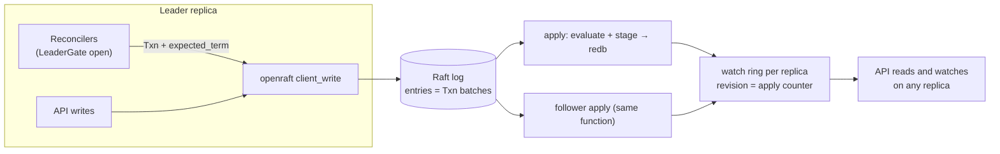

| Concern | M2 behaviour |
|---|---|
| Library | openraft 0.10, pinned exactly, wrapped in `racksmith-store-raft`; log in a separate `raft-log.redb`, state machine in `state.redb` |
| Revision | a counter advanced by apply, one per successful transaction in log order, identical on every replica |
| In the log | everything in §6.4, including the `ev/` events (they are `Op::Append` ops of each transaction, completed with the apply counter on every replica, so there is no separate drainer to replicate) |
| Not in the log | everything in §6.5, BMC session tokens, agent liveness, the KEK |
| Reconcilers | run only while `LeaderGate` is open for the current term; on step-down, a cancellation token stops every task; a late write from the deposed leader fails `expected_term` |
| Side effects outside the log | fenced by operation records (observe before act) and by the agent's `maxTermSeen`: plans carry the term and agents reject lower terms (I13) |
| Agent failover | plans and enrollment responses list every replica; followers answer `Session` with `UNAVAILABLE` + leader hint; agents reconnect with full jitter (1–30 s); the new leader starts every agent as `Unknown` with a 40 s grace, and agents replay unacknowledged reports |
| Reads | follower reads (milliseconds stale) by default; `min_revision` or `consistent = true` uses ReadIndex. Allocation and uniqueness are transactions, so they are linearizable by construction |
| Rolling upgrade | follower → follower → leader transfer → old leader; a schema migration is itself a log entry applied once all members advertise support |
| Exit test | a turmoil-based test (3 replicas, leader killed mid `deploy-1000`) plus the load-lab `leader-kill` scenario |

**Known blocker:** openraft 0.10 depends on `chrono` unconditionally, and RUSTSEC-2026-0543 (chrono
unmaintained, issued 2026-11-17) makes `cargo deny` fail. Plan: an upstream issue now to move to
`jiff` or `std::time`; if it is not resolved by M2, a dated, reasoned, time-boxed `deny.toml`
exception under [ADR 0028](../adr/0028-supply-chain-policy-amendments.md) [owner].

---

## 7. Reconciliation model

### 7.1 Runtime contract (front-end-agnostic)

```rust
pub trait Reconciler: Send + Sync + 'static {
    type Key: Ord + Clone + Send + Sync + fmt::Debug + 'static;
    const NAME: &'static str;
    fn reconcile(&self, key: Self::Key, ctx: &Ctx) -> impl Future<Output = Result<Outcome, ReconcileError>> + Send;
}
pub enum Outcome { Done, RequeueAfter(Duration), RequeueAt(Timestamp) }
pub enum ReconcileError {
    Transient { reason: &'static str, retry_after: Option<Duration> },  // backoff requeue
    Conflict,                                                           // compare failed: immediate requeue (max 5, then backoff)
    Permanent { condition: ConditionReason },                           // condition written; no requeue until the object changes
    NotLeader,                                                          // drop silently; the new leader re-lists
}
/// What feeds a reconciler: store-watch mappers in the binary, kube informers in the M2 operator.
pub trait KeySource<K>: Send { fn next(&mut self) -> impl Future<Output = Option<(K, Priority)>> + Send; }

impl<R: Reconciler> Controller<R> {
    pub fn new(r: R, cfg: ControllerConfig) -> Self;
    pub fn source(self, s: impl KeySource<R::Key> + 'static) -> Self;
    pub async fn run(self, gate: impl LeaderGate, shutdown: CancellationToken) -> Result<(), ControllerError>;
}
```

`Ctx` gives a reconciler a read-only `ObjectCache` handle, a `TypedStore` (which fills compares
from the revisions it read), the ports, the `Clock`, the semaphores and the current `Term`.

### 7.2 Work queue (own code, about 400 lines, property-tested)

- **Dedup and per-key serialization** with client-go semantics: a `dirty` set and a `processing`
  set. An add during processing marks the key dirty and `done()` requeues it, so events are never
  lost and two workers never handle one key.
- **Priority lanes:** P0 user intent (spec changes, API actions), P1 in-flight observations (agent
  reports, deadlines, power edges and effect outcomes for machines with open operations), P2
  retries, P3 resync and herd recovery. Dequeue is **weighted fair**, not strict: out of every 16
  dequeues, P0 gets 8, P1 4, P2 2 and P3 2, and a lane's unused share passes to the next lane
  with work. Every lane therefore makes progress and P0 keeps a guaranteed half of the dequeues
  under any P3 load; nothing is promoted between lanes. P3 is token-bucketed at 100 keys/s, and
  the bucket applies to every P3 item for as long as it waits.
- **Reserved workers:** of the 512 `MachineReconciler` workers, 64 serve only P0 and 64 only P1, so
  a burst in one lane can never occupy every worker (and reconciles no longer wait on BMCs, §7.3).
- **Delays:** a min-heap of `(Timestamp, key, lane)` drives `RequeueAfter`/`RequeueAt`. Absolute
  deadlines live in the store, so the heap is rebuilt at startup.
- **Backoff:** per key, exponential from 1 s to 300 s with full jitter from the `Entropy` port, reset
  on `Done`; a global retry bucket of 50/s with a burst of 500.
- **Resync:** every object is re-enqueued at P3 every 15 min ± 50%, phased by a hash of its id so
  resyncs never align.
- **No-op suppression:** `TypedStore::put_if_changed` compares encoded bytes and skips identical
  writes. Without it, every status write would trigger a watch event that re-enqueues the object,
  the most common controller hot loop.
- **Properties tested:** no key is processed concurrently; every add is eventually processed; P0
  receives at least half of the dequeues whenever it has work, under any P3 load; P3 never exceeds
  its bucket rate; the delay heap fires in order; queue length is bounded by the number of
  distinct keys.

### 7.3 The `MachineReconciler`: one actor, one decision

Each reconcile:

1. reads the machine at revision R from the object cache and rebuilds it with `Machine::restore`;
2. gathers `Observations`: the BMC observation (power, override, last action outcome), the session
   hub (connected, generation, attempt, bound session, last acked report), DHCP sightings, the
   committed OS-ready edge, admission state;
3. calls `racksmith_domain::decide(machine, obs, now, timeouts)`;
4. executes the `Decision`:
   - an event or operation change → one transaction with compares on `spec`, `life` and `obs` at R,
     plus its `ev/` row;
   - an action (only ever for an operation already committed in R, I12), after checking
     `LeaderGate::may_act(term)`, is **handed off, never awaited**: a power or override action goes
     to the machine's BMC effect executor with a non-blocking `try_send` (a full or busy executor
     returns `RequeueAt(next permit)`), and a plan or `Proceed` goes to `AgentSessions`. Its
     outcome comes back as an observation that re-enqueues the machine at P1, and a later
     reconcile records it;
   - nothing changed → no write at all.

**Effect executors.** Each BMC endpoint has one executor task in the core. It owns everything
that can wait on a BMC: the global BMC semaphore (200), the per-endpoint serialization and IPMI
spacing, the per-rack inrush limiter, the 60 s action timeout and the Redfish driver's
409-during-POST retries. It holds at most one pending action per machine (a newer action for the
same `(op, attempt, phase)` replaces it) and reports each result as an `ActionOutcome`. A
reconcile therefore never parks a worker on a BMC, and 1,000 power actions arriving together
occupy executor queues, not the 512 reconcile workers that P0 intents and P1 agent reports need.

| Operation phase (persisted) | Effect, issued by the next reconcile | Why it is idempotent |
|---|---|---|
| `PowerOffIssuing` | `EnsurePower(Off)` until power reads `Off` | a level, not a toggle; already off is a no-op |
| `BootOverrideIssuing` | `SetBootOverride(Pxe or UefiHttp, Once)` until the override reads back | setting a value |
| `PowerOnIssuing` | `EnsurePower(On)` until power reads `On` | a level |
| `AwaitingManualPower` (no BMC) | none; waits for a DHCP sighting of the boot MAC (§8.9) | — |
| `AwaitingAgent`, `AwaitingBandwidth` | none (waits for Hello on the bound session, then for a bandwidth token) | — |
| `Writing` | `SendPlan` over the bound session, keyed by `(op, attempt)` | the agent deduplicates by `(op, attempt)`; the gateway re-checks `(generation, op, attempt)` and the session binding before pushing |
| `HandingOff` | `SetBootOverride(Disk, Once)` until it reads back, then `Proceed(reboot)` | setting a value; the agent deduplicates by report sequence |
| `AwaitingOsReady` | none, or `ProbeReady` for recipes without phone-home | read-only |
| `HandoffPowerOff`, `HandoffOverride`, `HandoffPowerOn` | `EnsurePower(Off)`, `SetBootOverride(Disk, Once)`, `EnsurePower(On)`, each until observed (I11) | levels and values; never a write |

**Crash recovery (R39): observe before act.** On startup machines with an open operation are
enqueued at P1, and every other machine at P3, spread over 120 s (10k machines through the
100 keys/s P3 bucket take 100 s, so the spread and the bucket agree). Agent liveness starts as
`Unknown` with a fresh 40 s grace, so a restart never mass-fails agents, and no BMC call is made
for machines with fresh status and no open operation.

**Deadlines after a restart.** The domain never fails an operation on a deadline during the
post-restart grace (40 s plus 30 s of jitter after `restarted_at`). After it, deadlines are
credited with the outage: the reconciler re-arms `deadline` and `phase_deadline` as
`max(stored deadline, restarted_at + grace + (stored deadline − last commit before the crash))`,
bounded by twice the original operation timeout, and records the re-arm in the operation. A deploy
whose agent finished writing during a 40-minute control-plane outage, or whose OS is already up,
is therefore observed and completed instead of being failed as `broken` and tainted.

| Persisted phase at the crash | Observe | Then |
|---|---|---|
| `*Issuing`, `Handoff*` | BMC power state and override | the effect is re-derived from the committed phase; ensure-levels make repeats harmless |
| `AwaitingAgent` | agent reconnect within 40 s grace + 30 s jitter | reconnects on the bound session: continue. Absent by `phase_deadline` (default 10 min, raised per pool for slow-POST hardware): next attempt with a new boot token, `attempt` + 1 and `last_report_seq` reset |
| `Writing` | agent reconnect and its replayed reports | the image stream never stopped (it comes from the origin, not the control runtime): continue |
| `HandingOff`, `AwaitingOsReady` | committed ready edge, power state | I11: hand-off retries are the `Handoff*` power phases to disk, never a new write; at `deadline`, `deployment_failed` |
| `Wiping` | as for `Writing` | the wipe is idempotent |
| any, with `now > deadline` after the grace and the re-arm | everything above first | `*_failed` with reason `deadline_exceeded`; `broken` with a recorded reason |

Exit criterion (load lab `chaos`): every deploy ends `deployed` or `broken` with a reason, and the
effects log shows no disk write outside a committed, matching operation.

### 7.4 Agent-report handling

- Every agent message carries `(machine, generation, op, attempt, seq)`. The gateway checks the
  certificate SAN for `machine` and `generation`; the session hub checks that `(op, attempt)`
  equal `life.operation` and that the message arrives on the session bound to this attempt
  (§10.3). A stale report is dropped, counted and answered with `StaleReport`; it never moves the
  lifecycle.
- Phase-edge reports are persisted in the same transaction as the operation-phase change, and the
  ack (`Ack{seq}`) is sent only after the commit. After a reconnect the agent replays
  unacknowledged reports, and the control plane deduplicates by `(op, attempt, seq)` using
  `operation.last_report_seq`, which is reset to 0 whenever `attempt` changes. The agent is a fresh
  in-RAM process on every boot, so each attempt's `seq` starts at 1.
- Reports reach the lifecycle only as `Observations` to `decide()` (I10).

### 7.5 Concurrency limits and back-pressure

| Resource | Default limit | Enforced by |
|---|---|---|
| `MachineReconciler` workers | 512 tasks, 64 reserved for P0 and 64 for P1; reconciles never await a BMC | controller pool |
| BMC requests in flight, global | 200 | semaphore, awaited only by effect executors and pollers |
| BMC requests per endpoint | 1; IPMI also ≥ 5 s apart | one effect executor per endpoint |
| BMC new TLS handshakes | 200/s | GCRA |
| BMC connect / read / action timeout | 10 s / 30 s / 60 s | HTTP client |
| Power-on rate per `rack` label | 4 per 10 s (inrush); the admission controller pre-staggers slot grants across racks so a wave does not queue a whole rack behind it, and the wait is timed as `T_inrush` (§9.1) | keyed GCRA in the effect executors |
| Active deploys (global slot, taken at `deploy`) | `max_concurrent_deploys` = 1,000 | `AdmissionController` |
| Image bandwidth (token taken at agent Hello) | per-source budget (§9.5) | `AdmissionController` |
| Agent sessions | 4,096; beyond that `UNAVAILABLE` + retry-after | gateway |
| Unknown-machine enrollments | 20/s globally; 1 per 10 s and 4 pending per source MAC and per source IP; 1,024 pending in total and 256 per `BootNetwork`; 256 MiB of pending inventory blobs in total; alert `EnrollmentCapReached` at the cap (§8.6) | gateway GCRA + store caps |
| Store proposals | 4,096 queued | bounded channel |
| Boot runtime → core decision requests | 4,096 queued; drop when full | bounded channel |
| API | 100 rps per token (burst 200); 10/s destructive | tower layer |
| Watchers | 4,096 batches per watcher; overflow → `ResyncRequired` | store |

**Circuit breaker:** when more than 20% of the deploys of one `(image, pool)` fail within 10 minutes
(with at least 10 attempts), admission pauses that pair, sets `ImageDeployFailing` on the image and
fires an alert. `racksmith image resume` re-enables it. A bad image cannot fail 1,000 machines.

**Polling cadence:** idle machines every 120 s ± 30% (IPMI 300 s), machines with an open operation
every 10 s. At 10k that is about 83 Redfish GET/s. One Redfish session per BMC, re-created on 401
and deleted on shutdown.

### 7.6 How both front ends host it (ADR 0005)

- **Binary (M1):** `racksmith-server::ServerBuilder` creates the redb store, the object cache fed by
  `Store::watch`, and one `Controller` per reconciler, sourced by store-watch mappers, the delay
  heap and the observers. The gate is `AlwaysLeader` (with the observe-only switch). SIGTERM is
  handled in `racksmith-cli`, with a 30 s drain.
- **HA binary (M2):** the same, with `racksmith-store-raft` and its `LeaderGate`. The core does not
  change.
- **Operator (M2), proposed direction:** the operator runs the same `ServerBuilder` in a pod, with
  the same embedded store (single replica, or three with Raft as a StatefulSet). It adds one
  controller, `CrdSync`, which watches CRDs through kube-runtime informers, writes their `spec`
  into the store through the same validated, confirmation-checked write path (the confirmation
  hash travels as an annotation), and projects coarse status (state, phase, conditions, last
  deployment) back at most every 10 s per object. Keeping the store as the single source of truth
  avoids two sources of truth (the Metal3 lesson) and etcd write amplification, and the
  conformance suite runs unchanged against both front ends. This refines
  [ADR 0005](../adr/0005-one-core-two-front-ends.md) and gets its own ADR in M2 [owner].

---

## 8. Boot and network

### 8.1 DHCP modes (per `BootNetwork`, that is per provisioning interface)

| Mode | RackSmith answers | Addressing | Use |
|---|---|---|---|
| `proxy` (**default**, [ADR 0008](../adr/0008-pluggable-network-services.md)) | ProxyOffer on :67 and :4011 to PXE and HTTP-boot clients only (option 60 `PXEClient`/`HTTPClient`), never `yiaddr` | site DHCP | brownfield, drop-in |
| `full` (opt-in per subnet) | full DHCPv4 (DORA) for the subnet's dynamic range + boot options; static reservations for known machines | built-in IPAM; leases in the store (grants as edges, lease 1 h ± 10%) | greenfield, labs |
| `external` | nothing on :67; the site DHCP points `next-server`/bootfile at RackSmith; reservations through the `Dhcp` port (Kea adapter, M2) | site DHCP | sites that own DHCP |
| `off` | nothing; UEFI HTTP Boot URI set out of band (Redfish `HttpBootUri`) | — | locked-down networks |

Deployed machines never touch boot services: their boot order is disk first, and RackSmith boots a
machine through a **one-time** override only when it wants it. A site power restore therefore
causes no PXE storm. DHCPv6 (R11, M4) is not built; `BootNetwork` carries an address family so it
can be added without a schema change. A `BootNetwork` is either a local interface or a relayed
subnet reached through DHCP relays (§8.10); the modes above apply to both.

### 8.2 Boot chain (M1, Secure Boot off)

| Request | Answer |
|---|---|
| DISCOVER, option 60 `PXEClient`, arch 0x00 (BIOS) | proxy OFFER, bootfile `undionly.kpxe` |
| … arch 0x07 or 0x09 (x86-64 UEFI) | bootfile `ipxe-x86_64.efi` (snponly build) |
| … arch 0x0b (arm64 UEFI) | bootfile `ipxe-arm64.efi` |
| option 60 `HTTPClient`, arch 0x10 or 0x13 (UEFI HTTP Boot) | bootfile `http://<cp>:8080/boot/ipxe-<arch>.efi` |
| user class (option 77) `iPXE` | bootfile `https://<cp>:8443/boot/v1/script` |
| REQUEST on 4011 | ACK with the same options |

- **Stage 1 (unauthenticated):** the NBP is a RackSmith release build of iPXE, delivered by TFTP to
  PXE ROMs or by plain HTTP to UEFI HTTP-boot clients (about 1 MB). Its embedded script runs
  `dhcp` and chains the HTTPS script URL with `mac`, `uuid`, `serial`, `arch` and `ip` as query
  parameters.
- **Stage 2 (authenticated):** the per-boot iPXE script, the kernel (about 14 MB) and the agent
  initramfs (≤ 40 MB, target 32 MB) over HTTPS :8443, with the installation's server root pinned
  in iPXE (§8.3, §11.4). Kernel and initramfs come from immutable digest URLs
  (`/boot/v1/files/sha256/<d>`). The script is answered on the boot runtime; the two bulk files
  are served by the data runtime's threads through rustls, so about 46 GB of TLS at 1,000
  concurrent boots never competes with DHCP on the 2 boot workers. That traffic is counted
  against the origin's egress in the slot formula (§9.5), because HTTP caches cannot serve these
  files over HTTPS with the pinned root unless they hold a server certificate.
- **Kernel command line:** `rs.cp`, `rs.ca=sha256:<fingerprint>`, `rs.token`, `rs.now=<unix time>`,
  `ip=${net0/ip}::${net0/gateway}:${net0/netmask}:::BOOTIF:off`, `BOOTIF=${net0/mac}`, `panic=0`,
  `amd_pstate=active` (amd-pstate is built into the kernel, not a module, so it is selected on the
  command line and ignored on other CPUs). The agent configures its interface from these values,
  which skips a third DHCP round; `panic=0` means a panicked agent hangs instead of rebooting into
  whatever is on disk (§10.7).
- **iPXE HTTPS throughput is unmeasured.** iPXE does TLS in software over the firmware's SNP
  driver, and the research lists its throughput on real UEFI firmware as a gap. `T_ipxe` is
  therefore budgeted from the research p95 (§9.1), and the week-1 lab skeleton plus one rented
  commodity machine measure it. **Decision rule:** if either measurement is below 20 MB/s for the
  kernel plus initramfs, serving them over plain HTTP verified by iPXE `imgverify` against the
  same trust root moves from M1-stretch into M1, which also makes them cacheable by any HTTP cache
  with `sendfile`. Otherwise `imgverify` stays **[M1-stretch]**.

### 8.3 M1 trust anchor: serve-time injection into a release-built iPXE

[ADR 0018](../adr/0018-serve-time-ipxe-trust-anchor.md). The per-install iPXE C build at
`racksmith init` proposed by the base design is rejected: it needs a C toolchain or container on
the operator host, which breaks R1 and puts the 15-minute install at risk.

- RackSmith releases ship iPXE builds (x86_64 EFI, arm64 EFI, BIOS `undionly.kpxe`) compiled with
  the chain script and `TRUST=` set to a **placeholder** certificate. iPXE stores trusted roots as
  SHA-256 fingerprints, so the placeholder becomes a known 32-byte marker in the binary.
- When TFTP or HTTP serves the binary, `racksmith-netboot` replaces the marker with the fingerprint
  of this installation's **server root** (§11.4: a root that signs only server certificates, so
  no agent or enrollment certificate can ever chain to what iPXE trusts), in about 50 lines plus a
  CI test that boots the patched binary.
  UEFI does not check PE checksums for unsigned images while Secure Boot is off. The boot HTTPS
  server sends its full chain including the root, so iPXE can match the fingerprint.
- **Week-1 spike.** Fallback 1: an iPXE build with `ALLOW_TRUST_OVERRIDE`, with the trust setting
  delivered by proxyDHCP (equivalent strength, since stage 1 is unauthenticated anyway). Fallback 2:
  plain HTTP for script, kernel and initramfs, with the residual risk documented.

### 8.4 Boot sequence of a known machine (proxyDHCP)

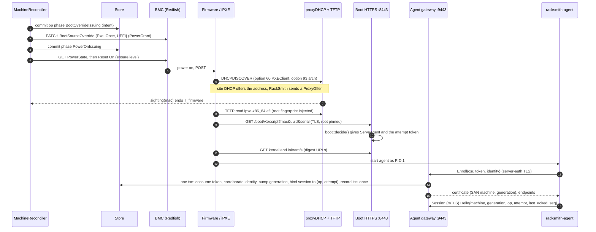

### 8.5 Boot decisions and the boot token

```rust
// racksmith_domain::boot (pure)
pub fn decide(machine: Option<&BootView>, req: &BootRequest, policy: &BootPolicyView, now: Timestamp) -> BootAction;
pub enum BootAction {
    ServeAgent { purpose: AgentPurpose, token: TokenIssue },  // purpose: Commission | Deploy | Release
    EnrollUnknown,                                           // agent without a token, under enrollment policy
    LocalBoot,                                               // `exit` (UEFI) or `sanboot --drive 0x80` (BIOS)
    Ignore { reason: IgnoreReason },                         // deny policy, identity mismatch, rate-limited
}
```

- **Lookup:** the handler resolves the machine by MAC (any MAC in its identity, or the boot MAC),
  then checks UUID and serial against the stored identity. A mismatch is `Ignore` plus an alert.
  A MAC that matches no machine but whose script query carries the UUID and serial of a machine
  without a learned boot MAC is the boot-MAC learning case of §8.9.
- **Agent only when expected:** `ServeAgent` only when the open operation is in `PowerOnIssuing` or
  `AwaitingAgent`. A known machine with no open operation gets `LocalBoot` (a 200-byte script), so a
  site that PXE-boots after a power loss causes nothing destructive.
- **Token construction:**
  `token = "v<k>." + base64url(HMAC-SHA256(boot_key_k, "rs-boot/v1" ‖ machine ‖ op ‖ attempt))`. It is
  recomputable, so it is never stored; the store records only that it was issued, to which
  `(mac, ip, uuid)` tuple, and when. TTL 15 minutes from first issue. The key version `k` is
  embedded so that `racksmith admin boot-key rotate` keeps the previous key valid for 1 hour (longer
  than any token's TTL), and a rotation never invalidates boots in flight.
- **Idempotent re-issue:** a second script fetch for the same attempt from the **same tuple** within
  120 s gets the same token again. Real UEFI and iPXE stacks re-fetch after transient TLS or HTTP
  errors, and failing them would cost a power cycle plus another POST (up to 4 minutes on GPU
  servers) and false alerts at 1,000 concurrent deploys.
- **Conflict closes the attempt, fail closed:** a fetch for the attempt from a **different tuple**,
  or an `Enroll` presenting a token that was already consumed, makes the reconciler emit
  `mark_broken` with reason `boot_token_conflict`. That supersedes the operation, bumps
  `enrollment_generation` (killing every certificate and session for the machine) and raises
  `BootTokenConflict`. A tainted machine must then be released.
- **Plan push rule:** a plan is pushed only for an attempt whose token was issued to exactly one
  tuple, consumed by exactly one `Enroll`, and first issued at least 5 s earlier (the settle window),
  and only **on the session created by that `Enroll`** (`Operation.session`, §10.3). A session
  that existed before the token was consumed never receives the plan, whatever certificate it holds.
  Script fetch precedes `Enroll` by the kernel and initramfs download plus kernel boot (about 10 s),
  so a racing duplicate fetch has almost always arrived by then and the window adds no latency in
  practice.
- **Honest residual risk:** the script query (`mac`, `uuid`, `serial`) is not secret, and BMC
  corroboration compares claims that are not secret either. An on-link attacker who clones the
  tuple and fetches first can enroll and receive the plan, including user-data, before the real
  machine's fetch is detected. M1 detects and kills that session; it does not prevent the first
  exposure. **User-data is exposed to a stage-1 attacker until Secure Boot (M2).** In M1 that
  attacker can be any deployed OS on the same provisioning network (§11.9,
  [ADR 0033](../adr/0033-provisioning-network-boundary-and-os-ready-path.md)). The docs say so,
  tell users not to put long-lived secrets in user-data, and recommend DHCP snooping and a
  provisioning network that deployed tenants do not share.

### 8.6 Unknown machines (R8)

1. An unknown MAC PXE-boots; `boot::decide()` returns `EnrollUnknown`, or `Ignore` under the `deny`
   policy.
2. The agent boots without a token and calls `Enroll`. The gateway rate-limits this to 20/s
   globally and to one per 10 s and 4 pending per source MAC and per source IP, and caps pending
   requests at 1,024 in total and 256 per `BootNetwork`, with a 1 h TTL. A tokenless `Enroll` is
   accepted only from a MAC that boot services sighted in a DHCP request and that fetched an
   `EnrollUnknown` script within the last 15 minutes; anything else is refused without a
   certificate. Pending inventory blobs are capped at 256 MiB in total, and reaching any cap
   raises `EnrollmentCapReached`.
3. The control plane creates an `EnrollmentRequest` (`enr/<id>`), **not** a machine. Unapproved
   hardware never enters the lifecycle. The agent receives an enrollment-scoped certificate (SAN
   `urn:racksmith:enrollment:<request-id>`, 1 h, issued by the client CA, never by anything iPXE or
   agents trust, §11.4) whose only rights are inventory upload and waiting.
4. The enrollment policy, per `BootNetwork` or pool, decides what happens next:
   - `auto-accept` (default only with `racksmith init --lab`): create the machine in `new` at once;
   - `require-approval` (production default): an admin runs `racksmith enrollment approve <id> [--pool p]`;
   - `bmc-corroborated-only`: accept the request only as "a known machine that still needs a
     control-plane-initiated boot" when a registered BMC reports the same UUID, serial and MACs.
     MAC, UUID and serial are not secret (§8.5), so until TPM EK binding (M2) this policy is
     documented as **equivalent to `auto-accept`** for the enrolling session: it never issues a
     machine certificate to that session (see step 5);
   - `deny`.
5. On acceptance, the machine is created in `new` (or merged into an existing machine, §8.9), and
   the reconciler emits `start_commissioning` under the pool's `auto-commission` policy. **Power
   phases are never skipped for a session created by a tokenless `Enroll`**, except under
   `auto-accept`, which already trusts on-link claims by definition: the commission operation
   power-cycles the machine through its BMC (or waits for a manual power-on, §8.9), and only an
   `Enroll` that presents the token minted for that boot receives a machine certificate and the
   commission plan. The tokenless session is told to power off. Under `auto-accept` the gateway
   re-issues a machine certificate for the same key over the open session (`Renew`) and `decide()`
   goes straight to `Inventorying`, so lab enrollment and commissioning happen in one boot. The
   inventory a tokenless session uploaded is shown to the approver but never used for
   `resolve_root_disk`; only the commissioning inventory from a token-bearing boot is.
6. Without a decision within the TTL, the agent powers the machine off.

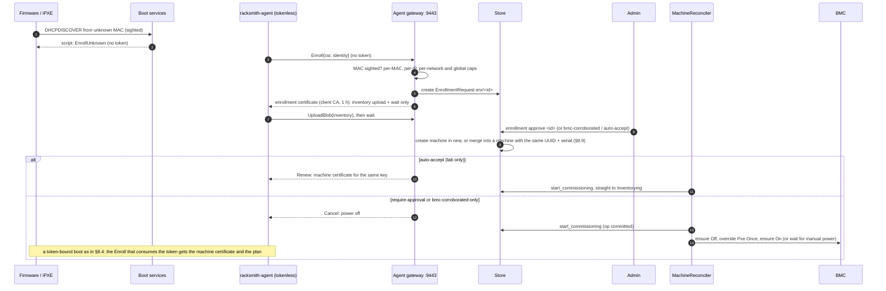

### 8.7 Port traits and power drivers

```rust
pub trait PowerDriver: Send + Sync + 'static {
    fn capabilities(&self, bmc: &BmcHandle) -> PowerCapabilities;   // uefi_http_boot, virtual_media (M2), min spacing
    fn power_state(&self, bmc: &BmcHandle) -> impl Future<Output = Result<PowerState, PowerError>> + Send;
    fn ensure_power(&self, bmc: &BmcHandle, target: PowerTarget, grant: &PowerGrant)
        -> impl Future<Output = Result<(), PowerError>> + Send;      // On | Off { graceful_timeout }
    fn set_boot_override(&self, bmc: &BmcHandle, o: BootOverride, grant: &PowerGrant)
        -> impl Future<Output = Result<(), PowerError>> + Send;      // Pxe | UefiHttp { uri } | Disk, always Once
    fn identity(&self, bmc: &BmcHandle) -> impl Future<Output = Result<BmcIdentity, PowerError>> + Send;
}
pub enum PowerError { Unreachable, Unauthorized, Busy { retry_after: Option<Duration> }, Conflict,
                      Unsupported, CertificateMismatch, Protocol { detail: String }, Timeout }

pub trait Dhcp: Send + Sync + 'static {
    fn ensure_reservation(&self, r: &Reservation) -> impl Future<Output = Result<(), DhcpError>> + Send;
    fn remove_reservation(&self, subnet: SubnetId, mac: MacAddress) -> impl Future<Output = Result<(), DhcpError>> + Send;
    fn leases(&self, subnet: SubnetId) -> impl Future<Output = Result<Vec<Lease>, DhcpError>> + Send;
}
pub trait Ipam: Send + Sync + 'static {
    fn allocate(&self, req: AllocationRequest) -> impl Future<Output = Result<Allocation, IpamError>> + Send; // idempotent by (owner, purpose)
    fn release(&self, owner: OwnerKey, purpose: Purpose) -> impl Future<Output = Result<(), IpamError>> + Send;
    fn lookup(&self, owner: OwnerKey) -> impl Future<Output = Result<Vec<Allocation>, IpamError>> + Send;
}
pub trait Dns: Send + Sync + 'static {
    fn upsert(&self, rrset: &RecordSet) -> impl Future<Output = Result<(), DnsError>> + Send;  // A, AAAA, PTR
    fn remove(&self, name: &DnsName, kind: RecordKind) -> impl Future<Output = Result<(), DnsError>> + Send;
}
pub trait BootArtifacts: Send + Sync + 'static {
    fn artifact(&self, kind: BootArtifact) -> Result<ArtifactHandle, BootArtifactsError>;   // Nbp | Kernel | Initrd per arch: path, digest, size
}
```

- **Redfish** (`racksmith-redfish`, about 1.5k lines over reqwest + rustls with no default roots):
  ServiceRoot, SessionService, Systems, ComputerSystem (PowerState, Boot, UUID, SerialNumber,
  EthernetInterfaces), `#ComputerSystem.Reset` (`On`, `ForceOff`, `GracefulShutdown`), PATCH of
  `Boot.BootSourceOverride{Target, Enabled, Mode}` and `HttpBootUri`. TLS is a TOFU-pinned SHA-256
  fingerprint per BMC or an operator CA, never "skip verification". One session token per BMC. A
  quirk table keyed by `(vendor, model)` covers 409-during-POST retries (6 × 5 s) and the Basic-auth
  fallback, driven by recorded fixtures. nv-redfish is evaluated behind the same port in M3.
- **IPMI** (`racksmith-ipmi`, about 1.2k lines on RustCrypto): RMCP+ RAKP sessions, cipher suites 3
  and 17, Chassis Control, Get Chassis Status, Set System Boot Options parameter 5 (PXE or disk, EFI
  bit, one-time). The RMCP+ parser is fuzzed. Documented: RAKP leaks salted password hashes
  (CVE-2013-4786), so Redfish is preferred.
- **Built-in network implementations:** IPAM uses `ipalloc/<subnet>/<ip>` keys with `Absent`
  compares and a deterministic lowest-free allocation from an in-memory bitmap rebuilt from the
  store. DNS writes RFC 1035 zone files to `dns/zones/` (atomic rename, SOA serial = store
  revision); an authoritative responder is M2. DHCP reads reservations and leases from the store.
  In M1 the deployed OS uses DHCP on its boot interface; IPAM-driven static addressing is M2.
- **What R9 delivers in M1, per DHCP mode.**

  | | `full` | `proxy`, `external`, `off` |
  |---|---|---|
  | `IpamReconciler` | On `commissioning_succeeded`, allocates one address per machine in the boot subnet with key `(machine, purpose = boot)` and writes a DHCP reservation for the boot MAC through the `Dhcp` port; the deployed OS receives the same address by DHCP. Releases both on `Delete` only, so an address survives redeploys | does nothing: the site DHCP owns addresses and RackSmith never learns the deployed OS's address, except from the phone-home source address (§10.6) |
  | `Dns` (zone files) | On reservation: `upsert` A and PTR for `<machine name>.<zone>`; on `Delete`: `remove`. BMC names are not published in M1 | records only names whose address RackSmith knows: none in M1 |
  | Configuration | `Subnet.dns_zone` (for example `prov.example.net`) and `[dns] zone_dir`; zone files are served by the site's DNS server (a `$INCLUDE` or secondary), since RackSmith has no responder in M1 | — |

  This is a **partial delivery of R9** (traits plus working built-ins in full mode; zone files
  without a responder; nothing in proxy mode), flagged to the owner in §16.3.

### 8.8 Boot-service hardening

- **Listeners** bind to configured interfaces only (`SO_BINDTODEVICE` through `socket2`). The process
  runs unprivileged with `CAP_NET_BIND_SERVICE` and `CAP_NET_RAW` (§12.6).
- **Rate limits:** DHCP 10 packets/s per MAC and 2,000/s in total; TFTP 64 concurrent transfers,
  blksize ≤ 1468, windowsize ≤ 16, files served from memory; boot HTTPS per source IP.
- **Decisions are sans-IO:** packet parsing (dhcproto) and option selection live in
  `racksmith-netboot-core`, which is deterministic and fuzzed without sockets.
- **Fuzz targets:** DHCP packet → `netboot-core` → `boot::decide()`; TFTP requests and option
  negotiation; iPXE script query parsing; boot-file Range requests.
- **Rogue-DHCP detection:** OFFERs from other servers that carry PXE options increment
  `racksmith_rogue_dhcp_offers_total{server_ip}` and log once per server per hour. Detection only;
  `racksmith doctor` runs the same probe before install (§12.5).

### 8.9 Machine creation, BMC binding and boot-MAC learning

[ADR 0031](../adr/0031-machine-creation-and-bmc-association.md). There are three ways a machine
comes to exist, and each ends with a machine that has an identity, a boot MAC and, if possible, a
BMC.

| Path | Creates | BMC binding | Boot MAC |
|---|---|---|---|
| **BMC first:** `racksmith bmc add NAME … --create-machine` (the quickstart path) | the `BmcReconciler` reads the BMC identity (Redfish UUID, serial, `EthernetInterfaces`; IPMI GUID) and creates a `new` machine with that identity and `spec.bmc` set, in one transaction with `Absent` compares on `idx/uuid` and `idx/serial` | set at creation | from `spec.boot_mac` if the operator gave one; otherwise **learned**, see below |
| **Machine first:** `racksmith machine create NAME [--bmc B] [--boot-mac M]` or `apply -f` | a `new` machine with the given spec | `spec.bmc`; the `BmcReconciler` reads the BMC identity and copies UUID and serial into the machine's identity if it has none (a mismatch sets `BmcIdentityMismatch` and blocks commissioning) | given, or learned |
| **PXE first:** an unknown machine enrolls (§8.6) | on approval, a `new` machine with the enrolled identity, **or** a merge (below) | `racksmith machine update NAME --bmc B`, or automatic when exactly one registered BMC reports the same UUID and serial | the MAC the agent enrolled from |

- **Boot-MAC learning.** IPMI reports no MACs, and Redfish `EthernetInterfaces` is often empty or
  lists NICs that are not on the provisioning network, so a BMC cannot be trusted to name the boot
  MAC. A machine without `spec.boot_mac` is commissioned anyway: the commission operation sets the
  PXE override and powers on, and the first script fetch whose query carries the machine's UUID
  and serial, from a MAC not owned by another machine, inside an open commission operation in
  `PowerOnIssuing` or `AwaitingAgent`, records that MAC as `boot_mac` (in `life`, with an
  `idx/mac` entry) in the same transaction that issues the token. The same tuple rules as any
  token apply (§8.5), so a second claimant closes the attempt. Deploys require a known boot MAC.
- **Merge, not duplicate.** When an `EnrollmentRequest` is approved and an existing machine has
  the same SMBIOS UUID and serial (`idx/uuid`, `idx/serial`), `Approve` merges: it adds the
  request's MACs to the machine's identity and records the boot MAC, and creates no second
  machine. A UUID that matches one machine and a serial that matches another is refused with
  `IdentityConflict`. While a machine created BMC-first has no boot MAC, its own PXE boots are
  answered as the boot-MAC learning case above, not as `EnrollUnknown`.
- **Machines without a BMC (`spec.bmc = None`).** Allowed, for example after R8 auto-enrollment.
  Such a machine can be commissioned through the manual-power path: the commission operation
  enters `AwaitingManualPower` instead of the three `*Issuing` phases, sets
  `ManualPowerRequired`, and advances to `AwaitingAgent` on the first DHCP sighting of its boot MAC
  in that operation; after inventory the agent powers it off. **`allocate` is rejected without a
  BMC** (condition `NoPowerDriver`): a deploy and a release both need a one-time override and a
  power cycle that only a BMC can give, and I11 hand-off retries are BMC actions. `decide()` has
  explicit rules for `bmc = None` in every state, so `DECIDE_RULES` stays total, and
  `DeployProtocol.tla` models a BMC-less machine as one whose power actions are disabled.

### 8.10 Routed and relayed provisioning networks

[ADR 0032](../adr/0032-routed-and-relayed-provisioning-networks.md). Hyperscale and GPU sites run
L3 leaf-spine fabrics where each rack is its own subnet behind DHCP relays, so a design that only
works on the control plane's own L2 segment would leave the main target topology untested.

- **`BootNetwork` kinds.** `local { interface }` (today's model) or `relayed { subnets[], relay_addresses[] }`.
  The DHCP listener binds a routed socket on the provisioning-facing address in addition to the
  per-interface ones, and accepts unicast DHCP from the configured relay addresses only.
- **Full mode behind relays.** A relayed DISCOVER carries `giaddr`; the server selects the
  `Subnet` whose prefix contains `giaddr` (option 82 circuit and remote id are recorded in the
  sighting and may refine the choice in M2), answers to the relay as RFC 2131 requires, and
  allocates from that subnet. A packet whose `giaddr` matches no configured subnet is dropped and
  counted.
- **Proxy mode behind relays.** It works when the relay forwards to both the site DHCP server and
  RackSmith (the usual "multiple helper addresses" setup): RackSmith answers the relayed DISCOVER
  with a ProxyOffer sent to the relay, and the client's follow-up on port 4011 is unicast to
  RackSmith's advertised address. Relays that forward to one server only need `external` mode
  (the site DHCP sets `next-server` and the bootfile).
- **Which address to advertise.** Each relayed subnet has a `cp_address` (default: the control
  plane's address that routes to `giaddr`), used in bootfile URLs, `rs.cp`, the OS-ready URL and
  `EnrollResponse.cp_endpoints`. Agents on remote subnets reach :8443, :8444 and :9443 by routing;
  `racksmith doctor` checks that each `cp_address` is bound and that the configured relay
  addresses are reachable.
- **Lab.** The nightly lab adds one relayed topology: a second bridge behind a Linux router VM
  running `dhcrelay` (or dnsmasq in relay mode), in both full and proxy mode (§13.1).

---
## 9. Deploy path and performance budget

### 9.1 Timing schema and phase budget (PRD §7: power-on → OS-ready p95 < 5 min)

The timing schema is [ADR 0027](../adr/0027-deploy-timing-schema-and-benchmark-method.md). Each
phase boundary is taken from the clock that observes it: the control plane's BMC call timestamps,
the boot services' first packet or request per MAC, and the agent's monotonic offsets converted
onto the control-plane clock (§12.4).

| Phase | Starts | Ends | Controlled by |
|---|---|---|---|
| `T_queue` | `deploy` intent committed | global deploy slot granted | RackSmith |
| `T_inrush` | slot granted | power-on permitted by the per-rack inrush limiter (§7.5) | RackSmith (site policy) |
| `T_power` | power-on permitted | BMC acknowledged override + power on, as observed by the next poll | BMC |
| `T_firmware` | power-on acknowledged | first DHCPDISCOVER from the boot MAC | **hardware** |
| `T_pxe` | first DISCOVER | iPXE binary fully served | network |
| `T_ipxe` | iPXE served | initramfs fully served | RackSmith + network |
| `T_kernel` | initramfs served | agent `Enroll` received | RackSmith (agent image) |
| `T_enroll` | `Enroll` received | session established (Hello) | RackSmith |
| `T_bwwait` | Hello | bandwidth token granted | RackSmith (admission) |
| `T_prep` | plan delivered | disk invalidated and the image's hole extents zeroed (§9.3) | RackSmith |
| `T_stream` | first range requested | last extent written + `fdatasync` | RackSmith + network + disk |
| `T_finalize` | stream flushed | partition table, config drive written + verified | RackSmith |
| `T_handoff` | hand-off issued | OS kernel start (reboot: POST #2 + bootloader) | RackSmith / **hardware** |
| `T_firstboot` | OS kernel start | OS-ready signal | image recipe |

**Budget, reboot hand-off, 2 GB compressed image (about 6 GB written), typical / p95 in seconds.**
The lab column is the M1 release gate; the hardware columns explain what the lab number means.
Every p95 below is taken from the boot-budget research (lab: its §2.2; hardware: its §2.1, using
the low end of each p95 range) unless it is marked **[est]**, in which case the reason for the
tighter figure is given under the table. All of them are planning figures until the named gate
measures them.

| Phase | Virtual lab (KVM, pinned OVMF, `tc` 10 Gb/s; runner class in the environment fingerprint, §13.1) | Commodity 1U/2U (10 GbE, NVMe) | GPU server, cold |
|---|---|---|---|
| `T_queue` | 0 / 1 | 0 / 1 | 0 / 1 |
| `T_inrush` (single deploy) | 0 / 0 | 0 / 0 | 0 / 0 |
| `T_power` | 2 / 5 | 3 / 15 | 4 / 30 |
| `T_firmware` | 6 / 20 **[est]** ¹ | 45 / 90 | 120 / 240 |
| `T_pxe` | 2 / 3 | 2 / 5 **[est]** ² | 3 / 10 **[est]** ² |
| `T_ipxe` | 3 / 6 | 4 / 10 | 4 / 10 |
| `T_kernel` | 4 / 8 | 6 / 20 | 9 / 30 |
| `T_enroll` | 1 / 2 | 1 / 2 | 1 / 2 |
| `T_bwwait` (single deploy) | 0 / 0 | 0 / 0 | 0 / 0 |
| `T_prep` | 1 / 3 | 2 / 10 | 2 / 10 |
| `T_stream` | 20 / 120 (host disk bound, `cache=none`) | 8 / 30 | 8 / 30 |
| `T_finalize` | 2 / 6 | 3 / 10 | 3 / 10 |
| `T_handoff` (reboot) | 8 / 20 | 50 / 100 | 130 / 243 |
| `T_firstboot` | 25 / 60 | 30 / 60 | 30 / 60 |
| **Sum of the phases** | **74 / 254** (planning: passes with about 46 s to spare) | **154 / 353** (planning: fails) | **314 / 676** (fails) |
| **RackSmith-controlled subtotal** (`T_ipxe` + `T_kernel` + `T_enroll` + `T_prep` + `T_stream` + `T_finalize` + `T_firstboot`) | 56 / 205 | 54 / 142 (target ≤ 90, not met by the plan) | 57 / 152 (target ≤ 90, not met by the plan) |

¹ The pinned OVMF build with IPv6 PXE disabled and a fixed boot order removes the regressions and
sequential IPv4/IPv6 attempts that make up the research's 20–90 s p95 range; if the pinned build
measures slower, the gate uses the measurement. ² Assumes switch edge ports (PortFast or
equivalent); without them spanning tree adds 27–40 s, and the docs list edge ports as a site
prerequisite.

**The sums are planning figures, not bounds.** Quantiles do not add: the p95 of a sum can exceed
the sum of the p95s when each phase carries a rare, large tail event below its own 5% (a PXE
DISCOVER retransmit of about 8 s, a spanning-tree delay, the BMC's 409-during-POST retries of up
to 30 s, a chunk refetch or hedge, a cloud-init stall). With 14 phases each carrying an
independent 4% tail event, at least one fires in 1 − 0.96¹⁴ ≈ 44% of deploys. So:

- the **gate is the measured end-to-end p95** (§13.1), never a sum;
- `cargo xtask bench model` runs a Monte Carlo model over per-phase distributions with those tail
  events listed explicitly, fitted to the lab's measured phases where they exist and to the
  research ranges otherwise; it produces the hardware columns' end-to-end p95 and is labelled
  `modelled`.

Sources for the hardware columns are the boot-budget research (Oracle measured a 448 GB
two-socket server reboot at 184 s versus 30 s with kexec; GPU-class POST of 2–4+ minutes;
struct-page initialization on TB-class RAM and mlx5/NVMe probing in `T_kernel`; cloud-init as the
slow unit of `T_firstboot`; zstd decode above 500 MB/s per core). The timed lab runs its NVMe disk
with `cache=none` (O_DIRECT, §13.1), so `fdatasync` in steps 4–5 of §9.3 reaches the runner's disk
and the lab `T_stream` is bound by that disk, not by virtio-net or host RAM. `T_inrush` is 0 for
one deploy; in a rack-dense wave it is what the per-rack limiter adds (up to about 100 s for a
40-node rack without pre-staggering), and `deploy-1000` measures it (§13.2).

**Synthetic POST profiles** (`racksmith-sim --post-delay`, added to both POSTs: before the first
spawn and before the respawn that follows the agent's reboot, §13.1; published with the
`virtual-lab, simulated POST` label):

| Profile | Reboot hand-off (M1) | kexec hand-off (M3) | Parked agent + kexec (M3) |
|---|---|---|---|
| `post-0` (stock OVMF) | 254 s ✅ | 239 s ✅ | 195 s ✅ |
| `post-90` (commodity 1U/2U) | 434 s ❌ (typical 254 s ✅) | 329 s ❌ (typical 158 s ✅) | 195 s ✅ |
| `post-180` (GPU, typical) | 614 s ❌ | 419 s ❌ | 195 s ✅ |
| `post-240` (GPU, pessimistic) | 734 s ❌ | 479 s ❌ | 195 s ✅ |

These are planning sums under the same caveat; the published profile numbers are the measured
p95s from the weekly profile runs (§13.1).

**What this means.**

1. **M1's exit criterion is expected to pass with about 46 s of margin** in the lab (`post-0`,
   reboot hand-off), using the research's own lab p95s. That is a plan, not a result: it passes
   only when the nightly benchmark's measured p95, and its one-sided 95% upper confidence bound,
   are under 300 s.
2. **The RackSmith-controlled subtotal is the number software controls.** The target stays ≤ 90 s
   p95 on 10 GbE and NVMe hardware, but the planning figure is 142 s, so the target is **not
   marked as met** until it is measured on rented hardware. Closing the gap is mostly recipe and
   agent work: `T_firstboot` (60 s p95 assumes tuned recipes; cloud-init stalls reach 120 s) and
   `T_kernel` (deferred struct-page init, module loading by modalias). The subtotal is exported as
   `racksmith_deploy_controlled_seconds`, reported next to every end-to-end number and labelled by
   POST profile. In the lab its absolute value is dominated by the runner's disk, so the lab uses
   it only as a relative regression signal (§13.1).
3. **Two POSTs miss 5 minutes p95 on commodity servers as well as GPU servers.** Commodity
   servers pass at typical values; at p95 they need one POST. GPU servers need parked agents and
   kexec (M3). §16 asks the owner to restate the §7 metric per hardware class [owner].
4. **The lab fails loudly without `/dev/kvm`**: TCG emulation is roughly ten times slower and would
   make the number meaningless.

### 9.2 Image format: rsimg v1

[ADR 0015](../adr/0015-rsimg-chunked-image-format.md) answers PRD §12 Q3: rsimg is the only format
on the wire; raw, qcow2 and OCI are import formats.

- **Layout:** the raw disk is split into fixed **extents of 4 MiB** (the default; 16 MiB is the
  alternative, chosen by the week-3 benchmark of decode throughput, manifest size, agent memory and
  resume granularity). Each non-zero extent becomes **one independent zstd frame** (level 12 at
  import, multi-threaded; decode speed is roughly independent of level). All-zero extents are
  **holes** and emit no frame. The frames are concatenated, followed by a zstd **seekable** seek
  table in a skippable frame, so stock `zstd -d` decodes the blob and `zeekstd` can seek in it.
- **Manifest:** a deterministic protobuf, `racksmith.rsimg.v1.Manifest` (fields in ascending
  order, no unknown fields). About 90 KiB for a 6 GB raw image (1,536 extents × about 60 bytes).

```protobuf
message Manifest {
  uint32 format_version = 1;            // 1
  ImageInfo image = 2;                  // name, version, os_family, arch, recipe, recipe_version
  uint64 virtual_size = 3;              // bytes of the raw disk
  uint32 extent_size = 4;               // 4 MiB
  string blob_digest = 5;               // sha256 of the whole blob (OCI layer digest)
  uint64 blob_size = 6;
  repeated Extent extents = 7;          // non-hole extents, ascending disk offset
  PartitionTable table = 8;             // GPT | MBR; boot-critical extents (written last, §9.3)
  ConfigDriveLayout config_drive = 9;   // NOCLOUD | CONFIGDRIVE2
  ReadySignal ready_signal = 10;        // PHONE_HOME | TCP_PROBE { port }
  Provenance provenance = 11;           // upstream url + digest, upstream signature kind + key id, recipe commit
  HandoffHint handoff = 12;             // reserved for M3 kexec: kernel and initrd paths, cmdline, root partuuid
}
message Extent { uint64 disk_offset = 1; uint64 blob_offset = 2; uint32 compressed_len = 3; uint32 raw_len = 4; bytes sha256 = 5; }
// sha256 is over the compressed frame bytes. Detached signature: ECDSA P-256 over the manifest
// bytes, cosign `sign-blob --key` format. Content address of the image = sha256(manifest bytes).
```

| Property | What it buys |
|---|---|
| Independent frames | parallel decode on N cores, which removes the single-core zstd ceiling (about 1–1.5 GB/s) that 25/100 GbE would hit |
| Fixed disk offset per frame | out-of-order parallel `pwrite`; any extent can be retried alone |
| Per-frame SHA-256 in a signed manifest | verify before write at 4 MiB granularity; resolves R18's "verify before any write" against streaming (a whole-file digest cannot be checked before the last byte) |
| Holes recorded at import | a 20 GB virtual disk holding 6 GB of data streams and writes 6 GB of data (bmaptool reports 5–8× fewer bytes on sparse images); the 14 GB of holes cost a fast write-zeroes on devices that accelerate it, and a physical zero write on devices that do not (§9.3) |
| Content-addressed, immutable blob + Range | any HTTP cache is correct; resume after a dropped connection; multi-source and hedged fetch; P2P pieces in M4 with no format change |
| `HandoffHint` extracted at import | M3 kexec needs no format change and the agent never parses bootloader configs |

- **Import paths [M1]:** rsimg (re-verified and stored as is); raw (local or HTTP(S)); qcow2
  converted with `qemu-img convert` when the host has it (documented optional tool; native
  conversion is M2); OCI pull of rsimg artifacts (manifest + blob layers) with our own client of
  about 400 lines on reqwest, anonymous or bearer token. `oci-client` is not used because it pulls
  `chrono`. Full OCI disk-image layers are M2. qcow2 is never parsed in the agent: its cluster order
  is not disk order, so it cannot be streamed.
- **Provenance before re-signing (R18).** The catalog key re-signs whatever an import produces, and
  that key is a default pool trust anchor, so an import must not launder unverified bytes. A raw or
  qcow2 import (local, HTTP or HTTPS) is **refused** unless it carries an expected `--sha256` or a
  verifiable detached signature: OpenPGP through `rpgp` (MIT/Apache-2.0, already vetted, pulled into
  M1 for this check only) or a cosign `sign-blob` signature, each against a key the operator
  names. An rsimg or OCI rsimg import must verify against a configured trust anchor. The digest or
  key id used is recorded in `Manifest.provenance`. An operator who really has no digest passes
  `--allow-unverified-provenance`: the manifest is then marked `UNVERIFIED_PROVENANCE` and signed
  with a separate *unverified-imports* key that is **not** a default pool anchor, so agents in
  pools with the default trust policy refuse it, and only a pool whose `image_trust` explicitly
  adds that key can deploy it.

### 9.3 Streaming, verification and crash-safe writing (agent side)

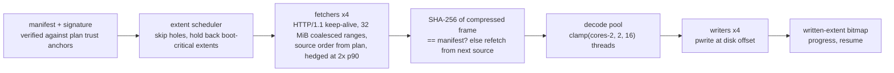

- **Verify before write:** the manifest signature is checked against trust anchors delivered in the
  **mTLS plan**, never fetched from the image source. Each compressed frame is hashed **before**
  decompression, so an unverified byte never reaches the decoder or the disk. A mismatch is retried
  once from the next source, then the deploy fails with `ImageIntegrity` (no retry, counted by the
  circuit breaker).
- **Bounded memory:** at most 32 extents in flight across the pipeline (≤ 128 MiB decoded plus
  compressed buffers), so a slow disk back-pressures the fetchers. Machines need ≥ 1 GiB of RAM;
  lab VMs get 2 GiB.
- **Hedged fetch, with a budget:** when a range takes longer than twice the running p90, the same
  range may be requested from the next source and the first verified answer wins. Hedges are
  capped at 5% extra bytes per agent and never go to the origin; a hedge that would exceed the cap
  or target the origin is not sent. This trims the tail at 1,000 concurrent deploys when one cache
  is hot without letting a slow cache move its load onto the origin.
- **Failover re-admits.** When a source fails (5 errors or a dead connection), the agent does not
  silently switch: it reports `SourceFailed{source}` over the session, the machine goes back to
  `AwaitingBandwidth`, and the admission controller grants a token for the next source in the
  plan's order (or the agent waits). The origin answers unadmitted range requests with
  `429 Too Many Requests` and `Retry-After`, checked against the tokens it knows about, so a dead
  rack cache turns into queueing instead of an overload of the origin (§9.5).
- **Throughput figure for the budget:** 30 s p95 on 10 GbE (§9.1), the low end of the research's
  contention-dominated 30–90 s range.
- **CPU:** the agent loads cpufreq drivers and sets the `performance` governor before streaming, the
  lesson of the MAAS deploy on NVIDIA Grace (46 minutes without a cpufreq driver, 20 with one,
  LP#2046452).
- **Throughput target** on 10 GbE, Gen4 NVMe and 8+ cores: network-bound at about 1.1 GB/s
  compressed in, so 2 GB compressed takes 2–3 s on an idle network; the 30 s p95 leaves room for TCP
  ramp-up and contention. Each stage (fetch, verify, decode, write wait) is timed and exported.

**Crash-safe write order.** A machine that crashes, loses power or panics in the middle of a write
must never boot a half-written image. The agent therefore:

1. verifies the manifest, checks plan consistency, and finds the block device whose `DiskId` equals
   the plan's target (no fallback, §4.3);
2. **invalidates** the disk first: zeroes the first and last 1 MiB (protective MBR, primary and
   backup GPT) and known signatures (md, LVM), then `fdatasync`. From here on the disk is not
   bootable;
3. **zeroes only the image's hole extents** inside the manifest's `virtual_size`, the only bytes
   the image needs to read as zero. On a block device `fallocate(PUNCH_HOLE | KEEP_SIZE)` is not a
   discard: the kernel maps it to a write-zeroes request with no fallback
   (`BLKDEV_ZERO_NOFALLBACK`), and it returns `EOPNOTSUPP` on devices without write-zeroes support
   (common on SATA SSDs, whose libata driver disables it, and on many `megaraid_sas` and
   `mpt3sas` volumes). A plain discard (`BLKDISCARD`) carries no zero-read guarantee at all. So the
   agent reads `queue/write_zeroes_max_bytes` for the target: when it is non-zero it uses
   `PUNCH_HOLE | KEEP_SIZE` (fast on NVMe namespaces that deallocate on write-zeroes, and on
   virtio), and on `EOPNOTSUPP` or a zero limit it writes zero pages over the hole extents
   (`ZERO_RANGE` or plain writes), timed and reported as `prep_mode = zero_fill`. The rest of the
   disk beyond `virtual_size` is not zeroed on the critical path; a best-effort `BLKDISCARD` of it,
   capped at 10 s, runs after `ImageWritten` when the device supports discard;
4. streams every extent **except the boot-critical set** listed in the manifest (the extents that
   hold the partition table, boot sector and the image's backup GPT), then `fdatasync`;
5. writes the boot-critical extents, relocates the backup GPT to the true end of the disk, adds the
   config-drive partition and writes the config-drive image (§10.6), then `fdatasync`;
6. reads back the partition table and the first extent and re-hashes them against the manifest
   (about 10 ms), which catches a wrong target or a silent write failure;
7. reports `ImageWritten`.

A crash before step 5 completes leaves no valid partition table, so firmware finds nothing to boot.
The kernel runs with `panic=0` (hang, never reboot into the disk), and the control plane's phase
deadline powers the machine off through the BMC (§10.7). The safe state is *off*.

`T_prep` depends on the device class: a 20 GB image with 14 GB of holes costs well under a second
with accelerated write-zeroes, about 5 s of zero-filling on an NVMe drive without it, and about
30 s on a SATA SSD. It is therefore reported with `prep_mode` and the device's transport and
model, and the rented-hardware run measures it per device class; the lab's QEMU NVMe on a host file
accelerates write-zeroes and does not show the slow path, so the nightly lab also deploys once to
a virtio-blk disk with `write-zeroes=off` (and a serial) to exercise the fallback.

### 9.4 End-to-end deploy sequence

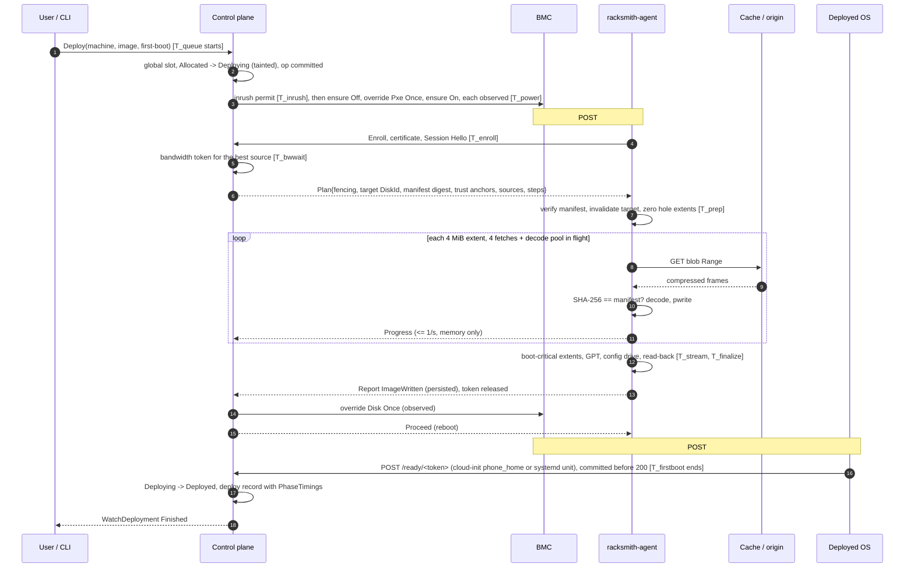

### 9.5 Distribution and admission for 1,000 concurrent deploys

[ADR 0022](../adr/0022-cached-image-distribution-and-admission.md).

**Volume.** 1,000 × 2 GB = 2 TB, plus 1,000 × (14 + 32) MB ≈ 46 GB of kernel and initramfs. In a
realistic 120 s transfer window that is about 133 Gb/s; one 100 GbE origin needs about 174 s just
to push 2 TB (boot-budget research). A single control-plane NIC cannot do it; caches can.

**Two-stage admission.**

1. **Global slot at `deploy`:** `active_deploys < max_concurrent_deploys` (default 1,000). Queued
   machines stay `allocated` in phase `Queued` with condition `Queued{position}`; the wait is
   `T_queue`, visible, never hidden.
2. **Bandwidth token at agent Hello, released when `T_stream` ends.** POST and bootstrap never hold
   egress. With admission at power-on, a GPU server's 90–240 s POST would hold a reservation and cut
   effective concurrency by about `(T_firmware + T_bootstrap) / W`, several times on exactly the
   hardware RackSmith targets. Waiting for a token happens with the agent connected (phase
   `AwaitingBandwidth`, timed as `T_bwwait`).

```
slots(source) = floor( 0.9 × E_source × W / S )
  E_source = usable egress of the source (bytes/s); W = stream window target (default 30 s);
  S = compressed image size; 0.9 = headroom
in-flight deploys a source sustains at p95 ≈ slots × T_deploy / W     (arrivals spread by POST jitter)
```

| Topology | Slots (S = 2 GB, W = 30 s) | 1,000 concurrent, p95 < 5 min? |
|---|---|---|
| Origin only, 2 × 25 GbE (≈ 5.8 GB/s usable) | 78 | **No** for a simultaneous wave (1,000 streams take about 385 s); about 700 in flight sustained at a 270 s deploy time. Published as the "bandwidth permitting" figure |
| Origin + 25 rack caches on 25 GbE (≈ 2.9 GB/s each; nginx in M1, configured as below) | 78 + 25 × 39 = 1,053 | **Modelled yes**; the origin serves 25 × 2 GB = 50 GB once *if* each cache fills once. Published as `modelled` until the cold-cache test below passes |
| P2P (M4, R22) on the same extent format | scales with N | Yes, without cache hardware (Uber Kraken: 3 GB to 2,600 hosts, p50 10 s) |

- `admission::admit(request, ledger, config)` is a pure domain function; the `AdmissionController`
  holds the ledger in memory and rebuilds it from open operations and connected sessions at startup.
- **Sources** are `ImageSource` objects with `egress_bytes_per_s` and a rack/site selector. The plan
  lists `[rack cache, site cache, origin]` and the agent fails over (and hedges) in that order.
- **Hedges and failover stay inside admission** (§9.3): hedges are capped at 5% extra bytes per
  agent and never target the origin; a failed source sends the machine back to
  `AwaitingBandwidth` for a token on the next source; the origin sheds unadmitted ranges with `429`
  and `Retry-After`. A dead rack cache therefore queues its 39 streams instead of adding them to
  the origin's 78 token holders.
- **Stage-2 boot files count against the origin.** Kernel plus initramfs (about 46 MB per boot) are
  served over HTTPS by the control plane's data runtime (§8.2) and are not cacheable while they
  need the pinned root, so the origin's `E_source` is reduced by the boot rate × 46 MB before
  slots are computed (about 0.8 GB/s for 1,000 boots spread over 60 s). If the week-1 measurement
  moves them to `imgverify` over plain HTTP (§8.2), caches serve them and the deduction disappears.
- **The nginx recipe** (`docs/ops/nginx-rack-cache.conf`, M1) is what makes "the origin serves
  each blob once" true for 32 MiB Range requests on a 2 GB object. Stock `proxy_cache` fetches the
  whole object from upstream on a Range miss, and without a lock each of about 40 concurrent first
  requests per rack goes to the origin. The recipe uses `ngx_http_slice_module` with
  `slice 32m` (equal to the agent's coalesced range and a multiple of the 4 MiB extent),
  `proxy_cache_key $uri$slice_range`, `proxy_set_header Range $slice_range`,
  `proxy_cache_lock on` with `proxy_cache_lock_timeout` and `proxy_cache_lock_age` of 30 s (the
  default 5 s timeout releases waiters to the origin uncached), `proxy_cache_valid 200 206 30d`,
  and relies on the origin's `Cache-Control: public, max-age=31536000, immutable` for
  content-addressed blob URLs.
- **Published figure:** `racksmith_image_slots{source}` and the derived in-flight figure are
  exported, printed by the benchmark harness, and checked by the load lab in both topologies. The
  1,000-concurrent cached figure stays labelled `modelled` until the nightly **cold-cache test**
  passes: at least 40 real-bytes agents pull one 2 GB rsimg through one cold nginx cache built from
  the recipe, and the test asserts that origin egress stays within 1.1 × the blob size (§13.2).

### 9.6 Recipes (R18: Ubuntu, Debian, Rocky/Alma, Flatcar, Talos)

- `images/recipes/<os>/recipe.toml` plus a script, run by `cargo xtask image build <os>` in CI
  containers: download upstream, verify upstream integrity in CI, convert, tune, encode to rsimg,
  and sign with the project's release key. What "verify upstream" means differs per OS, and the
  docs and T7 say so:

  | OS | Upstream artifact | Integrity check in recipe CI |
  |---|---|---|
  | Ubuntu 24.04 | cloud image + `SHA256SUMS` | `gpgv` over `SHA256SUMS.gpg` with the pinned Ubuntu cloud-image key |
  | Debian 13 | `cloud.debian.org` generic cloud image + `SHA512SUMS` | **no upstream signature exists** (the directory publishes only `SHA512SUMS`): HTTPS to `cloud.debian.org` plus a SHA-512 that the recipe pins in `recipe.toml` and a reviewer approves per bump. Building the image from `debian-cloud-images` in CI is the stronger M2 option |
  | Rocky 10 | GenericCloud image + `CHECKSUM` | `gpgv` over `CHECKSUM.asc` with the pinned Rocky key |
  | Flatcar stable | OpenStack image | `gpgv` over the `.sig` with the pinned Flatcar image-signing key |
  | Talos | Image Factory `nocloud` raw image for a pinned schematic ID | the recipe pins the schematic ID and the image's SHA-256 in `recipe.toml`. Talos's sigstore-signed release assets cover the `metal-*` images, not Factory `nocloud` images, so cosign verification applies only if the week-2 recipe spike finds a published signature for the chosen artifact; otherwise trust is HTTPS plus the pinned digest, documented |

  Upstream OpenPGP verification for recipes therefore happens in recipe CI; the binary uses `rpgp`
  only to check user imports (§9.2).
- **Tuning:** GRUB timeout 0, no snap seeding, `systemd-networkd-wait-online` bounded to 10 s,
  correct `console=`, cloud-init datasource list `[NoCloud]`, recipes ship a phone-home unit.
- **Targets:** Ubuntu 24.04, Debian 13, Rocky 10, Flatcar stable, Talos (nocloud platform image). The
  per-PR lab uses a small Debian image (about 300 MB); nightly deploys all five.
- **Distribution:** GitHub Releases and OCI artifacts on ghcr.io; users run
  `racksmith image import --oci ghcr.io/…`. The project release key ships in the binary as a default
  pool trust anchor.

### 9.7 Hand-off and the kexec plan

- **M1: reboot only.** After `ImageWritten`, the reconciler sets the boot override to `Disk, Once`
  and, once the override reads back, sends `Proceed`; the agent calls `reboot(Restart)`. If no
  OS-ready signal arrives by the hand-off deadline, retries go through the `HandoffPowerOff`,
  `HandoffOverride` and `HandoffPowerOn` phases (§4.4): observed off, override to disk, observed
  on. They are never a second write in the same attempt (I11). The lab exercises this real-BMC
  path, because the emulator turns the agent's reboot into a BMC-visible reset (§13.1).
- **Seams in M1:** `Handoff::Kexec { kernel, initrd, cmdline }` exists in the proto and the domain and
  is rejected with `UNIMPLEMENTED`; `Manifest.handoff` is reserved; `status.handoff`
  (`UNKNOWN | KEXEC_OK | KEXEC_FAILED`) is reserved and stays `UNKNOWN`.
- **M3:** the agent reads the two files named in `HandoffHint` from a read-only mount and loads them
  through `kexec_file_load` (an upstream rustix wrapper, a published `racksmith-sys` crate, or a
  static `kexec-tools` subprocess, decided by an M3 ADR). The control plane arms a hand-off deadline
  (default 120 s); on expiry it power-cycles through the BMC to disk, records `HandoffFallback`, sets
  `status.handoff = KEXEC_FAILED`, and later deploys on that machine choose reboot. The deploy is not
  failed and nothing is written twice (I11). Kexec stays opt-in per hardware profile until M3
  validates GPU and mlx5 device state. Parked agents (fast track) land in M3 on the reserved
  `status.agent.residency`.
- **Why not in M1:** kexec needs either `unsafe` or a GPL-2.0 subprocess and a mount in the initramfs,
  and its value appears only on real hardware with long POSTs, which M1 cannot test. A lab-only
  kexec spike is an M1-stretch item to de-risk M3 (owner decision, §16.5).

---

## 10. Agent design

### 10.1 Initramfs build (answers PRD §12 Q2)

[ADR 0016](../adr/0016-rust-pid1-agent-initramfs.md). `cargo xtask initramfs --arch x86_64|aarch64`:

| Input | Choice | Budget |
|---|---|---|
| Init | `racksmith-agent` as PID 1: static musl, LTO, `panic = abort`, stripped | ≤ 12 MiB (gated; includes rcgen for the CSR, about 0.3 MiB **[est]**) |
| Kernel | Debian stable signed `linux-image-*` pinned by SHA-256 (signed, so it is ready for the M2 shim chain); served separately | about 14 MiB |
| Modules | curated `agent/modules.list`, resolved with dependencies from `modules.dep`: virtio_net, e1000e, igb, ixgbe, i40e, ice, mlx5_core, bnxt_en; nvme, ahci, megaraid_sas, mpt3sas, virtio_blk; vfat; acpi-cpufreq, cppc_cpufreq. amd-pstate is not listed: since Linux 6.1 it can only be built in, so it never appears in `modules.dep`; it is selected with `amd_pstate=active` on the kernel command line (§8.2), and `xtask initramfs` fails on any listed module it cannot resolve | ≤ 14 MiB |
| Firmware | only blobs the NIC set needs (for example ice DDP, bnx2x), licenses recorded | ≤ 4 MiB |
| Tools | **none**: no shell, busybox, kexec-tools, e2fsprogs or container runtime | 0 |
| Output | `racksmith-agent-<arch>.cpio.zst`, `vmlinuz-<arch>`, CycloneDX SBOM, source-offer manifest for the GPL kernel | **≤ 40 MiB compressed (target 32 MiB), enforced by `cargo xtask size`** |

The cpio is written with the `cpio` crate (newc, sorted entries, fixed mtimes and uids,
`SOURCE_DATE_EPOCH`), so builds are reproducible and the digest is recorded in the release. Agents
are cross-built for `x86_64-unknown-linux-musl` and `aarch64-unknown-linux-musl`. Filesystem growth
is left to the OS (`growpart` on first boot), which keeps GPL filesystem tools out of the initramfs.

### 10.2 PID 1 duties

| Step | Target time | How |
|---|---|---|
| mount `/proc`, `/sys`, `/dev` (devtmpfs), `/run`; console logging | < 50 ms | `rustix::mount` |
| set the clock from `rs.now` when the RTC is more than 60 s off (so certificate checks work) | < 10 ms | `clock_settime` |
| load NIC and storage modules first by modalias, 8 parallel `finit_module` calls; the rest later | < 1.5 s | `rustix::system::finit_module` |
| set `scaling_governor = performance` on every policy | < 10 ms | sysfs |
| bring up `BOOTIF` from `ip=` through rtnetlink; own DHCP client (dhcproto) only if `ip=` is missing | < 500 ms | rtnetlink |
| fetch nothing to trust: the root fingerprint comes from `rs.ca` over the pinned HTTPS boot channel | — | — |
| generate an ephemeral P-256 key in RAM (ring), build the PKCS#10 CSR, read SMBIOS | < 100 ms | ring (key and signature), rcgen on its ring backend (CSR encoding; ring alone has no CSR or X.509 builder), smbios-lib |
| reap children; supervise the agent task; on a fatal error report it if possible, then `reboot(PowerOff)` | — | `rustix::system::reboot` |

M1 needs no `unsafe` and no subprocess: every syscall above has a safe wrapper in rustix or
rtnetlink (verified in the Rust-ecosystem research).

### 10.3 Enrollment and identity (R8, R27)

[ADR 0017](../adr/0017-agent-enrollment-and-built-in-ca.md).

```
agent: P-256 key generated in RAM, never written anywhere
agent -> :9443 (server-auth TLS; chain must end at the server root whose fingerprint is rs.ca;
                the leaf must carry serverAuth EKU and a SAN equal to the rs.cp host)
  Enroll { csr, boot_token?, identity { smbios_uuid, system_serial, board_serial, macs[], boot_mac },
           agent_version, initramfs_digest, arch }          // fields 20-29 reserved for TPM EK (M2)
control plane, ONE store transaction:
  token present: recompute for the open operation and attempt (constant-time compare);
                 unconsumed, within TTL, issued to exactly one tuple -> mark consumed
                 consumed already or tuple conflict -> mark_broken(boot_token_conflict) (§8.5)
                 bump enrollment_generation (every older certificate and session dies)
                 bind the attempt to this session: Operation.session = SPKI hash of the CSR key
  corroborate:   identity == BMC identity (Redfish UUID + serial + MAC set; IPMI GUID) when a BMC is known
  no token:      EnrollmentRequest under the enrollment policy (§8.6)
  issue certificate from a FIXED TEMPLATE: the CSR contributes its public key and nothing else
                     (subject, SANs, EKU, basicConstraints and extensions in the CSR are ignored);
                     CN=m-<id>, SAN URI urn:racksmith:machine:m-<id>:gen:<g>, EKU clientAuth only,
                     basicConstraints CA:false, 12 h, signed by the client issuing CA (§11.4)
reply EnrollResponse { cert_chain, cp_endpoints[], session_params }
```

- **Certificates bind `(machine, generation)`; plans bind to one session.** Operation fencing is
  per message (`op` and `attempt` in every report and plan, checked against `life.operation`). A
  token-consuming `Enroll` bumps the generation and records the new session's key in
  `Operation.session`, so a certificate obtained earlier, for example during commissioning or by
  an attacker who once won a race, is dead before the deploy plan exists, and the plan is pushed
  only on the bound session (§8.5). A new operation that does not power the machine (none in M1)
  could reuse the session; every M1 operation opens a power-on phase and therefore gets a fresh,
  token-bound session.
- **One live session per machine.** A second session for the same `(machine, generation)` is a
  conflict: both are closed, the attempt is closed with `mark_broken(session_conflict)`, and
  `BootTokenConflict` is raised.
- **Renewal is bounded.** `Renew` (at 50% of the lifetime) works only over the bound session, only
  while an operation is open, and never past the operation's deadline; an agent with no open
  operation gets no renewal and its certificate expires within 12 h.
- **Pending agents** (unknown machine awaiting approval) hold an enrollment-scoped certificate
  (`urn:racksmith:enrollment:<request-id>`, 1 h, client CA) that permits only inventory upload and
  waiting. Only under `auto-accept` does approval re-issue a machine certificate for the same key
  over the session; under the other policies the machine is commissioned through a
  control-plane-initiated, token-bound boot (§8.6).
- **Issuance is tested hostile.** The `enroll_request` fuzz target and a unit-test table feed CSRs
  that request CA:true, serverAuth, foreign SANs, other subjects and unknown extensions, and assert
  that every issued certificate equals the template.
- **There is no parking in M1.** After commissioning or a wipe the agent powers the machine off. A
  parked agent and its certificate rules are an M3 design item on the reserved residency field.
- **Revocation without CRLs:** on every new stream and every report, the gateway checks the SAN's
  generation against `life.enrollment_generation`. A bump (release, `mark_broken`, re-enrollment,
  restore, boot-token conflict) kills old certificates and sessions immediately; the 12 h lifetime
  bounds the rest.
- **TPM EK capture is M2** (R29 seed), with the proto fields reserved now.

### 10.4 Control channel (`AgentService.Session`, bidirectional gRPC over mTLS)

| Direction | Message | Semantics |
|---|---|---|
| A → CP | `Hello{machine, generation, op, attempt, last_acked_seq, max_term_seen, agent_version}` | first message; the control plane answers with the current plan only on the session bound to `(op, attempt)`, or nothing |
| A → CP | `Report{seq, op, attempt, PhaseStarted \| PhaseFinished{outcome, mono_start, mono_end} \| InventoryReady{digest, summary} \| ImageWritten \| SourceFailed{source} \| WipeDone{regions}}` | **persisted** edges; acked after commit; replayed after a reconnect; deduplicated by `(op, attempt, seq)` |
| A → CP | `Progress{op, bytes_fetched, bytes_written, extents_done, extents_total, rate, stage_times}` | ≤ 1/s, memory only, lossy |
| A → CP | `Log{op, lines}` | batched to 64 KiB or 1 s; written to the log segment store |
| A → CP | `Ping{agent_mono}` | every 10 s; the session is lost after 40 s of silence |
| CP → A | `Plan{op, fencing, CommissionPlan \| DeployPlan \| WipePlan}` | idempotent by `(op, attempt)`; rejected if `term < max_term_seen` or `(machine, generation)` differ from the certificate |
| CP → A | `Pong{agent_mono, cp_wall}` | carries the control-plane clock for skew estimation (§12.4) |
| CP → A | `Ack{seq}`, `Cancel{op, reason}`, `Renew{cert}`, `Proceed{step}` | |

**`DeployPlan`** = `{op, fencing, target: DiskId, image {manifest_digest, trust_anchors[], sources[]},
config_drive, steps[], deadline}`. Steps are a closed enum: `PrepareDisk`, `WriteImage`,
`Finalize`, `WriteConfigDrive`, `Handoff(Reboot | PowerOff)` (`Kexec` reserved). `Plan::validate`
checks step order, that every disk-writing step names the plan's target, and that the fencing
matches the session. It is a consistency check, not an authorization (§4.3).

**`WipePlan`** = `{op, fencing, targets: [DiskId], steps[], deadline}`, built from a
`MetadataWipe` grant. `targets` is the root disk, plus every other non-removable disk in the
commissioning inventory when the pool's `wipe_policy.scope` is `all-nonremovable` (the default
`root-only` wipes the root disk alone). Steps are a closed enum, executed in order on every target:

1. `ZeroHead`: the first 16 MiB (protective MBR, primary GPT, bootloader areas).
2. `ZeroTail`: the last 16 MiB of the device. This covers the backup GPT that §9.3 relocated to the
   true end of the disk **and the 16 MiB config-drive partition** (§10.6), which holds user-data
   and SSH keys in plain text.
3. `ZeroPartitionHeads`: the first and last 1 MiB of every partition in the current partition
   table, read before step 1, which removes filesystem superblocks, md and LVM metadata and
   LUKS headers.
4. `ZeroRanges{ranges}`: extra ranges from `wipe_policy.extra` (empty by default).
5. `Verify`: read back every zeroed region and check it is all zeros; the agent reports
   `WipeDone{regions}` with the verified byte ranges, and the control plane persists them in the
   release record.

`MachinePool.wipe_policy = { scope: root-only | all-nonremovable, extra: [ranges] }`. This is still
a metadata wipe, not sanitization (§11.1 T8); data blocks between the zeroed regions survive. The
canary test (§11.5) reads the config-drive region of a released lab VM's disk and fails if the
user-data canary is still there.

```mermaid
sequenceDiagram
    autonumber
    participant U as User / CLI
    participant R as Control plane
    participant B as BMC
    participant A as racksmith-agent
    U->>R: Release(machine) dry run, then confirm_destructive = plan_hash
    R->>R: deployed / allocated / broken -> releasing, Release op committed
    alt never tainted (allocated, no deploy)
        R->>R: release_completed with no power action (owner, root disk cleared)
    else tainted
        R->>B: ensure Off, override Pxe Once, ensure On (each observed)
        Note over B,A: POST, token-bound boot and Enroll as in §8.4 (generation bumped, session bound)
        A->>R: Session Hello{op, attempt}
        R-->>A: WipePlan{targets, ZeroHead, ZeroTail, ZeroPartitionHeads, Verify} (MetadataWipe grant)
        A->>A: zero regions, fdatasync, read back
        A-->>R: Report WipeDone{regions} (persisted, acked after commit)
        R->>R: releasing -> ready: clear tainted, owner, root disk; bump generation
        A->>A: power off (no parking in M1)
    end
    Note over R: wipe failure or deadline: release_failed -> broken, tainted unchanged
```

**Retry contract** (the Tinkerbell lesson): only the agent retries; the control plane never holds or
loops on a request. Unary calls have a 30 s deadline. Reconnects use full-jitter exponential backoff
from 1 s to 30 s. gRPC codes decide the action: `UNAVAILABLE` → back off and try the next endpoint;
`FAILED_PRECONDITION` (stale op) → re-`Hello`; `PERMISSION_DENIED` → power off. gRPC messages are
capped at 4 MiB (64 KiB for reports).

### 10.5 Inventory and commissioning (R23)

- **Fast identity at enrollment** (< 100 ms): SMBIOS UUID and serials, MACs.
- **Inventory step:** CPU (`/proc/cpuinfo`, topology), memory (`/proc/meminfo`, SMBIOS DIMMs),
  disks (`/sys/block`: size, model, serial, WWN or EUI-64/NGUID, rotational, removable, transport →
  `DiskId`), NICs (`/sys/class/net`: MAC, driver, speed, PCI address, link), PCI devices
  (`/sys/bus/pci/devices`: class, vendor, device), GPUs (PCI class 0x0300/0x0302), firmware versions
  (SMBIOS BIOS version; BMC-reported).
- **Storage:** a summary of 4 KiB or less goes into `life`/`obs` for allocation filters and disk
  resolution; the full JSON (zstd, ≤ 1 MiB) goes to the content-addressed blob store via `UploadBlob`.
- **Commissioning in M1** = inventory + disk readability (read the first and last 1 MiB of each disk)
  + NIC link checks. Burn-in, DCGM and fabric checks are M3 (R25) and plug in as new
  `CommissionPlan` steps.

### 10.6 First-boot configuration and the OS-ready signal (R19)

[ADR 0023](../adr/0023-config-drive-first-boot.md). One mechanism for every recipe, with nothing
mounted:

- After relocating the backup GPT, the agent appends a **16 MiB config-drive partition at the very
  end of the disk** and writes a vfat image built **in RAM** with `fatfs` (built with
  `default-features = false`, so no `chrono`; the agent sets every FAT timestamp explicitly from
  `rs.now`). The OS's `growpart` then grows the root partition into the free space between the
  image and the config drive.
  - `NOCLOUD`: label `CIDATA`, files `meta-data` (instance-id = deploy id), `user-data` (from the
    plan, including SSH keys), optional `network-config`. Used by Ubuntu, Debian, Rocky and Talos
    (nocloud platform image).
  - `CONFIGDRIVE2`: label `config-2`, `openstack/latest/user_data` (Ignition JSON) and
    `meta_data.json`. Used by Flatcar's OpenStack image.
- **The `FirstBootConfig` resource.** `racksmith.firstboot.v1alpha1.FirstBootConfig { metadata,
  format: CLOUD_CONFIG | IGNITION | TALOS_MACHINE_CONFIG, payload (input-only, sensitive) }`,
  stored at `fbc/<id>` with the payload AEAD-encrypted under the KEK (§11.5) and its digest in
  clear, served by `FirstBootConfigService` and `racksmith firstboot create|get|list|update|delete`
  (so `cargo xtask cli-coverage` sees it). `Assignment.first_boot_config` names one; the deploy
  rejects a format that does not match the image's `os_family`. The plaintext exists only in the
  control plane's memory while the plan is built and in the agent's RAM until it is written.
- **Composition with what RackSmith injects** (the phone-home with its ready token, and
  `Assignment.ssh_authorized_keys`), per format:

  | Format | How RackSmith's part is combined with the user's | SSH keys | OS-ready |
  |---|---|---|---|
  | `CLOUD_CONFIG` (Ubuntu, Debian, Rocky) | `user-data` becomes a MIME multipart: the user's part first, then RackSmith's `#cloud-config` part with `merge_how: list(append)+dict(no_replace,recurse_list)`. A user part that defines its own `phone_home` keeps it, and RackSmith's phone-home moves to a `runcmd` `curl` so the two never collide | appended to `ssh_authorized_keys` of the default user | `PHONE_HOME` |
  | `IGNITION` (Flatcar) | RackSmith writes its own Ignition config that sets `ignition.config.merge` to the user's config, which is inlined as a `data:` URL, so the user's config is applied and RackSmith adds a systemd unit and `passwd.users[core].sshAuthorizedKeys` | merged into `passwd.users` for `core` | `PHONE_HOME` (systemd oneshot) |
  | `TALOS_MACHINE_CONFIG` (Talos) | written unchanged as nocloud `user-data`; Talos runs no cloud-init | **not applicable**: Talos has no SSH, so a deploy with `ssh_authorized_keys` set is rejected with `SshKeysUnsupported` | `TCP_PROBE{50000}` |

- **OS-ready:** `PHONE_HOME` (cloud-init `phone_home` or `runcmd` in the injected user-data, or a
  oneshot systemd unit in the Ignition config) posts to `http://<ready address>/ready/<token>`
  (§2.2; by default the boot HTTP address on the provisioning network, [ADR 0033](../adr/0033-provisioning-network-boundary-and-os-ready-path.md)).
  The token is a 256-bit single-use value bound to `(machine, deploy op)`; it can only move that
  deploy from `AwaitingOsReady` to `deployed`, which is why plain HTTP is acceptable. The handler
  **commits the signal** as the `ready` edge in `m/<id>/obs` (op, attempt, source address, time)
  **before** it answers 200, so a crash after the 200 cannot lose it. A late or replayed POST is
  accepted (and answered 200 without a new write) while the deploy operation is open, in any
  phase from `Writing` on, so a phone-home that arrives early, or is retried by cloud-init after a
  control-plane restart, still counts.
- **`TCP_PROBE{port}`** (Talos: 50000) has the control plane probe every 5 s instead. In proxy mode
  RackSmith does not assign the deployed OS's address, so the probe target is chosen in this
  order: the full-mode reservation (§8.7); otherwise the address the agent reported from its
  `ip=` boot lease, which the site DHCP normally hands out again when iPXE and the deployed OS
  identify by the same boot MAC (an assumption **[est]** that the nightly lab checks per recipe
  against dnsmasq, and that sites can make certain with a reservation); otherwise no target, in
  which case the deploy sets
  `ReadyProbeAddressUnknown` and fails at its deadline. Static addressing through IPAM (M2) removes
  the guess. Which signal was used, and for a probe which address, is recorded with the timings,
  so benchmark comparisons stay honest.

### 10.7 Failure handling

| Failure | Agent | Control plane |
|---|---|---|
| Control plane unreachable mid-write | keeps writing until the plan deadline; buffers up to 1,024 reports; reconnects with jitter | on return, replays and deduplicates |
| Control plane unreachable after the write | waits for `Proceed`; after 30 min, powers off | deadline → hand-off retry or `deployment_failed` |
| Chunk fetch error | 5 retries with backoff, then `SourceFailed`; hedges within the 5% budget | back to `AwaitingBandwidth` for a token on the next source; source error rate feeds the circuit breaker |
| Chunk hash mismatch | retry once from the next source, then fail `ImageIntegrity` | `deployment_failed`, no retry, alert |
| Manifest signature invalid | refuses the plan; writes nothing | `deployment_failed` (`SignatureInvalid`), no retry |
| Target `DiskId` not present | fails `PrepareDisk` (`TargetDiskNotFound`) | `deployment_failed`; recommission needed |
| Disk write error | aborts; reports `DiskWriteFailed{disk, errno}` | `deployment_failed`, condition `DiskFault` |
| Stale plan (old generation, op or term) | rejects | counted, ignored |
| Agent crash or kernel panic | `panic=0`: the machine hangs; the partial disk is not bootable (§9.3) | phase deadline → `EnsurePower(Off)`, then the next attempt with a new token |

---

## 11. Security architecture

### 11.1 Threat model (the M1 column is what ships)

| # | Threat | M1 mitigation | Later |
|---|---|---|---|
| T1 | Rogue DHCP/PXE on the provisioning L2. **Attacker in M1: any host on the provisioning network, including every deployed OS** (they stay on it, [ADR 0033](../adr/0033-provisioning-network-boundary-and-os-ready-path.md)) | proxyDHCP by default; passive rogue-DHCP detection (metric + `doctor` probe); an attacker's iPXE cannot obtain a boot token for a machine it does not impersonate; DHCP snooping recommended; rating: **high likelihood in M1** wherever untrusted workloads run on deployed machines, which is why M1 claims a single trust domain | Secure Boot chain, separate tenant network (M2) |
| T2 | Stage-1 substitution (TFTP/HTTP NBP) | only the ~1 MB iPXE is unauthenticated; everything after is HTTPS with the server root pinned by serve-time injection (§8.3); the server root signs only server certificates, issuance ignores CSR contents, and verifiers check EKU and SAN (§11.4); documented residual risk | signed iPXE shim, firmware-enrolled CA (M2) |
| T3 | Spoofed agent (cloned MAC/UUID/serial). **Attacker in M1: any deployed OS**, which sees other machines' MACs and SMBIOS UUIDs in broadcast DHCP and, as a former tenant, knows serials | HMAC boot token per attempt, idempotent only for one tuple, conflict closes the attempt and bumps the generation (§8.5); a token-consuming `Enroll` bumps the generation and binds the plan to its own session, one live session per machine, renewal only while an operation is open (§10.3); BMC corroboration never replaces a token-bound boot (§8.6); settle window before plan push; per-MAC, per-IP and global enrollment limits. **User-data is exposed to a first-fetching attacker on the provisioning network until M2** | TPM EK pinning and credential activation (M2) |
| T4 | Malicious hardware or agent input | message caps (4 MiB, 64 KiB reports); strict `TryFrom` validation in `racksmith-proto`; fuzz targets on every agent-facing decoder; agents cause no lifecycle event (I10) | — |
| T5 | Previous tenant persists (BMC/UEFI implants, in-band KCS accounts) | one-time boot override only, never a persistent boot order; **M1 is declared single trust domain** | BMC account audit and credential rotation (M2, R30), attestation gate (M2, R29), firmware baselines and secure erase (M3) |
| T6 | BMC credential theft | field-level AEAD under a KEK (§11.5); redaction types; ciphertext-only snapshots; per-BMC TLS pin; Redfish sessions; IPMI RAKP weakness documented | rotation (M2), KMS/HSM KEK (M2+) |
| T7 | Image supply chain | recipe CI checks upstream signatures where they exist (Ubuntu, Rocky, Flatcar) and pinned, reviewed digests over HTTPS where they do not (Debian, and Talos Factory images unless a signature is found), §9.6; user imports need a pinned digest or a verifiable signature before the catalog key signs them (§9.2); signed rsimg manifest verified by the agent before any write; trust anchors only over mTLS; optional `require_external_signature` | Sigstore bundles (M2), SLSA provenance for imported images, Debian images built in CI (M2) |
| T8 | Data remanence | M1 release = metadata wipe with a defined region list including the config drive (§10.4), **explicitly not sanitization** | secure erase + verification records (M3) |
| T9 | Stolen API token, API abuse | hashed tokens, 90-day default expiry, roles, per-token and destructive rate limits, confirmation plan hashes, actor-attributed events | OIDC, scoped roles (M2) |
| T10 | Control-plane host compromise | unprivileged with two capabilities, systemd sandboxing, KEK outside the data dir (or TPM-sealed via systemd-creds), root CA key used only at init and issuing-CA rotation | HSM-held root (M2+) |
| T11 | DoS on boot and enrollment services | interface-scoped listeners, per-MAC and global rate limits, bounded queues, isolated boot runtime; tokenless `Enroll` only from DHCP-sighted MACs, per-MAC, per-IP and per-`BootNetwork` caps, a pending-blob byte cap and an alert at the cap (§8.6) | — |
| T12 | Stale state acting destructively (restore, stale agent, deposed leader) | fencing with the attempt, generation bumps, observe-only after restore and `RestoreUnverified` on every machine until verified (§6.6), `expected_term` | Raft term fencing (M2) |
| T13 | Wrong-disk wipe | target pinned to a stable `DiskId` at allocation; agent refuses without an exact match (§4.3) | — |

### 11.2 Trust boundaries

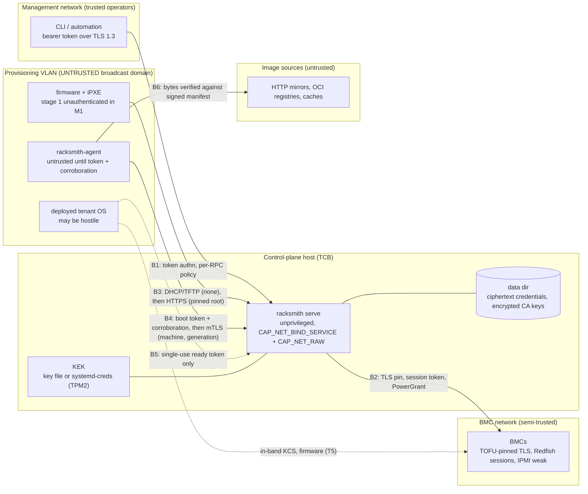

### 11.3 Boot chain by milestone

| Milestone | Chain | Integrity |
|---|---|---|
| **M1** (Secure Boot off) | proxyDHCP → TFTP/HTTP → release-built iPXE with the root fingerprint injected at serve time → HTTPS script, kernel, initramfs | stage 1 unauthenticated (documented); everything after authenticated. The boot HTTPS listener offers TLS 1.2 ECDHE-GCM because iPXE has no TLS 1.3; every other listener is TLS 1.3 only |
| **M2** (R29) | UEFI Secure Boot → iPXE signed shim → signed iPXE → HTTPS with the RackSmith root enrolled in firmware (Redfish `Boot/Certificates` where supported; OVMF `etc/edk2/https/cacerts` in the lab) → distro-signed kernel + agent initramfs; TPM measured boot and quote gate `allocate` (`attesting`) | firmware-enforced stage 1; the nightly lab runs an OVMF Secure Boot smoke test from M1 so the path stays warm |
| **M3+** | signed agent UKI; DPU-isolated boot (M4, R16) | full chain |

### 11.4 PKI and mTLS

The built-in CA lives in `racksmith-pki` (rcgen, x509-parser; ring as the only rustls provider).
Server and client certificates come from **separate hierarchies**, so a client certificate can
never act as a server to anything that pins the server root.

| Key | Algorithm, lifetime | Use | Storage |
|---|---|---|---|
| Server root CA | P-256, 10 years | signs the server issuing CA only; its fingerprint is injected into iPXE, passed to agents as `rs.ca` and pinned by the CLI | AEAD-encrypted under the KEK; decrypted only at `init` and issuing-CA rotation |
| Server issuing CA | P-256, 1 year | server certificates only (90 days, renewed at 50%) for :7443, :8443, :8444, :9443: EKU serverAuth, SANs set from configuration | encrypted; in memory while the server runs |
| Client CA | P-256, 1 year (root and issuer in one; nothing pins it except the agent gateway) | agent certificates (12 h) and enrollment certificates (1 h): EKU clientAuth only | encrypted; in memory while the server runs |
| Catalog signing key | P-256 | rsimg manifest signatures for user imports whose provenance was verified (§9.2), unless the pool requires external signatures | encrypted |
| Unverified-imports key | P-256 | signs imports made with `--allow-unverified-provenance`; never a default pool anchor | encrypted |
| Boot-token keys (versioned), ready-token key | 256-bit | §8.5, §10.6 | encrypted |

- **Issuance from fixed templates.** Every certificate is built from a template in
  `racksmith-pki`: the CSR contributes only its public key (after a proof-of-possession check of
  its signature); subject, SANs, EKU, key usage, basicConstraints (always CA:false for leaves) and
  every extension come from the template, never from the CSR. rcgen's CSR-to-params path, which
  copies requested SANs and extensions, is not used. Hostile CSRs are fuzzed and unit-tested
  (§10.3).
- **Verifiers check purpose.** The agent's TLS verifier requires the chain to end at the `rs.ca`
  server root, the leaf to carry serverAuth, and a SAN equal to the `rs.cp` host; iPXE pins the
  server root, which signs nothing else. The agent gateway accepts client certificates only from
  the client CA with clientAuth and the expected SAN form.
- `racksmith init` prints the server root fingerprint; `racksmith login --ca-fingerprint` pins it
  in the CLI. The bootstrap admin may use a Unix socket (`/run/racksmith/admin.sock`, mode 0600)
  instead.
- Revocation uses generation checks, not CRLs (§10.3). Issuing-CA rotation is a manual command in
  M1 and automatic in M2.
- No public roots are bundled (`webpki-roots` is CDLA-licensed and not on the allowlist). Outbound
  HTTPS from the control plane uses `rustls-native-certs` or a configured bundle; the agent needs
  none, because chunk integrity comes from the signed manifest.

### 11.5 Credentials at rest (R14) and redaction

[ADR 0021](../adr/0021-envelope-encryption-for-secrets.md).

```
KEK (KekProvider: key file 0400 outside --data-dir, generated by `racksmith init`;
     or systemd-creds via $CREDENTIALS_DIRECTORY, sealed by TPM2 and/or the host key)
 └─ wraps DEK_v{n} (random 256-bit, stored wrapped under pki/dek/<n>)
      └─ XChaCha20-Poly1305(secret, random 192-bit nonce,
           AAD = "racksmith/v1|{kind}|{resource_id}|{field}|dek_v{n}")
```

- **Covered:** BMC passwords, first-boot user-data, CA keys, catalog key, boot-token keys. The AAD
  binds each ciphertext to its record and field, so ciphertexts cannot be swapped between records.
- **Rotation:** `racksmith admin kek rotate` re-wraps DEKs (O(1)); DEK rotation re-encrypts lazily
  in the `BmcReconciler`.
- **Redaction is enforced by code:** `racksmith_domain::Secret<T>` has no `Serialize` or `Display`
  and its `Debug` prints `[REDACTED]`; `expose_secret` is source-banned outside four crates (§3.2);
  `sensitive` proto fields are input-only (`xtask proto-check`); a tracing layer drops fields named
  `password`, `token` or `secret` as defence in depth.
- **Canary test** (lab, every PR touching BMC, API or logging code, and nightly): register a BMC with
  password `RSK-CANARY-<random>` and user-data holding a second canary, run commission, deploy and
  release, then search logs, traces, metrics, every gRPC and REST response, `state.redb` and a
  snapshot. Any hit fails the build.

### 11.6 Image signing and provenance

- rsimg manifests are signed with ECDSA P-256 in cosign `sign-blob` format (`p256` crate, about 200
  lines, fuzzed).
- **Trust anchors** are per pool (`pool.spec.image_trust`, defaulting to the project release key
  plus the catalog key) and travel to the agent in the mTLS plan. `require_external_signature`
  drops the catalog key, so a compromised control plane cannot sign an image by itself. Which
  default to ship is an [owner] decision.
- **M2 (R30):** Sigstore bundles verified offline with `sigstore-verify`, the trusted root refreshed
  through TUF on the control plane, never in the agent. RackSmith's own release artifacts (binary,
  initramfs, iPXE) carry SLSA provenance from M1 CI.

### 11.7 Authentication and authorization (R28)

[ADR 0020](../adr/0020-static-tokens-and-per-rpc-authorization.md).

- **Tokens:** opaque `rsk_<id>_<secret>` with a 256-bit secret, stored as SHA-256 and compared in
  constant time; fields: principal, role, optional CIDR allowlist, expiry (default 90 days), last
  used. `racksmith init` writes one bootstrap admin token to a 0600 file. There is no default
  password.
- **Principals:** `User{token_id, role}`, `Agent{machine, generation}`, `Enrollment{request}`,
  `ReadyToken{machine, op}`, `System{controller}`. Agents and phone-home callers never reach the user
  API listener.
- **Policy as contract:** every RPC declares
  `option (racksmith.options.v1.policy) = { action: "machine.deploy", min_role: OPERATOR, resource: "machine" }`.
  `xtask codegen` builds the policy table used by the one authz layer shared by gRPC and REST; an RPC
  without the option fails CI (default deny).
- **Decision point (pure, in the domain):**
  `authorize(principal, action, ResourceAttrs { kind, id, pool, site, tenant, owner }) -> Decision`.
  M1 checks role only. The `tenant` attribute exists in every `v1alpha1` resource, so PRD Q5's
  multi-tenant model (scoped roles, OIDC groups, or Cedar policies in M2) lands behind this function
  without touching call sites. OIDC arrives in M2 behind `Authenticator` (answers PRD Q4).

### 11.8 Audit in M1 (a minimal pull-forward of R31)

- Every lifecycle transition, power action, enrollment decision, token create/revoke, BMC credential
  write (metadata only), KEK/CA operation and restore/resume writes an `ev/` row
  `{revision, time, actor, principal, request_id, trace_id, machine, from, event, to, op, reason}`
  **in the same transaction** as the change, and emits it as a `tracing` event with target
  `racksmith::audit` for log shipping. Retention is 7 days in the store (configurable); longer
  retention is the log pipeline's job.
- **M2:** a hash chain with signed checkpoints, credential-read records and the post-release BMC
  account audit. **M3:** sanitization records. This pull-forward is an [owner] decision.

### 11.9 Isolation statement and install prerequisites

| Property | M1 | M2 | M3 |
|---|---|---|---|
| API tenancy | `tenant` attribute exists; role checks only | OIDC groups → tenant-scoped roles | — |
| Data between tenants | metadata wipe only (**not isolation**) | — | secure erase + verification (R21) |
| Platform integrity between tenants | one-time boot override | BMC credential rotation, account audit, attestation gate | firmware baselines, KCS lockdown |
| Claim the docs may make | "single trust domain" | "attested allocation" | "tenant reprovisioning" |

**Install prerequisites** (documented, checked by `racksmith doctor` where it can, §12.5): the
provisioning network carries no traffic from parties outside the installation's trust domain;
switches use edge ports and, where available, DHCP snooping; no foreign DHCP server answers PXE
clients on the provisioning network (unless `proxy` mode is intended next to the site DHCP); the
management API is not exposed on the provisioning network.

**What M1 does not claim** ([ADR 0033](../adr/0033-provisioning-network-boundary-and-os-ready-path.md)).
In M1 the deployed OS keeps using its boot interface, so deployed machines are on-link on the
provisioning network, and a prerequisite that the provisioning network "carries no tenant
traffic" cannot be met. M1 therefore does not promise isolation of the boot and enrollment
services from deployed machines: T1 and T3 are rated with any deployed OS as a possible attacker,
and the fixes above (session-bound plans, generation bump on a token-consuming `Enroll`, separate
server and client CAs, enrollment only from DHCP-sighted MACs) are what limit it. Sites that
need more give deployed machines a separate tenant interface or VLAN through `network-config` and
declare the tenant subnets in `[network] tenant_subnets`; `racksmith doctor` then fails if any
provisioning interface address or relayed provisioning subnet overlaps a declared tenant subnet.
A VLAN flip after hand-off through switch integration is an M2 item.

---
## 12. Observability and operations

### 12.1 Metrics (Prometheus, `prometheus-client`, `:9464/metrics`)

| Metric | Type | Labels | Purpose |
|---|---|---|---|
| `racksmith_deploy_phase_seconds` | histogram (0.1 s … 900 s) | `phase`, `pool`, `image`, `handoff`, `outcome`, `environment`, `post_profile` | R20 and §7 per-phase timings |
| `racksmith_deploy_total_seconds` | histogram | `image`, `outcome`, `environment`, `post_profile` | end-to-end number |
| `racksmith_deploy_controlled_seconds` | histogram | `environment`, `post_profile` | the RackSmith-controlled subtotal (§9.1); **the regression metric** |
| `racksmith_deploy_total` | counter | `outcome`, `reason`, `pool`, `image` | success rate |
| `racksmith_deploys_active`, `racksmith_deploys_queued` | gauge | — | global admission |
| `racksmith_image_slots`, `racksmith_image_tokens_in_use` | gauge | `source` | bandwidth admission, published figure |
| `racksmith_agent_stage_seconds` | histogram | `stage` (fetch, verify, decode, write) | where agent time goes |
| `racksmith_agent_stream_bytes_per_second` | histogram | `source_kind` (cache, origin) | distribution health |
| `racksmith_lifecycle_transitions_total` | counter | `from`, `event`, `to`, `actor_kind` | lifecycle flow |
| `racksmith_machines` | gauge | `state`, `pool` | fleet shape |
| `racksmith_queue_depth`, `racksmith_queue_oldest_seconds` | gauge | `controller`, `lane` | R38 queue depth; herd detection |
| `racksmith_reconcile_seconds`, `racksmith_reconcile_errors_total` | histogram, counter | `controller`, `result` / `kind` | reconciler health |
| `racksmith_bmc_requests_total`, `racksmith_bmc_request_seconds`, `racksmith_bmc_inflight` | counter, histogram, gauge | `driver`, `op`, `status`, `vendor` | BMC health, semaphore saturation |
| `racksmith_store_commit_seconds`, `racksmith_store_batch_size`, `racksmith_store_file_bytes` | histogram, gauge | — | group commit, growth |
| `racksmith_watch_dropped_total` | counter | `consumer` | slow watchers |
| `racksmith_agent_sessions`, `racksmith_agent_stale_reports_total` | gauge, counter | `purpose` | agent fleet, fencing hits |
| `racksmith_dhcp_packets_total`, `racksmith_rogue_dhcp_offers_total` | counter | `mode`, `type` / `server_ip` | boot services, T1 |
| `racksmith_enrollment_total`, `racksmith_boot_token_conflicts_total` | counter | `result`, `reason` | T3 signals |
| `racksmith_api_request_seconds` | histogram | `service`, `method`, `code` | §7 p99 |
| `tokio_*` runtime metrics | gauge | `runtime` (control, boot) | starvation, the reason for §2.3 |

Machine ids are never labels; per-machine data lives in traces, events and deploy records.
Histograms take `Duration::as_secs_f64`, so our code does no float arithmetic and the
`float_arithmetic` lint stays intact.

### 12.2 Tracing

- One span per reconcile (`reconcile{controller, key, lane, attempt}`), with child spans for BMC calls,
  store commits and plan sends.
- **One trace per deploy**, rooted at the API request; its `trace_id` is stored in the operation
  record. The agent does **not** link OpenTelemetry (it keeps the agent binary inside its size gate):
  it reports monotonic phase timestamps, and the control plane creates synthetic child spans from
  them when the report arrives. That gives one trace across control plane, agent and BMC calls
  (R38) without a second exporter in the initramfs [owner: confirm this reading of R38].
- Export over OTLP (`opentelemetry-otlp` over tonic, same rustls/ring stack), off by default.
  Sampling: parent-based, 100% for deploys, 1% for resync reconciles.

### 12.3 Logs

`tracing` JSON lines on stdout (journald). Every line carries `request_id`/`trace_id`, `machine` (as
a field) and `op`. Agent console output and logs go to `logs/` segments, read with
`racksmith machine logs NAME [--deploy ID]`. A secret-field filter layer runs as defence in depth.

### 12.4 Deploy timing capture (the benchmark is a product feature)

- `PhaseTimings { phases: [ {phase, start, end, clock: Cp | Boot | Agent | Os, error_bound} ], total,
  controlled_total, ready_signal, handoff_mode, environment, post_profile }` is stored in the deploy
  record (`dr/…`), streamed in `WatchDeployment` and exported to the histograms.
- **Boundaries come from the clock that observes them:** `T_power` from the control plane's BMC call
  timestamps; `T_firmware` ends at the boot services' first DISCOVER for the MAC; `T_pxe` and
  `T_ipxe` from boot-service transfer completions; `T_enroll` from the gateway; `T_prep` through
  `T_finalize` from agent reports; `T_firstboot` ends at the ready signal.
- **Agent clock-skew correction (Cristian's algorithm):** the agent's `Ping` carries its monotonic
  time, and each `Pong` returns it with the control plane's wall clock. The agent keeps the
  minimum-RTT sample as its offset estimate and attaches `{offset, rtt}` to every report; the
  control plane converts agent monotonic offsets onto its own clock, with an error bound of ± RTT/2,
  and records which clock produced each phase.
- `racksmith machine timings NAME` prints them; `racksmith bench report` aggregates p50, p95 and
  p99 per phase into the JSON format published under `docs/benchmarks/`.

### 12.5 Health, readiness and `racksmith doctor`

- `/healthz` (process alive), `/readyz` (store open, migrations done, listeners bound, not in
  observe-only mode, or reports it), `/debug/queues` (admin token).
- **`racksmith doctor`** preflight, also run by `racksmith init`:
  - interfaces, addresses, port bindability, capabilities;
  - **provisioning isolation:** sends a DHCPDISCOVER with PXE options and reports foreign OFFERs;
    warns when a provisioning interface carries the default route or the management API address;
  - relayed `BootNetwork`s: each `cp_address` is bound and each relay address answers (§8.10);
  - declared `[network] tenant_subnets` do not overlap any provisioning address or relayed subnet
    (§11.9);
  - boot artifacts present, digests matching the binary's pinned list (§12.6);
  - clock sync, KEK readability, data-dir permissions, free disk, redb integrity;
  - CA and issuing-CA expiry; a reachability sample of registered BMCs;
  - `/dev/kvm` presence when `--lab` is set.
- `racksmith admin {snapshot, restore, resume, migrate, kek rotate, boot-key rotate, dump, compact}`.

### 12.6 Configuration, packaging and upgrades

```toml
[server]    data_dir = "/var/lib/racksmith"; api_listen = "0.0.0.0:7443"; metrics_listen = "127.0.0.1:9464"
[runtime]   control_threads = 0; boot_threads = 2; data_threads = 0        # 0 = computed default (§2.3)
[store]     cache_mb = 256; snapshot_interval = "6h"; snapshot_keep = 8; event_retention = "7d"
[boot]      interfaces = ["enp65s0"]; dhcp_mode = "proxy"; enrollment_policy = "require-approval"; ready_listen = ""   # "" = boot HTTP address
[network]   tenant_subnets = []                                           # for the doctor overlap check (§11.9)
[bmc]       inflight_global = 200; poll_idle = "120s"; poll_inflight = "10s"; ipmi_min_interval = "5s"
[deploy]    max_concurrent = 1000; stream_window = "30s"; agent_arrival = "10m"; deadline = "30m"; attempts = 2
[images]    origin_listen = "0.0.0.0:8444"; dir = "/var/lib/racksmith/images"
[security]  kek = { provider = "file", path = "/etc/racksmith/kek" }
[telemetry] otlp_endpoint = ""; log_format = "json"
```

- **Config:** one TOML file (`/etc/racksmith/racksmith.toml`), validated at startup into a typed
  `Config`; unknown keys are errors. `RACKSMITH_CONFIG` is the only environment variable read (in
  `racksmith-cli`, never in the domain).
- **Packaging:** a static `racksmith` binary for x86_64 and aarch64 (glibc static-pie for the
  server; musl plus mimalloc as the alternative, chosen by the week-6 RSS measurement), plus
  `racksmith-agent-<arch>.cpio.zst`, `vmlinuz-<arch>` and the iPXE builds as release assets; a
  hardened systemd unit (`User=racksmith`, `AmbientCapabilities=CAP_NET_BIND_SERVICE CAP_NET_RAW`,
  `ProtectSystem=strict`, `ReadWritePaths=/var/lib/racksmith`, `NoNewPrivileges`,
  `SystemCallFilter=@system-service`, `LoadCredentialEncrypted=kek`); an OCI image for running the
  binary as a StatefulSet before the operator exists.
- **Boot artifacts** (iPXE builds, `vmlinuz-<arch>`, `racksmith-agent-<arch>.cpio.zst`) are
  release assets, not embedded in the binary (the `include!` ban and a 60–100 MB binary rule that
  out). Each release binary carries a **pinned list** of their SHA-256 digests and sizes for its own
  version: a constant table in `racksmith-cli` that the release pull request updates from the
  reproducible artifact build and that a release check compares with the built assets. Install
  paths:
  - **online:** `racksmith init` downloads the assets for its version and arch set from the
    release URL over HTTPS (`rustls-native-certs` or the configured bundle) and verifies every
    digest against the pinned list before writing `data/boot/`;
  - **air-gapped:** the operator copies the release's `racksmith-boot-<version>.tar` next to the
    binary and runs `racksmith admin boot-artifacts import DIR`, which verifies the same digests;
    `init --offline` does this automatically when the tarball is beside the binary;
  - `[boot] arches` (default `["x86_64"]`) selects which arches are installed; `aarch64` adds the
    arm64 iPXE build, kernel and initramfs.
  `data/boot/` is content-addressed (`sha256/<digest>`), so old and new artifacts coexist.
  **Upgrades:** the new binary installs its artifacts before it starts serving; boots in flight
  keep the URLs (and digests) in their scripts, so they finish on the old initramfs, and old
  artifacts are garbage-collected once no open operation references them and 24 h have passed.
  **Version skew:** a script names the exact initramfs digest, so an HTTP cache can only serve the
  bytes the script asked for; the control plane accepts agent protocol N-1 (negotiated in `Hello`),
  which covers an agent from the previous release finishing its boot during an upgrade.
- **Quickstart** (< 15 min, CI-tested): `racksmith init` (config, KEK, CA, boot key, admin token,
  verified boot artifacts, doctor; no toolchain, no image build) → `racksmith serve` →
  `racksmith bmc add NAME … --create-machine` (the machine is created in `new` from the BMC's
  identity, §8.9) → `racksmith machine commission NAME` (the boot MAC is learned on this boot) →
  `racksmith image import --oci ghcr.io/…/debian` → `racksmith machine deploy NAME`. Under
  `init --lab` the pool's `auto-commission` policy makes the commission step automatic.
- **Upgrades (single node):** replace the binary and restart. On SIGTERM: stop admitting, finish
  store batches, delete BMC sessions, leave agents running (they reconnect within 1–30 s), exit
  within 30 s. On start: automatic pre-migration snapshot, then migrations. In-flight deploys
  continue because the data path is agent ↔ origin/cache; agents retry chunks while the origin
  restarts. Boot-artifact skew is handled as described above.
- **Upgrades (M2 HA):** rolling, one replica at a time, leader transferred last.

### 12.7 Memory budget at 10k (RSS < 2 GB)

| Item | Budget |
|---|---|
| Object cache (10k × about 8 KiB decoded) + indexes | 120 MiB |
| Store key index (about 70k keys) | 10 MiB |
| Watch ring (byte-capped) | 128 MiB |
| redb page cache (explicit) | 256 MiB |
| Agent sessions (1,000 active × about 100 KiB; cap 4,096) | 100–400 MiB |
| BMC client state (10k session tokens, 200 TLS connections) | 30 MiB |
| Queues, delay heap, deadlines | 10 MiB |
| API connections, 200 watch streams, buffers | 100 MiB |
| Image origin buffers (`sendfile`; page cache is not RSS) | 50 MiB |
| Allocator overhead (× 1.3) and runtimes | about 250 MiB |
| **Total** | **about 1.05–1.35 GiB**; the load-lab gate fails above 1.8 GiB |

### 12.8 Alerts shipped as Prometheus rules (`docs/ops/alerts.yaml`)

`DeployP95Regression`, `DeployFailureRateHigh` (> 5% over 30 min), `QueueOldestP0` (> 30 s),
`BmcErrorRateHigh{vendor}`, `StoreCommitP99High` (> 50 ms), `WatchDrops`, `RogueDhcpDetected`,
`BootTokenConflict`, `EnrollmentRejectedSpike`, `CaExpiringSoon`, `SnapshotStale`, `RssHigh`,
`ImageDeployFailing` (circuit breaker open), `ObserveOnlyMode` (restore not yet resumed),
`RestoreUnverifiedMachines` (machines still awaiting `restore-verify`), `EnrollmentCapReached`,
`ManualPowerRequired`.

---

## 13. Testing and verification strategy

### 13.1 Virtual lab (ADR 0010): `racksmith-sim --qemu` and `cargo xtask lab`

[ADR 0026](../adr/0026-racksmith-sim-and-tiered-lab.md).

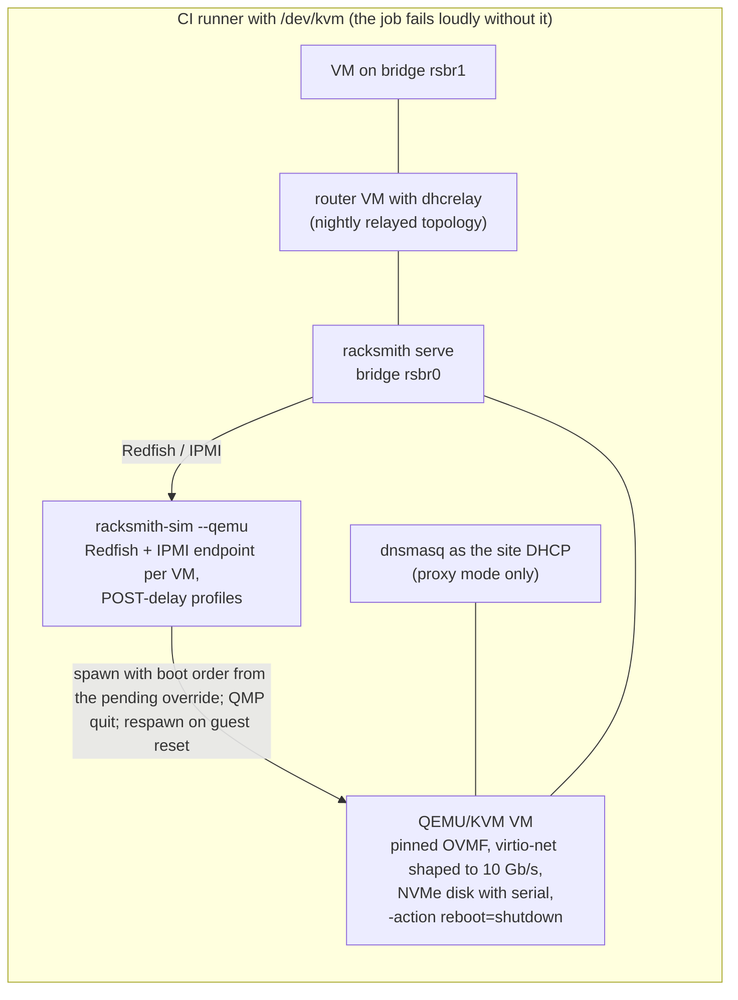

- **`racksmith-sim --qemu`** is our own BMC emulator. Power-on spawns QEMU with network or disk
  first according to the pending one-time override, after sleeping `--post-delay` to model POST.
  Power-off sends QMP `quit`; `GracefulShutdown` sends `system_powerdown`. QEMU runs with
  `-action reboot=shutdown`, so a guest reboot (the agent's `reboot(Restart)` at hand-off, or a
  reboot inside the deployed OS) makes QEMU exit instead of resetting in place. The sim treats that
  exit as a **reset**: it consumes the pending one-time override (applying `Disk, Once` if the
  control plane set it), sleeps `--post-delay` again for POST #2, and respawns with the resulting
  boot order, exactly as a real BMC-managed machine would. Each spawn is logged with its boot
  source, and the lab asserts that the second boot of every deploy came from disk **through the
  override**, with no DHCP or iPXE traffic from the VM in between. Running one sushy-tools and one
  VirtualBMC per VM on every PR would be slower and flakier, so those two serve as nightly
  **conformance oracles** for our Redfish and IPMI clients instead.
- **Per-PR `lab-e2e`** (target ≤ 15 min): one UEFI VM, the small Debian recipe, proxyDHCP against
  dnsmasq, Redfish: BMC-first machine creation → commission (boot MAC learned) → deploy →
  OS-ready → release (config-drive region verified zero), then a `kill -9` of the control plane
  during `Writing` and an assertion that the redeploy completes with no write outside a committed
  operation. Uploads boot logs, agent logs, pcaps and the deploy record as artifacts for reviewers
  (the verification tier of the trust pyramid). It is **functional evidence**: it runs one small
  image once and checks a generous time ceiling (10 min) only to catch gross regressions; it does
  not verify the p95 target. It becomes a required check once stable (target week 9).
- **Nightly, split across parallel jobs** so that no job exceeds the 6 h limit of hosted runners
  and timed runs never share a disk with other VMs:
  - `lab-nightly-bench` (**the M1 p95 verifier**): the 2 GB benchmark image, profile `post-0`,
    reboot hand-off, **60 runs**, on one dedicated runner with local NVMe that runs nothing else
    during the job (about 2.5 h: about 150 s per deploy-plus-release cycle). It reports the
    empirical p95 and the distribution-free one-sided 95% upper confidence bound for p95, which
    for n = 60 is the largest sample (P(max ≥ true p95) = 1 − 0.95⁶⁰ ≈ 95%). The M1 exit
    criterion needs both under 300 s. With only 20 runs the empirical p95 (the 19th order
    statistic) would understate the true p95 about 74% of the time, which is why the gate does not
    use 20.
  - `lab-nightly-functional` (three shards on hosted KVM runners, about 1 h each): all 5 recipes;
    full DHCP mode; the relayed topology (§8.10) in full and proxy mode; legacy BIOS (SeaBIOS)
    once; UEFI HTTP Boot once; IPMI path; a BMC-less machine through manual power; rogue DHCP
    (assert the metric); boot-token conflict (fetch the script from a second tuple, assert the
    attempt closes); a second session for one machine (assert the conflict); the canary
    credential test; the restore drill (§6.6); the upgrade test N-1 → N → N-1; the quickstart
    timing; an OVMF Secure Boot smoke test; the write-zeroes fallback (§9.3); hand-off retry after
    a hung OS (assert the `Handoff*` phases and no second write); sushy-tools and VirtualBMC
    conformance; an aarch64 VM (TCG, functional only, not timed).
  - the load lab (§13.2) on its own runner.
- **Weekly `lab-weekly-post`:** profiles `post-90`, `post-180` and `post-240`, 20 runs each, one job
  per profile on its own runner (each at most about 3.5 h). These runs show how the number moves
  with POST; with n = 20 they are published as indicative (empirical p95 and the sample maximum,
  which is only a 64% upper bound), never as the gate.
- **Runner and trigger path for bot PRs (owner decision: self-hosted only).** All lab jobs run on
  the maintainer's own KVM hardware. The per-PR job uses an ephemeral self-hosted VM runner,
  created for one job and destroyed after it, with no secrets, no persistent state and no network
  path beyond the lab. It starts automatically for maintainer PRs; for PRs from the agents' bot
  account or from forks it starts only after a maintainer reads the diff and applies a label, and
  the repository requires approval before outside contributors' workflows run. The nightly
  benchmark host (local NVMe), the load lab and the weekly profile runs are scheduled against
  `main` only, never triggered by a PR. **Runner class is part of every
  result:** the environment fingerprint records the runner type, CPU model, disk model and
  whether it is local NVMe or network-attached, the OVMF and kernel versions, and the QEMU cache
  mode; hosted runners (network-attached SSD, limited free disk) are never used for timed runs.
- **Disks:** raw sparse files on the runner's disk. Timed runs use `cache=none,aio=native`
  (O_DIRECT), so the guest's `fdatasync` reaches the disk and `T_stream` measures the runner's
  disk rather than host RAM; functional runs may use `cache=unsafe` for speed. The cache mode is
  recorded in the results.

### 13.2 Load lab: `racksmith-sim --fleet 10000`

- **BMC simulator:** 10k virtual Redfish endpoints in one process on distinct `127.10.x.y:443`
  addresses (all of `127.0.0.0/8` routes to `lo`), rustls with a sim CA, per-endpoint state
  machines. Vendor profiles from fixtures: GET p50 300 ms / p99 3 s, reset 1–5 s, session limits
  with 503 + Retry-After, 409 during POST windows. 10% of endpoints speak IPMI over UDP with 1%
  loss.
- **Agent simulator:** the **real `racksmith-agent` library** (session client, plan validation,
  report replay, skew handling) with a throttled fake block device (1–2 GB/s) and two image modes:
  **virtual** (the sim origin returns sizes and timings, so 2 TB never moves) and **real bytes** (50
  agents pulling real rsimg frames to calibrate the origin and admission). Boot services are
  bypassed: agents "boot" a profile-driven delay after the simulated power-on with a PXE override.
  **Rack labels:** the fleet is laid out 40 machines per `rack` label (250 racks at 10k), so
  `deploy-1000` exercises the per-rack inrush limiter and measures `T_inrush`.
- **Cold-cache test** (nightly, real bytes): 40 agents pull one 2 GB rsimg through one cold nginx
  cache configured from the M1 recipe (§9.5) in front of the real origin; the test asserts that
  origin egress stays within 1.1 × the blob size and that no agent fell back to the origin. Until
  it passes, the cached-topology result of `deploy-1000` is published as `modelled`, because the
  virtual mode only feeds the slot formula back to itself.
  A DHCP packet generator for 10k DISCOVER packets per minute is **[M1-stretch]**.
- **Scenarios and gates** (nightly and before releases, seeded):
  - `enroll-10k`;
  - `steady-10k` (1 h): **API read p99 < 50 ms at 200 rps**, **RSS < 2 GB** (fail above 1.8 GiB),
    about 83 BMC GET/s, store writes < 100/s;
  - `deploy-1000` in two topologies (caches with ≥ 1,000 slots: p95 < 5 min of simulated time with
    `T_inrush` included, zero lost deploys, `T_inrush` p95 ≤ 20 s with pre-staggering; origin only:
    queueing matches the published slot figure); one cache is killed mid-wave and the origin's
    request rate must stay within its token count (no hedge or failover bypass, §9.5);
  - `power-restore` (10k BMCs gone for 5 min, then back): P0 action latency p99 < 2 s, API p99 still
    < 50 ms (the runtime-isolation check). It runs a second time *during* `deploy-1000` with 10%
    slow BMCs, and P1 report acks must stay under 1 s p99, which checks that BMC waits never hold
    reconcile workers (§7.3);
  - `chaos`: `kill -9` of the control plane every 10 min during `deploy-1000`, 10% slow BMCs, session
    exhaustion. **No plan is ever sent without a committed open operation**; every deploy ends
    `deployed` or `broken` with a reason; the sim checks I6–I12 against its effects log;
  - `leader-kill` (M2).
  - **Regression rule.** PRD §11 asks for benchmark p95 tracked **per release** with no regression
    over 10%; that rule is applied when a release is cut. The nightly gate goes beyond the PRD (a
    design choice): a metric fails when both its median and its p95 are more than 10% worse than
    the median of the previous 14 nights *and* a one-sided Mann–Whitney test at the 5% level
    agrees, so one noisy night on shared infrastructure does not fail the build. Results are JSON
    under `docs/benchmarks/`, labelled `simulated`.
- **Runner:** 16–32 vCPU, 32–64 GB, control plane and sim in separate cgroups, `ulimit -n 65536`;
  the full nightly takes about 75 min.

### 13.3 Contract tests per port (`racksmith-testkit`)

| Port | Suite checks |
|---|---|
| `Store` | linearizable commits under concurrency; compares; one transaction = one revision; `Append` keys carry the committing revision and never collide; gap-free ordered watch under concurrent writers; `Compacted`, `ResyncRequired`; snapshot isolation; limits; durability across `kill -9`; model-based proptest against the in-memory store |
| `PowerDriver` | ensure-level idempotency; the override is `Once` and consumed after one boot; 409/429/503/401 classification; timeouts; session reuse and cleanup; TLS pin mismatch → `CertificateMismatch`. Runs against recorded fixtures (sushy-tools, DMTF mockups, donated vendor responses) and nightly against sushy-tools and VirtualBMC |
| `Dhcp`, `Ipam`, `Dns` | idempotent ensure and release; uniqueness under concurrency; persistence across restart; atomic zone-file replacement |
| `KekProvider` | wrap/unwrap round trip; wrong key fails; AAD binding |
| `Authenticator` | expired, revoked and wrong-secret tokens; constant-time path |
| `BootTokens` | recompute equals issue; key rotation keeps the previous version valid for 1 h; constant-time verify; a token for one `(machine, op, attempt)` never verifies for another |
| `AgentSessions` | ack only after commit; replay and dedup by `(op, attempt, seq)`; `last_report_seq` reset on a new attempt; plan pushed only on the bound session and only when `(generation, op, attempt)` match; a second session for one machine is a conflict |
| `BootDecisions` | bounded: full channel drops, never blocks; answers come from the object cache at a stated revision |

### 13.4 Deterministic simulation of the core

`racksmith-core` runs against testkit fakes on a current-thread runtime with `ManualClock`, seeded
`Entropy`, the in-memory store, `FakePower` and a scripted agent (a homegrown harness rather than a
runtime shim; `turmoil` joins for M2 partition cases).

- **Crash injection at every await point:** fault-injecting store and power fakes count awaits; for
  N in 1..K the harness drops the whole core at await N, rebuilds it from the store and runs to
  quiescence.
- **Assertions:** I6–I12 and I15 hold; no duplicate destructive effect per operation; every operation
  closes; with no faults, the power actions equal the expected sequence (no blind resets).
- **Scale:** thousands of seeds per PR in about 60 s; 100k seeds nightly.

### 13.5 Fuzz targets (`fuzz/`, cargo-fuzz, nightly corpus growth)

| Target | Input |
|---|---|
| `dhcp_packet` | raw DHCP packet → `netboot-core` → `boot::decide()` |
| `tftp_request` | read request + option negotiation |
| `boot_script_query` | iPXE script query strings and template escaping |
| `rsimg_manifest` | manifest bytes + signature verification |
| `rsimg_frames` | corrupt or truncated frames never reach the writer (differential: libzstd vs ruzstd) |
| `plan_validate` | `DeployPlan` proto → `Plan::validate` |
| `agent_message`, `control_message` | session protos → `TryFrom` |
| `enroll_request` | CSR + identity |
| `ipmi_rmcp` | RMCP+ responses (RAKP 2/4, command responses) |
| `redfish_json` | ComputerSystem, Session and error JSON into driver types |
| `rest_transcode` | HTTP method, path, query and body → proto request |
| `inventory_sysfs` | agent sysfs and SMBIOS parsers |
| `storage_decode` | `racksmith.storage.v1` records → `Machine::restore` |
| `lifecycle_sequence` (existing, extended), `decide_sequence` (new) | events + actors + guards; arbitrary observations into `decide()` |

### 13.6 Formal models

- `MachineLifecycle.tla`, extended with `tainted`, `owner` and generated `Guards` (§4.8), on every PR.
- `DeployProtocol.tla`, new and hand-written (§4.8), small bounds on every PR, larger bounds nightly.
- Kani proofs in `racksmith-domain` (§4.8) and in `racksmith-rsimg` (extent index arithmetic; no
  panic on any extent table).
- Work-queue and watch semantics are covered by property tests and the store contract suite rather
  than separate TLA+ models, which keeps the formal workload to two specs in M1.

### 13.7 Benchmark harness and the MAAS comparison

[ADR 0027](../adr/0027-deploy-timing-schema-and-benchmark-method.md).

- `cargo xtask bench lab --profile post-0|post-90|post-180|post-240 --image <recipe> --runs N`
  drives the lab, collects `PhaseTimings`, and reports p50, p95 and p99 per phase, end to end and
  for the controlled subtotal, plus the one-sided 95% upper confidence bound for each p95, with an
  environment fingerprint (runner class, CPU, disk model and attachment, KVM, OVMF version,
  kernel, QEMU cache mode). `cargo xtask bench model` is the Monte Carlo model of §9.1.
- **MAAS 3.x** (snap) runs on the **same** host with the same VM shapes, power through the same
  `racksmith-sim` Redfish endpoints (MAAS supports Redfish), and the same disk contents.
- **Network isolation per system.** Two PXE responders on one segment would both answer the same
  VMs, so the two systems never share a provisioning network: RackSmith runs on `rsbr0` with
  dnsmasq as site DHCP and RackSmith proxyDHCP, MAAS runs on its own bridge `maasbr0` where the
  MAAS rack controller provides managed DHCP, and each VM is attached to one bridge for one run.
  Runs alternate between the systems so host conditions are shared; PostgreSQL and the MAAS
  region and rack controllers run in a separate VM so that their load is not on the timed host's
  CPU budget twice.
- **"Same image" across two datasources.** RackSmith's recipes pin the cloud-init datasource list
  to `[NoCloud]` and rely on the config drive, while MAAS deploys configure the MAAS datasource
  through curtin. The comparison therefore uses one **base image build** with two thin variants
  that differ only in cloud-init datasource configuration: the RackSmith rsimg (`[NoCloud]`) and
  the MAAS `dd-gz` (`[MAAS]`), both produced by the same recipe run and published with their
  digests and the diff between them. Both variants carry the neutral phone-home.
- **Feasibility first.** A week-2 spike (WS-H) brings up MAAS on `maasbr0` with one VM and deploys
  the `[MAAS]` variant through the emulated Redfish endpoint; if it fails, the comparison method is
  revisited before weeks 9–12, not during them.
- **Timing is measured identically from outside** for both: power from the emulator's log, first
  DHCP from a pcap, and the same ready signal (a cloud-init `phone_home` to a neutral collector in
  both images); each system's own phase events are reported alongside.
- **Publication:** method, raw data and scripts in `docs/benchmarks/maas-vs-racksmith/`, labelled
  `virtual-lab`, run per release on a rented KVM host, with MAAS maintainers invited to review (PRD
  §10). Before the M1 release a rented GPU-class machine provides an honest `post-N` calibration
  (PRD Q6) [owner].

---

## 14. M1 scope cut and build order

The executable M1 plan (tasks, weeks, dependencies, gates) is [docs/plan/m1.md](../plan/m1.md).

### 14.1 In M1, stretch and deferred

The M1 baseline follows the MVP proposal's scope table and adds only the safety core from the
operability proposal: the `tainted` guard, grants, the fencing tuple, `DiskId` pinning and the
minimum restore safety.

| Area | In M1 | M1-stretch (fallback) | Deferred |
|---|---|---|---|
| Store | redb, Store trait + contract suite, group commit, watch, snapshots, minimum restore safety (observe-only, supersede, generation bump, `RestoreUnverified` on every machine, `restore-report`, `restore-verify`), migrations framework, `racksmith-storage-model` | — | Raft (M2); hash-chained history store (M2) |
| Lifecycle | `tainted` guard, `broken → releasing`, `release_failed`; operations, fencing, grants, `decide()`, actor matrix; `DeployProtocol.tla` hand-written | `DECIDE_RULES` → TLA+ generation (fallback: hand-written model + conformance test) | `attesting` (M2), `erasing`, `quarantined` (M3) |
| Boot | proxyDHCP, full DHCPv4, relayed subnets (giaddr), TFTP, HTTP + HTTPS boot, serve-time trust anchor, legacy BIOS via `undionly.kpxe`, UEFI HTTP Boot answer, rogue-DHCP metric, BMC-first machine creation and boot-MAC learning, manual-power commissioning | `imgverify` over plain HTTP for kernel/initramfs, promoted to M1 if the week-1 throughput measurement is below 20 MB/s (fallback: HTTPS) | DHCPv6 (M4), Secure Boot (M2), separate tenant network / VLAN flip (M2) |
| BMC | Redfish subset, IPMI subset, TOFU pinning, sessions | — | Redfish events (M2), virtual media (M2), account audit and rotation (M2), firmware (M3) |
| Agent | PID 1, enrollment, session, inventory, rsimg writer with crash-safe order, config drive, defined `WipePlan`, reboot hand-off, size gate | speculative manifest prefetch during enrollment (fallback: fetch after plan) | kexec, parked agents (M3); TPM EK capture (M2); secure erase, burn-in (M3) |
| Images | rsimg v1, signed manifests, import of rsimg/raw, qcow2 via `qemu-img`, OCI pull of rsimg artifacts, import provenance check (pinned digest, or `rpgp`/cosign signature), `FirstBootConfig` resource, 5 recipes built and verified in CI | — | Sigstore (M2), full OCI disk images (M2), Debian built from `debian-cloud-images` (M2), P2P (M4) |
| Distribution | origin on the data runtime, two-stage admission, slot formula, budgeted hedged fetch, re-admitted failover, origin `429` shedding, nginx slice-cache recipe with a cold-cache test | — | cache role (M2/M3), site agent (M3) |
| API | gRPC v1alpha1, REST transcoder (unary), OpenAPI, full CLI coverage, client-side apply with dry-run + confirmation | REST NDJSON streaming (fallback: gRPC streaming only) | server-side apply, OIDC (M2), Terraform/CAPI (M2), gRPC-Web |
| Security | server root + server issuing CA, separate client CA, template-only issuance, session-bound plans, mTLS, versioned boot tokens, KEK (file, systemd-creds), AEAD, redaction + canary, tokens + RBAC + policy check, events table | issuing-CA rotation command | Argon2id/KMS KEKs, attestation, rotation (M2) |
| Ops | metrics, traces, logs, timings with skew correction, alert rules, `doctor`, systemd unit, quickstart | — | dashboard (post-v1) |
| Verification | per-PR lab (1 VM), nightly lab, 10k sim with every §7 gate, deterministic core sim, fuzz targets, MAAS comparison | DHCP packet generator for the sim | real-hardware runs (rented, before release) |

### 14.2 Interface freeze points

| Freeze | Week | What is frozen | Why |
|---|---|---|---|
| **F1** | end of week 2 | `racksmith-ports` traits, including the seams `BootDecisions`, `BootTokens` and `AgentSessions`; Store semantics ([ADR 0029](../adr/0029-fix-store-trait-semantics.md), engine-independent); domain lifecycle change + `Operation`, `Fencing` (with `attempt`), grant, `Phase`, `Observations` (with `BmcObservation`), `Decision` types; `racksmith-storage-model` key schema and codec (the storage proto's v1 field set may still grow until F2); `architecture.toml` v2 with generated roots and `platforms`; CI platform matrix ([ADR 0030](../adr/0030-linux-only-crates-and-ci-platform-matrix.md)); codegen pipeline passing `cargo xtask ci`; proto skeleton (`options`, `meta`, `machine`) | unblocks every adapter and the core in parallel |
| **F2** | end of week 5 | `agent.v1alpha1` messages and `DeployPlan`; rsimg v1 manifest and extent size (after the week-3 benchmark); storage proto v1, `schema_version = 1`; `DeployProtocol.tla` green | agent, import, sim and store finish independently |
| **F3** | end of week 9 | M1 public API surface (still `v1alpha1`), config format, CLI verbs, metric names | docs, quickstart and benchmark harness |
| **RC** | week 11 | feature complete; fixes only | benchmarks, rented-hardware sanity run, MAAS comparison |

### 14.3 Parallel workstreams

```mermaid
gantt
    dateFormat X
    axisFormat W%s
    section Foundation
    Spikes iPXE trust, PID 1 boot, codegen vs lints :s0, 1, 2
    WS-A Domain types, lifecycle change, TLA+, Kani :a1, 1, 4
    WS-H Lab skeleton, KVM runner check             :h0, 1, 3
    F1 freeze                                       :milestone, f1, 2, 2
    section Core and store
    WS-B Store redb, contract suite, benchmark      :b1, 2, 6
    WS-C Core runtime, MachineReconciler on fakes   :c1, 3, 9
    section Edges
    WS-D Boot services, netboot-core                :d1, 2, 7
    WS-E Redfish, IPMI, racksmith-sim QEMU mode     :e1, 2, 7
    WS-J PKI, KEK, tokens, enrollment               :j1, 2, 7
    section Deploy path
    WS-F Agent, initramfs, size gate                :f1, 3, 9
    WS-G rsimg, import, origin, recipes             :g1, 3, 10
    F2 freeze                                       :milestone, f2, 5, 5
    section Surface
    WS-K API, transcoder, CLI, apply                :k1, 3, 10
    WS-L Telemetry, timings, doctor                 :l1, 5, 9
    section Proof
    First green lab e2e deploy                      :milestone, m1, 8, 8
    WS-H Sim fleet mode, load gates                 :h1, 6, 11
    F3 freeze                                       :milestone, f3, 9, 9
    WS-H Benchmarks, MAAS comparison                :h2, 9, 12
```

| Stream | Crates | Depends on | Review model |
|---|---|---|---|
| A Domain | `racksmith-domain`, `specs/tla/` | — | maintainer reviews every PR (safety-critical) |
| B Store | `racksmith-store-redb` | F1 `Store` contract | agent |
| C Core | `racksmith-core`, `racksmith-server` | F1 | maintainer reviews the executor and crash handling |
| D Boot | `racksmith-netboot-core`, `racksmith-netboot` | F1, lab skeleton | agent |
| E Power + sim | `racksmith-redfish`, `racksmith-ipmi`, `racksmith-sim` | F1 `PowerDriver` contract | agents (2) |
| F Agent | `racksmith-agent`, `xtask initramfs`, `xtask size` | F1, F2 | agent; maintainer reviews enrollment and the write order |
| G Images | `racksmith-rsimg`, `racksmith-imagesvc`, recipes | F1, then the week-3 benchmark | agent |
| H Lab + bench | `lab/`, `bench/`, CI workflows, sim fleet mode, MAAS feasibility spike (week 2) | lab skeleton from week 1 | maintainer + agent |
| J Security | `racksmith-pki`, enrollment in the gateway | F1 | maintainer reviews |
| K API | `racksmith-proto`, `racksmith-api`, `racksmith-cli` | F1, then F3 | agent |
| L Telemetry | metrics, traces, timings, alert rules, `doctor` | F2 | agent |

**Critical path:** lab skeleton (W1–3) → boot services and the trust-anchor spike (W1–5) → agent
enrollment and session (W4–6) → rsimg writer (W5–7) → `MachineReconciler` deploy path (W5–8) →
**first green e2e lab deploy (W8)** → recipes and crash tests (W8–10) → load gates and benchmarks
(W9–12). The lab comes first (ADR 0010): week 1 delivers a VM that PXE-boots a stock iPXE from a
stub, so the boot workstream has a real target from its first PR.

### 14.4 Ordered cut list and never-cut list

If M1 slips, cut from the top. The owner decided (2026-11-18) that no PRD P0 item slips out of
M1, so the cut list holds only items outside P0 scope:

1. REST NDJSON streaming (gRPC streaming stays).
2. UEFI HTTP Boot answer (PXE path stays).

**Never cut (owner decision):** qcow2 import (R17, through optional `qemu-img` until native
conversion in M2), legacy BIOS boot (R7), OCI import (R18), the IPMI driver (R13), and the approved
pull-forwards: the actor-attributed events table, the rogue-DHCP metric and the `owner`/`tenant`
fields.

**Never cut:** verify-before-write (signed manifest, per-frame hash); import provenance checks;
operation records and observe before act; session-bound plans and template-only issuance; the
crash-safe write order; the `tainted` guard; grants and fencing; `DiskId` pinning; the minimum
restore safety including `RestoreUnverified`, `restore-report` and `restore-verify`; the canary
test; the 10k sim gates; the 5 recipes (an M1 exit criterion).

### 14.5 Keeping the maintainer off the critical path

Twenty-three ADRs are proposed (§15), but only eight gate F1. They must be accepted in weeks 1–2;
the rest are accepted with the workstream that needs them, and none of them blocks parallel work.

| When | ADRs |
|---|---|
| Weeks 1–2 (gate F1) | 0011 layout, 0013 lifecycle, 0014 orchestration, 0017 enrollment, 0019 codegen, 0029 store trait semantics, 0030 platforms and CI matrix, 0031 machine creation |
| Week 1 (spike result decides) | 0018 iPXE trust anchor |
| Week 3 (after the benchmark) | 0012 store engine, 0015 rsimg |
| With their workstream (weeks 3–6) | 0016 initramfs, 0020 authn/z, 0021 secrets, 0022 distribution, 0023 config drive, 0024 runtimes, 0025 restore, 0026 lab, 0032 relayed networks, 0033 provisioning boundary |
| Before F3 | 0027 timing schema |
| When a dependency needs it | 0028 supply-chain policy (the `[graph] targets` part is needed when the first Linux-only dependency lands) |

Line-by-line maintainer review is reserved for the domain crate, the executor in `racksmith-core`,
enrollment and the agent's write order. Everything else is reviewed against its contract suite, its
lab evidence and the generated artifacts, which is what the trust pyramid is for.

---

## 15. Decisions needing ADRs

All were written as *Proposed* ADRs and accepted by the owner on 2026-11-18 (§16.5). Options are summarized; each ADR has the full
context.

| ADR | Decision | Options | Recommendation |
|---|---|---|---|
| [0011](../adr/0011-evolve-workspace-into-ports-core-adapters.md) | Workspace layout v2 and `architecture.toml` evolution | (a) few large crates; (b) ports, core and adapters in layers with a dev-only test kit | (b): the crate map of §3, the new bans, a dev-only rule, a generated-path rule, the size gate |
| [0012](../adr/0012-redb-store-behind-etcd-style-trait.md) | Store engine and Raft library (PRD Q1) | redb; rusqlite; fjall (license gaps); sled (unmaintained); openraft vs raft-rs for M2 | redb with one group-commit writer, accepted after the week-3 benchmark, rusqlite fallback; openraft in M2 with the chrono blocker tracked |
| [0013](../adr/0013-extend-lifecycle-with-tainted-guard.md) | M1 lifecycle change | (a) keep the M0 table; (b) the minimal safety change; (c) a full v2 table with `enrolling` and `abort_deployment` | (b): `tainted` guard, `broken → releasing`, `release_failed` |
| [0014](../adr/0014-pure-decide-step-with-operations-fencing-grants.md) | Orchestration and destructive-action safety | (a) per-flow reconcilers with their own logic; (b) a workflow engine; (c) one actor per machine around a pure `decide()`, operation records, fencing, grant types, `DiskId` pinning | (c) |
| [0015](../adr/0015-rsimg-chunked-image-format.md) | Image format (PRD Q3) | raw + whole-file digest; qcow2; OCI layers as-is; chunked zstd with a signed per-chunk manifest | rsimg v1, 4 MiB extents unless the week-3 benchmark picks 16 MiB; import-only qcow2/raw/OCI |
| [0016](../adr/0016-rust-pid1-agent-initramfs.md) | Agent initramfs base (PRD Q2) | u-root; LinuxKit; Alpine/busybox; mkosi; Rust PID 1 + distro kernel | Rust PID 1 + Debian signed kernel + curated modules, no subprocesses, ≤ 40 MiB gate |
| [0017](../adr/0017-agent-enrollment-and-built-in-ca.md) | Agent enrollment, identity and the CA | MAC/UUID claims; stored random tokens; HMAC tokens + corroboration + short certificates; TPM-only | versioned HMAC tokens with one-tuple re-issue and fail-closed conflicts, corroboration, `(machine, generation)` certificates, root + issuing CA; TPM in M2 |
| [0018](../adr/0018-serve-time-ipxe-trust-anchor.md) | M1 boot-chain trust | plain HTTP; per-install iPXE build; serve-time injection; DHCP trust override | serve-time fingerprint injection; DHCP override, then plain HTTP, as fallbacks |
| [0019](../adr/0019-protobuf-codegen-and-rest-transcoder.md) | Protobuf tooling, generated code under the lints, REST gateway | `build.rs` + `include!` (banned); checked-in codegen; tonic-rest (fails `deny`); full axum codegen; runtime transcoder | checked-in codegen with item-level `expect`; generated route table + runtime transcoder [owner sign-off on ADR 0006 reading] |
| [0020](../adr/0020-static-tokens-and-per-rpc-authorization.md) | API authn/z (PRD Q4, Q5) | OIDC now; static tokens; mTLS user certificates | static hashed tokens, per-RPC policy with default deny, `authorize(principal, action, resource)` with `tenant`; OIDC in M2 |
| [0021](../adr/0021-envelope-encryption-for-secrets.md) | Secrets at rest | file permissions only; whole-database encryption; field AEAD under a KEK; Vault required | field AEAD (XChaCha20-Poly1305) with AAD binding, DEK versions, `KekProvider`, `Secret<T>`, canary test |
| [0022](../adr/0022-cached-image-distribution-and-admission.md) | Image distribution and admission | control plane streams everything; built-in cache role now; any HTTP cache + admission; P2P now | origin + any HTTP cache, global slot at `deploy`, bandwidth token at Hello, published slot figure; cache role M2/M3, P2P M4 |
| [0023](../adr/0023-config-drive-first-boot.md) | First-boot configuration and OS-ready | metadata service; per-OS injection (Ignition slot, Talos META); config-drive partition | end-of-disk config drive (NoCloud, config-2), phone-home token or TCP probe |
| [0024](../adr/0024-separate-runtimes-in-one-process.md) | Process runtime layout | one runtime; one runtime + blocking pool; separate control, boot and data contexts + writer thread | separate contexts |
| [0025](../adr/0025-restore-safety-and-reversible-migrations.md) | Restore safety and migrations | forward-only migrations, plain restore; reversible migrations, restore as a safety event | storage proto, `up`/`down` migrations, pre-migration snapshots; restore → supersede, generation bump, observe-only |
| [0026](../adr/0026-racksmith-sim-and-tiered-lab.md) | Lab emulator and CI tiers | sushy-tools + VirtualBMC per VM on every PR; own emulator only; own emulator + nightly oracles | `racksmith-sim` (QEMU + fleet modes, POST profiles), 1-VM per-PR lab on ephemeral self-hosted KVM runners, everything else nightly |
| [0027](../adr/0027-deploy-timing-schema-and-benchmark-method.md) | Timing schema and benchmark method | 7 coarse phases; fine phases with skew correction | the 14 phases of §9.1, three clocks with Cristian skew correction, controlled subtotal, POST profiles, labels, gating on the measured p95 with a confidence bound, Monte Carlo model for hardware columns, MAAS method |
| [0028](../adr/0028-supply-chain-policy-amendments.md) | `deny.toml` amendments | keep as is; targeted amendments | `[graph] targets` for Linux gnu/musl × x86_64/aarch64; ring only (ban aws-lc); keep chrono banned in M1 (including `fatfs` without default features); no CDLA exception; time-boxed exceptions only by ADR |
| [0029](../adr/0029-fix-store-trait-semantics.md) | Store trait semantics, split from the engine choice | freeze semantics with the engine after week 3; freeze semantics at F1 independently | freeze at F1: etcd-style transactions, `Op::Append` for same-transaction events, per-page consistent lists, watch and limits, the contract suite |
| [0030](../adr/0030-linux-only-crates-and-ci-platform-matrix.md) | Linux-only crates versus the macOS/Windows CI jobs | drop the macOS/Windows jobs; `cfg`-gate every Linux call; mark Linux-only crates and exclude them from non-Linux jobs | mark crates `platforms = ["linux"]` in `architecture.toml`; non-Linux jobs check the portable crates; amends `ci.yml` |
| [0031](../adr/0031-machine-creation-and-bmc-association.md) | How machines are created and bound to BMCs and boot MACs | BMC registration only; explicit machine create only; BMC-first creation plus boot-MAC learning and enrollment merge | BMC-first (`--create-machine`), machine-first and PXE-first paths; boot MAC learned on a token-bound boot; merge by UUID + serial; manual power for commissioning only |
| [0032](../adr/0032-routed-and-relayed-provisioning-networks.md) | Provisioning across routed subnets | single L2 only; relayed subnets with giaddr selection and per-subnet advertised address | relayed `BootNetwork`s, giaddr subnet selection in full mode, proxy behind dual-helper relays, `cp_address` per subnet, a relayed lab topology |
| [0033](../adr/0033-provisioning-network-boundary-and-os-ready-path.md) | Deployed machines on the provisioning network, and the OS-ready path | require a separate tenant network in M1; keep deployed OSes on the boot interface and drop the isolation claim | keep them in M1, drop the "no tenant traffic" prerequisite, re-rate T1/T3, `ready_listen`, defined probe-address sources, doctor overlap check; tenant network separation in M2 |

The operator's architecture (§7.6) is a refinement of ADR 0005 that gets its own ADR in M2.

---

## 16. Risks and open questions for the owner

### 16.1 Concerns about accepted ADRs (kept as constraints, flagged)

| ADR | Concern | What this design does |
|---|---|---|
| [0007](../adr/0007-block-image-streaming-deploy.md) | On GPU servers two POSTs alone exceed 5 min p95, so the headline is true only for VMs and commodity servers until kexec and parked agents ship (M3) | per-phase timings, controlled subtotal, POST profiles, kexec and residency seams; asks to restate §7 per hardware class |
| [0007](../adr/0007-block-image-streaming-deploy.md) | "SHA-256 and signature before write" needs a chunked format; a whole-file digest cannot be checked before writing | rsimg v1 satisfies the ADR literally (ADR 0015) |
| [0006](../adr/0006-protobuf-contracts-grpc-api.md) | "REST gateway generated from the contracts": no mature Rust gateway exists | generated route table + runtime transcoder; needs the owner's reading (ADR 0019) |
| [0009](../adr/0009-embedded-store-behind-trait.md) | openraft is the only credible Raft library, pre-1.0, and fails `deny.toml` on chrono today; "reversible migrations" is bounded by prost dropping unknown fields | single-replica Raft semantics now; upstream issue; time-boxed exception by ADR if needed; explicit `down` migrations |
| [0005](../adr/0005-one-core-two-front-ends.md) | An operator that used etcd as its store would create two sources of truth and different watch semantics | CRDs as an authoring and projection surface over the embedded store (§7.6), ADR in M2 |
| [0008](../adr/0008-pluggable-network-services.md) | Full DHCP doubles the boot test matrix and makes RackSmith own leases at sites that will never use it | kept; full mode is tested nightly; docs steer production to `proxy` or `external` |
| [0010](../adr/0010-virtual-lab-ci-testbed.md) | KVM runners for a public repo, including PRs from the agents' bot account | ephemeral self-hosted KVM runners (owner decision); label-gated for bot and fork PRs; nightly load lab on `main` only |
| [0010](../adr/0010-virtual-lab-ci-testbed.md), [0008](../adr/0008-pluggable-network-services.md) | ADR 0010 requires real proxyDHCP **and full-DHCP** boots, driven through emulated Redfish **and IPMI**, on every relevant PR, and ADR 0008 requires the lab to cover both DHCP modes. ADR 0026 runs only proxyDHCP and Redfish per PR and moves full DHCP and IPMI to nightly | this **narrows an accepted ADR**: ADR 0026 amends ADR 0010's per-PR scope; the owner accepted it, and ADR 0010's status now points at it (ADR 0001). The alternative is a second per-PR VM for full DHCP + IPMI, about 8 more minutes per PR |

### 16.2 Risks

| Risk | Impact | Mitigation |
|---|---|---|
| GPU POST times make the 5-minute claim false on target hardware | credibility | controlled subtotal, POST profiles, kexec + parked agents in M3, rented-hardware calibration before the release |
| Generated code cannot pass the strict lints without weakening them | the first proto PR fails `cargo xtask ci`; F1 slips | week-1 spike; item-level `expect` post-processing; `buf lint` comments rule; a narrowly scoped, ADR-backed `generated` rule as the last resort |
| The iPXE trust-anchor injection does not work on some firmware | stage-2 authentication weaker than planned | week-1 spike; DHCP trust override; plain HTTP with documented risk |
| Self-hosted runner capacity or isolation is insufficient for a ≤ 15-minute PR lab | agent PRs get no e2e evidence before review, or a public-repo runner is abused | 1-VM, small-image PR job; ephemeral VMs with no secrets; label gate for bot and fork PRs; nightly covers the rest |
| On-link attacker during M1 (stage 1 unauthenticated, cloned tuple), which in M1 includes any deployed OS | user-data exposure before detection | session-bound plans and a generation bump on every token-consuming `Enroll`; one live session per machine; separate server and client CAs with template-only issuance; fail-closed conflict handling; settle window; DHCP snooping recommended; documented residual risk and no isolation claim (ADR 0033); Secure Boot and a separate tenant network in M2 |
| Users treat M1 release as a secure wipe | data exposure between tenants | explicit docs, a CLI warning on release, the claim table in §11.9 |
| Kexec unreliable on GPU and NIC hardware | R21's < 60 s target | per-profile opt-in, learned `HandoffCapability`, BMC fallback without a second write (M3) |
| Solo maintainer becomes the bottleneck (the xCAT lesson) | the project stalls | small owned crates, contract suites, tiered ADR acceptance (§14.5), review reserved for the safety core |
| Immature dependencies (openraft, imago, nv-redfish) | breakage, advisories | thin ports, exact pins, own TFTP, IPMI and transcoder; qcow2 through an optional host tool in M1 |
| GPL artifacts in the release (kernel, iPXE) | compliance | source-offer manifest and SBOM from `xtask initramfs`; release checklist; no GPL tool inside the M1 initramfs |
| "Any HTTP cache" needs operator setup for 1,000 concurrent deploys | the headline concurrency needs infrastructure | nginx slice-cache recipe; nightly cold-cache test (40 real-bytes agents, origin egress ≤ 1.1 × blob); cached figure labelled `modelled` until it passes; cache role in M2/M3 |
| Phase budget figures are planning sums, and commodity servers miss 5 min p95 with two POSTs (353 s planning) | the M1 claim may need narrowing | gate only on the measured lab p95 with a confidence bound; Monte Carlo model for hardware columns; owner question 2 |
| Restore after real drift needs admin verification of every machine | slow recovery at 10k machines | `restore-report` diff, `restore-verify --all` for machines observed off with matching identity; only `PossiblyDeployedAfterSnapshot` machines need verification by name |

### 16.3 Questions only the owner can answer

1. **Lifecycle change (ADR 0013).** Approve, before F1 in week 2, the `tainted` guard on `mark_fixed`
   and `start_commissioning` from `broken`, the `broken → releasing` edge and the `release_failed`
   event. This changes the public, model-checked table.
2. **Restate the §7 deploy target per hardware class?** With the research p95s the planning sums
   are 254 s in the lab (passes), 353 s on commodity servers and 676 s on GPU servers (both fail
   with two POSTs), and the RackSmith-controlled subtotal plans at 142 s against a 90 s target.
   Proposal: "end-to-end < 5 min p95 in the virtual lab (the M1 gate, measured, with a 95% upper
   confidence bound); RackSmith-controlled phases ≤ 90 s p95 on 10 GbE/NVMe as a target to be
   measured on rented hardware; commodity and GPU servers under 5 min p95 with kexec and parked
   agents (M3)", every number labelled with its POST profile.
3. **ADR 0006 reading (ADR 0019).** Is a REST gateway made of a route table generated from the
   `google.api.http` annotations plus a runtime transcoder "generated from the contracts"? If full
   handler code generation is required, add one to two weeks to workstream K.
4. **M1 pull-forwards** (each changes PRD scope): the actor-attributed events table (a subset of
   R31), the rogue-DHCP metric, and the `owner`/`tenant` fields in v1alpha1.
5. **Cut-list items that touch P0 scope** (§14.4): agree the order, and that legacy BIOS (R7), OCI
   import (R18) and IPMI (R13) may slip to M2 if the schedule demands.
6. **Define M1 `release`** as a metadata wipe, documented as not sanitization, and M1 as a single
   trust domain, until R21 (M3) and R29 (M2).
7. **Deployed machines on the provisioning network (ADR 0033).** In M1 the deployed OS keeps its
   boot interface, so the "isolated VLAN with no tenant traffic" prerequisite is dropped, M1 claims
   no isolation of boot and enrollment services from deployed machines, and T1/T3 are rated with
   any deployed OS as an attacker. Accept this, and the residual risk that user-data is exposed to a
   first-fetching attacker on the provisioning network until Secure Boot (M2)? Or require a
   separate tenant interface for every M1 install (safer, but excludes single-NIC machines)?
8. **Default enrollment policy:** `require-approval` for production installs and `auto-accept` only
   with `racksmith init --lab`?
9. **Image trust default:** the control-plane catalog key plus the project release key as default
   pool anchors, with `require_external_signature` opt-in; or external signing by default (safer,
   more friction)?
10. **CI infrastructure:** budget for KVM-capable runners (hosted standard runners if they suffice,
    larger runners otherwise) and for the nightly load-lab runner; acceptance of the label-gated
    ephemeral fallback for bot PRs.
11. **`deny.toml` amendments (ADR 0028)**, and whether a time-boxed exception for openraft's chrono
    dependency is acceptable in M2 if upstream has not moved.
12. **Kexec in M1-stretch?** Whether a lab-only kexec spike (with a GPL `kexec-tools` subprocess in a
    lab-only initramfs) is worth pulling forward to de-risk M3.
13. **Operator direction** (§7.6): CRDs as an authoring and projection surface over the embedded
    store, decided by ADR in M2.
14. **Hardware partners** (PRD Q6): which provider for a rented GPU-class box before the M1 release,
    and which vendors or labs to approach before M3.
15. **Tracing reading of R38:** is a trace with control-plane-synthesized agent spans (no exporter in
    the agent) acceptable?
16. **R9 is partly delivered in M1:** traits plus working built-in DHCP and IPAM in full mode; the
    built-in DNS writes zone files with no responder (M2), and in proxy mode RackSmith publishes no
    names because it does not learn addresses (§8.7). Accept as M1 scope, or pull the responder
    forward?
17. **R17 reading:** R17 says the agent streams "raw or qcow2, zstd-compressed". The design streams
    only rsimg; raw and qcow2 are import formats, and qcow2 import needs `qemu-img`, an optional GPL
    host tool outside the single binary of R1, until native conversion in M2. Accept this reading,
    and cut-list item 4 (qcow2 import) as owner-gated?
18. **CI platform matrix (ADR 0030):** keep the macOS and Windows jobs for the portable crates only
    (an amendment to `ci.yml`, a code-owned guardrail), or drop them?
19. **ADR 0010 narrowing (ADR 0026):** per-PR lab with proxyDHCP and Redfish only, full DHCP and
    IPMI nightly; or a second per-PR VM to keep ADR 0010 as written?
20. **Benchmark runner:** a dedicated runner with local NVMe for `lab-nightly-bench` (60 runs,
    about 2.5 h per night) and three weekly profile jobs; hosted runners are not used for timed
    runs.
21. **Image import provenance (§9.2):** refuse unverified raw/qcow2 imports by default, with
    `--allow-unverified-provenance` signing them under a key that no pool trusts by default?

### 16.4 Answers this design proposes to PRD §12

| Q | Proposed answer | ADR |
|---|---|---|
| Q1 store and Raft | an etcd-style `Store` trait frozen at F1; redb behind it, benchmark-gated, rusqlite fallback; openraft in M2 (pinned, wrapped, chrono tracked) | [0029](../adr/0029-fix-store-trait-semantics.md), [0012](../adr/0012-redb-store-behind-etcd-style-trait.md) |
| Q2 initramfs base | Rust PID 1 + Debian signed kernel + curated modules, no subprocesses, ≤ 40 MiB gate (target 32 MiB) | [0016](../adr/0016-rust-pid1-agent-initramfs.md) |
| Q3 image format | rsimg v1 is the only on-wire format; raw, qcow2 and OCI are import formats | [0015](../adr/0015-rsimg-chunked-image-format.md) |
| Q4 M1 authentication | static hashed tokens; OIDC in M2 behind `Authenticator` | [0020](../adr/0020-static-tokens-and-per-rpc-authorization.md) |
| Q5 multi-tenant model | it shapes M2: `tenant` on every v1alpha1 resource and `authorize(principal, action, resource)` now; the model itself stays an owner decision | [0020](../adr/0020-static-tokens-and-per-rpc-authorization.md) |
| Q6 hardware partners | open (question 14) | — |

### 16.5 Owner decisions (2026-11-18)

The owner answered §16.3 and accepted ADRs 0011–0033 as recommended. Where an answer differs from
the proposal, the design above has been updated.

| # | Question | Decision |
|---|---|---|
| 1 | Lifecycle change (ADR 0013) | Approved: `tainted` guard, `broken → releasing`, `release_failed` |
| 2 | §7 deploy target | Restated per hardware class (PRD §7): the M1 gate is the measured virtual-lab p95 < 5 min; RackSmith-controlled phases ≤ 90 s p95 measured on rented hardware; commodity and GPU servers < 5 min in M3 with kexec and parked agents |
| 3 | REST gateway (ADR 0019 vs 0006) | A generated route table plus a runtime transcoder counts as generated from the contracts |
| 4 | M1 pull-forwards | All approved: events table, rogue-DHCP metric, `owner`/`tenant` fields |
| 5 | Cut list | **No P0 item slips**: legacy BIOS (R7), OCI import (R18), IPMI (R13) and qcow2 import (R17) stay in M1; §14.4 updated |
| 6 | M1 `release` | A metadata wipe, documented as not sanitization; M1 is a single trust domain |
| 7 | Provisioning network (ADR 0033) | Accepted for M1: deployed OSes stay on the boot interface, no isolation claim, residual risk documented; tenant separation in M2 |
| 8 | Enrollment default | `require-approval` in production; `auto-accept` only with `racksmith init --lab` |
| 9 | Image trust default | Catalog key plus project release key as default pool anchors; external signing opt-in |
| 10 | CI infrastructure | **Self-hosted only**: ephemeral per-job KVM VM runners, label-gated for bot and fork PRs; dedicated benchmark host (§13.1, ADR 0026 updated) |
| 11 | `deny.toml` (ADR 0028) | Approved; a time-boxed, ADR-recorded chrono exception for openraft in M2 is acceptable if upstream has not moved |
| 12 | kexec | Lab-only kexec spike in M1-stretch |
| 13 | Operator direction | CRDs as an authoring and projection surface over the embedded store; finalized by ADR in M2 |
| 14 | Hardware partners (PRD Q6) | Rent a bare-metal GPU-class machine from a cloud provider for calibration before the M1 release; vendor and lab partners for M3 remain open |
| 15 | Tracing (R38) | Agent spans synthesized by the control plane; no exporter in the agent |
| 16 | R9 DNS | Zone files in M1; responder and RFC 2136 in M2 |
| 17 | R17 reading | The agent streams rsimg only; qcow2 import ships in M1 through optional `qemu-img` (a subprocess, never linked), native conversion in M2 |
| 18 | CI platform matrix (ADR 0030) | macOS and Windows jobs check the portable crates only |
| 19 | ADR 0010 narrowing (ADR 0026) | One VM per PR (proxyDHCP + Redfish); full DHCP and IPMI nightly |
| 20 | Benchmark runner | A dedicated self-hosted host with local NVMe |
| 21 | Import provenance | Unverified raw/qcow2 imports refused by default; `--allow-unverified-provenance` signs under a key no pool trusts by default |
| — | API authentication (ADR 0020) | Static hashed tokens with per-RPC authorization in M1; OIDC in M2 |

---

## References

Research reports used by this design were produced in the design phase; the primary sources they
rely on are listed here.

**Prior art**
- MAAS: how it works <https://canonical.com/maas/how-maas-works>; deploying machines
  <https://canonical.com/maas/docs/latest/explanation/deploying-machines/>; images
  <https://canonical.com/maas/docs/latest/explanation/images/>; installation requirements
  <https://canonical.com/maas/docs/latest/reference/configuration-guides/installation-requirements/>
- MAAS deploy on NVIDIA Grace without a cpufreq driver (LP#2046452) <https://bugs.launchpad.net/bugs/2046452>
- MAAS power-query event spam (LP#1594991) <https://bugs.launchpad.net/bugs/1594991>
- MAAS security and Vault <https://canonical.com/maas/docs/stable/explanation/security/>
- Ironic deploy interfaces <https://docs.openstack.org/ironic/latest/admin/interfaces/deploy.html>;
  fast-track <https://docs.openstack.org/ironic/latest/admin/fast-track.html>; agent token
  <https://docs.openstack.org/ironic/latest/admin/agent-token.html>; power sync
  <https://docs.openstack.org/ironic/latest/admin/power-sync.html>
- Ironic at CERN (scaling lessons) <https://superuser.openinfra.org/?p=20065>
- Tinkerbell <https://github.com/tinkerbell/tinkerbell>; agent/server retry design
  <https://raw.githubusercontent.com/tinkerbell/tinkerbell/main/docs/technical/designs/AGENT_SERVER_RETRY.md>;
  MAC trust issue <https://github.com/tinkerbell/tink/issues/507>
- Metal3 scaling to 1,000 clusters <https://metal3.io/blog/2024/05/30/scaling_part_3.html>
- NVIDIA Base Command Manager provisioning <https://docs.nvidia.com/base-command-manager/product-manuals/11/admin/provisioning.md>

**Boot time and throughput**
- Oracle Linux, "Reboot faster with kexec" (184 s reboot vs 30 s kexec) <https://blogs.oracle.com/linux/post/reboot-faster-with-kexec>
- zstd benchmarks <https://github.com/facebook/zstd/blob/dev/README.md>
- zstd seekable format implementation (zeekstd) <https://github.com/rorosen/zeekstd>
- bmaptool sparse flashing <https://lwn.net/Articles/563355>
- UEFI HTTP Boot (`HTTPClient` vendor class) <https://documentation.suse.com/en-us/sles/15-SP6/html/SLES-all/cha-deployment-prep-uefi-httpboot.html>
- TFTP vs HTTP for network boot <https://louwrentius.com/uefi-pxe-http-boot-with-ipxe-or-how-to-circumvent-tftp.html>
- DDR5 memory training <https://uk.crucial.com/support/articles-faq-memory/ddr5-memory-training>
- cloud-init analyze <https://docs.cloud-init.io/en/24.3/explanation/analyze.html>
- Uber Kraken P2P distribution <https://github.com/uber/kraken>

**Control-plane scale**
- client-go work queue <https://github.com/kubernetes/client-go/blob/master/util/workqueue/queue.go>;
  rate limiters <https://github.com/kubernetes/client-go/blob/master/util/workqueue/default_rate_limiters.go>
- Kubernetes API concepts (watch, resourceVersion, bookmarks) <https://kubernetes.io/docs/reference/using-api/api-concepts/>
- etcd limits <https://etcd.io/docs/v3.5/dev-guide/limit/>
- KEP-589 efficient node heartbeats <https://github.com/kubernetes/enhancements/blob/master/keps/sig-node/589-efficient-node-heartbeats/README.md>
- DMTF Redfish specification DSP0266 <https://www.dmtf.org/sites/default/files/standards/documents/DSP0266_1.12.0.pdf>
- sushy-tools emulator <https://docs.openstack.org/sushy-tools/latest/user/dynamic-emulator.html>

**Security**
- iPXE crypto and trust <https://ipxe.org/crypto>; `imgtrust` <https://ipxe.org/cmd/imgtrust>;
  Secure Boot <https://ipxe.org/secboot>
- OVMF HTTPS boot configuration <https://qemu.googlesource.com/edk2/+/refs/heads/master/OvmfPkg/RUNTIME_CONFIG.md>
- IPMI RAKP hash disclosure CVE-2013-4786 <https://nvd.nist.gov/vuln/detail/CVE-2013-4786>
- NIST SP 800-88 Rev. 2 (media sanitization) <https://csrc.nist.gov/pubs/sp/800/88/r2/final>
- Cloudborne (bare-metal firmware persistence) <https://eclypsium.com/wp-content/uploads/2019/02/The-Missing-Security-Primer-for-Bare-Metal-Cloud-Services.pdf>
- systemd credentials <https://www.freedesktop.org/software/systemd/man/latest/systemd-creds.html>
- Keylime design <https://keylime.readthedocs.io/en/stable/design/overview.html>

**Rust ecosystem**
- redb <https://github.com/cberner/redb>; Builder cache default <https://docs.rs/redb/latest/redb/struct.Builder.html>
- openraft <https://github.com/databendlabs/openraft>
- RUSTSEC-2026-0543 (chrono unmaintained) <https://rustsec.org/advisories/RUSTSEC-2026-0543>
- buf CLI <https://github.com/bufbuild/buf>; breaking-change detection <https://buf.build/docs/breaking/>
- dhcproto <https://github.com/bluecatengineering/dhcproto>
- nv-redfish <https://github.com/dsx-ai-factory/nv-redfish>
- sigstore-rust <https://github.com/sigstore/sigstore-rust>
- imago <https://docs.rs/imago/latest/imago/>
- aws-lc-rs requirements <https://aws.github.io/aws-lc-rs/requirements/linux.html>
