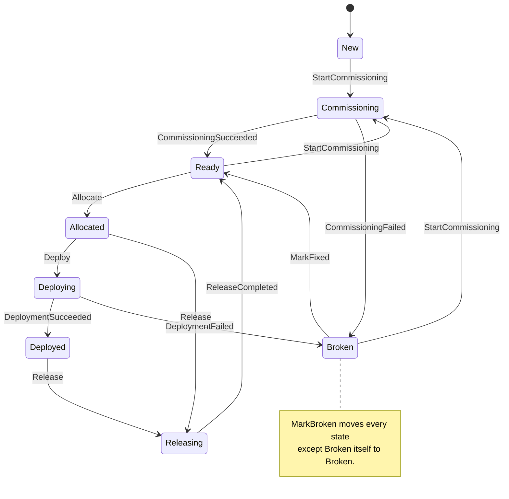

# Machine lifecycle

Every machine RackSmith manages is in exactly one lifecycle state, and moves between states only
in response to events. The lifecycle decides which destructive operations are allowed, for
example that only an allocated machine can be deployed, so it is the most safety-critical logic
in the project and the most heavily verified.

## States

| State           | Meaning                                                           |
|-----------------|-------------------------------------------------------------------|
| `new`           | Discovered (for example by PXE boot) but never commissioned.      |
| `commissioning` | Hardware inventory and tests are running.                         |
| `ready`         | Commissioned and available for allocation.                        |
| `allocated`     | Reserved by a user but not yet deployed.                          |
| `deploying`     | An operating system is being installed.                           |
| `deployed`      | Running the deployed operating system.                            |
| `releasing`     | Being wiped and returned to the pool.                             |
| `broken`        | Failed or taken out of service; needs repair or re-commissioning. |

States and events are written in `snake_case` on the wire and in the CLI, for example
`{"event": "start_commissioning"}`.

## Transitions

`MarkBroken` is accepted in every state except `broken`; the diagram shows it as a note rather
than seven arrows. Any event not listed for a state is rejected with a `TransitionError`, and the
machine's state does not change. Over the API, a rejected event is answered with
`409 Conflict`.

The table below is generated from the code by `racksmith lifecycle`, so it cannot drift from the
implementation. After changing the lifecycle, regenerate it with `cargo xtask docs --fix`; CI runs
`cargo xtask docs` and fails if it is stale.

<!-- BEGIN GENERATED: lifecycle -->
| From            | Event                     | To              |
|-----------------|---------------------------|-----------------|
| `new`           | `start_commissioning`     | `commissioning` |
| `ready`         | `start_commissioning`     | `commissioning` |
| `broken`        | `start_commissioning`     | `commissioning` |
| `commissioning` | `commissioning_succeeded` | `ready`         |
| `commissioning` | `commissioning_failed`    | `broken`        |
| `ready`         | `allocate`                | `allocated`     |
| `allocated`     | `deploy`                  | `deploying`     |
| `deploying`     | `deployment_succeeded`    | `deployed`      |
| `deploying`     | `deployment_failed`       | `broken`        |
| `allocated`     | `release`                 | `releasing`     |
| `deployed`      | `release`                 | `releasing`     |
| `releasing`     | `release_completed`       | `ready`         |
| `new`           | `mark_broken`             | `broken`        |
| `commissioning` | `mark_broken`             | `broken`        |
| `ready`         | `mark_broken`             | `broken`        |
| `allocated`     | `mark_broken`             | `broken`        |
| `deploying`     | `mark_broken`             | `broken`        |
| `deployed`      | `mark_broken`             | `broken`        |
| `releasing`     | `mark_broken`             | `broken`        |
| `broken`        | `mark_fixed`              | `ready`         |
<!-- END GENERATED: lifecycle -->

## Invariants

These properties must hold for every sequence of events:

| ID | Invariant                                                                                    |
|----|----------------------------------------------------------------------------------------------|
| I1 | `deployed` is reachable only through `deploying`.                                            |
| I2 | A machine is `deploying` or `deployed` only if it was `allocated` since it was last `ready`. |
| I3 | `ready` is reachable from every state, so a broken machine is always recoverable.            |
| I4 | Applying an event never panics, and a rejected event leaves the state unchanged.             |
| I5 | Every `(state, event)` pair is handled explicitly, with no wildcard match arm.               |

## How the lifecycle is verified

The same transition table is checked in several independent ways:

| Mechanism                 | Where                                                               | Checks                                          |
|---------------------------|---------------------------------------------------------------------|-------------------------------------------------|
| Exhaustive `match`        | `MachineState::apply` in `crates/racksmith-domain/src/lifecycle.rs` | I5 (compiler, `wildcard_enum_match_arm` lint)   |
| Spec-conformance test     | `crates/racksmith-domain/tests/lifecycle_props.rs`                  | All 88 `(state, event)` pairs against the table |
| Property tests (proptest) | `crates/racksmith-domain/tests/lifecycle_props.rs`                  | I1, I2, I4 over random sequences; I3 by search  |
| Kani proofs               | `#[cfg(kani)]` module in `lifecycle.rs`                             | I1, I4 for all inputs, bounded                  |
| TLA+ model (TLC)          | [`specs/tla/`](../specs/tla/)                                       | I1, I2, I3 over the whole state space           |
| Generated tables          | this file and `specs/tla/`, `cargo xtask docs`                      | The table above and the TLA+ model match `TRANSITIONS` |

## Changing the lifecycle

A lifecycle change updates all of the above in one pull request: the `match` in
`MachineState::apply` and the `TRANSITIONS` table, the conformance test, any affected Kani proof
or TLA+ property, the diagram and prose in this file, and the generated tables here and in the
TLA+ model (`cargo xtask docs --fix`). The checklist
lives in [AGENTS.md](../AGENTS.md#changing-the-machine-lifecycle). Changing which transitions are
allowed is also a public API change and deserves an [ADR](adr/).
