# RackSmith M1 implementation plan

| | |
|---|---|
| **Status** | Draft (waits for the owner's start signal; week numbers count from that signal) |
| **Date** | 2026-11-18 |
| **Owner** | @zoza1982 |
| **Milestone** | M1 Fast-deploy MVP, about 12 weeks ([PRD §8](../prd.md#8-milestones)) |
| **Binding inputs** | [PRD](../prd.md) (R1–R39, [§7](../prd.md#7-non-functional-targets-benchmarked-release-gates), [§8](../prd.md#8-milestones)), [system design](../design/system-design.md) (Accepted; [§14](../design/system-design.md#14-m1-scope-cut-and-build-order), [§16.5](../design/system-design.md#165-owner-decisions-2026-11-18)), ADRs [0011](../adr/0011-evolve-workspace-into-ports-core-adapters.md)–[0033](../adr/0033-provisioning-network-boundary-and-os-ready-path.md) (all Accepted), [AGENTS.md](../../AGENTS.md), [CONTRIBUTING.md](../../CONTRIBUTING.md), [`architecture.toml`](../../architecture.toml), [`.github/workflows/`](../../.github/workflows/) |
| **Changes** | Pull requests only. Changing scope, a target or a decision is an owner decision in the PRD or an ADR, never in this file |

This plan turns the accepted design into issue-sized work for one maintainer and AI agent fleets.
It does **not** restate the design: every task links to the design section or ADR that defines
it, and that section is the specification. When this plan and the design disagree, the design
wins and this plan is corrected.

**Conventions.** "§N" means a section of the
[system design](../design/system-design.md); "PRD §N" a section of the [PRD](../prd.md). **[est]**
marks an estimate a later measurement or task must confirm. **[owner]** marks a point only the
owner can decide or do. A task is **owner-gated (OG)** when it cannot start or merge without an
owner-only action: a decision, hardware, a repository setting, an external account, or approval
of a change to a code-owned guardrail file (`architecture.toml`, `deny.toml`, `Cargo.toml` lints,
`xtask/`, `specs/`, `fuzz/`, `.github/`, see [CODEOWNERS](../../.github/CODEOWNERS)). A task that
adds a fuzz target, a workflow job or an `xtask` command is therefore OG. Every task's acceptance
implicitly includes `cargo xtask ci` green locally and `ci-success` plus `verify-success` green on
the PR.

**Contents**

1. [Week 0: owner prerequisites](#1-week-0-owner-prerequisites)
2. [Lab runner infrastructure (weeks 1–2, workstream H)](#2-lab-runner-infrastructure-weeks-12-workstream-h)
3. [Phases by freeze point](#3-phases-by-freeze-point)
4. [Work breakdown](#4-work-breakdown)
5. [Critical path, dependency graph and agent lanes](#5-critical-path-dependency-graph-and-agent-lanes)
6. [Benchmark and spike decision points](#6-benchmark-and-spike-decision-points)
7. [Definition of done for M1](#7-definition-of-done-for-m1)
8. [How work is executed](#8-how-work-is-executed)
9. [Traceability](#9-traceability)
10. [Risks, schedule buffer and cut list](#10-risks-schedule-buffer-and-cut-list)
11. [Open items for the owner](#11-open-items-for-the-owner)

---

## 1. Week 0: owner prerequisites

Owner-only actions before or at the start signal. None of them is delegated to an agent. "Due"
is relative to week 1 (W1), the week the owner gives the start signal. Items marked
**critical** sit on the critical path (§5.1): a day late is a day lost.

| # | Action | Who | Due | Why / blocks | Done when |
|---|---|---|---|---|---|
| W0-1 | **Bot account for agent PRs.** Create a dedicated GitHub account (2FA on) for agent pull requests ([GOVERNANCE.md](../../GOVERNANCE.md)). Recommended [owner]: the bot works from **its own fork with no write access** to `zoza1982/Racksmith`, so its workflow runs fall under the fork-approval setting (W0-5) and it cannot edit a workflow in a branch of the main repo to reach the self-hosted runner (§2.6). Agents use a token scoped to that fork | owner | before W1 | every agent PR (§8); the self-hosted lab's safety model | the bot opened one test PR from its fork, and that PR's workflows waited for approval |
| W0-2 | **Dependabot PR #1** (`rust-toolchain` 1.98.1 → 1.100.0, open since 2026-11-18; Dependabot reports that its cooldown could not be applied). Decide: merge before W1 if `ci-success` and `verify-success` pass, so all M1 code starts on one toolchain; or close it and stay on 1.98.1 until a later `build:` PR. MSRV (`rust-version = "1.98"`) and the fuzz nightly pin are separate pins (CONTRIBUTING "Pinned tool versions") | owner | before W1 | new lints in 1.100 would otherwise land mid-F1 in agent PRs [est] | PR #1 merged or closed with a reason |
| W0-3 | **critical.** **GitHub credentials for the ARC scale set**: a GitHub App (or fine-grained token) that can register repository runners for `zoza1982/Racksmith` only, stored as a Kubernetes secret in the cluster, never in the repo. Exact permission set [est]: repository Administration read and write, as ARC requires for repository-level scale sets | owner | W1 day 1 | M1-H-04 | secret exists in the runner namespace |
| W0-4 | **critical.** **Network facts for the lab NetworkPolicy** (M1-H-05): the home **WAN address(es)**; the public hostnames and IPs of every home service exposed through port forwarding or ingress (Authentik SSO, dev-stack ingress, others); whether the cluster or the LAN has **IPv6** with global addresses; the k3s pod and service CIDRs; the node IPs; any VPN ranges. LAN subnets inside RFC 1918 are already denied and need not be listed | owner | W1 day 1 | M1-H-05 | list attached to the M1-H-05 issue |
| W0-5 | **critical.** **Tighten workflow approval for outside contributors**: change the repository setting `fork-pr-contributor-approval` from `first_time_contributors` (verified 2026-11-18) to `all_external_contributors`, for example `gh api -X PUT repos/zoza1982/Racksmith/actions/permissions/fork-pr-contributor-approval -f approval_policy=all_external_contributors`. From then on every push to every bot PR waits for a maintainer click before any workflow runs (load in §8.1) | owner | before the `racksmith-lab` runner is registered (W1) | ADR 0026: outside contributors' workflows need approval before they run on any runner | `GET` of the same endpoint returns `all_external_contributors` |
| W0-6 | **Enable VT-x on dietpi-4 and dietpi-5** (optional capacity). Hands-on: reboot each node into its BIOS console, enable virtualization, confirm `/dev/kvm`. If M1-H-01 chooses VM isolation, also enable nested virtualization (`kvm_intel nested=1` on dietpi-4/5, `kvm_amd nested=1` on dietpi-6). Both nodes run fusedpro's private CI (`amd64-k3s`, maxRunners 2), so RackSmith lab pods may land there only under the M1-H-08 isolation rule; schedule the reboot when that CI is idle | owner | any time W1–W8; not on the critical path | M1-H-09 (second lab runner node) | `/dev/kvm` (and nested virtualization if required) present on both nodes |
| W0-7 | **Choose the dedicated benchmark host** (local NVMe, nothing else running during timed jobs, KVM). No node is dedicated today. Suggested minimum [est]: 8+ cores, 32 GB, Gen4 NVMe, wired; 16+ cores and 64 GB if it also hosts the 10k load lab (§13.2 asks for 16–32 vCPU and 32–64 GB) | owner | decide by W4, **operational by W6** (hard dependency of M1-H-09, H-17, H-19a) | M1-H-17 (the M1 p95 verifier) and the load lab M1-H-19a..H-19e; until it exists, timed results are labelled **provisional** | host registered as `racksmith-bench` (M1-H-09) |
| W0-8 | **Rent a bare-metal GPU-class machine** for calibration before the M1 release (owner decision 14, §16.5): provider, budget and booking window; prefer an offer that exposes the BMC (Redfish) | owner | book by W8 for use in W10–W11 (before RC exit) | M1-H-23: POST-profile calibration, GPU inventory and the RackSmith-controlled subtotal on rented hardware (PRD §7) | booking confirmed; whether the BMC is exposed recorded |
| W0-9 | **Physical UEFI machine for the iPXE HTTPS throughput measurement.** §8.2 measures it in the lab and on "one rented commodity machine" by week 3. Options [owner]: a spare physical UEFI box on an isolated segment, a short rental, or accept the lab number alone until W10 | owner | W2 | M1-D-15b decision rule (§6.4) | option chosen |
| W0-10 | **Project release signing key**: custody and where the private key lives (it signs published recipe images and becomes a default pool trust anchor, §9.6, §11.6). Agents never hold it. Lab and per-PR images are signed with a CI test key instead (M1-G-16), so this key is off the path to the first green deploy | owner | W9 | M1-R-04 (published recipes) | key generated, public key ready to embed |
| W0-11 | **CI budget**, see the notes below | owner | W1 | capacity planning | budget confirmed |
| W0-12 | **Start date and calendar.** Twelve weeks from late November cross the year-end holidays; confirm the calendar mapping of W1–W12 and any weeks off [owner] | owner | at the start signal | §3, §10 | W1 date written into the GitHub milestone |

**CI budget notes.**

- **GitHub-hosted runners** keep every normal job: lint, test, docs, deny, arch, typos, coverage,
  workflow lint, TLA+, Kani and fuzzing. Standard hosted runners are free for this public
  repository. A self-hosted ARC runner, `racksmith-dietpi-6`, stands by: setting the repository
  variable `CI_RUNNER` to its name moves same-repository Linux jobs onto it, one at a time, while
  fork pull requests always stay hosted
  ([ADR 0038](../adr/0038-select-the-ci-runner-by-repository-variable.md), owner decision
  2026-11-26; unset by default). Constraints to plan for [est]: the plan's concurrent-job limit
  (agent fleets open many PRs at once, and `ci.yml` alone starts about 14 jobs per PR, including
  macOS and Windows), the 10 GB Actions cache per repository (the fuzz corpus cache shares it), and
  artifact retention for lab logs and pcaps.
- **Self-hosted (owner decision 10)**: only the KVM lab and benchmark jobs, on their own scale set
  and runner model (M1-H-01, M1-H-04), separate from the standby CI runner above. Cost is the owner's
  hardware and power; dietpi-6 is shared with the dev stack (§2.1). The rented GPU-class machine
  (W0-8) and, if chosen, a rented KVM host for the MAAS comparison (open item 5) are the only
  cash costs [owner].
- **No larger hosted runners** are planned. Lab binaries are compiled on free hosted runners and
  only executed on the self-hosted runner (§2.4), which keeps the self-hosted job short.

---

## 2. Lab runner infrastructure (weeks 1–2, workstream H)

The lab comes first ([ADR 0010](../adr/0010-virtual-lab-ci-testbed.md),
[ADR 0026](../adr/0026-racksmith-sim-and-tiered-lab.md), §13): the boot workstream needs a real
KVM target early. No self-hosted **lab** runner is registered for RackSmith today; the only
self-hosted runner is the standby CI runner of ADR 0038, which has no `/dev/kvm`. The design gives the lab
skeleton and the KVM runner check weeks 1–3 ([§14.3](../design/system-design.md#143-parallel-workstreams)
Gantt bar `h0, 1, 3`); this plan targets W1 for the runner and requires it by the end of W2.
Until it is live, the W1 spikes (D-07a, D-15a, F-02) run their lab step on a maintainer-run KVM
host, and the spike PR carries the log.

### 2.1 Facts this section relies on (verified 2026-11-18 on the owner's cluster)

| Fact | Consequence |
|---|---|
| Actions Runner Controller (ARC) is installed on the owner's k3s cluster (v1.36, Debian 12 nodes), managed from the separate `k8s-at-home` repository | RackSmith adds a scale set; it does not install ARC. Not yet verified: which namespaces the controller watches and its version (checked in M1-H-04) |
| The existing scale set `amd64-k3s` (namespace `arc-runners`) is registered to the private fusedpro repository only (ephemeral pods, maxRunners 2, pinned to dietpi-4/5) | personal accounts cannot share runners across repositories, so RackSmith needs **its own** scale set; the label `amd64-k3s` is never used by RackSmith |
| dietpi-6: Ryzen 7 5700U, 16 threads, 32 GB, 512 GB NVMe, `/dev/kvm` present; also hosts the dev stack (devbox, Paperclip agents, projects-mcp), which holds credentials | the only suitable node today; lab pods are capped at about 4 CPU and 6–8 GiB; **it overheats and reboots under sustained heavy load** (owner, 2026-11-18), so it carries one lab runner at most and never long full-core jobs; untrusted PR code shares a kernel and a pod network bridge with credential-bearing pods (M1-H-01 weighs this) |
| dietpi-3 has `/dev/kvm` but runs Authentik SSO with little free RAM | excluded |
| dietpi-4 (i7-7700T, 16 GB, NVMe) and dietpi-5 (i7-6700, 16 GB) have VT-x disabled (likely in BIOS) and run fusedpro's private CI, which can hold fusedpro secrets | later expansion only, after W0-6 and only under the isolation rule of M1-H-08 |
| No dedicated quiet host with local NVMe exists | timed results are **provisional** until W0-7 is done |

### 2.2 Where each change lives

| Change | Repository | Review path | Notes |
|---|---|---|---|
| ARC scale set `racksmith-lab` (Helm values), and later `racksmith-bench` | `k8s-at-home` (separate repo, separate PR) | owner-approved; agents may draft, never apply | new values file next to `helm/apps/arc/runner-scale-set-values.yaml`; file name [est] |
| Device plugin DaemonSet for `/dev/kvm` and `/dev/net/tun`, node labels and taints | `k8s-at-home` | owner-approved | dietpi-6 only at first |
| NetworkPolicy and namespace for RackSmith runners | `k8s-at-home` | owner-approved | own namespace, not `arc-runners` [est: name `arc-racksmith`] |
| Runner image (QEMU, pinned OVMF, dnsmasq, iproute2, pasta or slirp4netns, tcpdump) and the job-started hook (§2.5) | `k8s-at-home` (or another owner repo) | owner-approved | kept outside RackSmith so a RackSmith PR cannot change the runner or its policy hook |
| `lab.yml`, `lab-nightly.yml`, `lab-weekly.yml`, `bench.yml`, `load-lab.yml`, the `quickstart` and `upgrade-test` jobs; `.github/actionlint.yaml` declaring the self-hosted labels; `.github/lab-paths.txt` | RackSmith `.github/` (code-owned) | owner review; must follow ADR 0026 (per-PR scope, label gate, `main`-only scheduled jobs, fail without `/dev/kvm`) and the existing workflow rules (actions pinned by SHA, `persist-credentials: false`, actionlint and zizmor clean) | changing ADR 0026's runner model needs a new ADR (M1-H-01) |
| Lab scenarios (`lab/`, `cargo xtask lab`), `racksmith-sim` | RackSmith | normal review; `xtask/` changes are OG | product code |

**This plan never applies anything to the cluster or to `k8s-at-home`.** The M1-H tasks below
produce drafts that the owner applies.

### 2.3 Tasks

| ID | Task | Repo | Deps | Wk | Acceptance | OG |
|---|---|---|---|---|---|---|
| M1-H-01 | **Runner-model ADR.** ADR 0026, §13.1 and owner decision 10 say "ephemeral self-hosted **VM** runner". An ARC runner pod is a container on a shared kernel, not a VM. Inputs the ADR must weigh: the co-tenants of each candidate node and the secrets they hold (dietpi-6: devbox, Paperclip agents, projects-mcp and the kubelet credentials; dietpi-4/5: fusedpro's private CI runners). Owner decides: accept ephemeral ARC pods with the §2.6 measures (record ADR 0034 [est], which supersedes that part of ADR 0026), or require VM isolation (a VM-backed runtime class [est], which needs nested virtualization, W0-6), which changes M1-H-02..H-04. The same ADR amends ADR 0026's and §13.1's sizing of the nightly jobs by the 6-hour hosted-job limit (open item 2) | RackSmith `docs/adr/` | — | 1 | ADR merged with the chosen model and the co-tenant analysis; M1-H-04 follows it | yes |
| M1-H-02 | **Device plugin** exposing `/dev/kvm` and `/dev/net/tun` as extended resources on dietpi-6 only (a generic device plugin [est]); node label `racksmith.io/kvm=true` and taint `racksmith.io/lab=true:NoSchedule` on dietpi-6, so only lab pods that tolerate it land there and only on that node. No privileged pods. Device mode or group set so the non-root runner user can open them | k8s-at-home | — | 1 | a test pod requesting the resources, running as the runner image's non-root UID with the host `kvm` GID in `supplementalGroups`, starts `qemu-system-x86_64 -accel kvm`; a pod without the request sees neither device | yes |
| M1-H-03 | **Runner image and job-started hook**: ARC runner base plus QEMU, a pinned OVMF build, SeaBIOS, dnsmasq, iproute2, bridge tools, pasta or slirp4netns, tcpdump, `jq`; versions printed by the smoke job; image pinned by digest in the scale set. The hook enforces the policy of §2.5 from the GitHub event payload (not from the job definition) and logs every decision. A VM-runtime variant follows M1-H-01 only if VM isolation is chosen | k8s-at-home | — | 1 | image builds reproducibly from a pinned base; hook unit tests: each accepted case of §2.5 runs, and each rejected case is refused, including a fork PR whose edited `lab.yml` runs on `synchronize`, a `labeled` event whose head SHA differs from the maintainer-reviewed SHA, `push` to a non-main branch, `issue_comment`, `pull_request_target` and `workflow_run` | yes |
| M1-H-05 | **NetworkPolicy** for the runner namespace: a namespace default-deny policy first; then deny all ingress; egress allowed by an explicit rule to the `kube-dns` pods (namespaceSelector `kube-system`, podSelector `k8s-app: kube-dns`, UDP and TCP 53), since kube-router evaluates traffic after DNAT to the pod IP; and to `0.0.0.0/0` **except** RFC 1918, CGNAT (100.64.0.0/10), link-local, the k3s pod and service CIDRs, the node IPs, the home WAN address(es) and the IPs of exposed home services (W0-4; blocks hairpin NAT); if IPv6 exists, deny `::/0` egress except what the lab needs. Confirm that the cluster's network-policy controller enforces it (k3s ships one [est: kube-router based]) | k8s-at-home | W0-4 | 1 | from a runner pod: GitHub, ghcr.io and crates.io reachable; a LAN canary, a node IP, the WAN address, an exposed home ingress hostname, the k8s API and another namespace's pod unreachable; DNS resolves (checked by M1-H-07) | yes |
| M1-H-04 | **Scale set `racksmith-lab`** registered to `https://github.com/zoza1982/Racksmith`: ephemeral runners, `minRunners: 0`, `maxRunners: 1` [est, raise after measuring contention], node selector and toleration for dietpi-6, requests and limits `cpu: 4`, `memory: 8Gi` [est 6–8 GiB], an ephemeral-storage limit (about 40 GiB [est]), a low PriorityClass so the dev stack wins under pressure, no service-account token, `supplementalGroups` with the host `kvm` GID, device resources from M1-H-02, and **no added capabilities**: the job builds its bridge, taps and dnsmasq inside a user plus network namespace it creates (`unshare -Urn`, egress through pasta or slirp4netns [est]). Before registering: confirm the existing ARC controller's version and that it watches the new namespace (not limited by `flags.watchSingleNamespace`), otherwise a controller values change in `k8s-at-home` comes first; confirm that the pod's seccomp and AppArmor profiles allow unprivileged user namespaces (Debian 12 allows them; containerd's `RuntimeDefault` seccomp profile may block `unshare` [est], in which case an owner-applied localhost profile allows only that). If nested namespaces cannot work, VM isolation (M1-H-01 option 2) becomes mandatory on dietpi-6 | k8s-at-home | H-01, H-02, H-03, H-05, W0-3, W0-5 | 1–2 | runner appears under the repository's runners while a job runs and disappears after it; `kubectl describe` shows the limits, no added capabilities and no token; no fusedpro job can land on it and no RackSmith job on `amd64-k3s`; controller version and watched namespaces recorded on the issue | yes |
| M1-H-06 | **Workflow `lab.yml`**: per-PR `lab-smoke`, later `lab-e2e`, the gate and `lab-gate` design of §2.5, `permissions: {}` at workflow level and `contents: read` per job, no secrets, `persist-credentials: false`, `timeout-minutes`, a concurrency group per PR; `.github/actionlint.yaml` lists `racksmith-lab` and `racksmith-bench` as self-hosted labels so actionlint accepts them; `.github/lab-paths.txt` holds the lab-covered paths; zizmor findings fixed, not disabled | RackSmith | H-01 | 1–2 | `workflow lint` job green; a maintainer PR runs `lab-smoke`; a bot-fork PR does not until the three approval steps of §2.5 are done | yes |
| M1-H-07 | **Smoke job `lab-smoke`**: fails with a clear message when `/dev/kvm` or `/dev/net/tun` is missing or KVM acceleration is unavailable (no TCG fallback, §9.1 point 4); boots a tiny image under `-accel kvm` as the runner UID; prints the environment fingerprint fields of §13.1 (runner class, node, co-tenancy, CPU, disk model and attachment, QEMU and OVMF versions); asserts that the NetworkPolicy blocks the canaries of M1-H-05 and allows internet egress; asserts that the job cannot change `eth0`'s address or MAC and cannot open a raw socket on it | RackSmith | H-04, H-05, H-06 | 2 | green on the runner; every run also re-executes the device check with `/dev/kvm` masked (bind-mounted away inside the job's own mount namespace) and asserts the expected failure message, so the missing-device path is tested on every run rather than once by hand on a hosted runner | yes |
| M1-H-08 | **Capacity plan** (in the issue, revisited W4 and W8): measured `lab-smoke` and later `lab-e2e` duration, queue time, dietpi-6 CPU and memory headroom during jobs, nightly window [est 01:00–06:00 local] with a **time budget per job**: three functional shards about 1 h each (§13.1), quickstart and upgrade test about 20 min each [est], leaving about 1.5 h for per-PR jobs queued overnight. `lab-nightly-bench` (H-17), weekly POST profiles (H-18) and the load lab (H-19a..H-19e) **never** run on `racksmith-lab`. Before `racksmith-bench` exists, only a reduced provisional bench (n = 10, alternate nights [est]) runs there to validate H-16. Expansion path: (1) a second node class after W0-6 (dietpi-4/5), allowed only when RackSmith lab pods can never share a node with fusedpro runner pods (a dedicated node with its own taint and anti-affinity, or VM isolation as a precondition); (2) `racksmith-bench` on the dedicated host after W0-7 | RackSmith issue | H-07 | 2 | budget table and measured durations recorded; nightly jobs fit the window on three consecutive nights; `maxRunners` adjusted by owner PR in `k8s-at-home` | yes |
| M1-H-09 | **Expansion**: `racksmith-bench` scale set on the benchmark host, made quiet: a `NoSchedule` and `NoExecute` taint so only bench pods land there (DaemonSets other than the CNI and the KVM device plugin excluded), a Guaranteed-QoS runner pod with the kubelet static CPU manager (or no CPU limit, to avoid CFS throttling), scheduling that excludes the load lab and weekly jobs during the bench window, and fingerprint fields that record node co-tenancy; scheduled jobs on `main` only, enforced by the job-started hook. Alternative: run the bench host as a non-Kubernetes ephemeral runner [owner]. Plus a second `racksmith-lab` node once VT-x is on, under the M1-H-08 isolation rule | k8s-at-home | W0-7, H-08 | 6 | a scheduled `bench.yml` run lands on the bench host with no other pod scheduled during it (fingerprint shows it); a PR-triggered job that targets `racksmith-bench` is rejected by the hook | yes |

### 2.4 Job layout

- **Compile on hosted, run on self-hosted.** A hosted `lab-build` job compiles `racksmith`,
  `racksmith-sim`, the agent and the initramfs and uploads them as an artifact; the self-hosted job
  downloads them and runs only the lab. This keeps the 4-CPU lab pod off the Rust build and inside
  the 15-minute per-PR target (§13.1) [est].
- **On `racksmith-lab`**: per-PR `lab-e2e`; the three **nightly functional shards**, one at a time
  in the nightly window; the nightly **`quickstart`** job (it boots a VM, so it needs KVM) and the
  nightly **`upgrade-test`** job (on `racksmith-lab` when it boots VMs, otherwise hosted [est]).
- **On `racksmith-bench`, against `main` only (ADR 0026)**: **`lab-nightly-bench`**, the
  **weekly POST profiles** and the **load lab**, each in its own window. The load lab also needs
  the §13.2 runner class (open item 3).
- `lab-nightly-bench` never runs on `racksmith-lab`. Before `racksmith-bench` exists, only the
  reduced provisional bench of M1-H-08 runs there, every result labelled `provisional` in its
  environment fingerprint; provisional results never count toward the M1 exit criterion (§7).

### 2.5 Label gating design

| PR source | Trigger | Who approves |
|---|---|---|
| Maintainer (branch in the main repository, PR author is the owner) | `pull_request` `opened`, `synchronize`, `reopened` | none: runs automatically |
| Bot account (from its fork, W0-1) or any fork | `pull_request` `labeled` with the label `lab-run` | three maintainer steps: (1) read the diff and submit a review (comment or approve) on the head commit, which records that commit's SHA as the review's `commit_id`; (2) apply `lab-run`; (3) approve the labelled run itself, which waits like every fork run under W0-5 |
| Scheduled and dispatched jobs | `schedule`, or `workflow_dispatch` by the maintainer | runs from `main` only |

**Job-started hook policy for `racksmith-lab`** (M1-H-03). The hook reads the event payload
GitHub delivers with the job, not the PR-controlled workflow file, and accepts only:

1. `pull_request` with action `labeled`, `label.name == lab-run`, `sender.login` equal to the
   maintainer, and a maintainer review whose `commit_id` equals `pull_request.head.sha` (read from
   the public API [est]). This binds the run to the reviewed commit: a push between the review and
   the label changes the head SHA, and the hook rejects the run.
2. `pull_request` whose `head.repo.full_name` is the base repository and whose author is the owner.
3. `schedule` or `workflow_dispatch` on `refs/heads/main` (dispatch only by the maintainer).

Everything else is rejected: `push` to non-main branches, `opened` or `synchronize` from forks,
`issue_comment`, `pull_request_target`, `workflow_run`. `racksmith-bench` accepts only case 3.
Under W0-5 the maintainer approves every bot-fork push just to get `ci-success` and
`verify-success`, and that click approves all pending runs of the commit, including any
self-hosted job the PR added to a workflow. The hook is what stops such a job; the workflow's own
`if:` conditions and author checks live in PR-controlled YAML and enforce nothing.

- A later push does not re-run the lab; the maintainer reviews the new head and re-applies
  `lab-run`.
- `pull_request_target` is **not** used (it would run with a write token and secrets in the base
  context). The lab job has no secrets to leak.
- **Required check (week 9, M1-H-12).** A job skipped by its `if:` reports success to a required
  check. So the required check is `lab-gate`, a small hosted job that runs in two places under the
  same check name: on every `pull_request` event, where it passes only if the PR changes no path in
  `.github/lab-paths.txt` read from the base branch (the file is code-owned, and a PR that edits it
  or `lab-gate` needs owner review); and as a job with `needs: lab-e2e` in the labelled or owner
  run, which reports success for that head SHA once `lab-e2e` passes. Turning it on is a ruleset
  change (OG).

### 2.6 Public-repository safety measures

| Threat | Measure |
|---|---|
| A PR edits a workflow to drop the gate and run arbitrary code on the self-hosted runner | the job-started hook (outside the repo) enforces the §2.5 policy from the event payload; outside contributors' runs need approval (W0-5); the bot works from a fork without write access (W0-1) |
| A fork pushes an unreviewed commit between review and label | the hook requires a maintainer review whose `commit_id` equals the run's head SHA (§2.5 case 1) |
| Spoofing neighbouring pods on the node's pod bridge (ARP or IP impersonation of dev-stack pods, defeating source-IP-based policy) | the runner pod gets **no added capabilities**; bridges, taps and dnsmasq live in a nested user plus network namespace owned by the job; `lab-smoke` asserts that `eth0`'s address and MAC cannot be changed and that no raw socket opens on it |
| Persistence between jobs | ephemeral runner pods, one job each; no persistent volumes; caches only through the Actions cache API |
| Pivot into the home network | NetworkPolicy (M1-H-05) incl. WAN, exposed-service and node addresses, checked by every `lab-smoke`; own namespace; no service-account token mounted |
| Secret theft | no repository or environment secrets are referenced by lab workflows; the ARC registration secret lives in the cluster and is not mounted into job containers |
| Resource exhaustion of the dev stack | CPU and memory limits, low PriorityClass, `maxRunners: 1`, nightly jobs in the off-hours window with a per-job budget (M1-H-08) |
| Host kernel exposure (container, not VM) on a node shared with credential-bearing workloads (dietpi-6 dev stack; dietpi-4/5 fusedpro CI) | non-privileged pod, no added capabilities, devices only through the device plugin; co-tenants and their secrets weighed in M1-H-01; RackSmith lab pods never share a node with fusedpro runner pods (M1-H-08); residual risk recorded in M1-H-01 |

### 2.7 Acceptance criteria for the section (end of week 2 at the latest)

1. `lab-smoke` is green on `racksmith-lab` for a maintainer PR, and for a bot-fork PR only after
   the three approval steps of §2.5; the hook rejects a bot-fork job whose head is not the reviewed
   SHA.
2. The same job's masked-device step fails with the expected message on every run (M1-H-07).
3. From the runner pod the canaries of M1-H-05 (LAN, node IP, WAN address, exposed home ingress,
   k8s API, other namespaces) are unreachable, and GitHub and crates.io are reachable.
4. During a `lab-smoke` run, the dev-stack pods on dietpi-6 show no increase in CFS throttled
   periods above 5% [est] and the projects-mcp health endpoint's p95 latency stays within 2× its
   idle baseline [est], measured by a probe loop recorded on the M1-H-08 issue; the pod's limits
   are visible in `kubectl describe`.
5. The runner-model ADR (M1-H-01) is merged.

### 2.8 Risks of the lab runner

| Risk | Likelihood / impact | Mitigation |
|---|---|---|
| dietpi-6 thermal reboot under sustained load (owner-reported) | high / lab job killed mid-run, dev stack and its agents restarted | hard CPU limit and `maxRunners: 1`; no load lab, bench or POST profiles on dietpi-6 (M1-H-08); lab-smoke and lab-e2e record node uptime before and after, so a job lost to a reboot is reported as infrastructure failure and retried once rather than counted as a test failure; watch the node's temperature during the M1-H-08 measurements and lower the cap if it climbs; second node (W0-6) and bench host (W0-7) raise priority if reboots recur |
| Dev-stack contention on dietpi-6 (devbox, Paperclip agents, projects-mcp) | high / per-PR lab slower than 15 min, dev stack sluggish | caps and PriorityClass; compile on hosted (§2.4); nightly window with a budget; measure in M1-H-08; timed and load jobs only on the bench host; another node after W0-6 under the isolation rule |
| Public-repo abuse of a self-hosted runner | medium / home-network or dev-stack compromise | §2.5 hook policy and SHA binding; §2.6; fork-only bot; approval for all outside contributors; NetworkPolicy verified by every smoke run |
| Nested user namespaces blocked by the runtime's seccomp or AppArmor profile | medium / no lab without capabilities | localhost seccomp profile allowing only user and network namespace creation [owner]; else VM isolation (M1-H-01) |
| One runner serialises agent PRs | high / review latency | label only PRs that touch lab-covered paths; per-PR lab is 1 VM; second node after W0-6 |
| Timing noise on a shared node | certain / invalid p95 | timed runs only on the dedicated host; results labelled `provisional` until then |
| ARC pod is not a VM (ADR 0026 wording) | certain / isolation weaker than written | M1-H-01 decision before the runner goes live |
| k3s or ARC upgrade breaks the scale set mid-M1 | low / lab down | owner pins versions in `k8s-at-home` during M1; nightly smoke detects it |

---

## 3. Phases by freeze point

Freeze points are fixed by [§14.2](../design/system-design.md#142-interface-freeze-points); what
each freezes is defined there. The workstreams and their crates are
[§14.3](../design/system-design.md#143-parallel-workstreams).

| Phase | Weeks | Ends with | Exit evidence |
|---|---|---|---|
| Foundation | W1–W2 | **F1** (end of W2) | ports incl. the `BootDecisions` and `AgentSessions` payload types (C-01, A-05b), domain lifecycle change and types, Store semantics, storage key schema and codec (B-03a), `architecture.toml` v2, CI matrix, codegen pipeline, proto skeleton merged; lab runner live; lab skeleton boots a VM into stock iPXE |
| Contracts | W3–W5 | **F2** (end of W5) | `agent.v1alpha1` and `DeployPlan` (F-01b), rsimg v1 manifest and extent size, storage proto v1 (`schema_version = 1`, B-03b) merged; `DeployProtocol.tla` green (A-16b); week-3 decisions recorded |
| Integration | W6–W9 | **F3** (end of W9) | first green `lab-e2e` deploy (H-11b, H-11c in W8); public API surface, config format, CLI verbs and metric names frozen (K-15, last day of W9); `lab-e2e` required |
| Proof | W10–W11 | **RC** (W11) | feature complete, fixes only; nightly functional, bench and load gates green; rented-hardware run; MAAS comparison run |
| Release | W12 | M1 release | §7 definition of done met; release published |

### Week-by-week goals

Derived from the Wk column of §4; a task appears in the week it starts.

| Wk | Goal (all items are task IDs from §2.3 and §4) | Owner hands-on |
|---|---|---|
| 0 | Prerequisites W0-1..W0-12 | all of §1 |
| 1 | Lab runner drafts (H-01..H-06); `architecture.toml` new-crate entries (P-01a) on day 1, rule kinds (P-01b); spikes on a maintainer KVM host: codegen vs lints (P-04), iPXE trust anchor (D-07a), PID 1 boot (F-02), iPXE HTTPS throughput (D-15a); domain ids and aggregate (A-01), `Operation` (A-03), lifecycle change started (A-02), `Secret<T>` (A-15); Store trait (B-01) | apply k8s-at-home PRs; ADR 0034 decision; review P-01a, P-01b, A-* |
| 2 | **F1**: lab runner live (H-04, H-07), lab skeleton (H-10), capacity plan (H-08); grants, phases, boot answer and plan types (A-04, A-05, A-05b); ports and fakes (C-01, C-02); storage key schema and codec (B-03a); in-memory store (B-02); engine and extent prototypes (B-11, G-17); codegen (P-05), proto skeleton (K-01), CI matrix and deny (P-02, P-03); DHCP parsing (D-01a); iPXE builds (D-08); initramfs (F-03) | F1 sign-off; spike outcomes |
| 3 | Week-3 decisions (B-04, G-03, D-15b); `decide()` commission rules (A-07), boot answer (A-10), actor matrix (A-06), authorize (A-13); contract suites (C-03a, C-03c), work queue (C-04); option selection, TFTP, trust-anchor implementation (D-01b, D-02, D-07b); Redfish (E-01), sim endpoint (E-05a); agent proto draft (F-01a), PID 1 duties (F-04); PKI and KEK (J-01, J-02); proto packages (K-02a) | record decisions (§6) |
| 4 | Deploy and release rules (A-08, A-09), IPAM (A-14), commission TLA+ (A-16a); contract suites (C-03b, C-03d), controller and cache (C-05); redb store (B-05), rsimg format, signature and encoder (G-01, G-02, G-04); boot listeners and HTTPS script (D-03, D-06); IPMI session (E-04a), sim QEMU mode (E-05b); enrollment client (F-05), size gate (P-08); tokens (J-04, J-07); proto packages (K-02b), proto-check (P-06) | capacity check H-08 |
| 5 | **F2**: `DeployProtocol.tla` green (A-16b); agent proto frozen (F-01b); storage proto v1 (B-03b); watch and durability (B-06, B-09); server wiring (C-15), commission executor (C-06a), session hub (C-09); boot tokens and OS-ready endpoint (D-09, D-16); Redfish quirks and inventory, IPMI chassis (E-02, E-03, E-04b); MAAS feasibility spike (H-21); write-pipeline fetch and verify (F-08a), plan validation (F-13); metrics, logs (L-01, L-03); config and `serve` (K-13), conversions (K-03); `DiskId`, admission, transition plans (A-11, A-12, A-19) | F2 sign-off |
| 6 | Commission path: deploy executor (C-06b), effect executors and poller (C-07, C-08), BMC reconciler (C-11); session client and inventory (F-06, F-07), writers (F-08b); enrollment transaction (J-05), canary (J-03), authz layer (J-08); full DHCP, unknown machines, rogue DHCP (D-04, D-10, D-11); sim IPMI and fleet mode, oracles (E-06, E-07, E-09); nightly workflows (H-25); migrations, snapshots (B-08, B-07), image build framework and origin (G-16, G-09); `MachineService`, BMC/pool/network handlers (K-04, K-07); RSS measurement (L-09); decide fuzz targets (A-17); bench host operational (H-09) | review executor, enrollment; bench host online |
| 7 | **First commission in the lab** (H-11a); release executor, admission, crash recovery, TCP probe (C-06c, C-10, C-17, C-18); write order, config drive, wipe, hand-off (F-09..F-12); import, catalog, Debian recipe, nginx cache (G-05, G-08, G-11, G-10); tokenless enrollment, events (J-06, J-09); relayed networks, DNS, UEFI HTTP Boot (D-05, D-12, D-13); watch, streaming, image and first-boot handlers (K-05, K-06, K-08), OpenAPI (P-09); timings (L-04) | review write order |
| 8 | **First green `lab-e2e` deploy** (H-11b, H-11c); IPAM reconciler, housekeeper, det-sim, restore safety (C-12, C-13, C-14a, C-16); qcow2 and OCI import, Ubuntu recipe, benchmark image (G-06, G-07, G-12, G-18); sim agents, aarch64 agent, load lab `enroll-10k` and `steady-10k` (E-08, F-16, H-19a, H-19b); bench harness (H-16); handlers, REST, CLI (K-09, K-10, K-11a, K-11b), `init` (K-14), tracing (L-02), cert renewal (J-11) | — |
| 9 | **F3**: freeze review K-15 on the last day; `lab-e2e` required (H-12); `apply -f`, CLI admin verbs (K-12, K-11c), `cli-coverage` (P-07); doctor, bench report (L-05, L-07); `admin dump` (B-10); Rocky, Flatcar, Talos recipes (G-13..G-15); nightly shards (H-13..H-15); nightly bench on the dedicated host (H-17); `deploy-1000`, `power-restore` (H-19c, H-19d); MAAS harness (H-22a); decision re-runs (H-26); det-sim crash injection (C-14b) | F3 sign-off; ruleset change |
| 10 | Hardening: every nightly gate green; `chaos` (H-19e); cold-cache test (H-20); MAAS comparison runs (H-22b); quickstart and upgrade test (R-01, R-02); docs of claims (R-03); weekly POST profiles (H-18); alerts (L-06); packaging (L-08); rented GPU-class calibration starts (H-23) | rented machine |
| 11 | **RC**: feature complete, fixes only; release checklist (R-04); bench evidence collected; rented-hardware run finished | RC sign-off |
| 12 | Release: evidence bundle against §7, tag and publish (R-05); MAAS comparison and benchmark results published | release |

---

## 4. Work breakdown

One task is one pull request of roughly 1–3 days of agent work [est]; a task whose Wk spans two
weeks starts late in the first. Columns: **Design/ADR** is the specification; **R** the PRD
requirement IDs (or the PRD §7 target, or the §16.5 owner decision, it serves); **Deps** the task
IDs that must merge first; **Wk** the planned week; **Ln** the agent lane (§5.3); **Frz** the
freeze point the task belongs to (`F1`, `F2`, `F3`, `RC`, or `stretch`); **Acceptance** names the
gate that proves it (unit, proptest, Kani, TLA+, fuzz, contract = the port's `racksmith-testkit`
suite, sim = deterministic core simulation (§13.4) or load lab (§13.2), lab = `lab-e2e` or a
nightly lab shard, bench); **OG** = owner-gated. Lab tasks H-01..H-09 are in §2.3. Task IDs are
written without the `M1-` prefix inside tables (for example `A-02` is `M1-A-02`).

**Scheduling rule.** A task starts no earlier than the week its last dependency merges. A task may
share a week with a dependency only when the dependency is scheduled first in that week, and no
chain has more than two such same-week hops. A spike's dependencies are the inputs it really
needs; its follow-up implementation is a separate task.

### 4.1 Epic P: platform and guardrails ([§3](../design/system-design.md#3-crate-and-workspace-layout), ADR 0011, 0019, 0028, 0030)

Every task here changes a code-owned guardrail file, so each is owner-gated and cites its ADR.

| ID | Task | Design/ADR | R | Deps | Wk | Ln | Frz | Acceptance | OG |
|---|---|---|---|---|---|---|---|---|---|
| P-01a | `architecture.toml`: layer-map and allowlist entries for the new F1 crates only (`racksmith-ports`, `racksmith-testkit`, `racksmith-storage-model`, `racksmith-proto`), so A-01, B-01 and C-01 can start on day 1 | §3.1, ADR 0011 | R3 | — | 1 | 8 | F1 | `cargo xtask arch` green; a crate placed in the wrong layer fails | yes |
| P-01b | `cargo xtask arch` rule kinds: L0–L7 map, `dev-only`, `generated` roots, `platforms`, new dependency and source bans | §3.1–3.2, ADR 0011, 0030 | R1, R3 | P-01a | 1 | 8 | F1 | unit tests in `xtask`: one violating fixture per new rule kind fails, current crates pass | yes |
| P-02 | CI platform matrix: macOS and Windows jobs check the portable crates only | §3.1, ADR 0030 | owner decision 18 | P-01b | 2 | 8 | F1 | `ci.yml` passes workflow lint; the portable-crate list is derived from `platforms`, not hand-written | yes |
| P-03 | `deny.toml` amendments: `[graph] targets`, ring only (aws-lc banned), chrono stays banned | ADR 0028 | owner decision 11 | — | 2 | 8 | F1 | `cargo deny` green on both lockfiles; a scratch crate depending on `aws-lc-sys` fails | yes |
| P-04 | **Spike**: generated prost/tonic code under the strict lints | §5.7, §16.2, ADR 0019 | R32 | — | 1 | 8 | F1 | one generated module (`options`, `meta`) passes `cargo xtask ci` with item-level `expect` only; outcome and any fallback recorded on the issue | yes |
| P-05 | `cargo xtask codegen` and `--check` (protox, tonic-prost-build, pbjson, generated headers, three generated roots); `buf lint` and `buf breaking` pinned by checksum | §5.7, ADR 0019 | R32 | P-01b, P-04 | 2 | 8 | F1 | `--check` fails on a stale file in each root; `buf breaking` protects `options.v1` and `rsimg.v1` | yes |
| P-06 | `cargo xtask proto-check`: `sensitive` reachable from a response, RPC without `policy` (default deny), resource without `ObjectMeta` | §5.3, §11.7 | R14, R28, R32 | P-05 | 4 | 8 | F2 | one fixture per rule fails; real protos pass | yes |
| P-07 | `cargo xtask cli-coverage`: every RPC has a CLI command | §5.7 | R33 | P-05, K-11c | 9 | 8 | F3 | fixture with an uncovered RPC fails; `main` passes | yes |
| P-08 | `cargo xtask size`: stripped agent ≤ 12 MiB, initramfs ≤ 40 MiB | §3.2, §10.1, ADR 0016 | R17 | F-03 | 4 | 6 | F2 | oversize fixture fails; sizes printed in CI | yes |
| P-09 | OpenAPI generation (`buf generate`, `protoc-gen-openapi`) and stale check for `api/openapi/racksmith.v1alpha1.yaml` | §5.7 | R32 | P-05, K-02b | 7 | 8 | F3 | stale file fails CI | yes |

### 4.2 Epic A: domain ([§4](../design/system-design.md#4-domain-model-and-extended-lifecycle); maintainer reviews every PR)

| ID | Task | Design/ADR | R | Deps | Wk | Ln | Frz | Acceptance | OG |
|---|---|---|---|---|---|---|---|---|---|
| A-01 | Ids, `Machine` spec/status aggregate, `Meta` with `pool`, `site`, `tenant`; `owner`; `Machine::restore` (no `Deserialize`) | §4.1, ADR 0025 | R3, R34; pull-forward owner/tenant | P-01a | 1 | 1 | F1 | proptest `restore(serialize(m)) == m`; unit: invalid stored states rejected | no |
| A-02 | Lifecycle change: `tainted`, `release_failed`, `broken → releasing`, guards, `GUARDS` table; the full AGENTS.md lifecycle checklist (`apply` + `TRANSITIONS`, conformance test, `cargo xtask docs --fix` incl. guards, `MachineLifecycle.tla` with `tainted`/`owner` and I7, Mermaid and prose) | §4.2, §4.8, ADR 0013 | R39; owner decision 1 | A-01 | 1–2 | 1 | F1 | conformance test classifies all 96 pairs; TLC green with I7; Kani `handle` keeps I7; `cargo xtask docs` green | yes |
| A-03 | `Operation`, `Fencing` (with `attempt`), `OperationKind`, absolute deadlines; at most one open operation | §4.3, ADR 0014 | R39 | A-01 | 1 | 1 | F1 | proptest I8 | no |
| A-04 | `DiskWriteGrant`, `PowerGrant`: private constructors, `grant_disk_write`, `grant_power` | §4.3, ADR 0014 | R17, R39 | A-02, A-03 | 2 | 1 | F1 | Kani: `Ok` only for the I6 pairs; compile-fail doctest proves no public constructor | no |
| A-05 | `Phase` with state pairing; `Observations`, `BmcObservation`, `ActionOutcome`, `Decision`, `Action` types | §4.4 | R39 | A-03 | 2 | 1 | F1 | Kani: no `Phase` outside its state; unit | no |
| A-05b | Seam payload types frozen at F1: the boot answer enum `ServeAgent` / `LocalBoot` / `EnrollUnknown` / `Ignore` returned through `BootDecisions`, and the domain-level plan envelope `AgentSessions::push_plan` carries (plan kind, `(generation, op, attempt)`, opaque body that F-01b maps to `agent.v1alpha1`) [est] | §3.3, §8.5, §10.3, §14.2 | R7, R20, R39 | A-03 | 2 | 1 | F1 | unit; compile-checked use from the C-01 port signatures | no |
| A-06 | `permits(actor, event)` matrix | §4.5 | R28, R39 | A-02 | 3 | 1 | F2 | Kani over all `Actor × MachineEvent × MachineState`; proptest I10 | no |
| A-07 | `DECIDE_RULES` and interpreter: commission path, manual power, `bmc = None` rules | §4.4, §8.9, ADR 0031 | R8, R12, R23, R39 | A-04, A-05 | 3 | 1 | F2 | conformance test enumerates `DECIDE_RULES`; proptest against a reference interpreter; Kani I12 (bounded) | no |
| A-08 | `decide()` deploy path: `*Issuing` on evidence, `Writing`, hand-off and `Handoff*` retries, deadlines with post-restart grace and re-arm; the OS-ready observation (phone-home or TCP probe, D-16, C-18) closes the deploy operation | §4.4, §7.3, §9.7, §10.6 | R17, R20, R39 | A-07 | 4 | 1 | F2 | proptest I11 and I12; unit table per §7.3 crash rows; unit: `deployed` only after an OS-ready observation for the open operation | no |
| A-09 | `decide()` release path: never-tainted shortcut, wipe, `release_failed`; `RestoreUnverified` rule | §4.2, §6.6, ADR 0025 | R39 | A-07 | 4 | 1 | F2 | proptest I7, I15 | no |
| A-10 | `boot::decide()` over the A-05b answer enum: `ServeAgent` only when expected, `LocalBoot`, `EnrollUnknown`, `Ignore`, boot-MAC learning case | §8.5, §8.9 | R7, R8 | A-05b | 3 | 1 | F2 | Kani: no disk-writing `ServeAgent` outside `deploying`/`releasing`; unit table | no |
| A-11 | `DiskId` (WWN, serial) and `resolve_root_disk` | §4.3 | R17, R23 | A-01 | 5 | 1 | F2 | proptest: never a removable disk, explicit rule honoured exactly | no |
| A-12 | `admission::admit()` and the slot formula | §9.5, ADR 0022 | PRD §7 1,000 concurrent deploys; R17 | A-05 | 5 | 1 | F2 | proptest of admission arithmetic | no |
| A-13 | `authorize(principal, action, resource)` with `tenant`; role-only in M1, default deny | §11.7, ADR 0020 | R28; pull-forward tenant | A-01 | 3 | 1 | F2 | proptest: unknown action denied; unit role table | no |
| A-14 | IPAM allocation (deterministic lowest-free) | §8.7 | R9 | A-01 | 4 | 1 | F2 | proptest: unique, deterministic, idempotent per `(owner, purpose)` | no |
| A-15 | `Secret<T>` redaction type; `expose_secret` source ban entry | §11.5, §3.2, ADR 0021 | R14 | P-01a | 1 | 1 | F1 | unit: `Debug` prints `[REDACTED]`, no `Serialize`/`Display` (compile-fail doctest); `xtask arch` rejects `expose_secret` in a banned crate | yes |
| A-16a | `specs/tla/DeployProtocol.tla` (hand-written), commission path: operations, fencing, two-step protocol; small bounds per PR | §4.8 | R39 | A-07 | 4 | 1 | F2 | TLC green on every PR within the job timeout | yes |
| A-16b | `DeployProtocol.tla` deploy and release paths, liveness of §4.8; larger bounds nightly in `verify.yml` | §4.8 | R39 | A-16a, A-08 | 5 | 1 | F2 | TLC green per PR and nightly; a seeded bug (effect before commit) is caught | yes |
| A-17 | Fuzz: extend `lifecycle_sequence` (actors, guards, `tainted`); new `decide_sequence` | §4.8, §13.5 | R39 | A-08 | 6 | 1 | F2 | both targets in `verify.yml`; 60 s per PR without findings | yes |
| A-18 | **[stretch]** Generate the `DeployProtocol.tla` step relation from `DECIDE_RULES` (fallback: hand-written model + conformance test) | §4.4, §14.1 | R39 | A-16b | 6+ | 1 | stretch | generated spec equals the hand-written one under TLC | yes |
| A-19 | `TransitionPlan` and `plan_hash` for destructive confirmation | §4.9 | R34 | A-07 | 5 | 1 | F2 | unit: hash changes with `resource_version` and plan steps; destructive steps flagged | no |

### 4.3 Epic B: store ([§6](../design/system-design.md#6-storage), ADR 0012, 0025, 0029)

| ID | Task | Design/ADR | R | Deps | Wk | Ln | Frz | Acceptance | OG |
|---|---|---|---|---|---|---|---|---|---|
| B-01 | `Store` trait, `Txn`, `Compare`, `Op` (incl. `Append`), `Snapshot`, `WatchItem`, `StoreError` in `racksmith-ports` | §6.1, ADR 0029 | R2 | P-01a | 1 | 3 | F1 | signatures compile against the contract-suite skeleton; doc examples run; `racksmith-ports` passes the `tokio` source ban | no |
| B-02 | In-memory `Store` and the `store_contract` suite (model-based proptest) in `racksmith-testkit` | §6.1, §13.3 | R2, R39 | B-01 | 2 | 3 | F1 | in-memory store passes every contract property | no |
| B-03a | `racksmith-storage-model` F1 part: key schema and codec for the `Machine` and `Operation` aggregate; `MIGRATIONS` skeleton | §6.4, §6.7, §14.2 | R2 | P-05, A-01, A-03, A-05 | 2 | 3 | F1 | codec round-trip proptest; key-schema unit table; accepted separately at F1 | no |
| B-03b | `racksmith.storage.v1` field set completed and frozen with `schema_version = 1`; fuzz target `storage_decode` (`racksmith.storage.v1` records → `Machine::restore`) | §6.4, §6.7, §13.5 | R2, R39 | B-03a | 5 | 3 | F2 | `buf breaking` protects `storage.v1` from F2; fuzz target in `verify.yml`, 60 s per PR without findings | yes |
| B-11 | Throwaway prototype engines for the week-3 benchmark: minimal redb and rusqlite stores behind the `Store` trait (commit, compare, watch fan-out), not merged into product crates | §6.2, ADR 0012 | R2 | B-01 | 2 | 3 | F1 | both prototypes pass the commit and watch subset of `store_contract`; code lives under `benches/` or the benchmark branch [est] | no |
| B-04 | **Week-3 engine benchmark** redb vs rusqlite (decision point §6.1), run on `racksmith-lab` with the environment fingerprint and the `provisional` label; re-run on `racksmith-bench` in H-26 | §6.2, ADR 0012 | R2 | B-02, B-11 | 3 | 3 | F2 | JSON results under `docs/benchmarks/`; pass/fail against the ADR 0012 criteria with the margin recorded; decision recorded | yes |
| B-05 | `racksmith-store-redb`: writer thread, group commit, key index, compares, revisions, `Append` keys | §6.3 | R2 | B-04 | 4 | 3 | F2 | `store_contract` green against redb | no |
| B-06 | Watch ring, `Compacted`, `ResyncRequired`, `Progress` bookmarks, limits, back-pressure | §6.1 | R2 | B-05 | 5 | 3 | F2 | contract watch properties under concurrent writers | no |
| B-07 | Snapshots (`.rsnap`), scheduled snapshots, offline restore with safety steps 1–5 at the store level | §6.6, ADR 0025 | R2, R39 | B-06, A-09 | 6 | 3 | F3 | unit and integration: restore sets `restore_epoch`, `observe_only`, supersedes operations, bumps generations | no |
| B-08 | Migrations: `up`/`down`, pre-migration snapshot, refuse newer schema with the exact command | §6.7 | R2 | B-03b, B-05 | 6 | 3 | F2 | proptest `down(up(x)) == x`; unit for refusal message | no |
| B-09 | Durability across `kill -9` (subprocess harness) | §6.1 | R2, R39 | B-05 | 5 | 3 | F2 | contract durability test green in CI | no |
| B-10 | `racksmith admin dump --format jsonl`, `compact` at startup when the file exceeds twice its live size | §6.2 | R2 | B-05 | 9 | 3 | F3 | unit; dump of a fixture store is stable; merged before K-15 | no |

### 4.4 Epic C: core and server ([§7](../design/system-design.md#7-reconciliation-model), ADR 0014, 0024)

| ID | Task | Design/ADR | R | Deps | Wk | Ln | Frz | Acceptance | OG |
|---|---|---|---|---|---|---|---|---|---|
| C-01 | `racksmith-ports`: every other port trait incl. `BootDecisions`, `BootTokens`, `AgentSessions`, `LeaderGate`, using the A-05b payload types | §3.3 | R3, R9 | A-05, A-05b, B-01 | 2 | 2 | F1 | every trait compiles with a `racksmith-testkit` stub; `tokio` source ban passes; no port mentions an adapter type | no |
| C-02 | `racksmith-testkit` fakes: `FakePower` (scripted, fault-injecting), `FakeAgent`, `ManualClock`, seeded `Entropy` | §13.3, §13.4 | R39 | C-01 | 2 | 2 | F1 | unit; usable from core tests as dev-only | no |
| C-03a | Contract suites `PowerDriver` and `KekProvider` | §13.3 | R12, R13, R14 | C-02 | 3 | 2 | F2 | each suite passes against its fake | no |
| C-03b | Contract suites `Dhcp`, `Ipam`, `Dns` | §13.3 | R9 | C-02 | 4 | 2 | F2 | each suite passes against its fake | no |
| C-03c | Contract suites `Authenticator`, `BootTokens` | §13.3 | R27, R28 | C-02 | 3 | 2 | F2 | each suite passes against its fake | no |
| C-03d | Contract suites `AgentSessions`, `BootDecisions` | §13.3 | R27, R39 | C-02 | 4 | 2 | F2 | each suite passes against its fake | no |
| C-04 | `WorkQueue`: dedup, lanes, weighted-fair dequeue, reserved workers, delay heap, backoff, resync | §7.2 | R38, R39 | C-01 | 3 | 2 | F2 | proptest of every property listed in §7.2 | no |
| C-05 | `Controller<R>`, `Reconciler`, `KeySource`, `ObjectCache` with indexes, `TypedStore` (`put_if_changed`) | §7.1, §5.4 | R3, R39 | C-04, B-02 | 4 | 2 | F2 | unit; no-op suppression test | no |
| C-06a | `MachineReconciler` executor around `decide()`: two-step protocol, the `ev/` row written in the same transaction as each transition (this task owns that write), commission path | §7.3, §11.8 | R39, R31 (min) | C-05, A-07 | 5 | 2 | F3 | det-sim commission scenarios; unit: every transition commits its `ev/` row with a non-empty actor; maintainer line-by-line review | no |
| C-06b | `MachineReconciler` deploy path (`*Issuing`, `Writing`, hand-off, OS-ready) | §7.3, §9.7 | R17, R39 | C-06a, A-08 | 6 | 2 | F3 | det-sim deploy scenarios; maintainer line-by-line review | no |
| C-06c | `MachineReconciler` release path (wipe, `release_failed`, `RestoreUnverified`) | §7.3, §4.2 | R39 | C-06b, A-09 | 7 | 2 | F3 | det-sim release scenarios; maintainer line-by-line review | no |
| C-07 | Per-BMC effect executors: semaphore, per-endpoint serialization, IPMI spacing, rack inrush limiter, timeouts, `ActionOutcome` | §7.3, §7.5 | R12, R13 | C-05 | 6 | 2 | F3 | unit with `FakePower`; executor never blocks reconcile workers (test) | no |
| C-08 | `PowerPoller` (edges only, cadence of §7.5) | §2.1, §6.5 | R12, R13, R38 | C-07 | 6 | 2 | F3 | unit: no write without a power change | no |
| C-09 | `AgentSessionHub` implementing `AgentSessions`: ack after commit, dedup by `(op, attempt, seq)`, session binding, one live session | §7.4, §10.3 | R20, R27, R39 | C-05, C-03d | 5 | 2 | F3 | `AgentSessions` contract suite | no |
| C-10 | `AdmissionController`: ledger rebuild, global slots, bandwidth tokens, circuit breaker | §9.5, §7.5, ADR 0022 | PRD §7 1,000 concurrent deploys; R17 | A-12, C-05 | 7 | 2 | F3 | unit; load lab `deploy-1000` (H-19c) | no |
| C-11 | `BmcReconciler`: session, TOFU pin, identity read, BMC-first machine creation, binding, merge rules | §8.9, ADR 0031 | R8, R12, R13 | C-05, C-07, E-03 | 6 | 2 | F3 | unit with fixtures; lab (BMC-first path in H-11a) | no |
| C-12 | `IpamReconciler` (full mode) and zone-file publishing through `Dns` | §8.7 | R9 | A-14, D-04, D-12 | 8 | 2 | F3 | unit; nightly full-DHCP lab shard | no |
| C-13 | `Housekeeper` (retention, expired tokens, pending-enrollment GC) and `CertRenewer` hook | §2.1 | R2, R27 | C-05 | 8 | 2 | F3 | unit with `ManualClock` | no |
| C-14a | Deterministic core simulation harness: seeded scheduler, I6–I12 and I15 checks, thousands of seeds per PR | §13.4 | R39 | C-06c | 8 | 2 | F3 | job green per PR (≈ 60 s [est]) | yes |
| C-14b | Det-sim crash injection at every await across commission, deploy and release; 100k seeds nightly | §13.4 | R39 | C-14a | 9 | 2 | F3 | per-PR and nightly jobs green; a seeded crash-ordering bug is caught | yes |
| C-15 | `racksmith-server` `ServerBuilder`: four execution contexts, bounded channels, graceful drain | §2.3, §7.6, ADR 0024 | R1, R3 | C-05 | 5 | 2 | F2 | unit; the API stays responsive while the boot runtime is saturated (test) | no |
| C-16 | Restore safety in the core: observe-only switch, `resume`, `restore-report`, `restore-verify`, `PossiblyDeployedAfterSnapshot` | §6.6, ADR 0025 | R39 | B-07, C-06c | 8 | 2 | F3 | det-sim restore scenarios; nightly restore drill (H-15) | no |
| C-17 | Crash recovery at startup: P1/P3 enqueue spread, agent grace, deadline re-arm in the executor | §7.3 | R39 | C-06b | 7 | 2 | F3 | det-sim; `lab-e2e` `kill -9` during `Writing` (H-11c) | no |
| C-18 | `TCP_PROBE` OS-ready prober: probe addresses from the ADR 0033 sources, bounded concurrency, result committed as the OS-ready observation | §10.6, ADR 0033 | R17, R19, R20; owner decision 7 | C-05, D-16 | 7 | 2 | F3 | unit: probe-address selection per source; unit: no observation before a successful connect; lab Talos recipe (H-14) | no |

### 4.5 Epic D: boot services ([§8](../design/system-design.md#8-boot-and-network), ADR 0018, 0032)

| ID | Task | Design/ADR | R | Deps | Wk | Ln | Frz | Acceptance | OG |
|---|---|---|---|---|---|---|---|---|---|
| D-01a | `racksmith-netboot-core` DHCP packet parsing and encoding | §8.1 | R7 | — | 2 | 4 | F2 | unit; fuzz `dhcp_packet` | yes |
| D-01b | proxyDHCP option selection per arch (BIOS `undionly.kpxe`, UEFI x86-64 and arm64, `HTTPClient`) over the A-10 answer | §8.2 | R7 | D-01a, A-10 | 3 | 4 | F2 | unit table of §8.2 | no |
| D-02 | TFTP state machine (RFC 1350, 2347, 2348, 2349, 7440) | §8.8 | R7 | C-01 | 3 | 4 | F2 | unit; fuzz `tftp_request` | yes |
| D-03 | `racksmith-netboot` listeners: `SO_BINDTODEVICE`, proxy on :67/:4011, TFTP, rate limits | §8.8, §2.2 | R7 | D-01b, D-02, H-10 | 4 | 4 | F3 | lab skeleton VM gets a ProxyOffer and the NBP | no |
| D-04 | Full DHCPv4 mode (DORA), leases in the store, reservations through `Dhcp` | §8.1, §8.7 | R7, R9 | D-03, A-14, C-03b | 6 | 4 | F3 | `Dhcp` contract suite; nightly full-DHCP shard (H-13) | no |
| D-05 | Relayed `BootNetwork`: giaddr selection, `cp_address`, proxy behind dual helpers | §8.10, ADR 0032 | R7 | D-04 | 7 | 4 | F3 | unit; nightly relayed topology (H-13) | no |
| D-06 | Boot HTTP/HTTPS: per-boot script on the boot runtime, digest URLs for kernel and initramfs on the data runtime, `LocalBoot` | §8.2, §8.5, §2.3 | R7 | D-03, D-07b | 4 | 4 | F3 | unit; fuzz `boot_script_query`; lab | yes |
| D-07a | **Spike**: serve-time trust-anchor injection into a locally built release iPXE (decision point §6.3); lab step on a maintainer KVM host until `racksmith-lab` is live | §8.3, ADR 0018 | R7, R27 | — | 1 | 4 | F1 | spike result and boot log on the issue in W1 | yes |
| D-07b | Trust-anchor injection in the boot services, CI test that boots the patched D-08 binary | §8.3, ADR 0018 | R7, R27 | D-07a, D-08, H-10 | 3 | 4 | F2 | lab boots the patched NBP and fetches the HTTPS script with the root pinned | no |
| D-08 | Reproducible iPXE builds (x86-64 EFI snponly, arm64 EFI, `undionly.kpxe`) with the placeholder trust marker; digests; GPL source offer | §8.3, §12.6 | R7 | — | 2 | 4 | F2 | identical digests on two builds; artifacts attached to the workflow run; the source-offer manifest lists the iPXE commit and the source tarball's digest (test) | yes |
| D-09 | Boot tokens in boot services: mint at script time, same-tuple re-issue in 120 s, conflict → `mark_broken`, settle window; boot-MAC learning transaction | §8.5, §8.9 | R8, R27 | J-04, D-06 | 5 | 4 | F3 | unit; nightly boot-token conflict scenario (H-15) | no |
| D-10 | Unknown machines at the boot side: sightings, `EnrollUnknown` scripts, per-MAC and per-network caps | §8.6 | R8 | D-06 | 6 | 4 | F3 | unit; lab enrollment under `auto-accept`; unit: under the default `require-approval` policy an unknown machine stays a pending sighting | no |
| D-11 | Rogue-DHCP detection: `racksmith_rogue_dhcp_offers_total{server_ip}` and hourly log (pull-forward) | §8.8 | R38; pull-forward rogue-DHCP | D-03, L-01 | 6 | 4 | F3 | unit; nightly rogue-DHCP scenario asserts the metric (H-15) | no |
| D-12 | Zone-file DNS publisher (atomic rename, SOA serial = revision) | §8.7 | R9; owner decision 16 | C-03b | 7 | 4 | F3 | `Dns` contract suite | no |
| D-13 | UEFI HTTP Boot answer (`HTTPClient`, NBP over HTTP) | §8.2 | R7 | D-06 | 7 | 4 | F3 | nightly UEFI HTTP Boot scenario (H-13); **cut-list item 2** | no |
| D-14 | **[stretch, promoted if D-15a or D-15b < 20 MB/s]** kernel and initramfs over plain HTTP verified by iPXE `imgverify`; if promoted it takes the reserved lane-4 slot in W6–7 | §8.2, §14.1 | R7 | D-15b, D-06 | 6–7 | 4 | stretch | lab boot with `imgverify`; caches can serve the files | no |
| D-15a | iPXE HTTPS throughput measurement in a VM (stock iPXE, static HTTPS server; maintainer KVM host, or `racksmith-lab` once live), with the environment fingerprint | §8.2 | R7 | — | 1–2 | 4 | F1 | MB/s for kernel + initramfs recorded with fingerprint and `provisional` label | yes |
| D-15b | iPXE HTTPS throughput on one physical UEFI machine (W0-9); decision rule applied (§6.4) | §8.2 | R7 | D-15a, W0-9 | 3 | 4 | F2 | MB/s recorded; decision recorded on the issue | yes |
| D-16 | OS-ready endpoint on the boot runtime at `ready_listen` (default: the boot HTTP address): `POST /ready/<token>`, single-use ready token consumed and the OS-ready observation committed before `200` | §2.2, §9.4, §10.6, ADR 0033 | R17, R19, R20; owner decision 7 | D-06, J-04 | 5 | 4 | F3 | unit: a reused or wrong token is rejected and nothing is written; unit: `200` is returned only after the commit; lab: `T_firstboot` ends at the commit (H-11b) | no |

### 4.6 Epic E: power drivers and simulator ([§8.7](../design/system-design.md#8-boot-and-network), [§13](../design/system-design.md#13-testing-and-verification-strategy), ADR 0026)

| ID | Task | Design/ADR | R | Deps | Wk | Ln | Frz | Acceptance | OG |
|---|---|---|---|---|---|---|---|---|---|
| E-01 | `racksmith-redfish`: ServiceRoot, sessions, Systems, Reset, `BootSourceOverride`, `HttpBootUri`; TOFU pin, no default roots | §8.7 | R12 | C-03a | 3–4 | 5 | F3 | `power_contract` against recorded fixtures; fuzz `redfish_json` | yes |
| E-02 | Redfish quirk table (409-during-POST retries, Basic-auth fallback) driven by fixtures | §8.7 | R12 | E-01 | 5 | 5 | F3 | fixture tests per quirk | no |
| E-03 | Redfish identity and inventory read (UUID, serial, `EthernetInterfaces`) | §8.7, §8.9 | R12, R23 | E-01 | 5 | 5 | F3 | fixture tests | no |
| E-04a | `racksmith-ipmi`: RMCP+ session, RAKP, cipher suites 3 and 17 | §8.7 | R13 | C-03a | 4 | 5 | F3 | unit vectors per cipher suite; fuzz `ipmi_rmcp`; **never cut** | yes |
| E-04b | IPMI chassis control and status, boot options parameter 5 | §8.7 | R13 | E-04a | 5 | 5 | F3 | `power_contract`; **never cut** | no |
| E-05a | `racksmith-sim` QEMU mode, minimal: per-VM Redfish endpoint with power on/off and one-time boot override | §13.1, ADR 0026 | R12 | H-10, C-01 | 3 | 5 | F2 | lab skeleton VM powers on and off through the endpoint | no |
| E-05b | Sim QEMU mode complete: spawn by pending override, QMP quit, `-action reboot=shutdown` reset semantics, POST-delay profiles, spawn log | §13.1, ADR 0026 | R12 | E-05a | 4 | 5 | F3 | lab asserts the second boot came from disk through the override | no |
| E-06 | Sim IPMI endpoint per VM | §13.1 | R13 | E-05b, E-04b | 6 | 5 | F3 | nightly IPMI path (H-15) | no |
| E-07 | Sim fleet mode: 10k Redfish endpoints on `127.10.x.y`, vendor latency profiles, 10% IPMI with loss, 40 per rack | §13.2, ADR 0026 | R12, R13 | E-02 | 6 | 5 | F3 | 10k endpoints answer the fixture conformance subset (unit); `enroll-10k` runs (H-19a) | no |
| E-08 | Sim agents on the real agent library: fake block device, virtual and real-bytes image modes | §13.2 | R17, R20 | E-07, F-06, F-08b | 8 | 6 | F3 | `deploy-1000` runs (H-19c) | no |
| E-09 | Nightly conformance oracles: sushy-tools and VirtualBMC against our Redfish and IPMI clients | §13.1 | R12, R13 | E-02, E-04b, H-25 | 6 | 5 | F3 | nightly shard green (H-15) | yes |

### 4.7 Epic F: agent ([§10](../design/system-design.md#10-agent-design), ADR 0016, 0017, 0023)

| ID | Task | Design/ADR | R | Deps | Wk | Ln | Frz | Acceptance | OG |
|---|---|---|---|---|---|---|---|---|---|
| F-01a | `agent.v1alpha1` draft: `Enroll`, `Session` messages; TPM fields and `Kexec` reserved | §10.3–10.4 | R20, R27 | K-01, A-05b | 3 | 6 | F2 | `buf lint`; conversions round-trip | no |
| F-01b | `DeployPlan`, `WipePlan`, `CommissionPlan` mapped from the A-05b envelope; package frozen at F2 | §10.4, §14.2 | R17, R20, R27 | F-01a | 5 | 6 | F2 | `buf lint`; `buf breaking` from F2; F2 review checklist (every field documented, every plan step validated by F-13) | no |
| F-02 | **Spike**: Rust PID 1 boots in QEMU from the Debian signed kernel, mounts, loads modules, brings up `BOOTIF`; lab step on a maintainer KVM host until `racksmith-lab` is live | §10.1–10.2, ADR 0016 | R17 | — | 1 | 6 | F1 | VM reaches the agent's main loop; boot log on the issue | no |
| F-03 | `cargo xtask initramfs` (x86-64 and aarch64): curated modules, firmware, reproducible cpio, CycloneDX SBOM, source-offer manifest | §10.1 | R1, R17 | F-02 | 2–3 | 6 | F2 | two builds give identical digests; size gate P-08 | yes |
| F-04 | PID 1 duties: clock from `rs.now`, parallel `finit_module` by modalias, `performance` governor, rtnetlink, DHCP fallback, supervision | §10.2 | R17 | F-02 | 3 | 6 | F2 | unit for parsers; lab boot timing printed | no |
| F-05 | Enrollment client: P-256 key in RAM, CSR, TLS verifier (`rs.ca`, serverAuth, SAN = `rs.cp`) | §10.3, ADR 0017 | R8, R27 | F-01a, J-01 | 4 | 6 | F3 | unit; enrollment against a test CA and a `FakeAgent`-side contract test (the lab enrollment is H-11a); maintainer review | no |
| F-06 | Session client: `Hello`, reports with `seq`, replay buffer, `Ping`/`Pong` skew estimate, retry contract | §10.4, §12.4 | R20, R27 | F-05, C-09 | 6 | 6 | F3 | `AgentSessions` contract via `FakeAgent`; lab (H-11a) | no |
| F-07 | Inventory: CPU, memory, disks with `DiskId`, NICs, PCI, GPUs, firmware; `UploadBlob`; disk readability and link checks | §10.5 | R23 | F-06 | 6 | 6 | F3 | unit on recorded sysfs trees, including at least one GPU sysfs/PCI fixture; fuzz `inventory_sysfs` | yes |
| F-08a | rsimg write pipeline, part 1: fetchers, verify each frame before decode, decode pool (library, tested against a fake origin) | §9.3 | R17, R18 | G-01, G-02 | 5 | 6 | F3 | unit with a fake origin; a corrupted frame never reaches the decoder output (test) | no |
| F-08b | Write pipeline, part 2: writers, bounded memory, hedge budget, `SourceFailed` | §9.3 | R17 | F-08a | 6 | 6 | F3 | unit: memory stays under the bound; hedge budget respected; corrupted frame never reaches the writer (test) | no |
| F-09 | Crash-safe write order steps 1–7, write-zeroes detection and `zero_fill` fallback, `TargetDiskNotFound`, read-back | §9.3, §4.3 | R17 | F-08b, A-11 | 7 | 6 | F3 | unit on a loop device [est]; lab `kill -9` (H-11c); nightly write-zeroes fallback (H-15); maintainer review | no |
| F-10 | Config drive: in-RAM vfat (`fatfs`, no chrono), NoCloud and config-2, end-of-disk partition, backup GPT relocation | §10.6, ADR 0023 | R19 | F-09 | 7 | 6 | F3 | unit: image parses; lab OS reads it (H-11b) | no |
| F-11 | `WipePlan` execution: `ZeroHead`, `ZeroTail`, `ZeroPartitionHeads`, `ZeroRanges`, `Verify`, `WipeDone` | §10.4 | R39; owner decision 6 | F-09 | 7 | 6 | F3 | unit; lab release verifies the config-drive region is zero (H-11b) | no |
| F-12 | Hand-off (`reboot(Restart)` on `Proceed`), power-off after commission and wipe, failure table, `Kexec` → `UNIMPLEMENTED` | §9.7, §10.7 | R17 | F-06 | 7 | 6 | F3 | unit; lab hand-off retry (H-15) | no |
| F-13 | `Plan::validate` in `racksmith-rsimg`; fuzz `plan_validate`, `agent_message`, `control_message` | §4.3, §13.5 | R17, R27 | F-01a, G-01 | 5 | 6 | F2 | unit; three fuzz targets in `verify.yml` | yes |
| F-14 | **[stretch]** Lab-only kexec spike (GPL `kexec-tools` subprocess in a lab-only initramfs, never shipped) | §9.7, §16.5 decision 12 | R21 (M3 de-risk); owner decision 12 | F-12 | 9–11 | 6 | stretch | one lab deploy hands off by kexec; findings for the M3 ADR | no |
| F-15 | **[stretch]** Speculative manifest prefetch during enrollment (fallback: fetch after plan) | §14.1 | R17 | F-08b | 9+ | 6 | stretch | `T_bwwait`/`T_stream` change measured in bench | no |
| F-16 | aarch64 agent cross-build and TCG functional VM in the nightly lab (not timed) | §10.1, §13.1 | R1 (aarch64 agent) | F-03, H-25 | 8 | 6 | F3 | nightly aarch64 scenario (H-13) | yes |

### 4.8 Epic G: images and recipes ([§9.2](../design/system-design.md#92-image-format-rsimg-v1), [§9.6](../design/system-design.md#9-deploy-path-and-performance-budget), ADR 0015, 0022)

| ID | Task | Design/ADR | R | Deps | Wk | Ln | Frz | Acceptance | OG |
|---|---|---|---|---|---|---|---|---|---|
| G-17 | Throwaway extent prototype for the week-3 benchmark: minimal extent encoder and decoder with 4 and 16 MiB extents over zstd, not merged into product crates | §9.2, ADR 0015 | R17 | — | 2 | 3 | F1 | round-trips a fixture image at both sizes | no |
| G-03 | **Week-3 extent-size benchmark** 4 MiB vs 16 MiB (decision point §6.2) on the G-17 prototype, run on `racksmith-lab` with the fingerprint and the `provisional` label; re-run on `racksmith-bench` in H-26 | §9.2, ADR 0015 | R17 | G-17 | 3 | 3 | F2 | JSON results; decision recorded before F2 with its margin | yes |
| G-01 | `racksmith.rsimg.v1` (stable package), canonical encoding, extent math | §9.2, ADR 0015 | R17, R18 | P-05, G-03 | 4 | 3 | F2 | `buf breaking` protects it; Kani: extent index arithmetic, no panic on any extent table | no |
| G-02 | Manifest signature verification (ECDSA P-256, cosign `sign-blob` format) | §11.6 | R17, R18 | G-01 | 4 | 3 | F2 | unit vectors; fuzz `rsimg_manifest` | yes |
| G-04 | rsimg encoder: raw → extents, holes, zstd level 12, seek table | §9.2 | R17, R18 | G-01 | 4–5 | 3 | F2 | `zstd -d` decodes the blob (test); differential fuzz `rsimg_frames` (libzstd vs ruzstd) | yes |
| G-05 | Import of raw (local, HTTP(S)) and of prebuilt rsimg over HTTP(S) with manifest verification, with provenance: `--sha256`, OpenPGP (`rpgp`), cosign; refuse unverified; `--allow-unverified-provenance` under the unverified-imports key | §9.2, §16.5 decision 21 | R18; owner decision 21 | G-04, J-02 | 7 | 3 | F3 | unit per refusal case; unit: an rsimg URL with a bad manifest signature is refused; **never cut** | no |
| G-06 | qcow2 import through optional `qemu-img` (subprocess, never linked) | §9.2, §16.5 decision 17 | R17; owner decision 17 | G-05 | 8 | 3 | F3 | unit with a fixture qcow2; clear error when `qemu-img` is absent; **never cut** | no |
| G-07 | OCI pull client for rsimg artifacts (anonymous or bearer) | §9.2 | R18 | G-05 | 8 | 3 | F3 | unit against a local registry [est]; quickstart path (R-01); **never cut** | no |
| G-08 | `ImageCatalog`, `ImageImporter`, catalog re-signing, `Imported` condition, delete refused while referenced; default pool trust anchors = the catalog key plus the project release key, `require_external_signature` opt-in | §2.1, §5.2, §11.6 | R18; owner decisions 9, 21 | G-05, C-05 | 7 | 3 | F3 | unit: a default pool trusts exactly the catalog key and the release key; with `require_external_signature = true` a catalog-only image is refused; an image imported with `--allow-unverified-provenance` is refused at deploy by a default pool; lab import | no |
| G-09 | Origin on the data runtime: Range, `sendfile`, immutable cache headers, `429` for unadmitted ranges; stage-2 boot files over HTTPS | §9.5, §8.2, ADR 0022 | R17 | G-04, C-15 | 6 | 3 | F3 | unit; lab stream (H-11b) | no |
| G-10 | nginx slice-cache recipe `docs/ops/nginx-rack-cache.conf` | §9.5 | R17 | G-09 | 7 | 3 | RC | config parses (`nginx -t` in CI); cold-cache test (H-20) | no |
| G-16 | `cargo xtask image build <os>` framework: upstream verification, tuning, encode, sign (CI test key for lab and per-PR images; the project release key W0-10 only for published recipes in R-04) | §9.6, §11.6 | R18 | G-04 | 6 | 3 | F3 | Debian build reproducible in CI; signature verifies against the test key | yes |
| G-11 | Recipe Debian 13 (pinned SHA-512, reviewer-approved) and the small per-PR image, with phone-home to the D-16 endpoint | §9.6 | R18, R19 | G-16, D-16 | 7 | 3 | F3 | per-PR lab deploys it (H-11b) | no |
| G-18 | The **2 GB benchmark image** (D1, PRD §7): built by G-16, signed, pinned by digest in the bench config | §13.1, §9.1 | R17, R20 | G-16, G-11 | 8 | 3 | F3 | H-17 refuses to run when the image digest differs from the pin (test) | no |
| G-12 | Recipe Ubuntu 24.04 (`gpgv` over `SHA256SUMS.gpg`) | §9.6 | R18, R19 | G-16 | 8 | 3 | F3 | nightly recipe shard (H-14) | no |
| G-13 | Recipe Rocky 10 (`gpgv` over `CHECKSUM.asc`) | §9.6 | R18, R19 | G-16 | 9 | 3 | F3 | nightly recipe shard | no |
| G-14 | Recipe Flatcar stable (Ignition, config-2) | §9.6, §10.6 | R18, R19 | G-16, F-10 | 9 | 3 | F3 | nightly recipe shard | no |
| G-15 | Recipe Talos (Factory nocloud, pinned schematic and SHA-256, `TCP_PROBE`) | §9.6, §10.6 | R18, R19 | G-16, D-16, C-18 | 9 | 3 | F3 | nightly recipe shard incl. probe-address check | no |

### 4.9 Epic H: lab, simulation gates and benchmarks ([§13](../design/system-design.md#13-testing-and-verification-strategy), ADR 0026, 0027)

H-01..H-09 (runner infrastructure) are in §2.3.

| ID | Task | Design/ADR | R | Deps | Wk | Ln | Frz | Acceptance | OG |
|---|---|---|---|---|---|---|---|---|---|
| H-10 | **Lab skeleton** (`cargo xtask lab`): bridge `rsbr0` inside the job's network namespace, dnsmasq as proxy-mode site DHCP, a UEFI VM (pinned OVMF, NVMe with serial, virtio-net shaped to 10 Gb/s by a QEMU netdev rate limit or `tc`, recorded in the fingerprint) PXE-booting stock iPXE from a stub | §13.1, §14.3 | R7 | H-07 | 2 | 5 | F1 | `lab-smoke` boots the VM to the iPXE prompt and uploads the boot log; fingerprint shows the shaping | yes |
| H-11a | Per-PR `lab-e2e`, stage 1: BMC-first create → commission, with artifacts (boot and agent logs, pcaps) | §13.1 | R7, R8, R12, R23, R39 | H-10, C-06a, C-07, C-11, E-05b, D-09, J-05, F-07 | 7 | 5 | F3 | the job asserts that the boot MAC was learned during commission and that inventory was stored | yes |
| H-11b | `lab-e2e` stage 2: deploy → OS-ready → release, deploy record uploaded | §13.1 | R7, R17, R19, R20, R39 | H-11a, C-06c, F-09, F-10, F-11, F-12, G-09, G-11, D-16 | 8 | 5 | F3 | the job asserts that the second boot came from disk through the override with no DHCP or iPXE traffic in between; that release verified the config-drive region is zero; that an SSH login with the injected key succeeds; that `T_firstboot` ends at the D-16 commit | no |
| H-11c | `lab-e2e` stage 3: `kill -9` of the control plane during `Writing`, then redeploy | §13.1, §7.3 | R39 | H-11b, C-17 | 8 | 5 | F3 | the job asserts that the redeploy completes with no write outside a committed operation; the whole `lab-e2e` job fails if any of the H-11a..H-11c assertions fails; job wall time ≤ 15 min, create-to-OS-ready ≤ 10 min | no |
| H-12 | `lab-e2e` becomes required: `lab-gate` job (§2.5) and ruleset update | §13.1, ADR 0026 | — | H-11c | 9 | M | F3 | ruleset JSON updated in `.github/rulesets/`; a PR that changes a lab-covered path without a passing `lab-e2e` for its head SHA cannot merge | yes |
| H-13 | Nightly functional shard 1, boot matrix: full DHCP, relayed topology (router VM with `dhcrelay`) in full and proxy mode, legacy BIOS (SeaBIOS), UEFI HTTP Boot (only while D-13 is not cut), aarch64 TCG, OVMF Secure Boot smoke: with Secure Boot enforced, firmware refuses the unsigned iPXE NBP (refusal in the firmware log) and the control plane reports a boot timeout condition instead of hanging; Secure Boot itself is M2 (R29) | §13.1, §8.10 | R7, R9 | D-04, D-05, D-13, F-16, C-12, H-25 | 9–10 | 5 | RC | shard green on `main` nightly | yes |
| H-14 | Nightly functional shard 2, recipes: all 5 recipes deploy; TCP-probe address check per recipe; SSH login with the injected key per recipe (Talos: `SshKeysUnsupported` asserted instead) | §13.1, §9.6 | R18, R19 | G-11, G-12, G-13, G-14, G-15, C-18, H-11b, H-25 | 9–10 | 5 | RC | 5 of 5 recipes green on consecutive nights (count in §7) | yes |
| H-15 | Nightly functional shard 3, safety: IPMI path, BMC-less manual power, rogue DHCP, boot-token conflict, session conflict, canary, restore drill, write-zeroes fallback, hand-off retry, sushy-tools and VirtualBMC conformance | §13.1, §11.5, §6.6 | R8, R13, R14, R39; pull-forward rogue-DHCP | E-06, E-09, J-03, C-16, D-11, F-12, H-25 | 9–10 | 5 | RC | shard green on `main` nightly | yes |
| H-16 | `cargo xtask bench lab` and `bench model`: `PhaseTimings` collection, p50/p95/p99, one-sided 95% upper confidence bound, environment fingerprint, labels (environment, POST profile, `provisional`) | §13.7, §9.1, ADR 0027 | R20 | L-04 | 8 | 7 | F3 | unit for the statistics (n = 60 bound = sample maximum); `bench model` reproduces the §9.1 planning sums within 1 s [est]; JSON schema under `docs/benchmarks/` rejects a result without environment or POST-profile label | yes |
| H-17 | `lab-nightly-bench`: G-18 2 GB image, `post-0`, reboot hand-off, 60 runs, `cache=none`, 10 Gb/s shaping, on `racksmith-bench` only | §13.1, ADR 0026 | R17, R20 | H-16, H-09, G-18, H-25 | 9 | 5 | RC | **the M1 p95 verifier** (§7); runs non-provisionally from W9 | yes |
| H-18 | `lab-weekly-post` on `racksmith-bench`: profiles 90/180/240 s × 20 runs, published as indicative | §13.1 | R20 | H-17 | 10–12 | 5 | RC | three weekly results published | yes |
| H-19a | Load-lab harness (`racksmith-sim --fleet`, separate cgroups, seeded runs, JSON results, nightly regression rule of §13.2) and `enroll-10k`, on `racksmith-bench` in its own window | §13.2 | R2, R12, R38; PRD §7 10,000 machines | E-07, H-09, H-25 | 8 | 6 | RC | gate D3a of §7 green | yes |
| H-19b | Load-lab `steady-10k` | §13.2 | R2, R38; PRD §7 API p99 | H-19a, K-05 | 8 | 6 | RC | gate D3b of §7 green | no |
| H-19c | Load-lab `deploy-1000`, both topologies, cache kill mid-wave | §13.2, §9.5 | R17, R39; PRD §7 1,000 concurrent deploys | H-19a, E-08, C-10 | 9 | 6 | RC | gate D3c of §7 green | no |
| H-19d | Load-lab `power-restore`, alone and during `deploy-1000` with 10% slow BMCs | §13.2, §7.3 | R12, R38, R39 | H-19c, C-08 | 9–10 | 6 | RC | gate D3d of §7 green | no |
| H-19e | Load-lab `chaos` | §13.2 | R39 | H-19c, C-17 | 10 | 6 | RC | gate D3e of §7 green | no |
| H-20 | Cold-cache test: 40 real-bytes agents through one cold nginx cache; origin egress ≤ 1.1 × blob | §13.2, §9.5 | R17 | G-10, E-08, H-25 | 10 | 3 | RC | test green; cached `deploy-1000` figure loses the `modelled` label | yes |
| H-21 | **Spike**: MAAS 3.x on `maasbr0` deploys the `[MAAS]` image variant through the sim's Redfish endpoint | §13.7 | — (PRD §8 exit) | H-10, E-05a | 5 | 5 | F2 | result on the issue; if it fails, the comparison method is revisited before W9 | yes |
| H-22a | MAAS comparison harness: one base image, two datasource variants, neutral phone-home collector, alternating runs | §13.7 | — (PRD §8 exit) | H-21, H-16, G-11 | 9 | 4 | RC | a dry run produces one result of each system in the published format | yes |
| H-22b | MAAS comparison runs and publication in `docs/benchmarks/maas-vs-racksmith/` | §13.7 | — (PRD §8 exit) | H-22a | 10–12 | 4 | RC | method, raw data and scripts published, labelled `virtual-lab` | yes |
| H-23 | Rented GPU-class calibration: `post-N` profile calibration and the RackSmith-controlled subtotal on rented hardware; `T_prep` per device class; commission inventory reports the machine's GPUs; Redfish power and boot override against its BMC if the provider exposes one | §13.7, §9.1, §16.5 decision 14 | R17, R20, R23, R12; owner decision 14 | W0-8, H-16 | 10–11 | M | RC | results JSON validates against the H-16 schema with label `rented-hardware` and fingerprint; GPU count in inventory equals the provider's specification; Redfish result, or "BMC not exposed", recorded | yes |
| H-24 | **[stretch]** DHCP packet generator, 10k DISCOVER per minute | §13.2 | R7 | E-07 | 10+ | 6 | stretch | runs in the load lab | no |
| H-25 | Scheduled and auxiliary workflows: `lab-nightly.yml` (shards 1–3, `quickstart`, `upgrade-test` on `racksmith-lab`), `bench.yml` (`lab-nightly-bench` on `racksmith-bench`), `lab-weekly.yml` (POST profiles on `racksmith-bench`), `load-lab.yml` (on `racksmith-bench`), each with an explicit runner label, `main`-only triggers, the per-job time budget of M1-H-08 as `timeout-minutes` | §13.1, §13.2, ADR 0026 | — | H-06 | 6 | 5 | F3 | workflow lint green; each job declares its runner label; a scheduled dry run of each workflow lands on the intended scale set | yes |
| H-26 | Decision re-runs on `racksmith-bench`: B-04, G-03 and D-15a measurements repeated on the quiet host | §6.2, §9.2, §8.2 | R2, R7, R17 | H-09, B-04, G-03, D-15b | 9 | 6 | RC | results published next to the provisional ones; a result that flips a §6 decision opens a fallback ADR | yes |

### 4.10 Epic J: security ([§11](../design/system-design.md#11-security-architecture), ADR 0017, 0020, 0021)

| ID | Task | Design/ADR | R | Deps | Wk | Ln | Frz | Acceptance | OG |
|---|---|---|---|---|---|---|---|---|---|
| J-01 | `racksmith-pki`: server root and issuing CA, separate client CA, fixed issuance templates, proof-of-possession | §11.4, ADR 0017 | R27 | C-01 | 3 | 7 | F3 | hostile-CSR unit table; fuzz `enroll_request`; maintainer review | yes |
| J-02 | `KekProvider` (file, systemd-creds), envelope AEAD with AAD, DEK versions, `admin kek rotate` | §11.5, ADR 0021 | R14 | C-03a | 3 | 7 | F3 | `KekProvider` contract (round trip, wrong key, AAD binding) | no |
| J-03 | BMC credential storage (`cred/<bmc-id>` ciphertext), redaction tracing layer, canary harness | §11.5 | R14 | J-02, L-03 | 6 | 7 | F3 | canary scenario in H-15 and on PRs touching BMC, API or logging code; **never cut** | no |
| J-04 | Boot and ready tokens: versioned HMAC keys, rotation keeps the previous key 1 h, constant-time verify | §8.5, §10.6 | R8, R27 | J-02, C-03c | 4 | 7 | F3 | `BootTokens` contract | no |
| J-05 | Agent gateway enrollment transaction: consume token, corroborate, bump generation, bind session, issue certificate; one live session; bounded `Renew`; generation check on every stream | §10.3, ADR 0017 | R8, R27 | J-01, J-04, C-09 | 6 | 7 | F3 | unit; lab enrollment (H-11a); lab session-conflict scenario (H-15); maintainer review | no |
| J-06 | Tokenless enrollment: caps and rate limits, enrollment-scoped certificate, policies, `EnrollmentService` approve and merge, `IdentityConflict` | §8.6, §8.9, ADR 0031 | R8; owner decision 8 | J-05, D-10 | 7 | 7 | F3 | unit per policy; unit: under the default `require-approval` a tokenless machine stays pending until approved; lab `auto-accept` | no |
| J-07 | Static hashed tokens, `TokenService`, bootstrap admin token (0600), admin Unix socket | §11.7, ADR 0020 | R28 | C-03c | 4 | 7 | F3 | `Authenticator` contract (expired, revoked, wrong secret, constant time) | no |
| J-08 | Authz tower layer from the generated policy table, shared by gRPC and REST; per-token and destructive rate limits | §11.7, §5.4 | R28 | J-07, A-13, P-06 | 6 | 7 | F3 | in-process `oneshot` tests per role; REST and gRPC give the same decision | no |
| J-09 | Events table, read side and retention: `racksmith::audit` target, 7-day retention, `ListEvents` (pull-forward); the `ev/` write itself is C-06a's | §11.8, §6.4 | R31 (min), R38; pull-forward events table | C-06a, B-05 | 7 | 7 | F3 | unit: every `ev/` row carries a non-empty actor, and a test fails on a missing one; retention removes rows older than 7 days; det-sim checks no transition without its row | no |
| J-10 | **[stretch]** Issuing-CA rotation command | §14.1 | R27 | J-01 | 10+ | 7 | stretch | unit | no |
| J-11 | Server certificate renewal (90 days, renew at 50%) and expiry reporting | §11.4 | R27 | J-01, C-13 | 8 | 7 | F3 | unit with `ManualClock` | no |

### 4.11 Epic K: API and CLI ([§5](../design/system-design.md#5-api-design), ADR 0019, 0020)

| ID | Task | Design/ADR | R | Deps | Wk | Ln | Frz | Acceptance | OG |
|---|---|---|---|---|---|---|---|---|---|
| K-01 | Proto skeleton: `options/v1`, `meta/v1alpha1` (`ObjectMeta` with `pool`, `site`, `tenant`), `machine/v1alpha1` (with `owner`), vendored googleapis | §5.1, §5.3 | R32; pull-forward owner/tenant | P-05 | 2 | 8 | F1 | `buf lint` (COMMENTS); generated code passes `cargo xtask ci` | no |
| K-02a | v1alpha1 packages pool, bmc, image, network | §5.1–5.2 | R32 | K-01 | 3 | 8 | F2 | `buf lint` | no |
| K-02b | v1alpha1 packages firstboot, enrollment, auth, admin | §5.1–5.2 | R32 | K-02a | 4 | 8 | F2 | `buf lint`; `proto-check` (P-06) green | no |
| K-03 | `racksmith-proto` `TryFrom` conversions with strict validation; method-policy table | §3.1, §11.7 | R32 | K-02b, A-13 | 5 | 8 | F2 | unit; round-trip proptest | no |
| K-04 | `racksmith-api` rewrite: `MachineService` incl. lifecycle sugar RPCs, `dry_run`, `confirm_destructive` | §5.2, §4.9 | R32, R34 | K-03, C-05, A-19 | 6 | 8 | F3 | `oneshot` tests: destructive write without the plan hash rejected | no |
| K-05 | List and Watch semantics: pagination, per-page revision, `Compacted`, bookmarks, `min_revision`, filters incl. `tenant` | §5.4 | R32 | K-04, B-06 | 7 | 8 | F3 | `oneshot` tests per rule | no |
| K-06 | `WatchDeployment`: persisted edges then live progress | §5.5 | R20 | K-04, C-09 | 7 | 8 | F3 | unit: late subscriber gets persisted phases first | no |
| K-07 | `BmcService`, `PoolService`, `NetworkService` handlers (credentials input-only) | §5.2 | R12, R13, R14, R32 | K-04 | 6 | 8 | F3 | `oneshot`; responses never carry secrets (canary unit) | no |
| K-08 | `ImageService` and `FirstBootConfigService` incl. composition rules (MIME multipart, Ignition merge, Talos unchanged, `SshKeysUnsupported`) | §5.2, §10.6 | R18, R19, R32 | K-04, G-08, J-02 | 7 | 8 | F3 | unit per format; lab first boot and SSH login (H-11b, H-14) | no |
| K-09 | `AdminService`, `EnrollmentService`, `TokenService` handlers; agent service only on :9443 | §5.2 | R28, R32 | K-04, J-06, J-07, C-16 | 8 | 8 | F3 | `oneshot`; `AgentService` unreachable on :7443 (test) | no |
| K-10 | REST: generated route table and runtime transcoder sharing the authz layer | §5.7, ADR 0019 | R32; owner decision 3 | K-04, J-08 | 8 | 8 | F3 | REST and gRPC answers equal (test); fuzz `rest_transcode` | yes |
| K-11a | CLI commands for `MachineService` and `WatchDeployment`; `-o json\|yaml\|wide` equal to REST JSON; `login --ca-fingerprint` | §5.7 | R33 | K-05, K-06 | 8 | 8 | F3 | integration test per command against an in-process server; output equals REST JSON (test) | no |
| K-11b | CLI commands for the BMC, pool, network, image and first-boot services | §5.7 | R33 | K-07, K-08 | 8 | 8 | F3 | integration test per command | no |
| K-11c | CLI commands for the admin, enrollment, token and auth services | §5.7 | R33 | K-09 | 9 | 8 | F3 | integration test per command; `cli-coverage` (P-07) green | no |
| K-12 | `racksmith apply -f`: client-side apply with revision preconditions, dry run, diff, confirmation, `--max-machines` | §5.6 | R34 | K-11a | 9 | 8 | F3 | integration test against an in-process server; merged before K-15 | no |
| K-13 | Config file (typed, unknown keys are errors), `serve`, signals and 30 s drain in `racksmith-cli`; config keys incl. `enrollment_policy` and `ready_listen` | §12.6, §7.6 | R1 | C-15 | 5 | 8 | F3 | unit; SIGTERM drain test spawns the binary | no |
| K-14 | `racksmith init` (`--lab`, `--offline`): config, KEK, CA, boot key, admin token, boot-artifact install verified against the pinned digest table; `admin boot-artifacts import` | §12.6 | R1; owner decision 8 | K-13, J-01, J-02, D-08, F-03 | 8 | 7 | F3 | integration test with a local artifact directory; wrong digest refused; unit: `init` writes `enrollment_policy = "require-approval"` and `init --lab` writes `auto-accept` | no |
| K-15 | **F3 freeze review** on the last day of W9: API surface, config format, CLI verbs, metric and span names snapshot | §14.2 | R32, R33, R38 | K-11a, K-11b, K-11c, K-12, K-13, K-14, B-10, C-16, L-01, L-02, L-05, L-07 | 9 | M | F3 | snapshot files of the API surface, config schema, CLI verb tree and metric/span names committed and checked by a test that fails on drift; owner sign-off recorded on the issue | yes |
| K-16 | **[stretch, cut-list item 1]** REST NDJSON streaming (fallback: gRPC streaming only) | §5.7, §14.4 | R20 | K-10 | 10+ | 8 | stretch | `curl` streams `WatchDeployment` as NDJSON | no |

### 4.12 Epic L: telemetry and operations ([§12](../design/system-design.md#12-observability-and-operations), ADR 0027)

| ID | Task | Design/ADR | R | Deps | Wk | Ln | Frz | Acceptance | OG |
|---|---|---|---|---|---|---|---|---|---|
| L-01 | Metrics registry of §12.1 on :9464; `/healthz`, `/readyz` | §12.1, §12.5 | R38 | C-15 | 5 | 7 | F3 | unit: every §12.1 metric registered; no machine-id label | no |
| L-02 | Tracing: span per reconcile, one trace per deploy, synthetic agent spans, OTLP off by default | §12.2, §16.5 decision 15 | R38; owner decision 15 | C-06b, F-06 | 8 | 7 | F3 | unit: deploy trace contains BMC, store and agent spans | no |
| L-03 | JSON logs with secret-field filter; agent log segments and `machine logs` | §12.3 | R38, R14 | C-15 | 5 | 7 | F3 | unit; canary (J-03) | no |
| L-04 | `PhaseTimings` with three clocks and skew correction, deploy records, `machine timings`, controlled subtotal | §12.4, §9.1, ADR 0027 | R20 | C-06b, F-06 | 7 | 7 | F3 | unit for skew math; lab deploy record has all 14 phases (H-11b) | no |
| L-05 | `racksmith doctor` preflight (incl. rogue-DHCP probe, tenant-subnet overlap, `/dev/kvm` with `--lab`) | §12.5 | R7, R38 | K-13, D-11 | 9 | 7 | F3 | unit per check; run in the quickstart job; merged before K-15 | no |
| L-06 | Alert rules `docs/ops/alerts.yaml` | §12.8 | R38 | L-01 | 10 | 7 | RC | rules parse and reference only registered metrics (test) | no |
| L-07 | `racksmith bench report` aggregation into the `docs/benchmarks/` format | §12.4 | R20 | H-16 | 9 | 7 | F3 | unit; merged before K-15 | no |
| L-08 | Packaging: static binary x86-64 and aarch64 (allocator per L-09), hardened systemd unit, OCI image, release workflow with SBOM and SLSA provenance | §12.6, §11.6 | R1 | K-14, L-09 | 10–11 | 7 | RC | release dry run produces every asset; both binaries are statically linked (`file`/`ldd` check); the aarch64 binary runs `serve` under qemu-user (or an arm64 runner) and answers a smoke API call; workflow lint green | yes |
| L-09 | RSS measurement for decision 6.6: glibc static-pie vs musl + mimalloc under a steady-state fixture | §12.6, §12.7 | R1 | C-15, K-13 | 6 | 7 | F3 | RSS of both builds recorded on the issue with the fixture and fingerprint | no |

### 4.13 Epic R: release and documentation

| ID | Task | Design/ADR | R | Deps | Wk | Ln | Frz | Acceptance | OG |
|---|---|---|---|---|---|---|---|---|---|
| R-01 | Quickstart doc and nightly `quickstart` job (< 15 min) on `racksmith-lab` | §12.6, §1.4 | R1, R33 (PRD §7 install) | K-14, G-07, L-05, H-25 | 10 | 8 | RC | nightly job green under 15 min | yes |
| R-02 | Nightly `upgrade-test` N-1 → N → `migrate --to N-1` → N-1. Before the first release N-1 is a pre-release tag cut at F3 [est] | §6.7, §1.4 | R2 (PRD §7 upgrade) | B-08, K-14, H-25 | 10–11 | 3 | RC | nightly job green | yes |
| R-03 | Claims and safety docs: single trust domain, release is not sanitization (CLI warning), ADR 0033 residual risk, install prerequisites | §1.5, §11.9, §16.5 decisions 6–7 | owner decisions 6, 7 | K-11c | 10 | 8 | RC | CLI warning test; a docs test asserts that the quickstart and the `release` reference page contain the not-sanitization and single-trust-domain statements | no |
| R-04 | Release checklist: GPL source offer, SBOMs, pinned boot-artifact digest table in `racksmith-cli`, recipe images on ghcr.io signed with the project release key | §12.6, §16.2 | R1, R18 | L-08, G-11, G-12, G-13, G-14, G-15, W0-10 | 11–12 | M | RC | checklist executed in a dry run | yes |
| R-05 | M1 release: evidence bundle against §7 of this plan, tag, publish benchmark results | PRD §8 | all M1 | everything not stretch or cut | 12 | M | — | §7 table fully green | yes |

**Task count:** 9 lab-infrastructure tasks (§2.3) and 201 tasks in §4.1–4.13 (210 in total), of
which 7 are stretch.

---

## 5. Critical path, dependency graph and agent lanes

### 5.1 Critical path

Computed from the Deps columns of §2.3 and §4, assuming 3 working days per task [est] and a start
as soon as the last dependency merges (lane limits ignored). A week is 5 working days, so the end
of W8 is day 40.

**To the first green `lab-e2e` (H-11c, end of W8): 13 tasks, 39 days, 1 day of slack.** Several
chains have that length and share a prefix:

- BMC path: P-01a → A-01 → A-03 → A-05 (or A-05b) → C-01 → C-02 → C-03a → E-01 → E-03 → C-11 →
  H-11a → H-11b → H-11c.
- Enrollment: … C-02 → C-03a → J-02 → J-04 → J-05 → H-11a → …
- Session and inventory: … C-01 → C-04 → C-05 → C-09 → J-05, and C-09 → F-06 → F-07 → H-11a;
  also C-02 → C-03d → C-09.
- Boot tokens and OS-ready: … J-04 → D-09 → H-11a, and J-04 → D-16 → G-11 → H-11b.

Near-critical, 4 days of slack: the core executor (C-06a → C-06b → C-06c), C-07, J-01 → F-05, F-12,
A-10 and the boot chain D-01b/D-02 → D-03 → D-06. The agent write chain (F-08a → F-08b → F-09 →
F-10/F-11) and C-17 have 7 days; the lab skeleton chain has 10.

**To F1 (end of W2, day 10).** P-01a → A-01 → A-03 → A-05 → C-01 → C-02 is six PRs, so it holds
only at about 1.5 days per PR; P-01a → A-01 → A-03 → A-05 → B-03a is five; H-01 → H-04 → H-07 →
H-10 and P-01a → P-01b → P-05 → K-01 are four (2.5 days each). F1 therefore needs small domain and
port PRs reviewed the day they open; C-01 may be drafted against the open A-05 and A-05b PRs and
merge right after them.

**To F3 (K-15, last day of W9).** C-03a → J-02 → J-04 → J-05 → J-06 → K-09 → K-11c → K-15 and
C-06c → C-16 → K-09 make a 14-task chain with 2 days of slack, used by the F3 slack day (§10.2).

**Owner items.** Critical: the approval of P-01a (on every chain above); the H-01 decision and
W0-3, W0-4 and W0-5, which gate the lab chain to F1 from day 1; the W1–W2 OG approvals (§10.1).
Near-critical: W0-8 (rented machine → H-23 → R-05, 9 days of slack, booked by W8) and W0-7 (bench
host by W6, so that H-17 runs non-provisionally from W9 and W9–W11 leave room for the 3 consecutive
passing nights D1 needs plus fixes). W0-10 (release key) has 14 days of slack: G-16 signs lab and
per-PR images with a CI test key, so the key is needed only for the published recipes (R-04).

### 5.2 Dependency graph

Drawn only from the Deps columns: an arrow means "must merge first". Red nodes are the critical chains to
the first green `lab-e2e` (§5.1); yellow nodes are owner items. Every task is a dependency of R-05;
only the last tasks of each chain are drawn into it.

```mermaid
flowchart LR
    classDef crit fill:#fde2e1,stroke:#c0392b,color:#000
    classDef owner fill:#fff3cd,stroke:#b7950b,color:#000
    A01["A-01"]:::crit
    A03["A-03"]:::crit
    A05["A-05"]:::crit
    A05b["A-05b"]:::crit
    C01["C-01"]:::crit
    C02["C-02"]:::crit
    C03a["C-03a"]:::crit
    C03d["C-03d"]:::crit
    C04["C-04"]:::crit
    C05["C-05"]:::crit
    C06a["C-06a"]
    C06b["C-06b"]
    C06c["C-06c"]
    C09["C-09"]:::crit
    C11["C-11"]:::crit
    C17["C-17"]
    D09["D-09"]:::crit
    D16["D-16"]:::crit
    E01["E-01"]:::crit
    E03["E-03"]:::crit
    F06["F-06"]:::crit
    F07["F-07"]:::crit
    F08b["F-08b"]
    F09["F-09"]
    F10["F-10"]
    F11["F-11"]
    F12["F-12"]
    G09["G-09"]
    G11["G-11"]:::crit
    G16["G-16"]
    G18["G-18"]
    H01["H-01"]:::owner
    H04["H-04"]
    H05["H-05"]
    H07["H-07"]
    H09["H-09"]
    H10["H-10"]
    H11a["H-11a"]:::crit
    H11b["H-11b"]:::crit
    H11c["H-11c"]:::crit
    H12["H-12"]
    H16["H-16"]
    H17["H-17"]
    H19a["H-19a"]
    H19c["H-19c"]
    H19e["H-19e"]
    H23["H-23"]
    J02["J-02"]:::crit
    J04["J-04"]:::crit
    J05["J-05"]:::crit
    L04["L-04"]
    P01a["P-01a"]:::owner
    R05["R-05"]
    W03["W0-3"]:::owner
    W04["W0-4"]:::owner
    W05["W0-5"]:::owner
    W07["W0-7"]:::owner
    W08["W0-8"]:::owner
    P01a --> A01
    A01 --> A03
    A03 --> A05
    A03 --> A05b
    A05 --> C01
    A05b --> C01
    C01 --> C02
    C02 --> C03a
    C02 --> C03d
    C01 --> C04
    C04 --> C05
    C05 --> C06a
    C06a --> C06b
    C06b --> C06c
    C05 --> C09
    C03d --> C09
    C05 --> C11
    E03 --> C11
    C06b --> C17
    J04 --> D09
    J04 --> D16
    C03a --> E01
    E01 --> E03
    C09 --> F06
    F06 --> F07
    F08b --> F09
    F09 --> F10
    F09 --> F11
    F06 --> F12
    G16 --> G11
    D16 --> G11
    G16 --> G18
    G11 --> G18
    H01 --> H04
    H05 --> H04
    W03 --> H04
    W05 --> H04
    W04 --> H05
    H04 --> H07
    H05 --> H07
    W07 --> H09
    H07 --> H10
    H10 --> H11a
    C06a --> H11a
    C11 --> H11a
    D09 --> H11a
    J05 --> H11a
    F07 --> H11a
    H11a --> H11b
    C06c --> H11b
    F09 --> H11b
    F10 --> H11b
    F11 --> H11b
    F12 --> H11b
    G09 --> H11b
    G11 --> H11b
    D16 --> H11b
    H11b --> H11c
    C17 --> H11c
    H11c --> H12
    L04 --> H16
    H16 --> H17
    H09 --> H17
    G18 --> H17
    H09 --> H19a
    H19a --> H19c
    H19c --> H19e
    C17 --> H19e
    W08 --> H23
    H16 --> H23
    C03a --> J02
    J02 --> J04
    J04 --> J05
    C09 --> J05
    C06b --> L04
    F06 --> L04
    H12 --> R05
    H17 --> R05
    H19e --> R05
    H23 --> R05
```

### 5.3 Agent fleet lanes per week

Lanes are parallel streams of agent PRs, one owner per crate per sprint (§3.4). Eight agent lanes
are assumed (open item 11); the maintainer column is review and hands-on work. The table is
generated from the Ln and Wk columns of §4 (and §2.3: H-02..H-05 in lane 5, H-06 and H-07 in lanes
7 and 5): a task appears in every week it spans. No lane carries more than four non-stretch tasks in
a week; stretch tasks enter a lane only when it has no planned task. Maintainer-reviewed
line-by-line PRs (domain, core executor, enrollment, write order) are capped at about five per week
[est]. If decision 6.4 promotes D-14, it takes the reserved lane-4 slot in W6–W7.

| Wk | Maintainer | Lane 1 domain | Lane 2 core | Lane 3 store / images | Lane 4 boot | Lane 5 power / sim / lab | Lane 6 agent / load lab | Lane 7 security / telemetry | Lane 8 API / CLI / platform |
|---|---|---|---|---|---|---|---|---|---|
| 1 | H-01, apply k8s-at-home PRs, ADR 0034; review P-01a, P-01b, A-* | A-01, A-02, A-03, A-15 | fixes | B-01 | D-07a, D-15a | H-02, H-03, H-05, H-04 | F-02 | H-06 | P-01a, P-01b, P-04 |
| 2 | H-08, F1 sign-off | A-02, A-04, A-05, A-05b | C-01, C-02 | B-02, B-03a, B-11, G-17 | D-01a, D-08, D-15a | H-04, H-07, H-10 | F-03 | H-06 | P-02, P-03, P-05, K-01 |
| 3 | record decisions (§6) | A-06, A-07, A-10, A-13 | C-03a, C-03c, C-04 | B-04, G-03 | D-01b, D-02, D-07b, D-15b | E-01, E-05a | F-01a, F-03, F-04 | J-01, J-02 | K-02a |
| 4 | capacity check | A-08, A-09, A-14, A-16a | C-03b, C-03d, C-05 | B-05, G-01, G-02, G-04 | D-03, D-06 | E-01, E-04a, E-05b | P-08, F-05 | J-04, J-07 | P-06, K-02b |
| 5 | F2 sign-off | A-11, A-12, A-16b, A-19 | C-06a, C-09, C-15 | B-03b, B-06, B-09, G-04 | D-09, D-16 | E-02, E-03, E-04b, H-21 | F-01b, F-08a, F-13 | L-01, L-03 | K-03, K-13 |
| 6 | H-09, review executor, enrollment; bench host online | A-17, A-18 (stretch) | C-06b, C-07, C-08, C-11 | B-07, B-08, G-09, G-16 | D-04, D-10, D-11, D-14 (stretch) | E-06, E-07, E-09, H-25 | F-06, F-07, F-08b | J-03, J-05, J-08, L-09 | K-04, K-07 |
| 7 | review write order | fixes | C-06c, C-10, C-17, C-18 | G-05, G-08, G-10, G-11 | D-05, D-12, D-13 | H-11a | F-09, F-10, F-11, F-12 | J-06, J-09, L-04 | P-09, K-05, K-06, K-08 |
| 8 | review deploy evidence | fixes | C-12, C-13, C-14a, C-16 | G-06, G-07, G-18, G-12 | fixes | H-11b, H-11c | E-08, F-16, H-19a, H-19b | H-16, J-11, K-14, L-02 | K-09, K-10, K-11a, K-11b |
| 9 | H-12, K-15, F3 sign-off | fixes | C-14b | B-10, G-13, G-14, G-15 | H-22a | H-13, H-14, H-15, H-17 | F-14 (stretch), F-15 (stretch), H-19c, H-19d, H-26 | L-05, L-07 | P-07, K-11c, K-12 |
| 10 | H-23, rented machine | fixes | fixes | H-20, R-02 | H-22b | H-13, H-14, H-15, H-18 | H-19d, H-19e, H-24 (stretch) | J-10 (stretch), L-06, L-08 | K-16 (stretch), R-01, R-03 |
| 11 | H-23, R-04, RC sign-off | fixes | fixes | R-02 | H-22b | H-18 | fixes | L-08 | fixes |
| 12 | R-04, R-05, release | — | — | — | H-22b | H-18 | — | — | — |

---

## 6. Benchmark and spike decision points

All ADRs 0011–0033 are accepted. These are the measurements those ADRs make conditional. ADR 0001
does not allow rewriting an accepted ADR, so a **pass** is recorded as results under
`docs/benchmarks/` linked from the task issue, and a **fallback** is recorded as a new ADR that
supersedes the relevant part. The week-3 measurements run before any quiet host exists: they run on
the named runner with the environment fingerprint and the `provisional` label, a decision taken on
them records its margin against the criterion, and H-26 repeats them on `racksmith-bench` in W9.

| # | Decision | Week | Task | Runner | Criterion (from the ADR or design) | Pass | Fallback | Decided by |
|---|---|---|---|---|---|---|---|---|
| 6.1 | Store engine, redb vs rusqlite | 3 | B-04 (on the B-11 prototypes) | `racksmith-lab`, provisional; re-run H-26 | ADR 0012, §6.2: 10k machines, 200k index keys, 7 days of events; 50 txn/s steady, then 5,000 txn/s for 30 s with 200 watchers; commit p99 < 20 ms in the burst, RSS within its §12.7 share, file < 1 GiB after 7 simulated days, snapshot < 5 s, restore < 30 s | redb (B-05 as planned) | rusqlite behind the same trait (B-05 re-scoped); new ADR | owner, on the results |
| 6.2 | rsimg extent size, 4 MiB vs 16 MiB | 3 (before F2) | G-03 (on the G-17 prototype) | `racksmith-lab`, provisional; re-run H-26 | ADR 0015, §9.2: decode throughput, manifest size, agent memory, resume granularity | 4 MiB (default) | 16 MiB; new ADR; nginx `slice` stays a multiple (32 MiB) | owner, on the results |
| 6.3 | iPXE trust anchor by serve-time injection | 1 (spike), implemented by 3 | D-07a, D-07b | maintainer KVM host, then `racksmith-lab` | ADR 0018, §8.3: the patched release iPXE boots in the lab and pins the server root for the HTTPS script | injection (D-07b as planned) | 1: `ALLOW_TRUST_OVERRIDE` build with trust delivered by proxyDHCP; 2: plain HTTP for script, kernel and initramfs with the residual risk documented; new ADR either way | owner, on the spike |
| 6.4 | iPXE HTTPS throughput rule | 1–2 (VM), 3 (physical) | D-15a, D-15b | maintainer KVM host or `racksmith-lab` (provisional); physical machine (W0-9); re-run H-26 | §8.2: kernel plus initramfs over HTTPS below 20 MB/s in either measurement | `imgverify` stays stretch (D-14) | D-14 promoted into M1 in the reserved lane-4 slot of W6–7 (plain HTTP verified by `imgverify`; caches may serve the files; the stage-2 deduction in §9.5 disappears) | owner, on the numbers |
| 6.5 | Codegen under the strict lints | 1 | P-04 | hosted | §5.7, §16.2: first generated module passes `cargo xtask ci` with item-level `expect` | as planned | narrowly scoped, ADR-backed `generated` rule (last resort, §16.2) | owner |
| 6.6 | Server packaging allocator | 6 | L-09 (used by L-08) | `racksmith-lab` (RSS is not timing-sensitive) | §12.6: week-6 RSS measurement, glibc static-pie vs musl + mimalloc | either; recorded on L-09 | — | maintainer |

---

## 7. Definition of done for M1

M1 is done when the PRD §8 exit criteria hold, as restated per hardware class in PRD §7 (owner
decision 2, §16.5), each proven by the named job on `main`:

| # | Exit criterion (PRD §8 / §7) | Verifying job | Pass condition | Task |
|---|---|---|---|---|
| D1 | A machine goes from power-on to OS-ready in under 5 minutes in the virtual lab, in CI (single machine, p95, 2 GB compressed image, 10 GbE equivalent) | `lab-nightly-bench` on `racksmith-bench` | empirical p95 **and** one-sided 95% upper confidence bound (n = 60: the sample maximum) both < 300 s, G-18 image, `post-0`, reboot hand-off, `cache=none`, 10 Gb/s shaping, environment `virtual-lab`, not `provisional`; at least 3 consecutive passing nights before RC exit (W11) [est] | H-17, G-18 |
| D2 | 5 OS recipes deploy (Ubuntu, Debian, Rocky/Alma, Flatcar, Talos) | `lab-nightly-functional` shard 2 | all 5 deploy to OS-ready, with SSH login (Talos: probe), on at least 3 consecutive nights [est] | H-14, G-11..G-15 |
| D3a | 10k simulated fleet: machines managed per control plane = 10,000 (PRD §7) | load lab `enroll-10k` | all 10,000 simulated machines are created BMC-first and reach `ready` with zero failures within 60 min of simulated time [est]; RSS < 2 GB | H-19a |
| D3b | API read p99 at 10k (PRD §7) | load lab `steady-10k` (1 h) | API read p99 < 50 ms at 200 rps; RSS < 2 GB (fails above 1.8 GiB); store writes < 100/s | H-19b |
| D3c | 1,000 concurrent deploys (PRD §7) | load lab `deploy-1000` | with caches (≥ 1,000 slots): p95 < 5 min of simulated time with `T_inrush` included, zero lost deploys, `T_inrush` p95 ≤ 20 s; origin only: queueing matches the published slot figure; one cache killed mid-wave: the origin's request rate stays within its token count; the cached figure is published as `modelled` until H-20 passes | H-19c, H-20 |
| D3d | Runtime isolation under a power-restore herd (§13.2) | load lab `power-restore` | P0 action latency p99 < 2 s and API p99 < 50 ms; during `deploy-1000` with 10% slow BMCs, P1 report acks < 1 s p99 | H-19d |
| D3e | Crash safety at scale (§13.2) | load lab `chaos` | no plan is ever sent without a committed open operation; every deploy ends `deployed` or `broken` with a reason; I6–I12 hold against the sim's effects log | H-19e |
| D4 | MAAS comparison published | MAAS comparison harness | method, raw data and scripts in `docs/benchmarks/maas-vs-racksmith/`, labelled `virtual-lab` | H-22b |
| D5 | Install to first deployed machine < 15 min (PRD §7) | nightly `quickstart` | green under 15 min | R-01 |
| D6 | Upgrade: replace the binary; reversible migrations within a minor version (PRD §7) | nightly `upgrade-test` | N-1 → N → N-1 green with live data | R-02 |
| D7 | RackSmith-controlled phases ≤ 90 s p95 on 10 GbE/NVMe (PRD §7), measured on rented hardware before the release | H-23 run on the rented GPU-class machine | measured and published with its label; the plan figures are 142 s (commodity) and 152 s (GPU) (§9.1), so it may miss. Whether a miss blocks the release is an [owner] decision (open item 10) | H-23 |
| D8 | No PRD P0 item cut; every M1 R-id delivered | traceability matrix (§9.1) | every task not marked stretch and not cut under §10.3 is closed, **and** every R-id's main verifying gate in §9.1 is green on the release commit | all |
| D9 | Quality gates | `ci-success`, `verify-success` (TLA+ incl. `DeployProtocol.tla`, Kani, fuzz), required `lab-e2e` via `lab-gate` | green on the release commit | H-12, A-16b |
| D10 | Every published timing carries its environment and POST-profile labels (PRD §7) | H-16 JSON schema check over `docs/benchmarks/` | the schema check passes for every published result; a result without labels fails CI | H-16, R-05 |

PRD §11 and §13.2 also ask for benchmark p95 tracked per release with no regression over 10%. M1
has no earlier release to compare against, so the rule has no baseline at M1; the M1 results become
the baseline for M2.

---

## 8. How work is executed

### 8.1 Flow of one task

1. **Issue.** The maintainer (or an agent drafting for the maintainer) opens one issue per task
   from §4, titled `M1-X-NN: <task>`, with: links to the design section and ADR, R-ids, dependency
   IDs, freeze point, acceptance criteria and gate, OG flag. An issue is ready when its
   dependencies are merged.
2. **Agent PR from the bot account** (W0-1), from its fork, one task per PR. Title in
   Conventional Commits with the crate as scope, for example `feat(domain): add tainted guard`.
   The PR body names the task ID and R-ids (AGENTS.md "What to build"), fills the AI assistance
   section of the template, and reports whether `cargo xtask ci` skipped a tool.
3. **Run approval.** Under W0-5 every push to a bot PR waits until the maintainer approves its
   workflow runs (`ci.yml` about 15 jobs, `verify.yml`, `pr-title.yml`, CodeQL). This is a
   per-push maintainer step: with 6–8 active lanes and 2–3 pushes per PR, about 30–60 approvals per
   week [est]. Each approval also releases any self-hosted job added in that run; the job-started
   hook (§2.5) is what refuses it.
4. **Gates.** `ci-success` and `verify-success` on hosted runners. For PRs that touch lab-covered
   paths, the maintainer reviews the head commit, applies `lab-run` and approves the labelled run
   (§2.5); from W9 `lab-gate` is required.
5. **Maintainer review** by the model of §14.5: line by line for the domain crate, the core
   executor, enrollment and the agent's write order; against contract suites, lab evidence and
   generated artifacts for everything else. Guardrail files get explicit owner review.
6. **Merge** by the maintainer (squash). Agents never merge, approve or force-push.

Port signature changes after F1 are their own PR with an ADR amendment (§3.4). Refactors and
behaviour changes stay in separate PRs (AGENTS.md).

### 8.1a Convergence rules for agent workflows

These rules keep review loops from running past their estimate (lessons in
`~/Projects/oss-bootstrap-ultracode.md` §4 and §5).

- **Done is defined before launch**, in words that terminate: the task's acceptance column, the
  gate green, and its `requirements.toml` status flipped. "No more findings" is not a definition.
- **Triage every review finding:** High is always fixed; Medium is fixed only if it is reachable
  in behaviour that ships today; everything else becomes a follow-up issue, not another round.
- **At most 3 review rounds per PR.** A 4th round needs a confirmed High. Rounds after the first
  review only the new diff.
- **Chasing your own tail:** if most findings land in code the previous round added, stop adding
  mechanisms and ship what is green.
- **The full review gate runs before merge,** never after.
- **Budget before launch:** estimate gate minutes × runs × rounds and re-estimate each round.
  Check disk before each launch and between rounds (`target/` grows fast with parallel agents),
  and sweep for stale processes older than an hour at every check-in. Agents that share one
  build directory queue on its lock: give parallel lanes separate worktrees or accept the
  serialisation.
- **No self-matching wait loops:** agents never wait with `pgrep -f` / `pkill -f` on a pattern
  that appears in their own command line (it matches itself and never exits). Use background-task
  notifications, `wait $pid`, `tail --pid` or `pgrep -x`, and check a process's command line and
  parent before killing it.

### 8.1b Benchmarks name and assert their backend

Every benchmark and load-lab scenario (H-16, H-17, H-19a..H-19e, the MAAS comparison) is named
after the backend it actually exercises (store engine, image source, DHCP mode, runner class) and
**asserts** that backend at start-up, failing instead of silently running on a default. The
result fingerprint records it. A bench named after one backend that measures another is worse
than no bench.

### 8.2 GitHub milestone and labels (create later, not now)

Milestone **`M1`** with the W12 date once W0-12 fixes the calendar. Labels:

| Label | Meaning |
|---|---|
| `ws:P`, `ws:A`, `ws:B`, `ws:C`, `ws:D`, `ws:E`, `ws:F`, `ws:G`, `ws:H`, `ws:J`, `ws:K`, `ws:L`, `ws:R` | epic / workstream |
| `freeze:F1`, `freeze:F2`, `freeze:F3`, `freeze:RC` | freeze point |
| `owner-gated` | needs an owner-only action (OG = yes) |
| `safety-critical` | line-by-line maintainer review (§14.5) |
| `stretch` | M1-stretch, only when a lane is idle |
| `cut-list` | on the §14.4 cut list |
| `decision-point` | a §6 decision |
| `agent-ready` | dependencies merged; an agent may start |
| `lab-run` | maintainer approval to run the self-hosted lab on the reviewed head of this PR (§2.5) |

---

## 9. Traceability

The M1 exit criteria and their verifying jobs are §7. A task whose R column is "—" exists for a
PRD §8 exit criterion (the MAAS comparison) or for the CI gate itself.

### 9.1 Traceability matrix (R-id → tasks)

| R | Requirement (short) | Tasks | Main verifying gate |
|---|---|---|---|
| R1 | single static binary, x86-64 and aarch64 | P-01b, C-15, K-13, K-14, F-03, F-16, L-08, L-09, R-01, R-04 | L-08 static-link and aarch64 `serve` smoke, quickstart, release dry run |
| R2 | embedded crash-safe store behind a trait | B-01..B-11, C-13, R-02, H-19a, H-19b, H-26 | `store_contract`, B-04, `storage_decode` fuzz, upgrade-test |
| R3 | front-end-agnostic core | P-01a, P-01b, A-01, C-01, C-05, C-15 | `xtask arch` bans |
| R7 | proxyDHCP, full DHCPv4, TFTP, HTTP(S) boot, iPXE; UEFI and legacy BIOS | A-05b, A-10, D-01a..D-08, D-13, D-15a, D-15b, H-10, H-11a, H-11b, H-13, H-26, L-05 | lab-e2e, nightly boot matrix |
| R8 | auto-enrollment of unknown machines | A-07, A-10, C-11, D-09, D-10, J-04, J-05, J-06, F-05, H-11a, H-15 | lab, contract |
| R9 | `Ipam`, `Dhcp`, `Dns` traits with built-ins (DNS as zone files, §16.5 decision 16) | A-14, C-01, C-03b, C-12, D-04, D-12, H-13 | contract, nightly full DHCP |
| R12 | Redfish driver | A-07, C-03a, C-07, C-08, C-11, E-01, E-02, E-03, E-05a, E-05b, E-07, E-09, K-07, H-11a, H-19a, H-19d, H-23 | `power_contract`, lab |
| R13 | IPMI driver (never cut) | C-03a, C-07, C-08, C-11, E-04a, E-04b, E-06, E-07, E-09, H-15, K-07 | `power_contract`, nightly IPMI |
| R14 | BMC credentials encrypted, never logged, redacted | A-15, C-03a, J-02, J-03, L-03, K-07, P-06, H-15 | canary, `proto-check` |
| R17 | agent streams verified images, partitions, config | A-04, A-08, A-11, A-12, C-06b, C-10, C-18, D-16, F-01b..F-04, F-08a, F-08b, F-09, F-12, F-13, G-01..G-04, G-06, G-09, G-10, G-17, G-18, H-11b, H-17, H-19c, H-20, H-23, P-08 | lab, fuzz, Kani, size gate |
| R18 | catalog: HTTP(S) and OCI, verify before write, 5 recipes | F-08a, G-01, G-02, G-04, G-05, G-07, G-08, G-11..G-16, K-08, H-14, R-04 | nightly recipes, fuzz |
| R19 | first-boot config: cloud-init, Ignition, SSH keys | C-18, D-16, F-10, K-08, G-11..G-15, H-11b, H-14 | lab incl. SSH login |
| R20 | streamed progress and per-phase timings | A-05b, A-08, C-09, C-18, D-16, F-01a, F-01b, F-06, K-06, L-04, L-07, H-16, H-17, H-18, H-23 | lab deploy record, bench |
| R23 | basic commissioning inventory | A-07, A-11, E-03, F-07, H-11a, H-23 | lab, unit on sysfs fixtures incl. GPU, rented machine |
| R27 | agent mTLS bound to enrollment | C-03c, C-03d, C-09, D-07a, D-07b, D-09, F-01a, F-01b, F-05, F-06, F-13, J-01, J-04, J-05, J-11 | lab, fuzz `enroll_request` |
| R28 | tokens and roles | A-06, A-13, C-03c, J-07, J-08, K-09, P-06 | `oneshot`, `Authenticator` contract |
| R32 | gRPC protobuf source of truth, REST, OpenAPI | P-04, P-05, P-06, P-09, K-01..K-10, K-15 | `codegen --check`, `buf breaking`, `oneshot` |
| R33 | CLI covers every API capability | K-11a, K-11b, K-11c, P-07, K-15, R-01 | `cli-coverage` |
| R34 | declarative spec/status, `apply -f` | A-01, A-19, K-04, K-12 | integration test |
| R38 | logs, metrics, traces | C-04, C-08, D-11, J-09, L-01..L-07, H-19a, H-19b, H-19d, K-15 | unit, load lab |
| R39 | idempotent, crash-safe reconcilers | A-02..A-09, A-16a, A-16b, A-17, B-02, B-03b, B-07, B-09, C-02, C-04, C-05, C-06a..C-06c, C-09, C-14a, C-14b, C-16, C-17, F-11, H-11a..H-11c, H-15, H-19c..H-19e | det-sim, TLA+, Kani, lab `kill -9`, `chaos` |
| R31 (min, pull-forward) | actor-attributed events table | C-06a, J-09 | det-sim, unit (non-empty actor) |
| R21 (M3, stretch spike only) | kexec de-risking | F-14 | lab (stretch) |
| PRD §7 10,000 machines | machines managed per control plane | E-07, H-19a | D3a |
| PRD §7 1,000 concurrent deploys | concurrent deploys | A-12, C-10, E-08, H-19c, H-20 | D3c |

### 9.2 Pull-forwards, never-cut items and stretch items

| Item | Tasks |
|---|---|
| Pull-forward: actor-attributed events table | C-06a (write), J-09 (read side, retention) |
| Pull-forward: rogue-DHCP metric | D-11, H-15, L-05 |
| Pull-forward: `owner`/`tenant` fields in v1alpha1 | A-01, A-13, K-01, K-05 |
| Never cut (owner): qcow2 import | G-06 |
| Never cut (owner): legacy BIOS boot | D-01b, D-08, H-13 |
| Never cut (owner): OCI import | G-07 |
| Never cut (owner): IPMI driver | E-04a, E-04b, E-06, H-15 |
| Never cut: verify-before-write | F-08a, G-02 |
| Never cut: import provenance checks | G-05 |
| Never cut: operation records, observe before act | A-03, A-08, C-06a..C-06c, C-17 |
| Never cut: session-bound plans, template-only issuance | J-05, J-01 |
| Never cut: crash-safe write order | F-09 |
| Never cut: `tainted` guard | A-02 |
| Never cut: grants and fencing | A-03, A-04 |
| Never cut: `DiskId` pinning | A-11, F-09 |
| Never cut: minimum restore safety (`RestoreUnverified`, `restore-report`, `restore-verify`) | A-09, B-07, C-16, H-15 |
| Never cut: canary test | J-03, H-15 |
| Never cut: 10k sim gates | H-19a..H-19e |
| Never cut: 5 recipes | G-11..G-15, H-14 |
| Stretch: `DECIDE_RULES` → TLA+ generation | A-18 |
| Stretch: `imgverify` over plain HTTP (promoted if 6.4 fails) | D-14 |
| Stretch: lab-only kexec spike (owner decision 12) | F-14 |
| Stretch: speculative manifest prefetch | F-15 |
| Stretch: issuing-CA rotation command | J-10 |
| Stretch: REST NDJSON streaming (cut-list item 1) | K-16 |
| Stretch: DHCP packet generator | H-24 |

### 9.3 Owner decisions (§16.5) → tasks

| # | Decision (short) | Tasks with a testable acceptance |
|---|---|---|
| 1 | Lifecycle change (`tainted`, `broken → releasing`, `release_failed`) | A-02, A-09 |
| 2 | Deploy target per hardware class | H-17 (D1), H-23 (D7) |
| 3 | Generated route table plus runtime transcoder | K-10 |
| 4 | Pull-forwards | §9.2 rows |
| 5 | No P0 item slips | §9.2 never-cut rows, D8 |
| 6 | `release` is a metadata wipe, not sanitization; single trust domain | F-11, R-03 |
| 7 | Deployed OS stays on the provisioning network; OS-ready path (ADR 0033) | D-16, C-18, L-05 (overlap check), R-03 |
| 8 | `require-approval` by default; `auto-accept` only with `init --lab` | K-14, J-06, D-10 |
| 9 | Catalog key plus release key as default pool anchors; external signing opt-in | G-08, G-16, R-04 |
| 10 | Self-hosted lab only; dedicated benchmark host | M1-H-01..H-09, H-17 |
| 11 | `deny.toml` amendments | P-03 |
| 12 | Lab-only kexec spike (stretch) | F-14 |
| 13 | Operator direction (M2) | none in M1 |
| 14 | Rented GPU-class machine before release | W0-8, H-23 |
| 15 | Agent spans synthesized by the control plane | L-02 |
| 16 | DNS as zone files in M1 | D-12, C-12 |
| 17 | qcow2 import through optional `qemu-img` | G-06 |
| 18 | CI platform matrix | P-02 |
| 19 | One VM per PR; full DHCP and IPMI nightly | H-11a..H-11c, H-13, H-15 |
| 20 | Dedicated benchmark host | W0-7, M1-H-09, H-17 |
| 21 | Unverified imports refused; `--allow-unverified-provenance` key trusted by no default pool | G-05, G-08 |

---

## 10. Risks, schedule buffer and cut list

### 10.1 Risks

The design's risk register (§16.2) applies unchanged; these are the plan-level risks.

| Risk | Impact | Mitigation | Trigger and owner action |
|---|---|---|---|
| No PRD P0 item may be cut, so schedule is the only variable | release date slips | stretch items are the buffer; cut-list items 1–2; W11–W12 fixes only | first green `lab-e2e` not by end of W9 → owner re-plans the release date [owner] |
| The W7–W8 deploy chain (F-08b → F-09 → F-10/F-11 → H-11b → H-11c) has no slack | first green deploy slips past W8 | maintainer reviews F-09 and C-06b first in their weeks; H-11a in W7 exercises everything up to commission | H-11a not green by end of W7 → owner moves non-critical lane-6 work out |
| Benchmark host not operational by W6 | D1 and D3 cannot be proven; results stay provisional | W0-7 decision by W4; reduced provisional bench meanwhile | not decided by W4 → owner escalation |
| Lab capacity on dietpi-6 (shared with the dev stack) | slow agent feedback; noisy timing | §2.8; nightly budget (M1-H-08); second node after W0-6 | `lab-e2e` p50 above 15 min for a week → raise caps or add a node [owner] |
| Load lab needs a 16–32 vCPU, 32–64 GB runner (§13.2) that no lab node offers with its caps | D3 unproven | runs only on the benchmark host in its own window (open item 3) | decide with W0-7 |
| Week-3 benchmarks force a fallback (rusqlite, 16 MiB extents), or the H-26 re-run flips a decision | B-05 or G-01 re-scoped by about a week [est] | trait and format semantics are engine- and size-independent; fallback ADRs prepared; margins recorded | §6 result |
| iPXE trust-anchor spike fails on some firmware | weaker stage-2 authentication | §6.3 fallbacks | W1 spike |
| Generated code fails the lints | F1 slips | P-04 in W1; §6.5 fallback | W1 spike |
| Maintainer load in W1–W2: about 20 OG approvals (P-01a..P-05, A-02, A-15, D-07a, D-08, D-15a, F-03, H-01..H-08, H-10) plus line-by-line review of every A-* PR | F1 slips | P-01a is a minimal day-1 PR; spikes run on a maintainer host; H-21 moved to W5 | F1 items not merged by W2 day 4 → owner moves A-06/A-13-class work behind F1 |
| Agent PR volume exceeds maintainer review and run-approval capacity | merge queue grows | review depth by §14.5; contract suites and lab evidence; one owner per crate; at most 5 line-by-line PRs per week [est]; run approvals batched twice a day (§8.1) | open agent PRs > 15 [est] → pause lanes 7–8 |
| Year-end holidays inside W1–W12 | lost weeks | W0-12 calendar | owner |
| Rented GPU machine unavailable in W10–W11 | D7 not measured | book by W8 | owner |
| Public-repo abuse of the self-hosted runner | home-network or dev-stack compromise | §2.5, §2.6 | any unexpected job on the runner → disable the scale set |

### 10.2 Schedule buffer

- There is no free week in the 12. The buffer is (1) stretch tasks, which start only when a lane
  is idle; (2) cut-list items 1–2 below; (3) W11–W12, which are fix-only after RC.
- F3 has one slack day: everything K-15 snapshots merges by day 4 of W9, and the review is on
  day 5.
- Freeze points are fixed dates: work that misses a freeze moves behind it, it does not move the
  freeze, except by owner decision.

### 10.3 Cut list ([§14.4](../design/system-design.md#144-ordered-cut-list-and-never-cut-list))

If M1 slips, cut from the top. Only items outside PRD P0 scope are on it (owner decision 5):

1. REST NDJSON streaming (K-16; gRPC streaming stays).
2. UEFI HTTP Boot answer (D-13; the PXE path stays; H-13 drops its UEFI HTTP Boot case).

Everything in the never-cut rows of §9.2 stays in M1.

---

## 11. Open items for the owner

| # | Item | Needed by |
|---|---|---|
| 1 | Runner model: ARC pods are containers, while ADR 0026, §13.1 and owner decision 10 say "ephemeral VM runner" (M1-H-01), with the co-tenant analysis of dietpi-6 and dietpi-4/5 | W1 |
| 2 | §13.1 still says `lab-nightly-functional` runs "on hosted KVM runners" and sizes the nightly jobs by the 6-hour hosted limit, and accepted ADR 0026 says "Nightly, split into parallel jobs under the 6-hour hosted-job limit"; both contradict owner decision 10 (self-hosted only). This plan follows the decision; M1-H-01's ADR amends ADR 0026's sizing and a docs PR fixes §13.1 | W1 |
| 3 | Load-lab runner class (§13.2: 16–32 vCPU, 32–64 GB) exceeds the dietpi-6 caps; this plan runs it only on the benchmark host, which must be sized for it (W0-7), or on another machine | W4 |
| 4 | Physical UEFI machine for the iPXE HTTPS throughput rule in weeks 1–3 (W0-9), since the GPU rental comes only before RC | W2 |
| 5 | MAAS comparison host: §13.7 says "run per release on a rented KVM host"; the owner decisions name only the GPU-class rental. Rent a KVM host, or run on the benchmark host | W8 |
| 6 | First `upgrade-test` has no N-1 release; proposal: a pre-release tag cut at F3 (R-02) | W9 |
| 7 | Bot account working from a fork with no write access (W0-1), so fork approval covers it; accept the per-push run-approval load (§8.1) | W0 |
| 8 | Confirm that ADR 0011 (layer map) and ADR 0028 (supply chain) cover `architecture.toml` and `deny.toml` allowlist entries for crates and dependencies already named in §3.1, so those PRs need no new ADR each; dependencies not named there get an ADR (AGENTS.md, ADR 0001) | W1 |
| 9 | Calendar: W1 start date and holiday weeks (W0-12) | start signal |
| 10 | Whether missing the 90 s controlled-subtotal target on rented hardware (D7) blocks the M1 release, or is published as measured | W10 |
| 11 | Number of agent lanes: eight assumed (§5.3); with fewer, lanes merge and the schedule stretches | W1 |
| 12 | Nested user namespaces on dietpi-6: accept an owner-applied localhost seccomp profile if `RuntimeDefault` blocks them, or go straight to VM isolation (M1-H-04) | W1 |
| 13 | Bench host as a tainted k3s node or as a non-Kubernetes ephemeral runner (M1-H-09) | W4 |
