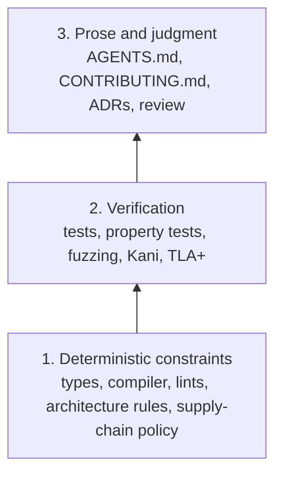

# The trust pyramid

RackSmith is developed with the expectation that many changes will be written by AI coding agents.
Reviewing every line by hand does not scale to that volume, so the project relies on guardrails
that make most mistakes impossible to merge, and keeps human review for what machines cannot
judge.

The guardrails are arranged as a pyramid. The lower a tier, the stronger and cheaper its
guarantees, and the more of the project's rules should live there:

The working rule: **every prose rule that can be a lint must become a lint.** Documentation should
point at the mechanism that enforces a rule, not restate it, because prose goes stale and agents
follow it inconsistently.

## Tier 1: deterministic constraints

These checks either pass or fail, the same way every time, and an agent cannot argue with them.

| Mechanism               | File                                                                                    | What it guarantees                                                                                                                                                                                                                                                                                     |
|-------------------------|-----------------------------------------------------------------------------------------|--------------------------------------------------------------------------------------------------------------------------------------------------------------------------------------------------------------------------------------------------------------------------------------------------------|
| Type system             | `crates/racksmith-domain/src/`                                                          | Invalid values (a malformed MAC, an over-long hostname, an unknown state) cannot be constructed; the lifecycle `match` is exhaustive.                                                                                                                                                                  |
| Compiler and lints      | [`Cargo.toml`](../Cargo.toml) `[workspace.lints]`                                       | `unsafe` is forbidden; clippy `all`, `pedantic` and `cargo` are errors; `unwrap`, `expect`, `panic!`, indexing, `as` casts, wildcard enum matches and missing docs are denied; every exception is an `#[expect(..., reason = "...")]` that fails once it is no longer needed. Clippy runs on Linux, macOS and Windows, so platform-specific code is linted too. |
| API bans                | [`clippy.toml`](../clippy.toml)                                                         | `HashMap`/`HashSet` (non-deterministic order), `std::sync::Mutex`, `println!`/`eprintln!`, `std::process::exit`, `std::thread::sleep`, `env::set_var`, `transmute` and `block_in_place` are rejected with the reason and the alternative.                                                              |
| Enforced architecture   | [`architecture.toml`](../architecture.toml), [`xtask/`](../xtask/) (`cargo xtask arch`) | Crate layering, per-crate dependency allowlists, banned crates (`anyhow` outside binaries, OpenSSL), dependencies only from crates.io or workspace members (no `[patch]`, `[replace]` or `workspace.exclude`), banned source patterns (no I/O or async in the domain, matched through imports and aliases, build scripts included), workspace lint inheritance and central dependency versions, renamed dependencies checked under their real package name, and no locked dependency requiring a newer Rust than the MSRV. Prints what it examined and fails if that is nothing. |
| Source rules            | [`xtask/`](../xtask/) (`cargo xtask arch`)                                              | Lint levels are set only in `Cargo.toml`: `allow`, `warn`, `deny` and `forbid` attributes, inner `#![expect]` and module-wide `expect` are rejected. No `mod.rs`, `#[path]`, `include!` (however it is named) or attribute spelled by a macro fragment, so every file is scanned. No `clippy` cfg, so clippy sees the code that is built. `TODO`/`FIXME` must reference an issue. The fuzz project restates the lint policy exactly. |
| Exemption ledger        | [`exceptions.toml`](../exceptions.toml) (`cargo xtask arch`)                           | Every `#[expect]` in the Rust sources, test code included, has exactly one code-owned entry with a justification and a reference that resolves offline (an ADR in force, an open M1 plan task or a design section); unlisted and stale entries, unresolved references and filler justifications or reasons (`"x"`, `"fix later"`, too short) fail. The owner's review of each entry is the point. See [ADR 0036](adr/0036-exemption-ledger.md). |
| Tracked files           | [`xtask/`](../xtask/) (`cargo xtask arch`), [`.githooks/pre-commit`](../.githooks/pre-commit) | The git index holds no build output (no path with a `target` component, at any depth) and no file over 5 MiB; the pre-commit hook rejects large staged files before they reach history. Fails if git lists no files. See [ADR 0037](adr/0037-guard-against-tracked-build-output.md). |
| Supply-chain policy     | [`deny.toml`](../deny.toml) (`cargo deny check`)                                        | Only permissive licenses, no known vulnerabilities, unmaintained or yanked crates, crates.io as the only source.                                                                                                                                                                                       |
| Formatting and spelling | [`rustfmt.toml`](../rustfmt.toml), [`_typos.toml`](../_typos.toml)                      | One canonical layout; no typos in code or docs.                                                                                                                                                                                                                                                        |
| Pinned toolchain        | [`rust-toolchain.toml`](../rust-toolchain.toml)                                         | Every contributor and CI run uses the same compiler and lints.                                                                                                                                                                                                                                         |
| Generated docs and model | [`xtask/`](../xtask/) (`cargo xtask docs`)                                             | The transition table in [lifecycle.md](lifecycle.md) and the `Transitions` set of the TLA+ model are produced from the code and cannot drift.                                                                                                                                                         |
| Completeness            | [`requirements.toml`](../requirements.toml), [`architecture.toml`](../architecture.toml) `[subsystems]` (`cargo xtask spec`, `cargo xtask arch`) | Nothing designed is missing silently: every leaf section of the system design is classified (`implemented` with entry points and existing tests, `partial` or `planned` with open M1 plan tasks, or `informative`), every input (a field or variant of a `Deserialize` or clap type, a router path parameter, an environment variable read) is `implemented` with an effect test or `rejected` with a task and a test, no `Deserialize` type accepts unknown fields, and every subsystem is `wired` into a consumer or `planned` with no code. The coverage page [requirements.md](requirements.md) is generated and drift-checked. See [ADR 0035](adr/0035-completeness-layer.md). |

## Tier 2: verification

These checks run the code, or a model of it, to find bugs the compiler cannot see.

| Mechanism                  | Where                                                               | What it verifies                                                                                  |
|----------------------------|---------------------------------------------------------------------|---------------------------------------------------------------------------------------------------|
| Unit and integration tests | `#[cfg(test)]` modules; `crates/*/tests/`                           | Behavior of each module; the HTTP API end to end, in process.                                     |
| Property tests (proptest)  | `crates/racksmith-domain/tests/`                                    | Parser round trips and lifecycle invariants over random inputs and event sequences.               |
| Spec-conformance test      | `crates/racksmith-domain/tests/lifecycle_props.rs`                  | Every one of the 88 `(state, event)` pairs matches the transition table.                          |
| Fuzzing (cargo-fuzz)       | [`fuzz/`](../fuzz/)                                                 | Parsers never panic and accept only valid input; the lifecycle agrees with `TRANSITIONS`.         |
| Kani                       | `#[cfg(kani)]` module in `crates/racksmith-domain/src/lifecycle.rs` | Bounded model checking: lifecycle invariants hold for all inputs, not just sampled ones.          |
| TLA+ (TLC)                 | [`specs/tla/`](../specs/tla/)                                       | The lifecycle design satisfies its safety and reachability invariants over the whole state space. |

See [lifecycle.md](lifecycle.md#how-the-lifecycle-is-verified) for which invariant each mechanism
covers.

A property that cannot fail verifies nothing. When you add or change a property test, break the
invariant it checks by hand (for example, add an invalid arm to `MachineState::apply`), run that
test file with `cargo test -p racksmith-domain --test <file>`, confirm the property fails, then
revert the change and delete any `*.proptest-regressions` file it left behind.

## Tier 3: prose and judgment

Natural-language rules are the weakest tier: they cannot be checked mechanically, so they are kept
short and limited to judgment calls.

| Document                              | Purpose                                                                                                      |
|---------------------------------------|--------------------------------------------------------------------------------------------------------------|
| [AGENTS.md](../AGENTS.md)             | Judgment rules for AI coding agents (and humans): where logic belongs, error handling, testing expectations. |
| [CONTRIBUTING.md](../CONTRIBUTING.md) | Setup, the gate and the pull request process.                                                                |
| [Architecture decision records](adr/) | Why the constraints are what they are, and the process to change them.                                       |
| Code review                           | Design, naming and intent, which no tool checks.                                                             |

## Enforcement in CI

Every tier is wired into GitHub so it cannot be skipped:

| Mechanism                           | File                                                                                                                                                                                        |
|-------------------------------------|---------------------------------------------------------------------------------------------------------------------------------------------------------------------------------------------|
| Local gate                          | `cargo xtask ci` ([`xtask/`](../xtask/)), run by the pre-push hook in [`.githooks/`](../.githooks/): every `ci-success` check that runs on one machine                                      |
| Required check `ci-success`         | [`.github/workflows/ci.yml`](../.github/workflows/ci.yml): fmt, clippy (Linux, macOS, Windows), tests, rustdoc, cargo-deny, architecture, generated docs, requirements traceability, MSRV, unused dependencies, typos, coverage floor, workflow lint |
| Required check `verify-success`     | [`.github/workflows/verify.yml`](../.github/workflows/verify.yml): TLC, Kani and fuzzing on every PR, plus longer nightly fuzzing                                                          |
| Conventional Commit PR titles       | [`.github/workflows/pr-title.yml`](../.github/workflows/pr-title.yml)                                                                                                                       |
| Static analysis and posture         | [`.github/workflows/codeql.yml`](../.github/workflows/codeql.yml), [`.github/workflows/scorecard.yml`](../.github/workflows/scorecard.yml)                                                  |
| Review of the guardrails themselves | [`.github/CODEOWNERS`](../.github/CODEOWNERS)                                                                                                                                               |
| Branch rules on `main`              | Rulesets as code in [`.github/rulesets/`](../.github/rulesets/): pull requests only, squash merge, both checks green with no bypass, code-owner review, no force pushes or deletions. Active; see [GOVERNANCE.md](../GOVERNANCE.md#branch-rules). |

With the rulesets active, an agent cannot weaken a lint, an allowlist or a CI job to get its
change merged without a maintainer explicitly approving it, because every file is code-owned and
agents open pull requests from a bot account whose work the maintainer must review.

## Future work: the outer loop

Once the foundations are in place, verification can run continuously rather than only on pull
requests. The planned outer loop:

1. On a schedule and on every release, run long fuzzing campaigns and model checking with larger
   bounds against the whole application, not just individual parsers.
2. When a run finds a failure, an agent minimizes the input, adds it as a regression test, and
   proposes a fix.
3. The agent opens a pull request that goes through exactly the same gates as any other change,
   and a human approves or rejects it. Nothing merges automatically.

Today the nightly `Verify` run is the first step: it fuzzes for longer from a corpus that grows
from night to night, and uploads crashing inputs, which a person then turns into a fix.
